# СУБД, хранение данных и индексы

> [!abstract] Обзор
> Разбирается СУБД (DBMS) как абстракция над хранилищем и её ключевые возможности: управление конкурентным доступом (concurrency control), восстановление после сбоя (crash recovery) и разграничение доступа (security access control). Рассмотрена архитектура СУБД — классическая реляционная схема обработки SQL-запроса и слоистая схема со SQL Gateway, а также Neon с разделением вычислений и хранения. На уровне хранения разобраны таблицы в отдельных файлах, страничная организация (пейджинг), записи фиксированного и переменного размера, MVCC и VACUUM, строчное (row-oriented) и колоночное (column-oriented) хранение, буферный пул и политики вытеснения. Отдельно разобраны индексы: кластеризованный, разрежённый, вторичный (secondary), хэш-индекс, B+ дерево, bitmap-индекс, инвертированный индекс, R-дерево, а также LSM-хранилища с memTable, SST, компактификацией и Bloom-фильтром. Дополнительно — оптимизатор и реляционная алгебра, TOAST и модификация B+ дерева.

> [!info] Курс
> [[index|Оглавление курса]]

## Оглавление
1. [[#1. Зачем нужна СУБД, абстракция и ключевые возможности]]
2. [[#2. Архитектура СУБД и оптимизатор]]
3. [[#3. Neon: разделение вычислений и хранения]]
4. [[#4. Хранение на уровне файлов, пейджинг, MVCC и VACUUM]]
5. [[#5. Строчное и колоночное хранение]]
6. [[#6. Системный каталог]]
7. [[#7. Буферный пул, память и политики вытеснения]]
8. [[#8. Индексы: назначение, кластеризация и виды]]
9. [[#9. Хэш-индекс и расширяемое хэширование]]
10. [[#10. B+ дерево: разбиение узлов, модификация и Bε-дерево]]
11. [[#11. Bitmap-индекс и битовые карты значений]]
12. [[#12. Инвертированный индекс]]
13. [[#13. Эмбеддинги и конвейер RAG]]
14. [[#14. R-дерево: многомерный поиск, минимизация площади и балансировка]]
15. [[#15. LSM-хранилище: key-value, memTable, WAL, SST, компактификация и Bloom-фильтр]]
16. [[#Глоссарий: как СУБД выполняет запрос ➕]]

**Схема** — [[#Схема]]
**Итог** — [[#Итог]]

## 1. Зачем нужна СУБД, абстракция и ключевые возможности

СУБД (DBMS) нужна, потому что даёт ключевую функциональность, которую тяжело и дорого реализовать на голых файлах. Если хранить данные в файлах, то под каждую схему или формат пришлось бы заново писать и переписывать свой парсер. СУБД — это **абстракция хранилища данных**. Такая система даёт data independence («независимость от данных»): мы не зависим от того, как именно физически лежат наши файлы. Помимо этого СУБД даёт: управление конкурентным доступом (concurrency control), когда несколько пользователей одновременно меняют один и тот же атрибут; менеджер восстановления (recovery manager) и журнал упреждающей записи (write-ahead log, WAL) для защиты от потери данных при внезапном отключении электричества; разграничение доступа (security access control), позволяющее разрешить или запретить доступ к частям базы.

*Источник: [00:03:00], [00:04:00], [00:05:00]*

> [!quote]- Кадр [00:04:00]
> 

## 2. Архитектура СУБД и оптимизатор

Архитектура СУБД включает SQL-интерфейс, движок оценки запросов ([[#Parser|Parser]], [[#Optimizer|Optimizer]], [[#Plan Executor|Plan Executor]], [[#Operator Evaluator|Operator Evaluator]]), управление конкурентным доступом и саму базу данных. SQL-команда проходит парсинг, разбиение на реляционные выражения, построение вариантов плана и выбор оптимального плана на основе статистики данных. Transaction Manager и Lock Manager следят за активными транзакциями: при MVCC они отслеживают версии, которые может видеть транзакция, а при блокировочном (locking) режиме — какие блокировки установлены. Архитектуру можно разбить на слои, где **SQL Gateway** отвечает за разбор SQL-запроса, а план запроса удобно смотреть через `EXPLAIN ANALYZE`. Законы реляционной алгебры позволяют оптимизатору переставлять выражения и «опускать» фильтр вниз, к самому соединению (join), чтобы сразу отсеять лишние строки. Примеры операций: проекция (`SELECT course_id, title FROM course`) и условие (`dep_name = 'music'`). Эквивалентные преобразования: `SELECT` по двум условиям эквивалентен вложенным `SELECT`; `join` с последующей фильтрацией эквивалентен фильтрации **до** `join`; условия `condition1` и `condition2` можно менять местами.

*Источник: [00:06:00], [00:07:00], [00:08:00], [00:09:00], [01:31:00], [01:32:00], …*

> [!quote]- Кадр [00:07:00]
> 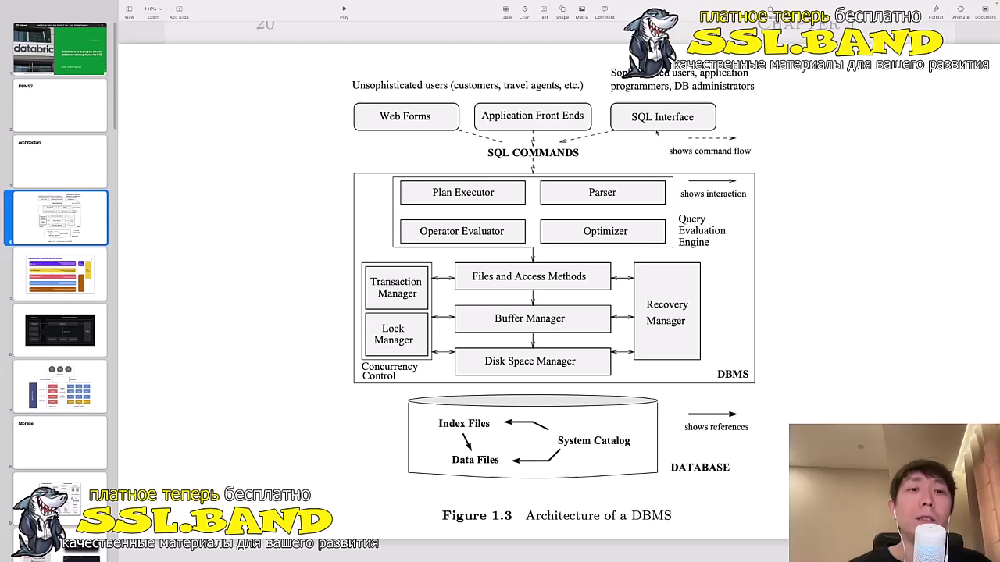

> [!quote]- Кадр [00:09:00]
> 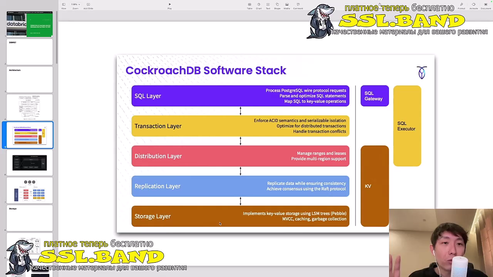

> [!quote]- Кадр [01:31:00]
> 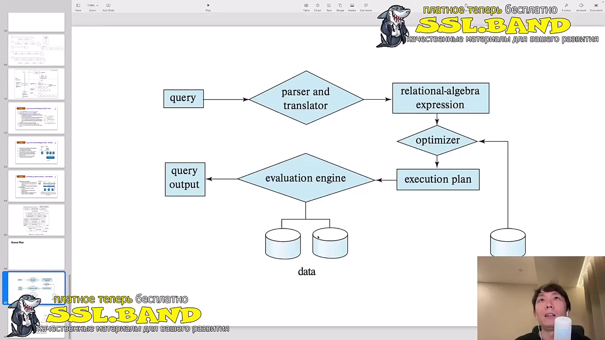

## 3. Neon: разделение вычислений и хранения

Neon — это серверлесс-Postgres, который можно масштабировать, ветвить (branching) и так далее. Он использует собственное хранилище и разбивает Postgres на два компонента: Compute (вычисления) и Storage (хранение). Neon перехватывает сообщения восстановления в потоке WAL (WAL stream). Вычислительные узлы (COMPUTES) на Postgres отделены от мульти-тенантного хранилища, в которое входят Pageserver, Safekeeper и объектное хранилище (object storage). Данные уходят в хранилище потоком WAL stream. Именно за счёт такого хранения можно делать бранчинг — ветвление является основной фичей Neon.

*Источник: [00:01:00], [00:10:00]*

> [!quote]- Кадр [00:01:00]
> 

> [!quote]- Кадр [00:10:00]
> 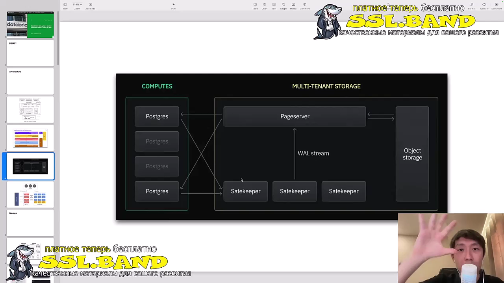

## 4. Хранение на уровне файлов, пейджинг, MVCC и VACUUM

InnoDB хранит каждую таблицу в отдельном файле в собственном (проприетарном) формате. Чтобы отслеживать конец файла и свободное место при конкурентных записях, файл разбивают на страницы (пейджи, pages) фиксированного размера — например, 4, 8 или 16 килобайт; этот размер не обязан совпадать с размером страниц операционной системы. Записи фиксированного размера хранятся с запасом; для атрибутов переменной длины используют фиксированный заголовок со смещением (offset). Заголовок страницы содержит контрольную сумму (checksum), LSN, версию, флаги и поля lower/upper; у страницы PostgreSQL заголовок — 24 байта. Композитный индекс сортирует данные сначала по X, затем по Y, поэтому добавляется слой косвенности (индирекции): индекс хранит ссылку на primary index (ID записи), чтобы при перемещении страниц индекс не приходилось обновлять. Если атрибут не помещается в страницу, используется страница переполнения (Overflow Page), а в Postgres — TOAST. При удалении записи в странице появляется свободное место, и нужно отслеживать следующее свободное место. VACUUM освобождает пространство, занятое мёртвыми версиями строк (dead tuples), — это что-то вроде сборщика мусора для хранилища. В обычном режиме работы Postgres удалённые или устаревшие после `UPDATE` версии строк физически не удаляются, а лишь помечаются; vacuum либо перезаписывает данные в новую страницу, либо перемещает их в пределах существующей — из-за этого индексы требуют обновления, а всё приходится при этом подлочивать (блокировать), чтобы никто параллельно не модифицировал данные.

> [!info] Зачем это нужно
> Слой косвенности нужен, чтобы при перемещении страниц индекс не нужно было обновлять.

*Источник: [00:11:00], [00:12:00], [00:13:00], [00:14:00], [00:15:00], [00:16:00], …*

> [!quote]- Кадр [00:19:00]
> 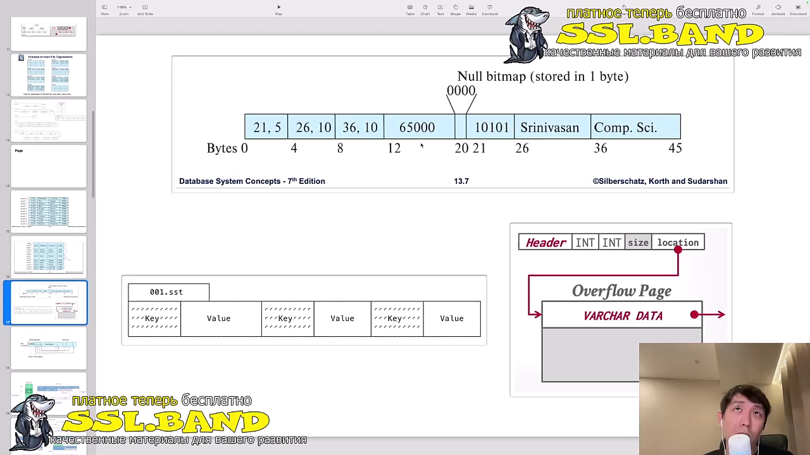

## 5. Строчное и колоночное хранение

При чтении из Postgres приходится выгребать всю запись целиком, хотя нужно всего одно число. Решение — переорганизовать хранилище и хранить все атрибуты одного типа рядом. Когда атрибуты одного типа лежат рядом, можно применять векторные операции, кодирование, параллельные вычисления и сжатие. **Колоночное хранение (column-oriented):** все атрибуты одного столбца хранятся рядом. **Строчное хранение (row-oriented):** рядом хранятся целые записи. Для транзакционной нагрузки (OLTP) лучше подходит строчное хранение. Важный вывод: то, как физически хранятся данные, напрямую влияет на то, как мы с ними можем работать.

| | Строчное (row-oriented) | Колоночное (column-oriented) |
|---|---|---|
| Что хранится рядом | целые записи | значения одного атрибута |

*Источник: [00:27:00], [00:29:00]*

## 6. Системный каталог

Системный каталог (system catalog) — это директория, которая хранит метаданные о том, где лежат данные: схемы таблиц, индексы, права доступа, свободное место и количество записей.

*Источник: [00:30:00]*

## 7. Буферный пул, память и политики вытеснения

Обращение к памяти (round-trip) занимает порядка 100 наносекунд, а к диску — порядка 50 микросекунд. Память волатильна: при отключении электричества всё её содержимое пропадает, поэтому важно работать с данными в памяти, но не забывать сбрасывать их на диск. Буферный пул (buffer pool) подтягивает страницы (pages) с диска в память и может делать больше: пре-фетчить страницы (подтягивать заранее), разделять одну страницу между запросами, удерживать (пинить) часто используемые страницы, помечать страницу как «грязную» (изменённую) и хранить информацию о том, кто её заблокировал. **FIFO** («первый пришёл — первый ушёл») — простейшая политика вытеснения из буферного пула. **LRU** (least recently used) вытесняет элемент, к которому дольше всего не обращались. У LRU есть слабое место — sequential flooding: при последовательном сканировании из пула вытесняются давно не трогавшиеся страницы, хотя они могли бы ещё пригодиться (эту проблему ещё называют SecFlooding).

*Источник: [00:31:00], [00:32:00], [00:33:00], [00:34:00], [00:35:00], [00:36:00], …*

> [!quote]- Кадр [00:33:00]
> 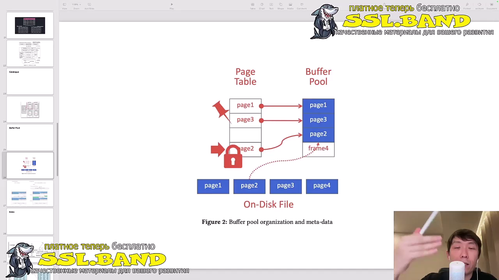

## 8. Индексы: назначение, кластеризация и виды

Данные можно искать перебором всей таблицы. Индекс же используется вместо полного сканирования и ускоряет доступ к нужным строкам:

```sql
-- перебор всей таблицы
SELECT * FROM tbl;

-- поиск с индексом по столбцу
SELECT * FROM tbl WHERE col = 'Queen';
```

**Кластеризованный индекс** задаёт порядок физического хранения записей в файлах; **некластеризованный** такого порядка не задаёт. **Разрежённый индекс (sparse index)** можно построить только тогда, когда записи уже хранятся в порядке индекса; он может отображать диапазоны записей (например, от 101.01 до 32.343), благодаря чему индекс получается меньше и обновляется реже. В Postgres используется heap (куча) — записи хранятся в произвольном порядке; primary index отвечает только за ограничение уникальности (unique constraint), позволяя отличать одну запись от другой. **Вторичный индекс (secondary)** применяется, когда поиск идёт не по primary key, а по другому атрибуту — например, по департаменту, зарплате или фамилии.

| Индекс | Порядок записей |
|---|---|
| Кластеризованный | задаёт порядок хранения в файлах |
| Некластеризованный | порядок не задаёт |

> [!info] Зачем это нужно
> Индекс ускоряет доступ к нужным данным вместо перебора всей таблицы.

*Источник: [00:38:00], [00:39:00], [00:40:00], [00:41:00]*

> [!quote]- Кадр [00:40:00]
> 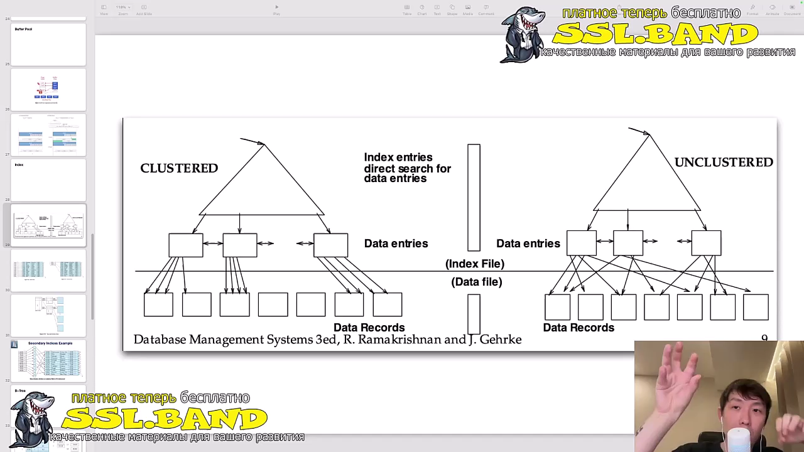

> [!quote]- Кадр [00:41:00]
> 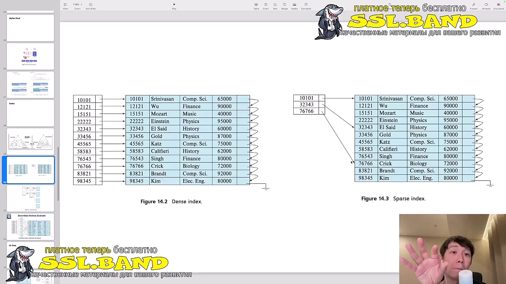

## 9. Хэш-индекс и расширяемое хэширование

Значение `x` прогоняется через хэш-функцию, которая определяет, в какой бакет (bucket) его положить. Хэш-индекс хорош, когда нужно найти **конкретное** значение. При коллизии в один бакет можно положить несколько значений; если хэш-функция распределяет неравномерно, все значения могут попасть в один бакет, и доступ станет O(N) вместо константного. При переполнении бакета расширяется префикс: сначала по первому биту выбирается один из двух бакетов, затем по следующему биту — один из четырёх, затем среди восьми и так далее. Префикс всегда расширяется, определяя, куда пойдёт значение (это и есть расширяемое хэширование, extendable hashing). Хэш-индекс плохо работает, когда нужно найти данные **по диапазону** (range), например «кто зарабатывает больше 7000»: порядок значений после хэш-функции не гарантируется, поэтому приходится проверять каждое значение. Для точечного извлечения конкретного значения хэш-индекс подходит отлично.

*Источник: [00:43:00], [00:44:00], [00:45:00]*

## 10. B+ дерево: разбиение узлов, модификация и Bε-дерево

**B+ дерево** — самый распространённый индекс и, по сути, индекс по умолчанию во многих СУБД. В B+ дереве значения хранятся только в листьях, а все листья сшиты указателями на соседний узел — это позволяет вытащить целый диапазон (например, от 176 до 429) одним проходом слева направо. **Fanout** — количество указателей, выходящих из одного узла; обозначим его `m`. Поиск конкретного значения выполняется за O(log_m n); для сравнения, в бинарном дереве поиска (BST) сложность O(log₂ n). Когда в узле больше нет места под новое значение, узел разбивают на два, распределяют элементы между ними и добавляют в родительский узел указатель на новый узел с новым диапазоном. Если и в родителе нет места — его тоже разбивают, и разделение поднимается вверх по дереву. При модификации B+ дерева возникает проблема: приходится блокировать почти всё дерево. Для этой проблемы существует оптимизация — **Bε-дерево (B-epsilon tree)**: это структура, оптимизированная под запись (write-optimized), она сглаживает компромисс между скоростью записи и скоростью точечных запросов. ➕ *(в лекции название искажено как «B-Epsilon 3»; уточнено агентом)*

> [!info] Зачем это нужно
> Bε-дерево решает проблему блокировки почти всего дерева при модификации.

*Источник: [00:46:00], [00:47:00], [00:48:00], [00:49:00], [00:51:00], [00:52:00], …*

> [!quote]- Кадр [00:52:00]
> 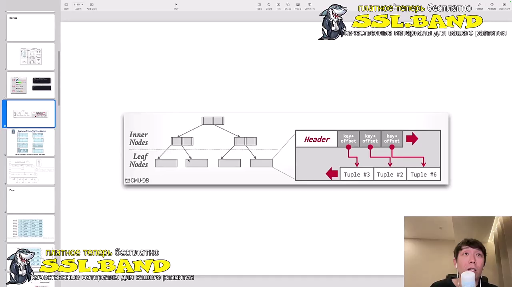

## 11. Bitmap-индекс и битовые карты значений

Bitmap-индекс применяют для атрибута с небольшим фиксированным набором значений — например, для поля, принимающего только `male` или `female`. Для каждого значения столбца строится битовая карта, в которой бит `1` на позиции записи означает, что запись имеет это значение. Чтобы проверить, есть ли записи одновременно с `female` **и** `L2`, берут соответствующие маски и делают побитовое И: если результат больше 0 — комбинация есть, если 0 — её нет.

*Источник: [00:53:00], [00:54:00], [00:55:00]*

> [!quote]- Кадр [00:53:00]
> 

> [!quote]- Кадр [00:55:00]
> 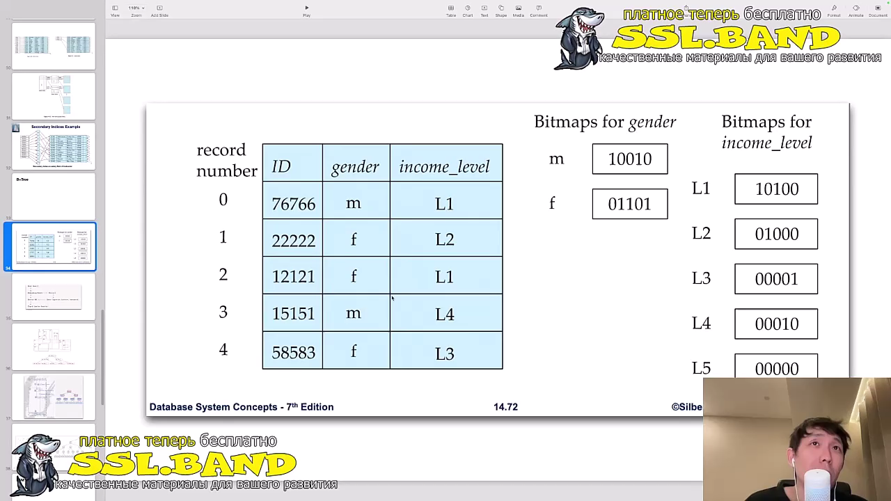

## 12. Инвертированный индекс

Чтобы найти песни, в которых встречается слово «любовь» и его производные, используют инвертированный индекс (inverted index). Он заранее строится так, что по слову сразу видно, в каких документах оно встречается: при поиске `love` вы сразу знаете, что это 2-я и 4-я песни. Такой индекс есть в Apache Lucene, Elasticsearch и Postgres.

*Источник: [00:56:00], [00:57:00]*

## 13. Эмбеддинги и конвейер RAG

Эмбеддинги нужны, чтобы понимать **смысл** текста, даже когда точного слова в нём нет: берут модель и генерируют эмбеддинги. В конвейере RAG вы получаете эмбеддинги через эмбеддинг-модель, и она выдаёт векторы — массивы чисел с плавающей точкой (float). Затем векторы сопоставляются с метаданными и кладутся в векторную базу данных. Поиск идёт по top-k похожих результатов или по косинусному расстоянию.

*Источник: [00:57:00], [00:58:00]*

## 14. R-дерево: многомерный поиск, минимизация площади и балансировка

**R-дерево (R-tree)** — структура, которая «понимает» геометрию и используется для поиска в многомерном пространстве (например, рост, вес, параметры болида Формулы-1). Чтобы найти объект (скажем, точку R12), мысленно рисуют диапазон и смотрят, куда он попал на верхнем уровне иерархии (в R1 или R2); если диапазон попал в оба — поиск идёт в левое и правое поддерево, а затем проверяется попадание внутри поддерева (R3, R4, R5). Задача R-дерева — **минимизировать нахлёсты (пересечения)**: каждый нахлёст заставляет перебирать лишнее поддерево, в котором нет нужных значений. При добавлении нового узла стараются минимизировать площадь ограничивающего прямоугольника (коробки), который покроет эти узлы, и сделать так, чтобы он как можно меньше пересекался с другими коробками. R-дерево стремится балансироваться и поддерживать высоту, применяется в n-мерных пространствах — например, в геймдеве, чтобы понять, какую часть сцены нужно отрендерить.

*Источник: [01:00:00], [01:03:00], [01:04:00]*

## 15. LSM-хранилище: key-value, memTable, WAL, SST, компактификация и Bloom-фильтр

**LSM** (log-structured merge) — альтернативный подход к организации хранилища, рассчитанный на очень интенсивную запись в реальном времени (write-heavy realtime workload). Его выбирают для write-intensive нагрузок и распределённых систем. **KV-хранилище** хранит пары «ключ-значение», где значением может быть целиком закодированная запись (tuple), а ключом — primary key. Пары хранятся в отсортированном виде и сбрасываются на диск; диапазоны проще дробить и шардировать, запись не тратит время на поиск места, а компактификация выполняется ниже по уровню. **memTable** — структура данных в памяти, которая держит записи отсортированными; на практике это красно-чёрное дерево или skip list (в RocksDB по умолчанию — skip list). При записи используется журнал упреждающей записи (write-ahead log, WAL): перед записью в memtable данные обязательно пишутся в WAL. Каждый **SST** (Sorted String Table) хранит данные отсортированными. SST-файлы иммутабельны (не меняются), разбиты на логические блоки, организованы в уровни, компактифицируются и сливаются на уровень ниже. При слиянии из двух записей с одинаковым ключом берётся более свежая по таймстемпу. Для каждого SST-файла строится **Bloom-фильтр**, который точно говорит, что ключа точно нет, но если ключ есть — отвечает лишь «может быть».

```
Memory
memTable size(5)

DISK
LEVEL 0
  SST 1
  SST 2

--- после сброса и компакции ---

Memory
memTable size(5)
DISK
LEVEL 0
  SST 1
  SST 2
LEVEL 1
LEVEL 2
```

| Стратегия компактификации | Работа с диапазонами ключей |
|---|---|
| Leveling (leveled) | В SST-файлах на нижних уровнях хранят диапазоны ключей; при слиянии диапазон становится, например, от A до G |
| Tiering | На диапазоны ключей (key ranges) не смотрят, сливают файлы как есть |

> [!info] Зачем это нужно
> LSM выбирают для write-heavy и write-intensive нагрузок и распределённых систем: запись не тратит время на поиск места — данные просто сбрасываются во флеш/на диск.

*Источник: [01:05:00], [01:06:00], [01:07:00], [01:08:00], [01:09:00], [01:10:00], …*

> [!quote]- Кадр [01:07:00]
> 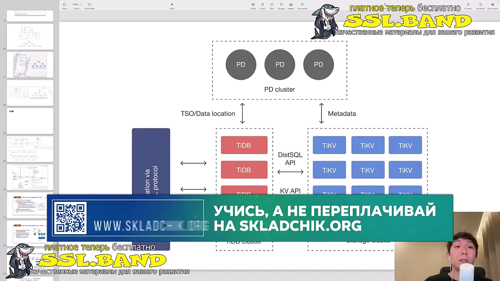

## Глоссарий: как СУБД выполняет запрос ➕

> [!note] ➕ Дополнено агентом (не из курса)
> Этот раздел написан мной, а не взят из лекции. Термины в тексте выше ([[#Parser]], [[#Optimizer]], [[#Plan Executor]], [[#Operator Evaluator]]) кликабельны и ведут сюда.

Каждый SQL-запрос проходит через несколько звеньев. Ниже — простыми словами, что делает каждое.

➕ Схема пути запроса:

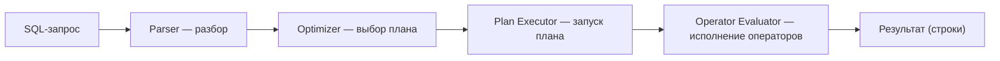

### Parser
**Что делает:** превращает текст SQL-запроса в структуру, с которой может работать движок — проверяет синтаксис и строит дерево разбора (AST).
**Пример:** для `SELECT title FROM course WHERE dep_name = 'music'` Parser убедится, что запрос написан по правилам языка, и поймёт, что это выборка `title` из `course` с фильтром по `dep_name`. Если в запросе опечатка (`SELEC ...`), именно Parser вернёт синтаксическую ошибку.

### Optimizer
**Что делает:** перебирает варианты, **как** выполнить запрос, оценивает их стоимость по статистике данных и выбирает самый дешёвый план.
**Пример:** у запроса с `JOIN` и `WHERE` есть несколько порядков выполнения. Оптимизатор может «опустить» фильтр к `JOIN` и отсеять строки раньше — это будет дешевле, чем сначала соединить все таблицы, а потом фильтровать. Результат — выбранный план, который можно увидеть через `EXPLAIN`.

### Plan Executor
**Что делает:** берёт выбранный план и **управляет его исполнением** — запускает операторы в нужном порядке, гонит строки через них (pull/push), распределяет работу.
**Пример:** для плана «прочитать `course` → отфильтровать → отсортировать» Plan Executor по очереди запускает нужные шаги и передаёт строки из одного оператора в следующий.

### Operator Evaluator
**Что делает:** выполняет **один конкретный оператор** плана — то есть делает саму работу над строками: сканирование таблицы, соединение, фильтрацию, агрегацию.
**Пример:** оператор «фильтр `dep_name = 'music'`» берёт очередную строку и решает, пропустить её дальше или отбросить. Оператор «соединение (join)» по каждой паре строк проверяет условие соединения. Plan Executor говорит *что* и *в каком порядке* запускать, а Operator Evaluator — это *исполнители отдельных шагов*.

## Схема

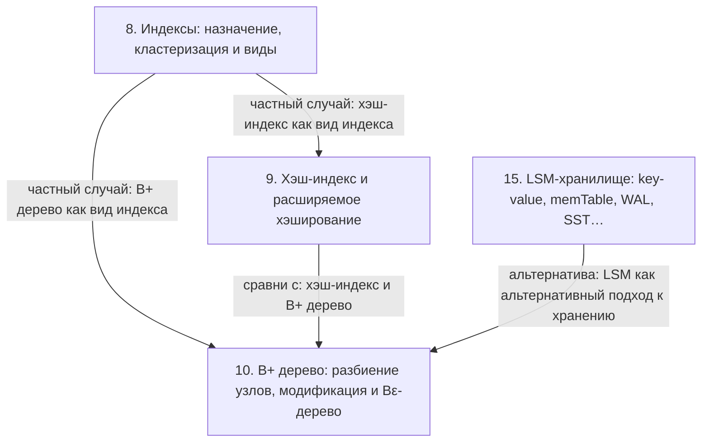

## Итог

> [!success] Что в итоге
> СУБД даёт абстракцию хранилища и ключевые возможности — управление конкурентным доступом, восстановление после сбоя и разграничение доступа. Архитектура может быть классической реляционной (со слоистой схемой и SQL Gateway) или, как у Neon, с разделением вычислений и хранения ради бранчинга. На уровне хранения записи и страницы организуются с фиксированным или переменным размером, MVCC и VACUUM управляют версиями и мёртвыми строками, а буферный пул держит данные в памяти с учётом её волатильности. Индексы заменяют полное сканирование: кластеризованный задаёт порядок, разрежённый отображает диапазоны, вторичный обслуживает поиск не по primary key, хэш-индекс подходит для точечного поиска, а B+ дерево опирается на разбиение узлов и имеет write-optimized родственника — Bε-дерево. Дополнительно разобраны bitmap-индекс, инвертированный индекс, эмбеддинги и R-дерево, LSM-хранилище с memTable и SST, а также оптимизатор, реляционная алгебра, TOAST и модификация B+ дерева.
