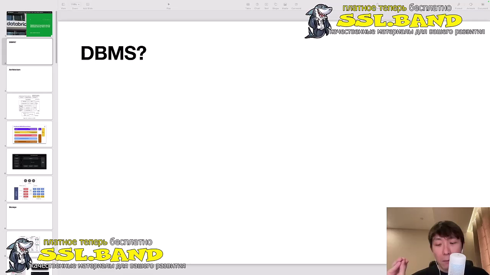
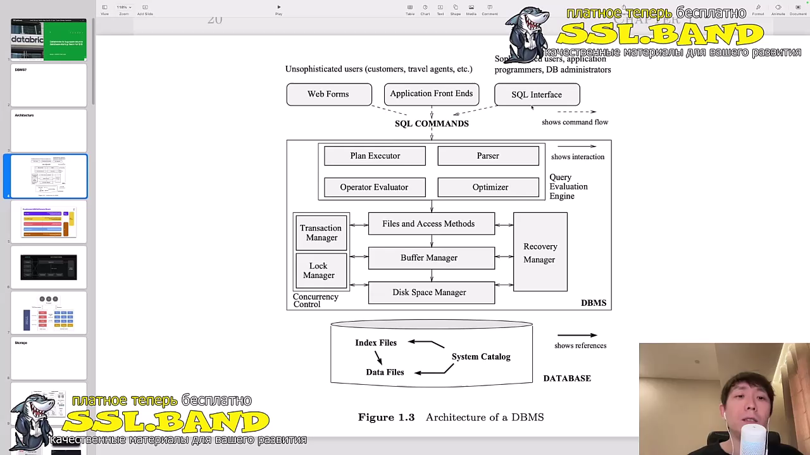
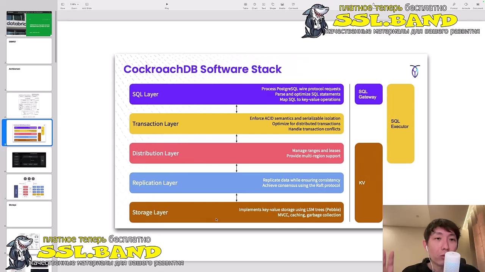
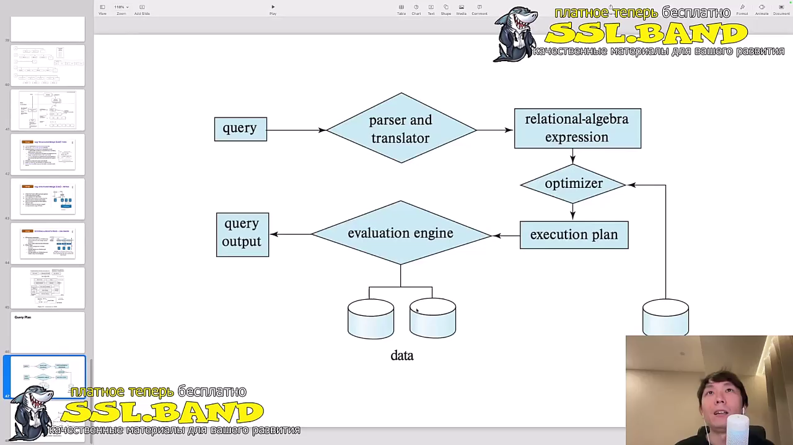
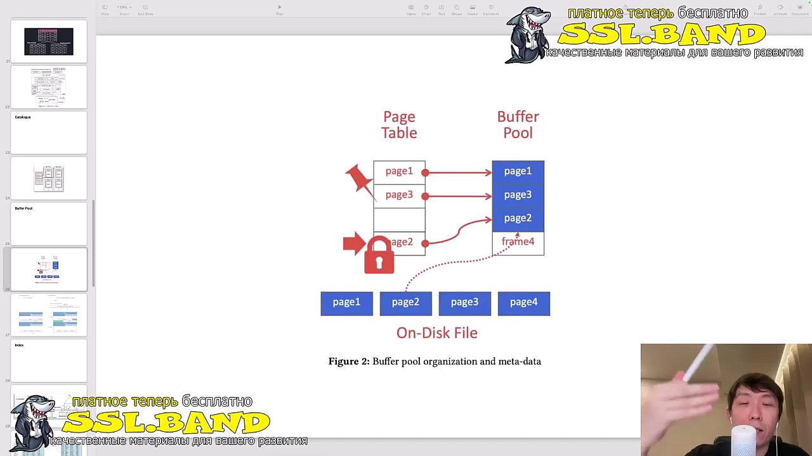
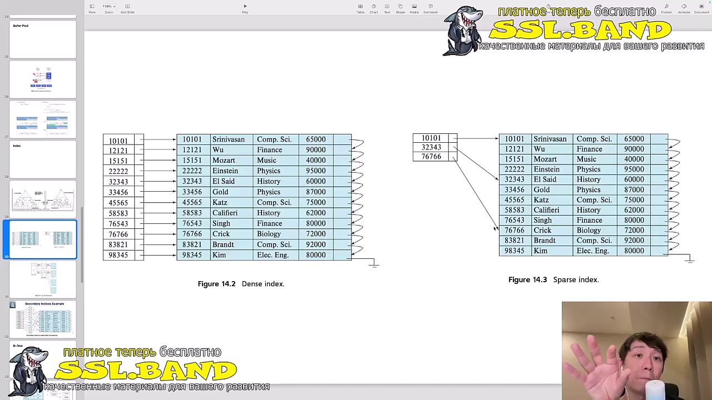
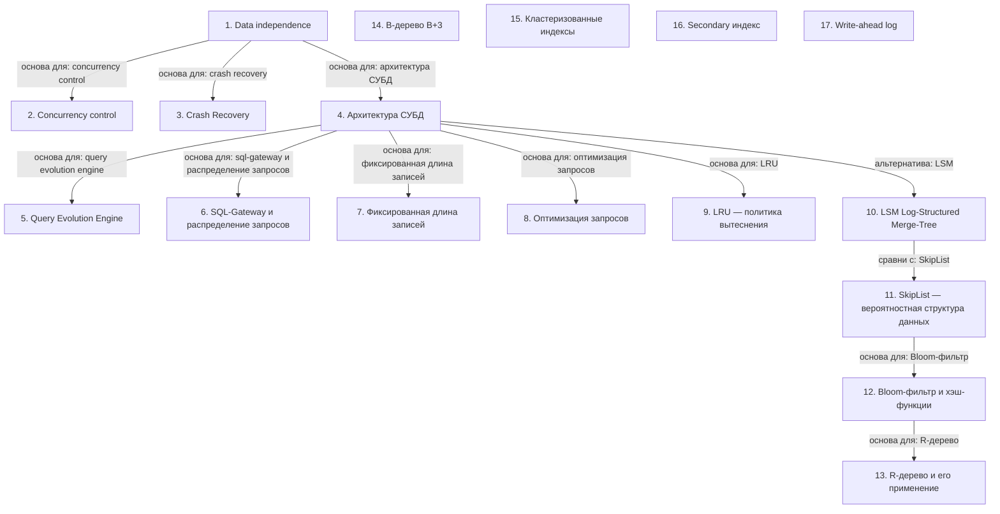

# Системы хранения данных и управления базами данных

> [!abstract] Обзор
> Лекция объединяет основы систем хранения данных и управления базами данных. Основные темы включают независимость данных, контроль конкурентного доступа, восстановление после сбоев, архитектуру СУБД, обработку запросов, хранение данных, индексы, кэширование, оптимизацию запросов, LRU, LSM, SkipList, B-деревья, R-деревья, Bloom-фильтры и другие структуры. Все компоненты связаны между собой и работают вместе для обеспечения надёжности, производительности и масштабируемости систем хранения и управления данными.

> [!info] Курс
> [[index|Оглавление курса]]

## Оглавление
1. [[#1. Data independence]]
2. [[#2. Concurrency control]]
3. [[#3. Crash Recovery]]
4. [[#4. Архитектура СУБД]]
5. [[#5. Query Evolution Engine]]
6. [[#6. SQL-Gateway и распределение запросов]]
7. [[#7. Фиксированная длина записей]]
8. [[#8. Оптимизация запросов]]
9. [[#9. LRU — политика вытеснения]]
10. [[#10. LSM (Log-Structured Merge-Tree)]]
11. [[#11. SkipList — вероятностная структура данных]]
12. [[#12. Bloom-фильтр и хэш-функции]]
13. [[#13. R-дерево и его применение]]
14. [[#14. B-дерево (B+3)]]
15. [[#15. Кластеризованные индексы]]
16. [[#16. Secondary индекс]]
17. [[#17. Write-ahead log]]

**Схема** — [[#Схема]]
**Итог** — [[#Итог]]

## 1. Data independence

Data independence означает, что данные не зависят от способа их хранения. Это позволяет менять структуру хранения без изменения приложений, работающих с данными. Это основа для масштабируемости и гибкости СУБД.

> [!info] Зачем это нужно
> Позволяет изменять способ хранения данных без изменения приложений.

## 2. Concurrency control

Конкурентный доступ возникает при одновременном изменении одного атрибута несколькими пользователями. СУБД обеспечивает контроль над этим, чтобы избежать конфликтов и обеспечить целостность данных.

> [!info] Зачем это нужно
> Обеспечивает целостность данных при одновременном доступе.

> [!quote]- Кадр [00:04:00]
> 

## 3. Crash Recovery

Crash Recovery восстанавливает базу данных до последнего корректного состояния после сбоя. Использует write-ahead-log для сохранения данных на диск и защиты от частично выполненных транзакций.

> [!info] Зачем это нужно
> Обеспечивает надёжность данных после сбоев.

> [!quote]- Кадр [00:05:00]
> 

## 4. Архитектура СУБД

SQL-запросы обрабатываются СУБД, которая парсит их, проверяет на валидность и использует закон эквивалентности для замены запросов. Значок представляет выборку данных, как в SQL-запросе.

> [!info] Зачем это нужно
> Позволяет обрабатывать запросы и обеспечивать их корректность.

## 5. Query Evolution Engine

Query Evolution Engine парсит SQL-запросы, разбивает их на выражения и строит оптимальные планы выполнения. Это позволяет оптимизировать производительность запросов.

> [!info] Зачем это нужно
> Позволяет оптимизировать выполнение запросов.

> [!quote]- Кадр [00:07:00]
> 

## 6. SQL-Gateway и распределение запросов

SQL-Gateway отвечает за разбор SQL-запросов, а SQL-экзекутор — за их распределение. Это позволяет масштабировать обработку запросов в распределённых системах.

> [!info] Зачем это нужно
> Позволяет распределять запросы между узлами.

> [!quote]- Кадр [00:09:00]
> 

## 7. Фиксированная длина записей

Фиксированная длина записей позволяет быстро находить данные в пейджу за счёт предсказуемого расположения. Однако это может приводить к потере неиспользованного пространства. Такой подход упрощает последовательное записывание данных в память.

> [!info] Зачем это нужно
> Предсказуемость и скорость доступа к данным важны для эффективного хранения.

## 8. Оптимизация запросов

Оптимизатор запросов строит наиболее эффективный план выполнения запроса, возможно, перестраивая его. Он может отфильтровать данные до соединения, что уменьшает загрузку. Оптимизация включает выбор плана и переорганизацию данных.

> [!info] Зачем это нужно
> Уменьшает время выполнения запросов и нагрузку на систему.

> [!quote]- Кадр [01:32:00]
> 

## 9. LRU — политика вытеснения

LRU (Least Recently Used) — это политика вытеснения, которая удаляет наименее недавно использованные данные. Это позволяет эффективно управлять памятью, особенно в кэшах.

> [!info] Зачем это нужно
> Позволяет сохранять в памяти наиболее часто используемые данные.

> [!quote]- Кадр [00:34:00]
> 

## 10. LSM (Log-Structured Merge-Tree)

LSM — подход к хранению данных, который решает проблемы балансировки при частых записях. Данные добавляются последовательно, а компакция происходит фоном. LSM используется в системах вроде ROXDB.

> [!info] Зачем это нужно
> Эффективен для высоких скоростей записи и масштабируемости.

## 11. SkipList — вероятностная структура данных

SkipList — это вероятностная структура данных, которая позволяет хранить и искать значения в сортированном виде. Уровни SkipList задаются случайным образом, что обеспечивает баланс между простотой и скоростью.

> [!info] Зачем это нужно
> Позволяет быстро искать данные в больших наборах.

## 12. Bloom-фильтр и хэш-функции

Bloom-фильтр использует несколько хэш-функций для отображения ключа в биты массива. Он позволяет быстро определить наличие элемента, но может давать ложноположительные результаты.

> [!info] Зачем это нужно
> Ускоряет поиск, но с риском ложных срабатываний.

## 13. R-дерево и его применение

R-дерево используется для организации пространственных данных. Оно поддерживает баланс высоты и площади покрытия и применяется в н-мерных пространствах.

> [!info] Зачем это нужно
> Позволяет эффективно хранить и искать пространственные данные.

## 14. B-дерево (B+3)

B+3 — это структура данных, где значения хранятся только в листовых узлах. Это позволяет эффективно искать и обновлять данные.

> [!info] Зачем это нужно
> Позволяет эффективно искать и обновлять данные.

## 15. Кластеризованные индексы

Кластеризованные индексы диктуют порядок хранения записей в файлах, а некластеризованные — нет. Это влияет на производительность и структуру данных.

> [!info] Зачем это нужно
> Позволяет оптимизировать производительность в зависимости от типа индекса.

## 16. Secondary индекс

Secondary индекс используется для поиска по атрибутам, отличным от первичного ключа. Это позволяет ускорить поиск по различным полям.

> [!info] Зачем это нужно
> Позволяет ускорить поиск по различным полям.

> [!quote]- Кадр [00:41:00]
> 

## 17. Write-ahead log

Write-ahead log записывает изменения перед их применением. Это используется для сохранения данных при записи в memtable.

> [!info] Зачем это нужно
> Обеспечивает надёжность и восстановимость данных.

> [!quote]- Кадр [00:08:00]
> 

## Схема

## Итог

> [!success] Что в итоге
> Системы хранения данных и управления базами данных — это сложные системы, которые обеспечивают независимость данных, контроль конкурентного доступа, восстановление после сбоев, эффективное хранение и поиск информации. Архитектура СУБД включает обработку запросов, управление памятью, индексы и кэширование. Все эти компоненты связаны между собой и работают вместе для обеспечения надёжности, производительности и масштабируемости систем хранения и управления данными.

