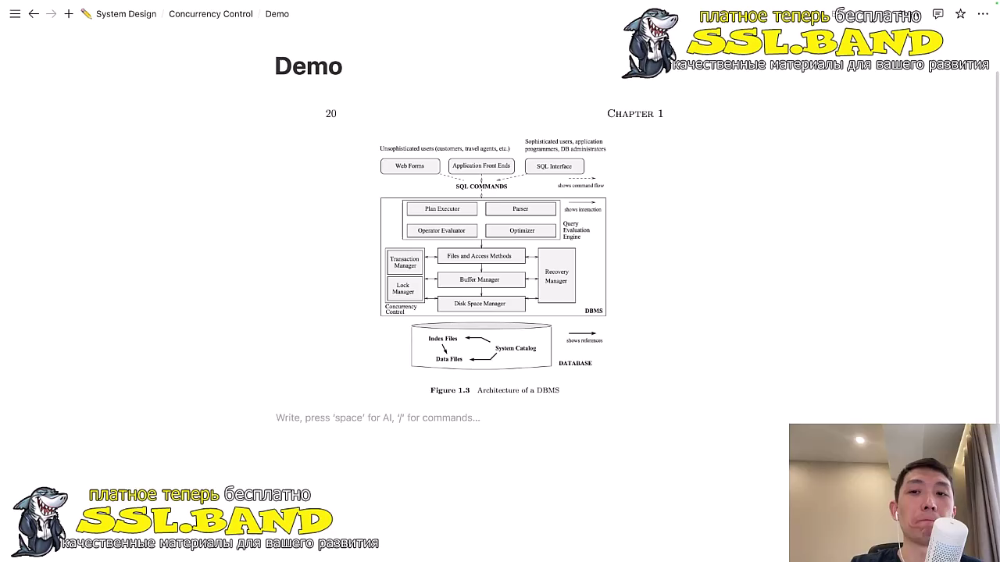
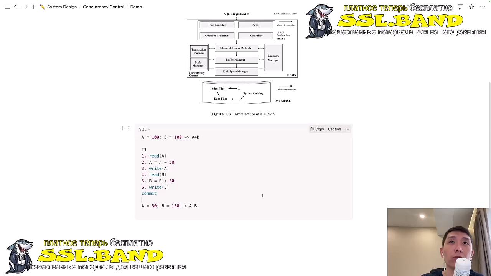
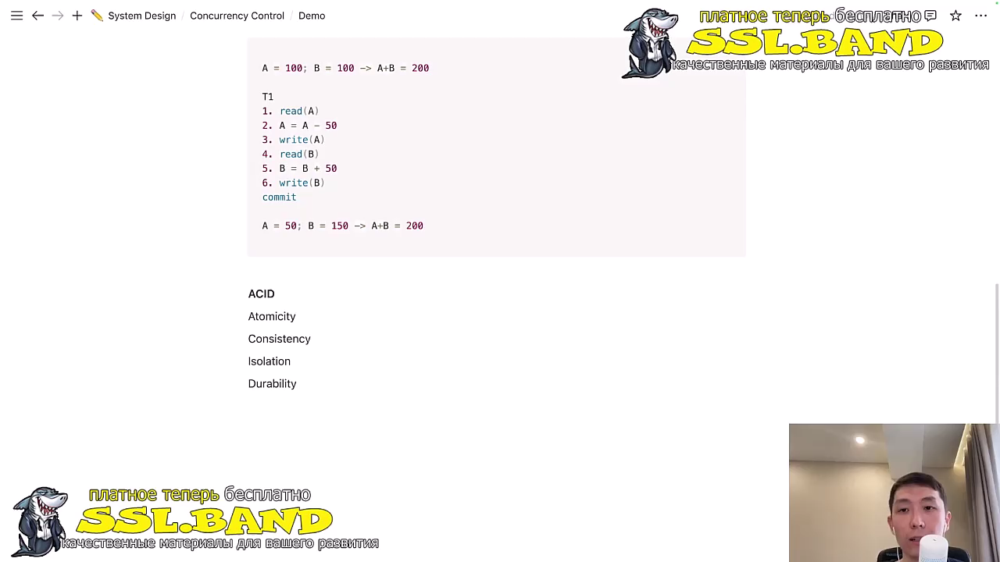
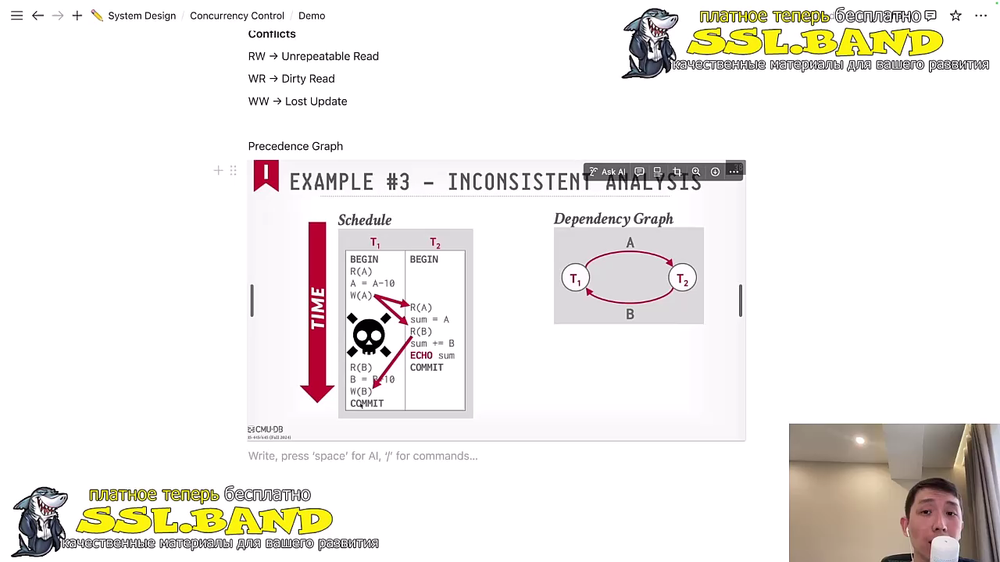
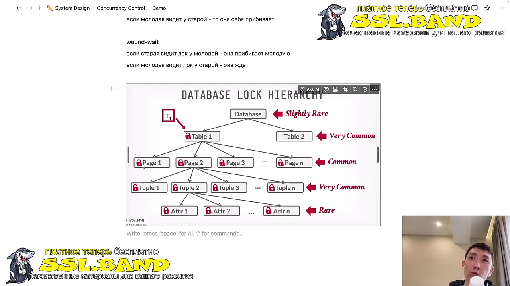
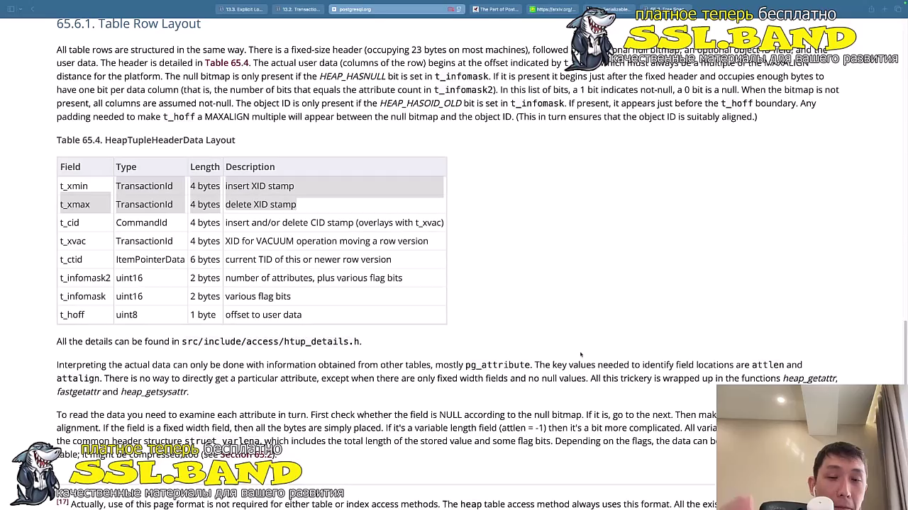
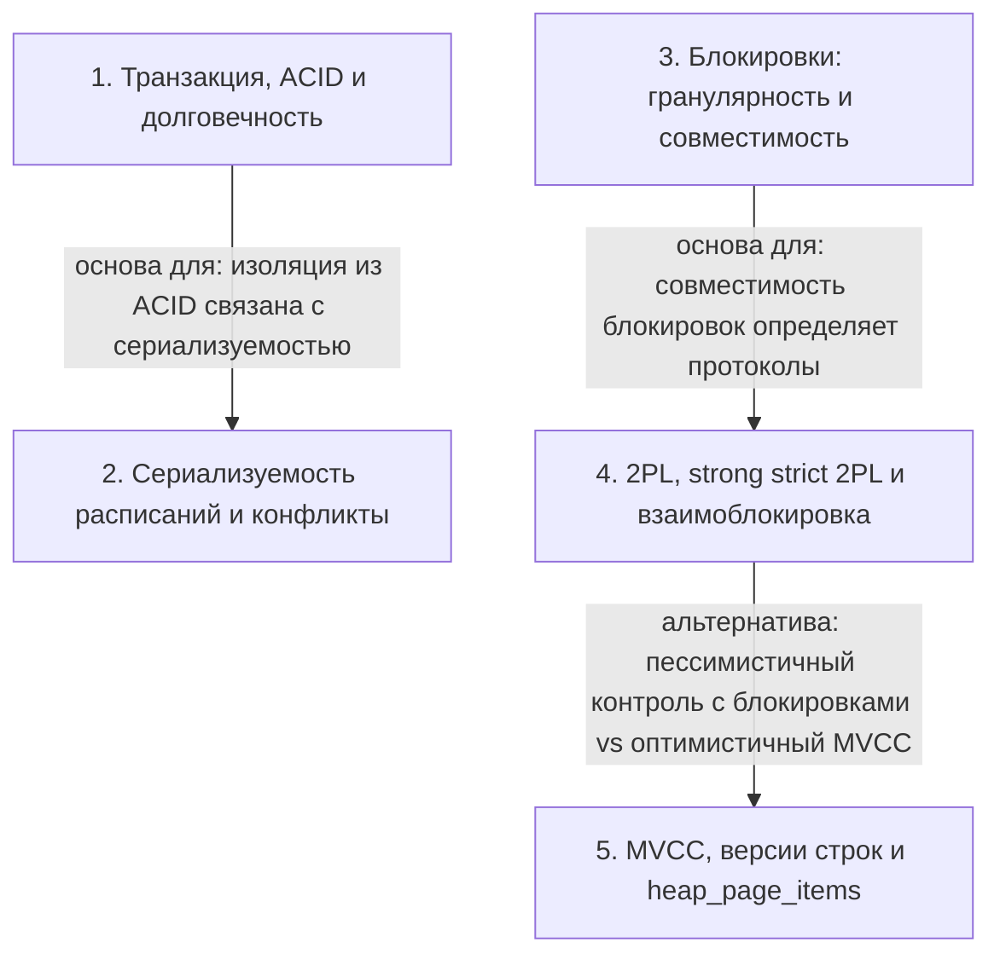

# Транзакции, MVCC и конкурентный доступ в PostgreSQL

> [!abstract] Обзор
> Разбираются транзакции и конкурентный доступ в СУБД: транзакция как единица выполнения, критерии корректности и свойства ACID, commit и долговечность (durability). Рассматриваются расписание (schedule), «идеальное» и сериализуемое расписание, конфликтная и view-сериализуемость, типы конфликтов RW/WR/WW, граф предшествования (Precedence Graph), топологическая сортировка, невосстанавливаемое расписание и каскадный откат (cascading rollback). Описаны блокировки и их гранулярность (иерархия Database → Table → Page), intent-блокировки и совместимость блокировок, протоколы 2PL и strong strict 2PL, взаимоблокировка (deadlock) и политики wait-die и wound-wait. Отдельно — оптимистичный контроль и MVCC: изоляция по снапшотам (snapshot isolation), версии объектов и таймстампы, заголовок кортежа (tuple header), xmin/xmax и CTID, откат, мусор, VACUUM, VACUUM FULL, FSM, переполнение идентификаторов и Vacuum Freeze. Практика связывает теорию с PostgreSQL: уровни изоляции (read committed, repeatable read, serializable), Serializable Snapshot Isolation и граф конфликтов, блокировка строки и `SKIP LOCKED`, явные блокировки и чтение `t_xmin`/`t_xmax` через `heap_page_items`.

> [!info] Курс
> [[index|Оглавление курса]]

## Оглавление
1. [[#1. Транзакция, ACID и долговечность]]
2. [[#2. Сериализуемость расписаний и конфликты]]
3. [[#3. Блокировки: гранулярность и совместимость]]
4. [[#4. 2PL, strong strict 2PL и взаимоблокировка]]
5. [[#5. MVCC, версии строк и heap_page_items]]
6. [[#6. VACUUM, VACUUM FULL, FSM и Vacuum Freeze]]
7. [[#7. Ожидание при конкурентном обновлении и SKIP LOCKED]]
8. [[#8. Уровни изоляции, REPEATABLE READ и SERIALIZABLE]]
9. [[#9. Явные блокировки в PostgreSQL]]

**Схема** — [[#Схема]]
**Итог** — [[#Итог]]

## 1. Транзакция, ACID и долговечность

Транзакция — это единица выполнения, которая обновляет и добавляет элементы данных в страницы. Чтобы записать данные, нужно подтянуть страницу в буфер-менеджер, возможно обновить индекс, затем записать страницу и сбросить её обратно на диск. Операцию можно назвать транзакцией только тогда, когда она отвечает критериям корректности и переводит базу из одного согласованного состояния в другое; при этом согласованность задаёт не только СУБД, но и логика приложения. ACID расшифровывается как Atomicity (атомарность), Consistency (согласованность), Isolation (изоляция) и Durability (долговечность). Атомарность — это принцип «всё или ничего»: недокатанную транзакцию нужно восстановить с помощью менеджера восстановления. В рассматриваемой модели чтение и запись идут в буферный пул, а commit просто сбрасывает данные на диск. Состояние **partially committed** («частично зафиксирована») — это когда клиент уже отправил финальный оператор (commit), но во время commit транзакция всё ещё может не закоммититься (например, из-за оптимистичного контроля конкуренции), и тогда она переходит в состояние failed и абортится. **Durability (долговечность)** — свойство, при котором после команды commit данные гарантированно сохраняются на диске: даже при внезапном выключении и включении результаты выполнения транзакции сохраняются.

*Источник: [00:02:00], [00:03:00], [00:04:00], [00:05:00], [00:06:00], [00:07:00], …*

> [!quote]- Кадр [00:02:00]
> 

> [!quote]- Кадр [00:03:00]
> 

> [!quote]- Кадр [00:07:00]
> 

## 2. Сериализуемость расписаний и конфликты

**Расписание (schedule)** — это хронологический порядок выполнения инструкций транзакций при конкурентном выполнении. «Идеальное» расписание даёт такой же результат, как если бы транзакции выполнялись по очереди одна за другой, и переводит базу из согласованного состояния в согласованное. Корректное расписание должно быть **сериализуемым (serializable)**: даже выглядящее перемешанным, при правильных перестановках оно эквивалентно последовательному (Serial Schedule). Различают **конфликтную (Conflict Serializability)** и **view-сериализуемость (View Serializability)**: conflict-serializable расписание можно привести к последовательному, переставляя только неконфликтующие куски операций, а view-сериализуемость даёт результат как у последовательного расписания, но при этом расписание не обязано быть конфликтно-сериализуемым. Типы конфликтов: **read-write** (он же неповторяющееся чтение, unrepeatable read); **write-read** (грязное чтение, dirty read); **write-write** (потерянное обновление, lost update, когда первое обновление теряется). **Граф предшествования (Precedence Graph)** — это анализ расписания, на основе которого строят граф зависимостей (Dependency Graph): при конфликте между операциями ставится ребро; если граф зациклился, расписание нельзя «развести», а если цикла нет — его разводят топологической сортировкой. **Невосстанавливаемое расписание** возникает, когда транзакция читает грязные данные и коммитится раньше транзакции, которая их записала; **каскадный откат (cascading rollback)** возникает из-за цепочки зависимостей: при аборте первой транзакции приходится откатывать все транзакции, которые прочитали её данные.

*Источник: [00:09:00], [00:12:00], [00:13:00], [00:14:00], [00:15:00], [00:17:00], …*

> [!quote]- Кадр [00:21:00]
> 

## 3. Блокировки: гранулярность и совместимость

Блокировка всей базы данных сильно ограничивает конкуренцию: если блокировать так, что выполняется лишь одна транзакция за раз, ресурсы не утилизируются. Блокировки можно ставить на разные уровни — база данных, таблица, страница (пейджа); иерархия: **Database → Table → Page**. Для параллельного доступа к разным страницам нужна более мелкая гранулярность — блокировки на уровне страниц; грубые блокировки на уровне таблицы для операций, которым хватило бы страницы, приводят к ложным конфликтам. **Intent share (IS)** означает, что где-то «под мной» происходит чтение; **intent exclusive (IX)** — что «под мной» что-то пишется; **SIX** — что я читаю и при этом «под собой» пишу. При чтении ставится **shared-блокировка**, при записи — **exclusive-блокировка**: shared-блокировку могут одновременно держать несколько читателей, но писать объект при этом никто не может; эксклюзивную блокировку нельзя взять, если кто-то читает или уже удерживает эксклюзивную. SIX и IS совместимы, если читается отдельный кортеж (tuple), но несовместимы, если читается вся страница; SIX и SIX, а также SIX и X несовместимы; X несовместима ни с кем. PostgreSQL использует MVCC, но при необходимости блокировки можно ставить явно — на уровне таблиц, строк и страниц (пейджей).

| Блокировки | Совместимость |
|---|---|
| IS и IS | совместимы |
| SIX и IS | совместимы |
| SIX и SIX | несовместимы |
| SIX и X | несовместимы; X несовместима ни с кем |

| Запрос ↓ / Удерживается → | Shared | Exclusive |
|---|---|---|
| Shared | можно | нельзя |
| Exclusive | нельзя | нельзя |

> [!info] Зачем это нужно
> Чтобы разные транзакции могли писать в разные страницы, можно блокировать отдельные страницы.

*Источник: [00:13:00], [00:33:00], [00:34:00], [00:47:00], [00:48:00], [00:49:00], …*

> [!quote]- Кадр [00:47:00]
> 

## 4. 2PL, strong strict 2PL и взаимоблокировка

Идеальный случай — последовательное выполнение транзакций, но оно снижает конкуренцию, поэтому нужны протоколы конкурентного управления: они допускают некоторую степень конкуренции и выдают корректные расписания. Просто брать блокировки недостаточно — их нужно брать, следуя протоколу блокировок, а не как попало. Пессимистичный контроль конкуренции берёт блокировки заранее; пример — **2PL (two-phase locking, двухфазная блокировка)**, где транзакция берёт блокировки в фазе роста (growing phase), а отпускает в фазе сжатия (shrinking phase); после начала фазы сжатия новые блокировки брать нельзя. Двухфазная блокировка обеспечивает сериализуемость за счёт правила: если начал отпускать блокировки, новые брать нельзя; `unlock` не может стоять выше `lock`. **Strong strict 2PL** требует удерживать блокировки до конца выполнения транзакции, поэтому каскадных абортов нет, но взамен страдает конкуренция. Расстановка блокировок по протоколу даёт конфликтно-сериализуемое расписание, но **2PL не защищает от взаимоблокировки (deadlock)**: транзакции могут взаимно ждать друг друга — одна держит B и ждёт A, другая держит A и ждёт B. Разрешить deadlock можно так: повесить тайм-аут (с риском повторного deadlock), взять все блокировки заранее (но страдает конкуренция), выставить приоритеты транзакций или построить граф блокировок и найти циклы. Для разрешения deadlock применяют **wait-die** и **wound-wait**: в wait-die старая транзакция, видя блокировку молодой, ждёт, а молодая, видя блокировку старой, сама себя «перебивает»; в wound-wait — наоборот, старшая «ранит» младшую.

> [!info] Зачем это нужно
> Чтобы допустить некоторую степень конкуренции и при этом получать корректные расписания, нужны протоколы конкурентного управления.

*Источник: [00:30:00], [00:31:00], [00:32:00], [00:36:00], [00:37:00], [00:38:00], …*

## 5. MVCC, версии строк и heap_page_items

**Оптимистичный подход** предполагает, что конфликтов не будет, а если они всё же возникнут — транзакция откатывается. Пример — **MVCC** (multiversion concurrency control): он использует `tmin` и `tmax`, создаёт копии строк при каждом изменении и для очистки требует vacuum. **Изоляция по снапшотам (snapshot isolation)** даёт каждой транзакции свою копию данных и своё представление мира, поэтому явные блокировки можно не ставить. В Postgres один логический объект может иметь несколько физических версий (кортежей, tuples), и разные транзакции видят разные версии. В MVCC писатели блокируют писателей (оба пытаются создать новую версию на основе одного и того же объекта, и один писатель ждёт решения транзакции другого), но писатели **не** блокируют читателей, а читатели — писателей. При старте каждой транзакции выдаётся таймстамп — увеличивающийся счётчик. Транзакция видит версию объекта, если её таймстамп попадает в интервал от begin timestamp до end timestamp этой версии; если версия не менялась, end timestamp считается бесконечностью. Запись создаёт новую версию, существующую не перезаписывают. У каждого кортежа есть свой заголовок (header): при явном `SELECT xmin, xmax` видно, что в таблице хранится не только значение — **`xmin`** это ID создавшей транзакции, **`xmax`** — ID транзакции, которая последней обновила или удалила кортеж. При `UPDATE` в Postgres создаётся новая версия кортежа, старая остаётся; **CTID** — указатель на новую версию кортежа, а **CID** — номер операции внутри транзакции, создавшей версию строки. Все строки таблицы имеют одинаковую структуру: фиксированный заголовок (23 байта на большинстве машин), затем необязательный null bitmap, необязательное поле object ID и пользовательские данные. Команда `CREATE TABLE mv` создаёт таблицу `mv` с колонками `id` и `value`, а запрос ниже выводит для каждого кортежа страницы его `t_xmin`, `t_xmax`, `t_cid` и `t_ctid`.

```sql
demo=# CREATE TABLE mv (
demo#    id SERIAL PRIMARY KEY,
demo#    value INT
demo# );
CREATE TABLE
demo=#

demo=# SELECT lp as tuple, t_xmin, t_xmax, t_field3 as t_cid, t_ctid FROM heap_page_items(get_raw_page('accounts', 0));
 tuple | t_xmin | t_xmax | t_cid | t_ctid
-------+--------+--------+-------+--------
     1 |   2329 |   2330 |     0 | (0,3)
     2 |   2329 |   2332 |     0 | (0,5)
     3 |   2330 |      0 |     0 | (0,3)
     4 |   2331 |      0 |     0 | (0,4)
     5 |   2332 |      0 |     0 | (0,5)
(5 rows)
```

*Источник: [00:31:00], [00:55:00], [00:56:00], [00:57:00], [00:58:00], [01:01:00], …*

> [!quote]- Кадр [01:22:00]
> 

## 6. VACUUM, VACUUM FULL, FSM и Vacuum Freeze

При откате транзакции все её обновления не применяются, и таблица остаётся в прежнем состоянии, но образуется мусор, который нужно очищать. Таблица может разрастаться из-за мёртвых строк (dead rows), что замедляет работу и требует ресурсов на очистку (purge, по смыслу близко к vacuum). Во время обновления строк можно запустить VACUUM. Вакуум нужен для двух целей: освобождать место в Postgres и поддерживать (maintenance) хранилище — при пересборке страницы индекс обновляется, а для нагруженного real-time продукта нужно запускать вакуум и следить за transaction ID (или хотя бы поставить на это метрику). **VACUUM FULL** сжимает и пересобирает страницы, чтобы избавиться от «трупов», и не может завершиться, пока не закоммитится транзакция, видящая старую версию строки. **FSM (free space map)** — структура данных, которая отвечает за то, где сейчас есть свободное место, куда можно вставить новую запись. Идентификатор транзакции — это число, и числа могут превышать разрядность, что даёт переполнение (overflow) и «закольцовывание» (wrap around): после ~2 миллиардов значения начинаются с нуля, и становится неясно, может ли транзакция видеть предыдущие записи. **Vacuum Freeze** перезаписывает `xmin` транзакций, которые точно находятся в прошлом, на фиксированное значение, которое всегда будет самым старым, — это предотвращает переполнение (wraparound).

> [!info] Зачем это нужно
> Вакуум нужен для освобождения места и поддержания (maintenance) хранилища.

*Источник: [01:06:00], [01:10:00], [01:11:00], [01:12:00], [01:13:00], [01:21:00], …*

> [!quote]- Кадр [01:22:00]
> 

## 7. Ожидание при конкурентном обновлении и SKIP LOCKED

Если один процесс создаёт новую версию, второй процесс, пытающийся создать новую версию на основе той же строки, ждёт: он не может создать новую версию, пока это делает другой. При выборке строки с `FOR UPDATE` она блокируется; параллельный `UPDATE` этой строки ждёт, пока транзакция с блокировкой выполнит commit. С помощью `SELECT ... FOR UPDATE SKIP LOCKED` можно обновлять только те строки, на которых нет блокировки, — пропуская занятые.

*Источник: [01:08:00], [01:29:00], [01:30:00]*

## 8. Уровни изоляции, REPEATABLE READ и SERIALIZABLE

При **грязном чтении (dirty read)** транзакция читает данные, записанные другой транзакцией, но ещё не закоммиченные. В Postgres такое невозможно из-за snapshot isolation. По умолчанию Postgres ставит уровень **read committed**; в примере вторая транзакция видит у Алисы 100, потому что данные ещё не закоммичены. В режиме **repeatable read** транзакция не может обновить запись, потому что версия строки, которую она видит, уже не существует. На уровне **REPEATABLE READ** команда `UPDATE` по строке, изменённой параллельной транзакцией, завершается ошибкой `could not serialize access due to concurrent update`; повторный `UPDATE` той же строки в этой транзакции проходит успешно, а при read committed вставленная и закоммиченная запись будет видна. До версии 9.1 уровень Serializable был не совсем сериализуемым и был подвержен аномалиям. **Serializable Snapshot Isolation** использует снапшоты, strong strict 2PL и serial-блокировки для определения конфликтов через xmin/xmax и список активных транзакций. На уровне **serializable** в Postgres может возникнуть ошибка `could not serialize access due to read/write dependencies`; обнаружив конфликт, транзакции строят граф конфликтов, и если граф циклический — выполниться они не могут. При этом СУБД перестраховывается и предотвращает ситуации, в которых могла бы возникнуть аномалия сериализации: она сразу забирает все блокировки, поэтому транзакция получает `cannot serialize`, даже если аномалии на самом деле нет.

```sql
demo=# BEGIN ISOLATION LEVEL REPEATABLE READ;
BEGIN
demo=# SELECT * FROM accounts WHERE name = 'Bob';
 id | name | balance
----+------+---------
  2 | Bob  |     100
(1 row)
demo=# UPDATE accounts SET balance = 0 WHERE name = 'Bob';
ERROR:  could not serialize access due to concurrent update
demo=# UPDATE accounts SET balance = 99 WHERE name = 'Bob';
UPDATE 1
demo=# COMMIT;
```

*Источник: [01:16:00], [01:17:00], [01:18:00], [01:19:00], [01:25:00], [01:26:00], …*

## 9. Явные блокировки в PostgreSQL

PostgreSQL предоставляет разные режимы блокировок для управления конкурентным доступом к данным в таблицах. Большинство команд PostgreSQL автоматически захватывают блокировки подходящих режимов. Эти режимы можно использовать для блокировок, управляемых приложением (application-controlled locking), когда MVCC не даёт желаемого поведения.

> [!info] Зачем это нужно
> Эти блокировки нужны, чтобы таблицы не были удалены во время выполнения команды.

*Источник: [00:54:00], [01:24:00], [01:33:00]*

## Схема



## Итог

> [!success] Что в итоге
> Транзакция — единица выполнения, которая переводит базу из одного согласованного состояния в другое и отвечает критериям корректности ACID; commit сбрасывает данные на диск и связан с долговечностью. Корректность конкурентного выполнения описывается расписанием (schedule), которое должно быть сериализуемым; для анализа используют конфликты RW/WR/WW, граф предшествования и топологическую сортировку, а нарушения ведут к невосстанавливаемым расписаниям и каскадному откату. Корректные расписания обеспечивают протоколы конкурентного управления: 2PL и strong strict 2PL, разрешение взаимоблокировок через wait-die и wound-wait, а также оптимистичный MVCC с изоляцией по снапшотам, версиями объектов и таймстампами. В PostgreSQL это дополняется уровнями изоляции, Serializable Snapshot Isolation и графом конфликтов, явными блокировками, VACUUM и Vacuum Freeze, а также служебными полями xmin/xmax и CTID.
