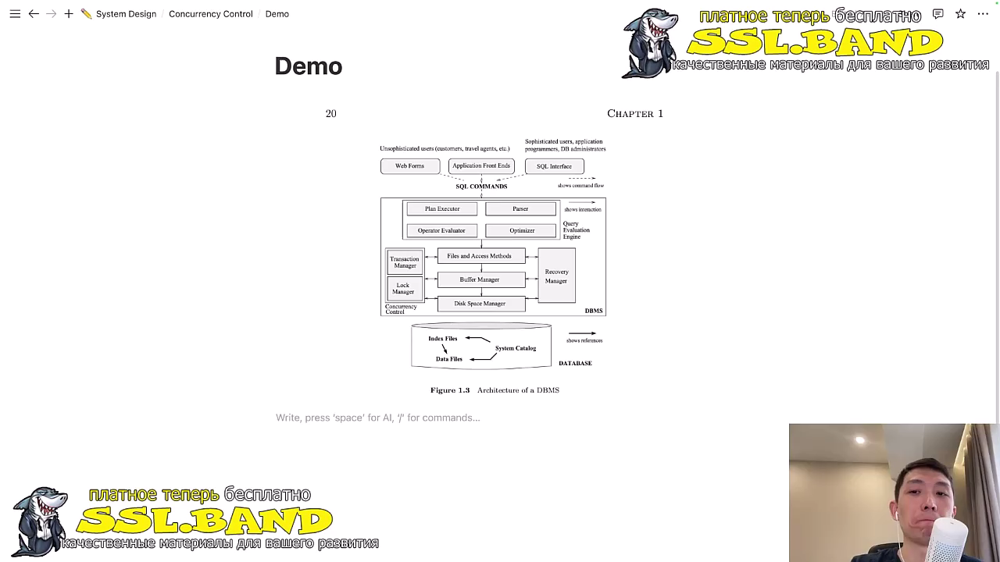
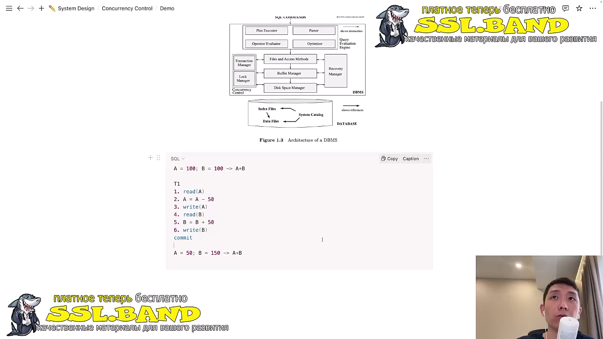
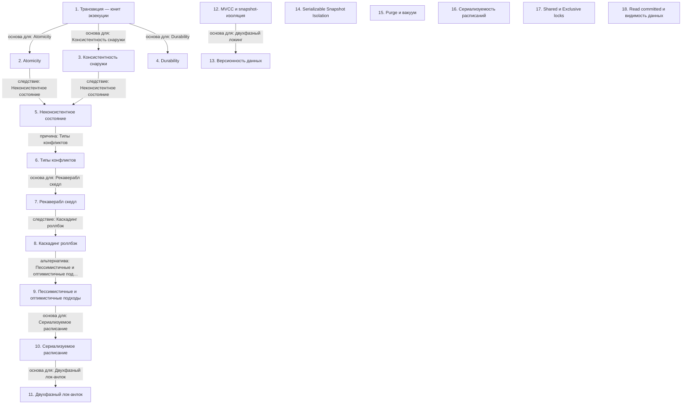

# Транзакции и управление согласованностью в СУБД

> [!abstract] Обзор
> Лекция по транзакциям и их свойствам в СУБД. Основные темы: атомарность, изоляция, согласованность, устойчивость, конфликты, расписания, блокировки, MVCC, версионность, вакуум, сериализуемость, рекаверабельность. Рассмотрены механизмы обеспечения целостности и согласованности данных в конкурентной среде.

> [!info] Курс
> [[index|Оглавление курса]]

## Оглавление
1. [[#1. Транзакция — юнит экзекуции]]
2. [[#2. Atomicity]]
3. [[#3. Консистентность снаружи]]
4. [[#4. Durability]]
5. [[#5. Неконсистентное состояние]]
6. [[#6. Типы конфликтов]]
7. [[#7. Рекаверабл скедл]]
8. [[#8. Каскадинг роллбэк]]
9. [[#9. Пессимистичные и оптимистичные подходы]]
10. [[#10. Сериализуемое расписание]]
11. [[#11. Двухфазный лок-анлок]]
12. [[#12. MVCC и snapshot-изоляция]]
13. [[#13. Версионность данных]]
14. [[#14. Serializable Snapshot Isolation]]
15. [[#15. Purge и вакуум]]
16. [[#16. Сериализуемость расписаний]]
17. [[#17. Shared и Exclusive locks]]
18. [[#18. Read committed и видимость данных]]

**Схема** — [[#Схема]]
**Итог** — [[#Итог]]

## 1. Транзакция — юнит экзекуции

Транзакция — это блок операций, который обновляет данные в пейджах, включая чтение, запись и обновление индексов. Заборта транзакции отменяет все изменения, сделанные в ней, и оставляет данные в исходном состоянии. Изоляция гарантирует, что выполнение одной транзакции не влияет на выполнение другой.

> [!info] Зачем это нужно
> Транзакции обеспечивают надёжность и согласованность данных в конкурентной среде.

> [!quote]- Кадр [00:02:00]
> 

## 2. Atomicity

Atomicity — это свойство транзакции, при котором она либо полностью выполняется, либо не выполняется вовсе. Это принцип all or nothing.

> [!info] Зачем это нужно
> Atomicity гарантирует целостность данных при выполнении транзакции.

> [!quote]- Кадр [00:04:00]
> 

## 3. Консистентность снаружи

Консистентность снаружи подразумевает, что приложение должно сохранять целостность данных вне СУБД. СУБД также обеспечивает переход между консистентными состояниями.

> [!info] Зачем это нужно
> Приложение и СУБД совместно обеспечивают согласованность данных.

## 4. Durability

Durability гарантирует, что данные транзакции доступны после перезагрузки системы. Это гарантия, что после Commit данные транзакции сохранены на диске.

> [!info] Зачем это нужно
> Durability обеспечивает надёжное хранение данных после завершения транзакции.

## 5. Неконсистентное состояние

Неконсистентное состояние возникает, когда данные после выполнения транзакций не соответствуют ожидаемому значению. Например, сумма a и b не совпадает с ожидаемым значением.

> [!info] Зачем это нужно
> Неконсистентное состояние указывает на ошибку в выполнении транзакций.

## 6. Типы конфликтов

RV-конфликт — это read-write, или unrepeatable read. WR-конфликт — это write-read, или dirty read. Эти конфликты нарушают согласованность данных.

> [!info] Зачем это нужно
> Типы конфликтов помогают понять, как транзакции влияют на данные.

## 7. Рекаверабл скедл

Рекаверабл скедл — это расписание, которое может быть восстановлено в случае ошибки. Понятие «Рекаверабл» важно для управления транзакциями.

> [!info] Зачем это нужно
> Рекаверабл скедл позволяет восстанавливать данные после сбоя.

## 8. Каскадинг роллбэк

Каскадинг роллбэк возникает при наличии цепочки зависимостей. Если одна транзакция откатывается, это приводит к откату всех зависимых транзакций.

> [!info] Зачем это нужно
> Каскадинг роллбэк обеспечивает целостность данных в случае ошибки.

## 9. Пессимистичные и оптимистичные подходы

Оптимистичные подходы ожидают отсутствие конфликтов. Пессимистичные подходы предполагают проблемы и требуют заранее блокировать ресурсы.

> [!info] Зачем это нужно
> Выбор подхода влияет на производительность и корректность транзакций.

## 10. Сериализуемое расписание

Сериализуемое расписание достигается за счёт порядка выполнения транзакций и правильного управления блокировками. Оно гарантирует согласованность данных.

> [!info] Зачем это нужно
> Сериализуемое расписание обеспечивает корректность выполнения транзакций.

## 11. Двухфазный лок-анлок

Двухфазный лок-анлок гарантирует Serializability. Анлок не может происходить выше лока, что обеспечивает порядок выполнения. Двухфазный локинг — протокол, при котором транзакции получают локи в фазе роста и отпускают их в фазе сокращения. После начала отпускания локов новые локи не могут быть взяты.

> [!info] Зачем это нужно
> Двухфазный лок-анлок позволяет избежать конфликтов в конкурентной среде.

## 12. MVCC и snapshot-изоляция

MVCC позволяет читателям и писателям работать без блокировок. Snapshot-изоляция обеспечивает видимость данных, актуальных на момент выполнения транзакции.

> [!info] Зачем это нужно
> Увеличивает параллелизм и производительность.

## 13. Версионность данных

Версии данных создаются при записи. Читатели видят версии, актуальные на момент выполнения транзакции. Это основа MVCC.

> [!info] Зачем это нужно
> Обеспечивает изоляцию и согласованность данных.

## 14. Serializable Snapshot Isolation

Serializable Snapshot Isolation — это комбинация снапшотов и Strong Strict 2PL. Использует серит локи для обнаружения конфликтов.

> [!info] Зачем это нужно
> Обеспечивает высокий уровень изоляции и согласованности.

## 15. Purge и вакуум

Purge — это процесс удаления мертвых строк, аналогичный вакууму. Мертвые строки замедляют работу БД, поэтому их необходимо удалять.

> [!info] Зачем это нужно
> Для поддержания производительности и чистоты данных.

## 16. Сериализуемость расписаний

Сериализуемость расписаний — это свойство, при котором результат выполнения расписания совпадает с результатом последовательного выполнения транзакций. Существуют виды: conflict serializability и view serializability.

> [!info] Зачем это нужно
> Для обеспечения корректности и предсказуемости поведения транзакций.

## 17. Shared и Exclusive locks

Shared lock используется для чтения, Exclusive lock — для записи. Совместное чтение возможно, но запись блокирует другие транзакции.

> [!info] Зачем это нужно
> Для управления доступом к данным в условиях параллелизма.

## 18. Read committed и видимость данных

Read committed гарантирует, что данные видны только после коммита. Новые записи становятся видимыми после успешного коммита.

> [!info] Зачем это нужно
> Для обеспечения видимости только завершенных транзакций.

## Схема

## Итог

> [!success] Что в итоге
> Транзакции обеспечивают надёжность и согласованность данных в СУБД. Их свойства — атомарность, изоляция, согласованность и устойчивость — гарантируют корректное выполнение в конкурентной среде. Управление конфликтами и блокировками позволяет избежать неконсистентных состояний и обеспечивает восстановимость данных. MVCC, версионность, локи и вакуум — ключевые механизмы, обеспечивающие согласованность и производительность в PostgreSQL и других СУБД.

