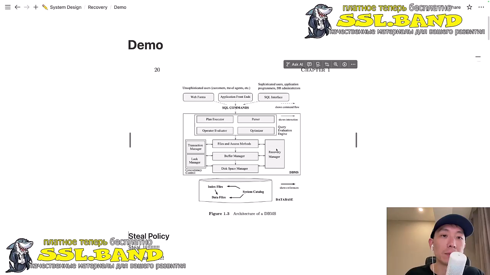
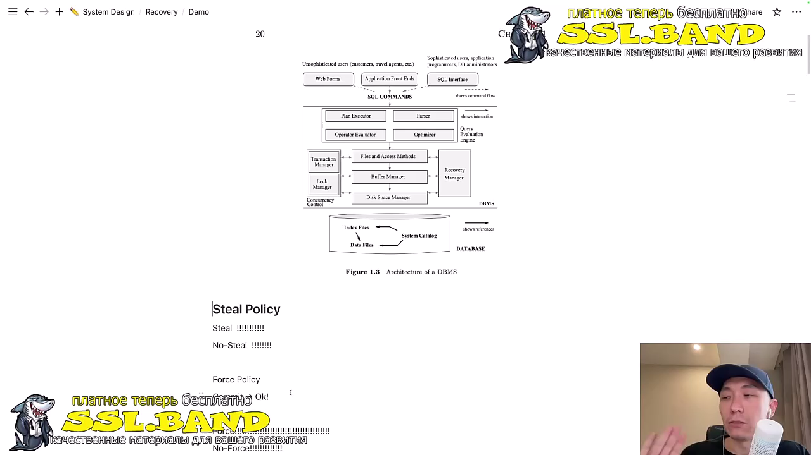
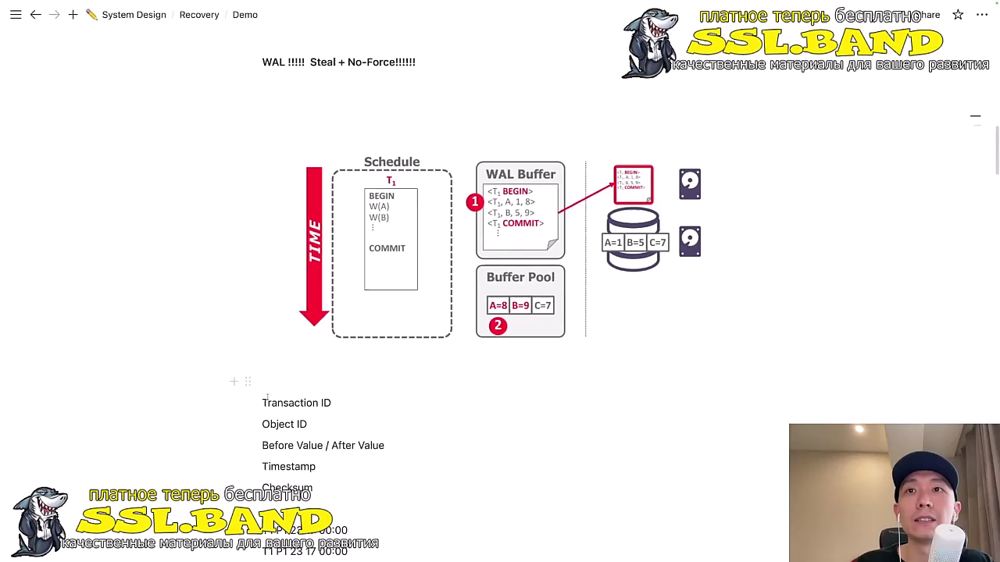
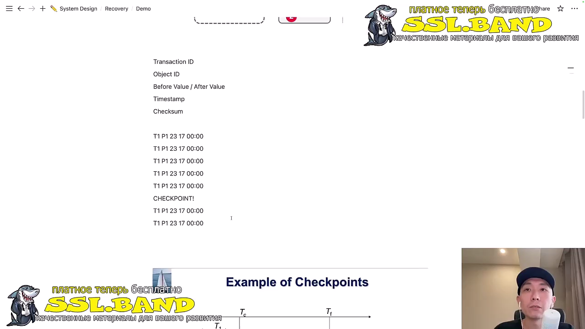
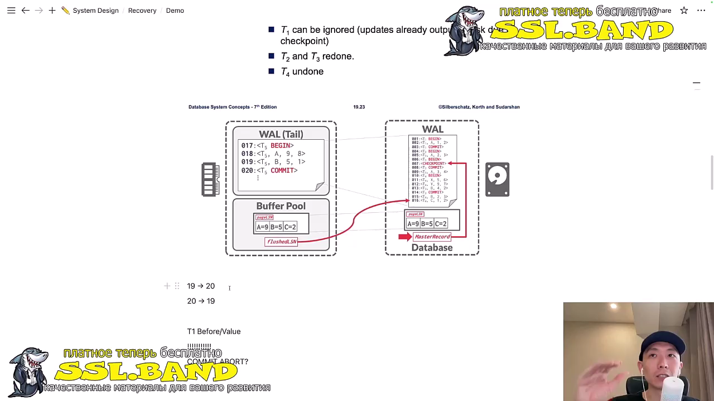
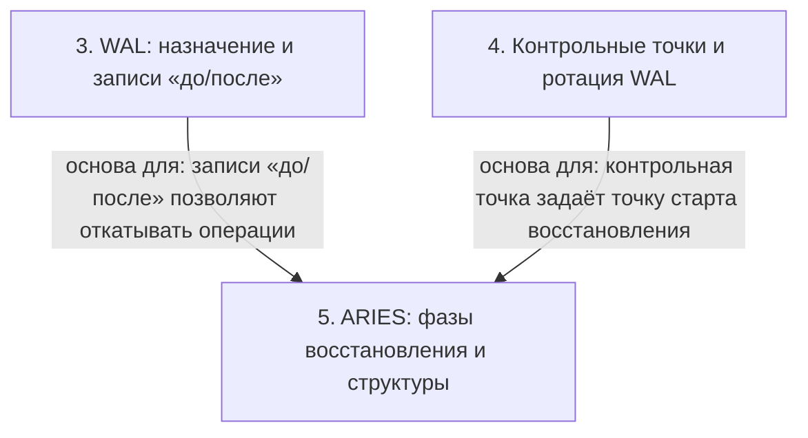

# Восстановление после сбоя в СУБД: WAL, ARIES и репликация

> [!abstract] Обзор
> Материал о восстановлении в СУБД и роли журнала упреждающей записи (write-ahead log, WAL). Рассматриваются архитектура ядра СУБД и место менеджера восстановления (Recovery Manager), ограниченность буферного пула, политики Steal/No-Steal и Force/No-Force. Описывается WAL с записями «до/после», LSN, контрольные точки (checkpoints), алгоритм ARIES с фазами анализ/redo/undo, CLR и компенсационные записи, а также binary log в MySQL. Разбираются механизмы отката: компенсация при аборте транзакции, PrevLSN и undo next LSN, Dirty Page Table и page LSN при повторном применении операций. Отдельно показана репликация через WAL и пример Neon, который перехватывает WAL от Postgres.

> [!info] Курс
> [[index|Оглавление курса]]

## Оглавление
1. [[#1. Архитектура СУБД и Recovery Manager]]
2. [[#2. Буферный пул и политики вытеснения]]
3. [[#3. WAL: назначение и записи «до/после»]]
4. [[#4. Контрольные точки и ротация WAL]]
5. [[#5. ARIES: фазы восстановления и структуры]]
6. [[#6. Компенсационные записи и навигация по логу]]
7. [[#7. Репликация через WAL: MySQL и Neon]]

**Схема** — [[#Схема]]
**Итог** — [[#Итог]]

## 1. Архитектура СУБД и Recovery Manager

Менеджер восстановления (Recovery Manager) — ключевая часть СУБД, участвующая во всём. Ядро СУБД включает движок оценки запросов (Query Evaluation Engine), менеджер транзакций (Transaction Manager), менеджер восстановления (Recovery Manager) и подсистему Files and Access Methods. Движок оценки запросов состоит из Parser, Operator Evaluator, Optimizer и Plan Executor. Менеджер транзакций включает Lock Manager и Concurrency Control, а Files and Access Methods — Buffer Manager и Disk Space Manager. На диаграмме архитектуры также показаны Application Front Ends, SQL Interface, SQL-команды, Index Files и Data Files.

*Источник: [00:01:00], [00:16:00], [00:24:00]*

## 2. Буферный пул и политики вытеснения

Буферный пул занимает конечный объём памяти и не может расти бесконечно — в какой-то момент в нём заканчивается место. При управлении буферами различают политики **Steal/No-Steal** и **Force/No-Force**. При **steal** грязная (незакоммиченная) страница может быть вытеснена на диск, поэтому при сбое такие изменения нужно откатывать (нужен UNDO). При **no-steal** грязные страницы на диск не сбрасываются, и UNDO не нужен, но буферный пул может заполниться. Политика **force** означает, что при commit изменения транзакции уже сброшены из памяти на диск; при **no-force** это не гарантируется, поэтому при сбое нужен REDO (повтор). Комбинация **Steal + No-Force** даёт максимальную производительность: она не требует, чтобы к моменту `Commit OK` все изменения уже лежали на диске, и позволяет сбрасывать грязные страницы по мере необходимости.

| Политика | Грязные страницы | Особенности |
|---|---|---|
| Steal | могут сбрасываться на диск | при сбое нужно откатывать (UNDO) незакоммиченные изменения |
| No-steal | не сбрасываются на диск | UNDO при восстановлении не нужен; но буферный пул может заполниться грязными страницами |

*Источник: [00:02:00], [00:03:00], [00:17:00]*

> [!quote]- Кадр [00:02:00]
> 

## 3. WAL: назначение и записи «до/после»

**WAL (write-ahead log)** — это журнал операций и фундаментальная часть СУБД; WAL можно перехватывать и превращать в другой тип хранения данных. **LSN (log sequence number)** — порядковый номер записи в логе; каждая страница хранит свой **page LSN** — LSN последнего изменения, попавшего в эту страницу. В Postgres для WAL настраивают периодичность сброса, запись полных страниц, запись данных со страниц и задержку сброса WAL; по умолчанию WAL сбрасывается на диск каждые 200 миллисекунд. Журнал упреждающей записи помогает восстанавливаться, откатывать транзакции, следить за состоянием базы и управлять буферным пулом. В WAL записываются значения объекта **до и после** изменения, что позволяет выполнить откат. При изменении значения для отката создаётся компенсирующая запись, фиксирующая обратное изменение (а не просто новое состояние): например, «было 19 → стало 20, значит откат: из 20 обратно в 19».

```
WAL: режим Steal + No-Force
Расписание:
  T1: BEGIN, W(A), W(B), COMMIT
WAL Buffer:
  <T1, BEGIN>
  <T1, A, 1, 8>
  <T1, B, 5, 9>
  <T1, COMMIT>
Buffer Pool:
  A=8  B=9  C=7
```

> [!info] Зачем это нужно
> WAL нужен для восстановления и отката.

*Источник: [00:04:00], [00:05:00], [00:06:00], [00:08:00], [00:21:00]*

> [!quote]- Кадр [00:04:00]
> 

> [!quote]- Кадр [00:06:00]
> 

## 4. Контрольные точки и ротация WAL

**Контрольная точка (checkpoint)** — это точка сохранения состояния базы данных, по смыслу похожая на «костёр» в видеоигре. Checkpoint позволяет ротировать WAL и не восстанавливать состояние с самого начала журнала: при восстановлении можно начать не с начала WAL, а с последней контрольной точки.

*Источник: [00:06:00], [00:07:00]*

> [!quote]- Кадр [00:07:00]
> 

## 5. ARIES: фазы восстановления и структуры

**ARIES** — алгоритм восстановления после сбоя, состоящий из трёх фаз: анализ (analysis), redo и undo. Фаза **анализа** последовательно вычитывает лог и определяет незакоммиченные транзакции, грязные страницы и LSN для старта; **Dirty Page Table** используется, чтобы пометить, какие страницы грязные, их версии и местоположение. **Redo** — повтор операций транзакции, даже если она позже закоммитится или откатится. **Undo** — компенсирующие записи в логе для отката изменений в обратном порядке. `page LSN` — это запись журнала о последнем изменении, попавшем в страницу; при восстановлении повтор операций для страницы начинается с записи после её `page LSN`. Например, T1 можно игнорировать, если её обновления уже выведены на диск к моменту checkpoint; T2 и T3 нужно переделать (redone), а T4 откатить (undone). После сбоя транзакции, которые не закоммичены и не аборчены, нужно откатывать обратно.

*Источник: [00:09:00], [00:10:00], [00:11:00], [00:18:00]*

> [!quote]- Кадр [00:09:00]
> 

## 6. Компенсационные записи и навигация по логу

**CLR (Compensation Log Record)** — это компенсирующая запись, которой компенсируют операцию при откате транзакции. Например, CLR отменяет операцию, произошедшую на LSN 10; если T1 меняет page 2 из 20 в 30, а затем откатывается, нужно сделать компенсирующую запись, которая из 30 сделает 20. Компенсационные записи (compensation log records) пишутся в лог; при повторном восстановлении обработка начинается с самого начала, и компенсации выполняются заново. При аборте транзакции выполняется компенсация, создаётся новая запись с новым LSN, которая откатывает операцию с указанным LSN, и для новой записи определяются предыдущая запись в рамках транзакции и следующая операция, которую она будет откатывать. Все операции одной транзакции связаны друг с другом через **PrevLSN** как связный список (linked list): например, у записи 30 PrevLSN указывает на 10, потому что они в рамках одной транзакции T1. **PrevLSN** указывает на предыдущую операцию транзакции, а **UndoNext LSN** — какую следующую операцию нужно откатить. У первой операции транзакции PrevLSN отсутствует, у второй уже есть; для отката следующей операции берётся та, что указана в PrevLSN. Во время записи CLR может произойти сбой; при восстановлении по undo next LSN видно, что откат не закончился, и его продолжают.

*Источник: [00:12:00], [00:14:00], [00:15:00], [00:19:00], [00:20:00]*

## 7. Репликация через WAL: MySQL и Neon

**Binary log** содержит события, описывающие изменения базы данных, — например, создание таблицы или изменение данных. Binary log — это журналирование, которое описывает операции; с его помощью можно делать репликацию или recovery. Благодаря write-ahead log можно делать репликацию: примеры — репликация по binary log (MySQL) и WAL-репликация. **Neon** перехватывает WAL от Postgres, прогоняет его через свою прослойку и хранит данные в собственном объектном хранилище (object storage). Postgres при этом стримит WAL и считает, что всё работает как обычно.

*Источник: [00:16:00], [00:21:00], [00:22:00]*

## Схема



## Итог

> [!success] Что в итоге
> Recovery Manager — ключевая часть СУБД, участвующая во всём; ядро СУБД включает движок оценки запросов, менеджер транзакций, менеджер восстановления и Files and Access Methods. Ограниченный буферный пул и политики Steal/No-Steal, Force/No-Force определяют, какие грязные страницы попадают на диск. WAL используется для восстановления, отката и репликации; при откате создаются компенсационные записи с PrevLSN и undo next LSN, а Dirty Page Table и page LSN задают точку повтора операций. Записи «до/после» и контрольные точки обеспечивают восстановление по трём фазам ARIES с компенсирующими записями CLR, а Neon перехватывает WAL от Postgres и хранит данные в собственном объектном хранилище.
