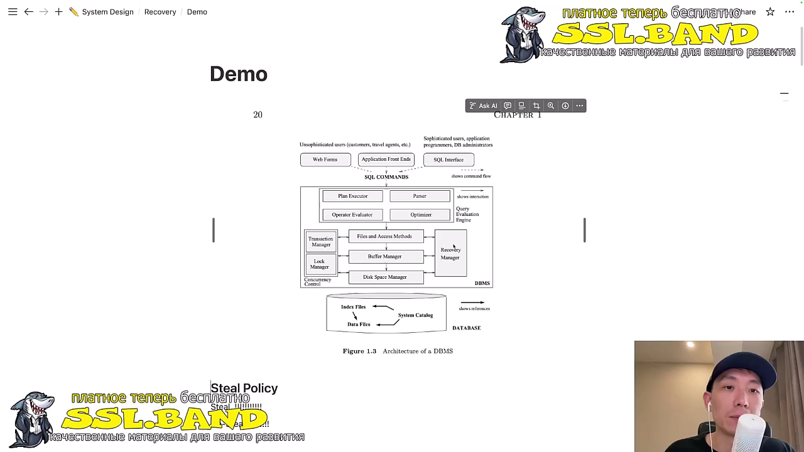
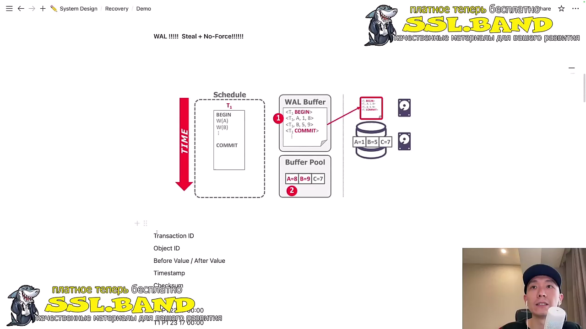
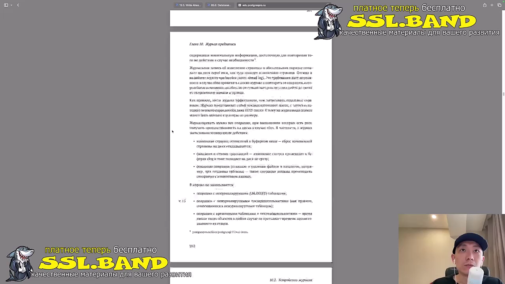
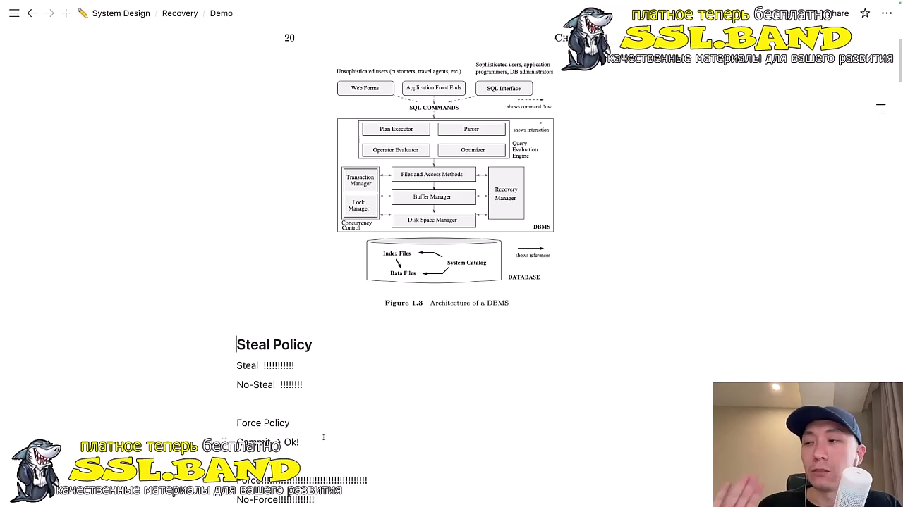
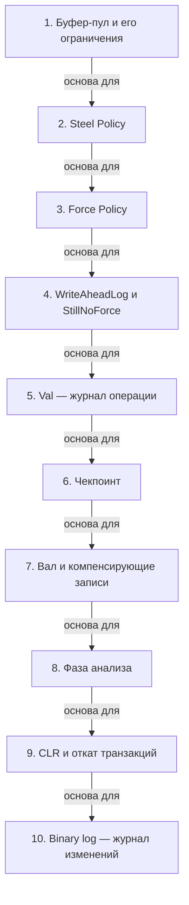

# Управление памятью и восстановление в DBMS

> [!abstract] Обзор
> Лекция по управлению памятью в базах данных, включая буфер-пул, политики Steel и Force, WriteAheadLog, чекпоинты, вал и алгоритмы восстановления. Объясняется, как система справляется с ограничениями памяти и обеспечивает надежность данных.

> [!info] Курс
> [[index|Оглавление курса]]

## Оглавление
1. [[#1. Буфер-пул и его ограничения]]
2. [[#2. Steel Policy]]
3. [[#3. Force Policy]]
4. [[#4. WriteAheadLog и StillNoForce]]
5. [[#5. Val — журнал операции]]
6. [[#6. Чекпоинт]]
7. [[#7. Вал и компенсирующие записи]]
8. [[#8. Фаза анализа]]
9. [[#9. CLR и откат транзакций]]
10. [[#10. Binary log — журнал изменений]]

**Схема** — [[#Схема]]
**Итог** — [[#Итог]]

## 1. Буфер-пул и его ограничения

Буфер-пул имеет физическое ограничение по объему памяти. При переполнении применяется политика Steel для записи грязных пейджей на диск, чтобы избежать потери данных.

> [!info] Зачем это нужно
> Ограничение памяти требует стратегии управления для сохранения целостности данных.

> [!quote]- Кадр [00:02:00]
> 

## 2. Steel Policy

Steel Policy применяется при переполнении буфер-пула. Она позволяет записывать грязные пейджи на диск, обеспечивая сохранность данных в критических ситуациях.

> [!info] Зачем это нужно
> Необходима для предотвращения потери данных при переполнении буфер-пула.

> [!quote]- Кадр [00:02:00]
> 

## 3. Force Policy

Force Policy гарантирует, что все изменения транзакции записаны на диск перед подтверждением. NoForcePolicy улучшает производительность, но снижает надежность.

> [!info] Зачем это нужно
> Обеспечивает надежность, но снижает производительность.

> [!quote]- Кадр [00:03:00]
> 

## 4. WriteAheadLog и StillNoForce

WriteAheadLog позволяет записывать изменения на диск с задержкой, что улучшает производительность. Это StillNoForce, так как изменения не записываются сразу, но сохраняются в буфере.

> [!info] Зачем это нужно
> Позволяет оптимизировать запись данных без потери целостности.

> [!quote]- Кадр [00:04:00]
> 

## 5. Val — журнал операции

Val — это журнал операций, используемый для восстановления данных. Write-ahead-log — его реализация, позволяющая откатывать транзакции в случае сбоя.

> [!info] Зачем это нужно
> Необходим для восстановления состояния системы после сбоя.

## 6. Чекпоинт

Чекпоинт используется для ротации журналов и предотвращения бесконечного роста файла. Он позволяет начать восстановление с последнего чекпоинта, сохраняя состояние системы.

> [!info] Зачем это нужно
> Позволяет управлять размером журнала и упрощает восстановление.

> [!quote]- Кадр [00:06:00]
> 

## 7. Вал и компенсирующие записи

Вал хранит историю изменений для восстановления. Компенсирующие записи позволяют откатывать изменения, возвращая систему к предыдущему состоянию.

> [!info] Зачем это нужно
> Необходим для отката транзакций и восстановления данных.

> [!quote]- Кадр [00:08:00]
> 

## 8. Фаза анализа

Фаза анализа читает лог и определяет, какие транзакции нужно откатить, какие страницы грязные и с какого LSN начинать восстановление. Это первый этап восстановления.

> [!info] Зачем это нужно
> Позволяет определить, какие изменения нужно откатить.

> [!quote]- Кадр [00:10:00]
> 

## 9. CLR и откат транзакций

CLR используется для отката незакомиченных транзакций после сбоя. Применяется обратная операция, например, undo T2 LSN 60, чтобы вернуть систему к состоянию до сбоя.

> [!info] Зачем это нужно
> Обеспечивает восстановление данных после сбоя.

## 10. Binary log — журнал изменений

Binary log используется для репликации и восстановления. Он содержит события, описывающие изменения в базе данных, и служит основой для репликации и отката.

> [!info] Зачем это нужно
> Необходим для репликации и восстановления данных.

## Схема

## Итог

> [!success] Что в итоге
> Буфер-пул и политики Steel/Force управляют памятью и предотвращают потери данных. WriteAheadLog и вал обеспечивают надежность и восстановление. Чекпоинт и фаза анализа позволяют восстанавливать состояние системы после сбоя. Все эти механизмы работают вместе для обеспечения целостности и надежности баз данных.

