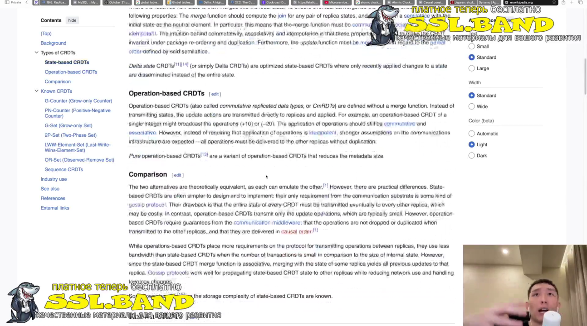
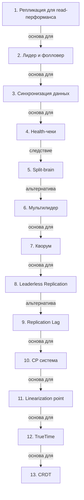

# Репликация и синхронизация в распределенных системах

> [!abstract] Обзор
> Лекция по репликации и синхронизации в распределенных системах. Основные темы: репликация для read-перформанса, лидер и фолловер, синхронизация данных, health-чеки, split-brain, мультилидер, chain репликация, кворум, leaderless replication, replication lag, CP системы, линия резабилити, linearization point, TrueTime, атомные часы и GPS, порядок событий, CRDT. Объясняется, как распределять нагрузку, избежать конфликтов и обеспечить консистентность.

> [!info] Курс
> [[index|Оглавление курса]]

## Оглавление
1. [[#1. Репликация для read-перформанса]]
2. [[#2. Лидер и фолловер]]
3. [[#3. Синхронизация данных]]
4. [[#4. Health-чеки]]
5. [[#5. Split-brain]]
6. [[#6. Мультилидер]]
7. [[#7. Кворум]]
8. [[#8. Leaderless Replication]]
9. [[#9. Replication Lag]]
10. [[#10. CP система]]
11. [[#11. Linearization point]]
12. [[#12. TrueTime]]
13. [[#13. CRDT]]

**Схема** — [[#Схема]]
**Итог** — [[#Итог]]

## 1. Репликация для read-перформанса

Репликация позволяет распределять read-нагрузку между нодами. Дублирование данных позволяет обрабатывать запросы на чтение на нескольких узлах, что повышает производительность.

> [!info] Зачем это нужно
> Повышает доступность и ускоряет чтение.

## 2. Лидер и фолловер

Лидер — нода, где происходят записи. Фолловер — нода, которая получает изменения от лидера. Лидер отвечает за согласованность, фолловеры — за репликацию.

> [!info] Зачем это нужно
> Позволяет разделить ответственность между узлами.

## 3. Синхронизация данных

Если запись подтверждается сразу, данные могут стать неконсистентными при чтении. Синхронизация обеспечивает согласованность, но требует времени.

> [!info] Зачем это нужно
> Обеспечивает целостность данных при распределенных операциях.

## 4. Health-чеки

Health-чеки определяют живые узлы. Частота чеков влияет на сеть: слишком часто — перегрузка, слишком редко — несвоевременное обнаружение сбоев.

> [!info] Зачем это нужно
> Позволяют быстро реагировать на отказы.

## 5. Split-brain

Split-brain — состояние, когда из-за разрыва сети возникают два лидера. Они независимо принимают записи, что приводит к расхождению данных.

> [!info] Зачем это нужно
> Приводит к потере согласованности.

## 6. Мультилидер

Мультилидер — топология, где в каждом регионе есть свой лидер. Возникают конфликты данных и дублирование, но используется в системах типа Global Table VWS.

> [!info] Зачем это нужно
> Позволяет масштабировать в географически распределенных системах.

## 7. Кворум

Кворум — это набор нод, которые могут обмениваться информацией через gossip. Обеспечивает согласованность и устойчивость к сбоям.

> [!info] Зачем это нужно
> Позволяет сохранять согласованность при частичных отказах.

## 8. Leaderless Replication

Leaderless Replication — подход, где запись и чтение распределяются между узлами без центрального лидера. Упрощает отказоустойчивость.

> [!info] Зачем это нужно
> Уменьшает зависимость от одного узла.

## 9. Replication Lag

Replication Lag — метрика, отражающая задержку между отправкой и получением данных. Нужно отслеживать для обеспечения согласованности.

> [!info] Зачем это нужно
> Позволяет оценить эффективность репликации.

## 10. CP система

CP система гарантирует консистентность, но не может обеспечить доступность при разрывах связи. Использует Partition Tolerance для сохранения согласованности.

> [!info] Зачем это нужно
> Позволяет сохранять целостность данных при сбоях.

## 11. Linearization point

Linearization point — момент, после которого значение переменной становится определённым. Это точка невозврата, после которой x становится фиксированным.

> [!info] Зачем это нужно
> Позволяет гарантировать согласованность в распределенных системах.

## 12. TrueTime

TrueTime использует GPS и атомные часы для точного определения времени. Позволяет синхронизировать события в распределенных системах.

> [!info] Зачем это нужно
> Позволяет точно отслеживать временные события.

## 13. CRDT

CRDT — специфичные структуры данных для коллаборативных приложений. Позволяют синхронизировать данные без центрального лидера.

> [!info] Зачем это нужно
> Позволяет работать с распределенными данными без потери согласованности.

> [!quote]- Кадр [00:37:02]
> 

## Схема

## Итог

> [!success] Что в итоге
> Репликация и синхронизация — ключевые аспекты распределенных систем. Репликация позволяет распределять нагрузку, а синхронизация — обеспечивать согласованность. CP системы гарантируют консистентность, но теряют доступность при сбоях. TrueTime и атомные часы позволяют точно отслеживать временные события. CRDT и порядок событий помогают синхронизировать данные без центрального лидера. Все эти концепции связаны и позволяют строить надежные и масштабируемые системы.

