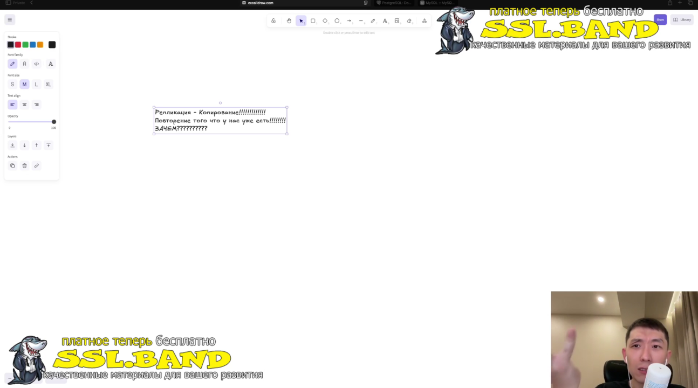
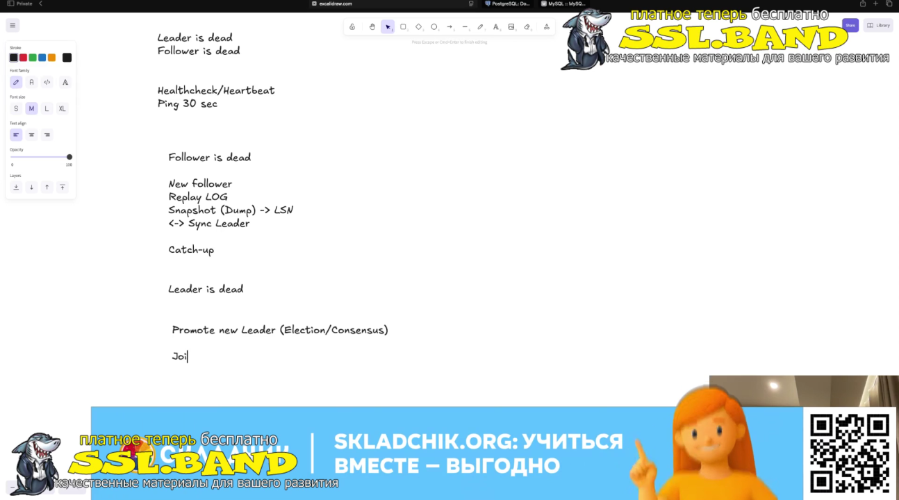
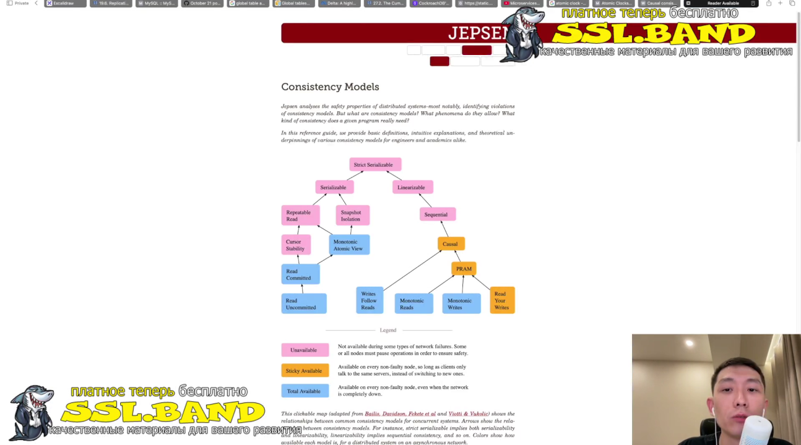
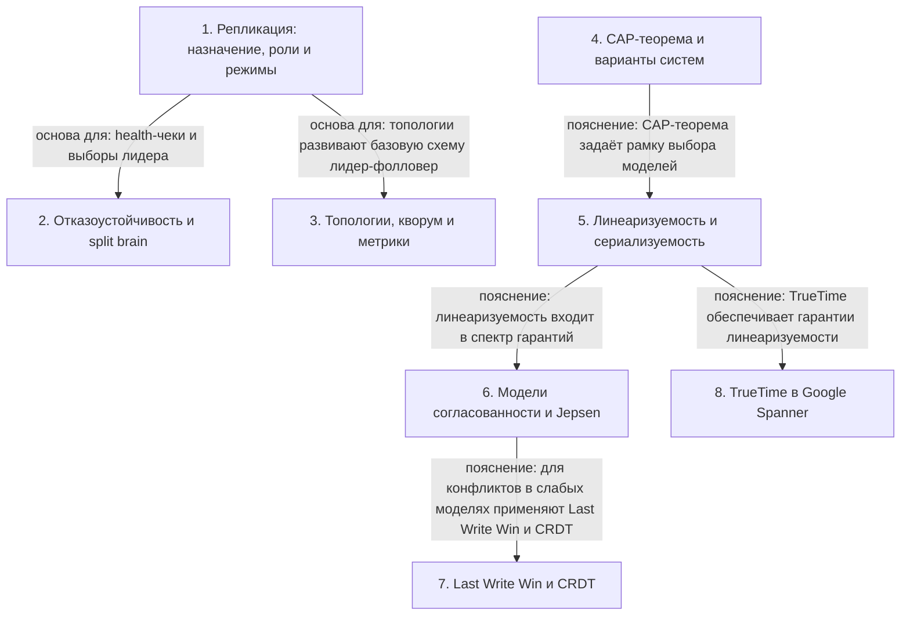

# Репликация в базах данных: топологии, отказоустойчивость и модели согласованности

> [!abstract] Обзор
> Материал о репликации в базах данных. Разбираются назначение репликации, роли лидера и фолловера, синхронный и асинхронный режимы, физическая и логическая репликация, проверки живости (health-чеки), снапшоты, выборы лидера, split brain, инцидент GitHub 2018, отстающая реплика, топологии, кворум и метрики replication latency и replication lag. Отдельно — CAP-теорема, варианты CA/CP/AP, линеаризуемость (Linearizability) и сериализуемость (Serializability), точка линеаризации (linearization point), спектр гарантий от согласованности в конечном счёте (Eventual Consistency) до Linearizability, read your own writes, Monotonic Read, причинная согласованность (causal consistency), порядок событий и векторы зависимостей. Также — иерархия моделей согласованности и Jepsen, Last Write Win, CRDT и TrueTime в Google Spanner.

> [!info] Курс
> [[index|Оглавление курса]]

## Оглавление
1. [[#1. Репликация: назначение, роли и режимы]]
2. [[#2. Отказоустойчивость и split brain]]
3. [[#3. Топологии, кворум и метрики]]
4. [[#4. CAP-теорема и варианты систем]]
5. [[#5. Линеаризуемость и сериализуемость]]
6. [[#6. Модели согласованности и Jepsen]]
7. [[#7. Last Write Win и CRDT]]
8. [[#8. TrueTime в Google Spanner]]

**Схема** — [[#Схема]]
**Итог** — [[#Итог]]

## 1. Репликация: назначение, роли и режимы

**Репликация** — это копирование, повторение того, что уже есть; она нужна для доступности (availability) и долговечности (durability), распределения нагрузки на чтение, масштабируемости (scalability) и улучшения задержки (latency) для пользователей. Ноду, в которую происходит запись, называют **лидер**, а другую — **фолловер** (термины slave/master не используются). При **синхронной** репликации изменения ждут «прорастания» во все ноды, и из-за этого страдает производительность; при **асинхронной** запись идёт в лидера, а в фолловера — асинхронно, из-за чего данные могут разъехаться или не дойти — это называют согласованностью в конечном счёте (eventual consistency). **Физическая** репликация копирует байты (пример — write-ahead log), а **логическая** — SQL-статементы. При передаче SQL-статементов встречаются недетерминированные запросы (`time now`, `random`), которые нужно аккуратно подставлять, иначе данные могут разъехаться.

| Тип репликации | Как идёт запись |
|---|---|
| Синхронная | Ждём «прорастания» во все ноды: и в лидера, и в фолловера |
| Асинхронная | Запись в лидера, в фолловера — асинхронно |

| Тип репликации | Что копируется |
|---|---|
| Физическая | Байты (пример — write-ahead log) |
| Логическая | SQL-статементы |

> [!info] Зачем это нужно
> Репликация нужна для доступности и долговечности.

*Источник: [00:00:00], [00:01:00], [00:02:00], [00:03:00], [00:04:00], [00:07:00]*

> [!quote]- Кадр [00:01:00]
> 

## 2. Отказоустойчивость и split brain

Чтобы определить, что лидер или фолловер «умер», используют проверки живости (health-чеки) или heartbeat-сигналы — например, пинг каждые 30 секунд; слишком частый пинг нагружает сеть, а слишком редкий не даёт понять, кто умер, а кто жив. Если лог слишком большой, чтобы проиграть его целиком (replay), можно взять снапшот или дамп, вытащить из него log sequence number, синхронизироваться с лидером и докачаться до нужного момента. При отказе лидера выбирается новый лидер из фолловеров с самым актуальным логом — через голосование и консенсус; примеры алгоритмов — raft и paxos. При сетевом разделении (network partition) можно ошибочно решить, что узел умер, и получить двух лидеров — это **split brain**. Оба пишут одни и те же log sequence number, записи под одним LSN разъезжаются, изменения одного из лидеров отбрасываются (дискардятся), и часть записей может быть потеряна. **GitHub лежал 24 часа** из-за задержек в системе: посчитали, что лидера нет, хотя лидер был жив, начали прогревать кэш, и записи на разных праймари разъехались.

*Источник: [00:08:00], [00:09:00], [00:10:00], [00:11:00], [00:12:00]*

> [!quote]- Кадр [00:11:00]
> 

## 3. Топологии, кворум и метрики

**Топология** — это то, как система выглядит на высоком уровне. Базовая топология — **лидер-фолловер (single-leader)**: запись идёт в одного лидера, а лидер пишет в реплики. В **мультилидер-топологии** в каждом регионе есть свой лидер со своими репликами; одинаковые данные могут приводить к конфликтам, которые нужно разрешать, а базы в регионах синхронизируются друг с другом. **Chain replication** похожа на связный список: запись идёт в первую ноду, затем каждая нода копирует данные на следующую по цепочке. **Leaderless** — топология с несколькими нодами и клиентом: ноды могут быть связаны и через gossip распространять изменения, чтобы достичь кворума. **Кворум** задаётся условием `W + R > N`, где `W` — число нод для записи, `R` — число нод для чтения. При `W + R > N` всегда найдётся хотя бы одна нода с последними изменениями. Увеличение `W` замедляет запись, но ускоряет чтение; увеличение `R` и уменьшение `W` ускоряет запись, но замедляет чтение, потому что нужно согласовать данные и найти актуальную версию. **Отстающая реплика (lagging replica)** — реплика, которая отстаёт от всех остальных и тянет за собой остальные. **Replication latency** показывает, сколько времени проходит с момента отправки записи до её появления на реплике, а **replication lag** — насколько отстают версии; при высокой latency lag, скорее всего, тоже будет расти.

*Источник: [00:13:00], [00:15:00], [00:16:00], [00:17:01], [00:19:01]*

## 4. CAP-теорема и варианты систем

**CAP-теорема** — аббревиатура для Consistency (согласованность), Availability (доступность) и Partition tolerance (устойчивость к разделению сети). Она утверждает, что нельзя выбрать все три свойства — нужно выбрать два из трёх. C — согласованность, A — доступность, P — устойчивость к разрывам. Система **CA** согласованна и доступна, а разделения сети остаются вне зоны её ответственности; под это подходит stateless-система, которая всегда выдаёт фиксированный ответ. Для **CP**-системы при разрыве между нодами она становится недоступной, но сохраняет согласованность. В **AP**-системах не критично, если узлы не могут синхронизироваться друг с другом; пример — комментарии или чат, где отличие или отсутствие сообщения неважно.

*Источник: [00:21:01], [00:22:01], [00:23:01], [00:24:01]*

## 5. Линеаризуемость и сериализуемость

**Линеаризуемость (Linearizability)** гораздо строже, чем **сериализуемость (Serializability)**: недостаточно, чтобы результат был либо 1, либо 2. CockroachDB предлагает уровень согласованности строже, чем сериализуемость, но слабее, чем линеаризуемость. Достичь линеаризуемости очень сложно. Событие считается произошедшим, если оно укладывается во временной интервал между своим началом и концом. **Точка линеаризации (linearization point)** — это точка невозврата, после которой значение стало равно 1; если запрос сделан точно после неё, результат виден точно.

| Модель | Отношение по строгости |
|---|---|
| Сериализуемость (Serializability) | слабее линеаризуемости |
| Линеаризуемость (Linearizability) | строже сериализуемости |
| CockroachDB | строже сериализуемости, слабее линеаризуемости |

*Источник: [00:25:01], [00:26:01]*

## 6. Модели согласованности и Jepsen

На одном конце спектра находится **согласованность в конечном счёте (Eventual Consistency)**, на другом — **линеаризуемость**, а между ними хочется получить какие-то гарантии посередине. При асинхронной репликации чтение должно направляться (роутиться) на ту же ноду, где была произведена запись; отсюда требование **read your own writes** («читай собственные записи»). **Monotonic Read** («монотонное чтение»): прочитав версию 3, нельзя позже увидеть версию 2; прочитав версию 2, можно увидеть версию 2 или 3, но нельзя увидеть версию 1. **Причинная согласованность (causal consistency)** — когда одно событие зависит от другого; для неё обеспечиваются read your own writes, monotonic read, write follow reads и monotonic write. Порядок событий критически важен: события связаны друг с другом, из одного следует другое, их нельзя перемешивать. При неправильном порядке меняется смысл, и чтобы восстановить нужное событие, приходится восстанавливать всю цепочку по порядку зависимостей — для этого можно использовать **векторы зависимостей (dependency vectors)**. Аналогия с TCP: пакеты, пришедшие не по порядку, буферизируются, и зависимость восстанавливается (например, четвёртый пакет зависит от третьего и второго). Модели согласованности (consistency models) можно упорядочить по строгости: одна модель зависит от другой и может быть строже. **Jepsen** анализирует safety-свойства распределённых систем, выявляет нарушения моделей согласованности и проверяет, действительно ли системы выполняют заявленные гарантии.

*Источник: [00:30:01], [00:31:01], [00:32:01], [00:33:01], [00:35:02]*

> [!quote]- Кадр [00:35:02]
> 

## 7. Last Write Win и CRDT

**Last Write Win** — подход, при котором побеждает последняя запись; применяется, например, в Apache Cassandra. **CRDT (Conflict-Free Replicated Data Type)** — тип данных, который умеет сливаться и объединяться; слияние CRDT может быть основано на состоянии или на операциях. CRDT — это специфичные структуры данных для коллаборативных приложений; используются в Google Docs и других сервисах. Apple применяет CRDT для синхронизации оффлайн-правок между устройствами.

*Источник: [00:36:02]*

## 8. TrueTime в Google Spanner

Google Spanner использует **TrueTime**, основанный на GPS и атомных часах. В дата-центрах Spanner стоят GPS-приёмники и атомные часы, которые компенсируют дрейф друг друга; это позволяет точно знать время события. TrueTime используется для обеспечения гарантий линеаризуемости.

> [!info] Зачем это нужно
> TrueTime необходим для обеспечения гарантий линеаризуемости.

*Источник: [00:28:01], [00:29:01]*

## Схема

## Итог

> [!success] Что в итоге
> Репликация копирует данные между нодами ради доступности, долговечности, производительности чтения, масштабируемости и задержки. Выбор режима и топологии определяет компромисс между скоростью и согласованностью, а health-чеки, снапшоты и выборы лидера поддерживают отказоустойчивость. CAP-теорема задаёт выбор двух из трёх свойств и определяет CA-, CP- и AP-системы, а между согласованностью в конечном счёте и линеаризуемостью лежит спектр гарантий. Для конфликтов применяют Last Write Win и CRDT, а TrueTime в Google Spanner обеспечивает гарантии линеаризуемости.
