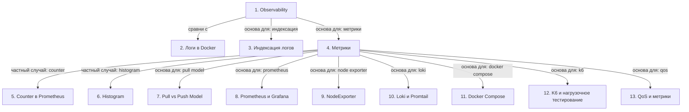

# Observability и инструменты мониторинга

> [!abstract] Обзор
> Лекция по Observability, логам, метрикам и инструментам мониторинга. Основные понятия: логи, метрики, customer feedback, инструменты сбора данных, инфраструктурные метрики, архитектура Prometheus и Loki, тестирование нагрузкой.

> [!info] Курс
> [[index|Оглавление курса]]

## Оглавление
1. [[#1. Observability]]
2. [[#2. Логи в Docker]]
3. [[#3. Индексация логов]]
4. [[#4. Метрики]]
5. [[#5. Counter в Prometheus]]
6. [[#6. Histogram]]
7. [[#7. Pull vs Push Model]]
8. [[#8. Prometheus и Grafana]]
9. [[#9. NodeExporter]]
10. [[#10. Loki и Promtail]]
11. [[#11. Docker Compose]]
12. [[#12. K6 и нагрузочное тестирование]]
13. [[#13. QoS и метрики]]

**Схема** — [[#Схема]]
**Итог** — [[#Итог]]

## 1. Observability

Observability — способ понимать, как работает приложение. Основные компоненты: логи, метрики и обратная связь от пользователей.

> [!info] Зачем это нужно
> Для диагностики и оптимизации производительности.

## 2. Логи в Docker

Логи в Docker-контейнерах выводятся в stdout. Для надежности логи должны сохраняться в файлы или отправляться в централизованные системы.

> [!info] Зачем это нужно
> Для сохранения информации о сбоях.

## 3. Индексация логов

Логи индексируются Observability Tool для удобного поиска по request ID, времени и содержимому.

> [!info] Зачем это нужно
> Для ускорения анализа и диагностики.

## 4. Метрики

Метрики — это статистика приложения. Они отслеживают CPU, запросы в секунду, ошибки и другие показатели.

> [!info] Зачем это нужно
> Для мониторинга и оптимизации.

## 5. Counter в Prometheus

Counter — метрика, которая всегда растёт. Используется для отслеживания количества событий, таких как запросы или ошибки.

> [!info] Зачем это нужно
> Для отслеживания роста событий.

## 6. Histogram

Histogram — метрика, которая разбивает значения на бакеты. Используется для анализа latency и распределения значений.

> [!info] Зачем это нужно
> Для точного анализа распределения данных.

## 7. Pull vs Push Model

Pull Model — когда Prometheus собирает метрики из сервисов. Push Model — когда сервисы отправляют метрики в Observability Tool.

> [!info] Зачем это нужно
> Для выбора подхода к сбору метрик.

## 8. Prometheus и Grafana

Prometheus собирает метрики, а Grafana отображает их в дашбордах. Это основная архитектура для мониторинга.

> [!info] Зачем это нужно
> Для визуализации и анализа данных.

## 9. NodeExporter

NodeExporter собирает метрики инфраструктуры: CPU, RAM, дисковое пространство. Это инструмент для мониторинга серверов.

> [!info] Зачем это нужно
> Для отслеживания состояния серверов.

## 10. Loki и Promtail

Loki — сервис для агрегации логов, аналогичный Prometheus для метрик. Promtail — агент, который отправляет логи в Loki.

> [!info] Зачем это нужно
> Для централизованного хранения и анализа логов.

## 11. Docker Compose

Docker Compose описывает сервисы: NodeService, Prometheus, Loki, Grafana, Node Exporter и Cadvisor. Это позволяет запускать мониторинг в контейнерах.

> [!info] Зачем это нужно
> Для быстрого запуска мониторинга.

## 12. K6 и нагрузочное тестирование

K6 используется для нагрузочного тестирования. Он позволяет симулировать параллельные запросы и проверять производительность системы.

> [!info] Зачем это нужно
> Для проверки устойчивости и производительности.

## 13. QoS и метрики

QoS — процент успешных запросов к неуспешным. Он помогает оценить качество обслуживания.

> [!info] Зачем это нужно
> Для анализа качества работы сервиса.

## Схема

## Итог

> [!success] Что в итоге
> Observability — ключевой инструмент для понимания работы приложения. Он включает логи, метрики и обратную связь. Инструменты вроде Prometheus, Loki и Grafana позволяют собирать, анализировать и визуализировать данные. Для мониторинга используются контейнеры и сервисы, а нагрузочное тестирование помогает проверить устойчивость системы.

