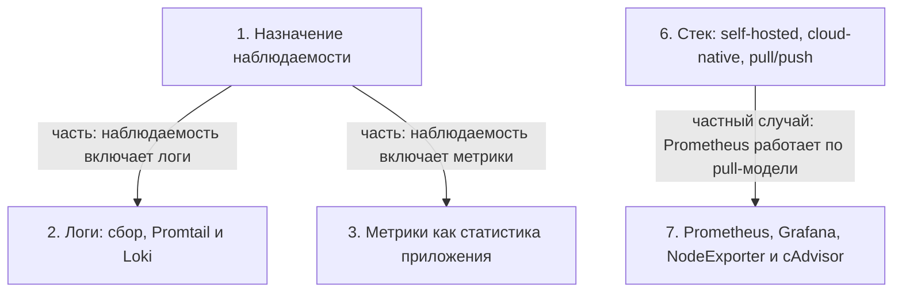

# Наблюдаемость на практике: логи, метрики и стек

> [!abstract] Обзор
> Материал о наблюдаемости на практике — о том, как понимать, работает ли приложение, и где именно его отлаживать (траблшутить); наблюдаемость состоит из логов, метрик и обратной связи от клиентов (customer feedback). Логи собирают в одном месте и отправляют (репортят) в инструмент наблюдаемости с языком запросов; на практике Node API пишет в stdout, Promtail читает файл и направляет логи в Loki. Метрики как статистика приложения рассматриваются через типы counter, gauge и histogram; для задержки (latency) используют персентили, а Summary ограничен в распределённых системах, где предпочитают гистограммы. Описан стек self-hosted Prometheus/Grafana против cloud-native, pull- и push-модели сбора, а также Prometheus, Grafana, NodeExporter и cAdvisor. Практическая часть включает POC с Node.js API, метод `call` с партнёрами и QoS, нагрузочный тест k6, дашборды Grafana и скрипт запуска стека, а также метрики App Insights и их анализ через count, Kusto и ограничения Azure portal.

> [!info] Курс
> [[index|Оглавление курса]]

## Оглавление
1. [[#1. Назначение наблюдаемости]]
2. [[#2. Логи: сбор, Promtail и Loki]]
3. [[#3. Метрики как статистика приложения]]
4. [[#4. Гистограмма и персентили задержки]]
5. [[#5. Summary и распределённое окружение]]
6. [[#6. Стек: self-hosted, cloud-native, pull/push]]
7. [[#7. Prometheus, Grafana, NodeExporter и cAdvisor]]
8. [[#8. Метод call, QoS и отправка метрик]]
9. [[#9. Нагрузочный тест k6]]
10. [[#10. Grafana: дашборды и запуск стека]]

**Схема** — [[#Схема]]
**Итог** — [[#Итог]]

## 1. Назначение наблюдаемости

Наблюдаемость помогает понимать, работает ли приложение. Если приложение не работает, наблюдаемость помогает понять, где именно, и починить или отладить. Наблюдаемость состоит из логов, метрик и обратной связи от клиентов (customer feedback).

*Источник: [00:00:15]*

## 2. Логи: сбор, Promtail и Loki

Балансировщик (load balancer) посылает запросы на случайную машину, поэтому логи со всех машин отправляются (пушатся) в одно место — чтобы они не пропадали при падении машины и их было проще искать. Логи отправляются в формате JSON в инструмент наблюдаемости, который индексирует все поля; через язык запросов (kusto, promql) можно запросить конкретный лог по request ID, времени и лог-строке вместо поиска по миллионам строк. Node API может писать логи через `console.log` в stdout; в Docker stdout записывается в файл внутри контейнера, и его читает **Promtail** — отдельный контейнер и агент для логов, который ничего не экспонирует наружу, читает лог-файлы из volume и направляет их в **Loki**. Loki агрегирует логи, а Prometheus — метрики; каждое «испускание» метрики (emit) — отдельная лог-строка, а персентили можно посчитать через Loki. В `promtail-config.yml` клиент отправляет логи в Loki по адресу `http://loki:3100/loki/api/v1/push`; `scrape_config` `node-service` собирает JSON-логи Docker-контейнеров, а `pipeline_stages` извлекает `output`, `stream` и `timestamp` и добавляет метку `container: node-service`. Подстановка container ID через скрипт — плохой подход; вместо этого используются метки (labels), а логи обычно агрегируются поминутно.

| Prometheus | Loki |
|---|---|
| агрегирует метрики | агрегирует логи |

> [!info] Зачем это нужно
> Цель сбора логов в одном месте — чтобы они не пропадали при падении машины.

*Источник: [00:00:46], [00:01:17], [00:10:44], [00:11:14], [00:18:41], [00:18:44], …*

## 3. Метрики как статистика приложения

Метрики — это статистика приложения; они могут отправлять всё, что вы скажете: от запросов в секунду до загрузки CPU в конкретных регионах. Для WebSocket-сервера можно отслеживать число активных подключений. **Counter** — метрика, которая всегда растёт и никогда не идёт вниз; система берёт количество новых запросов за минуту и делит на 60, получая приблизительное число запросов в секунду (request per second). **Gauge** хорошо подходит для значений, которые могут расти и падать, и может отслеживать, сколько активных партнёров есть сейчас. С помощью Prometheus SDK можно определять метрики — например, counter для `http_requests_total` и counter для ошибок приложения; SDK умеет собирать метрики и логи одновременно в Azure App Insights. Метрику можно заинкрементировать с нужными измерениями (dimension): измерение метрики — это по сути label в Prometheus. Instrumentation Key можно взять из ресурса App Insights, а в App Insights выбрать Metrics Namespace, кастомный namespace и свои метрики (например, «Azure requests per second») с разбивкой по измерению (например, по endpoint или статус-коду). У каждой метрики есть значение (value), и оно инкрементится. В Azure average совпадает с Prometheus; в k6 при анализе метрик average не работает — нужно использовать count. Kusto — декларативный язык на основе SQL, похожий на SQL: он позволяет посчитать персентиль и посчитать отдельно. Функционал Azure portal по метрикам слабее, чем у Grafana.

> [!info] Зачем это нужно
> Инструмент наблюдаемости не даёт понимания работы приложения во всех регионах и деплойментах, поэтому нужны метрики.

*Источник: [00:01:47], [00:03:14], [00:03:45], [00:04:02], [00:13:23], [00:16:07], …*

## 4. Гистограмма и персентили задержки

**Гистограмма (histogram)** работает с числовой прямой от нуля до максимума, которую можно поделить на бакеты (buckets); границы бакетов выбираются самостоятельно, и в каждый бакет ставится счётчик (counter), считающий, сколько значений в него попало. Для метрики `request duration` используется гистограмма с заданными бакетами (например, 1, 10, 100, 500, 1000, 2000, 5000, 10000 — в миллисекундах); чем больше и мельче диапазоны, тем точнее рассчитываются персентили. **Квантили** (например, 95-й персентиль, 99-й или медиана) помогают считать задержку. Среднее (average) обычно будет неправильным: один запрос может занимать 30 секунд, другой — пару миллисекунд, а в среднем выйдет 15 секунд. Задержку P95 или P99 сравнивают со средним, чтобы посмотреть, какая будет разница. Для большинства запросов важно знать задержку, поэтому интересны персентили; гистограмма помогает их вычислить, а если требуемая задержка, например 500 мс, можно настроить бакеты и с их помощью проверить SLA.

*Источник: [00:04:47], [00:05:15], [00:05:45], [00:15:08]*

## 5. Summary и распределённое окружение

**Summary** тоже умеет считать P99/P95, но даёт точное число, тогда как гистограммы — приближение (approximation). Summary сильно не рекомендуют: он работает только на стороне клиента (client-side), то есть нормально считает только внутри клиента. Summary не посчитает персентили между машинами, поэтому его обычно не рекомендуют в сильно распределённых системах (high distributed systems). В распределённом окружении используются **гистограммы**, так как у них задано одинаковое количество бакетов. Гистограммы со всех машин можно отправить в систему наблюдаемости и посчитать общую гистограмму или P99 одновременно со всех машин; это позволяет агрегировать задержку по региону, гео или подмножеству машин.

| Инструмент | Точность | Особенность |
|---|---|---|
| Summary | Точное число | Работает только на клиенте, не агрегируется между машинами |
| Histogram | Приближение | Задано одинаковое количество бакетов, используется в распределённом окружении |

*Источник: [00:06:15], [00:06:45], [00:07:15]*

## 6. Стек: self-hosted, cloud-native, pull/push

**Self-hosted Prometheus Grafana Stack** — это стек, который можно поднять самостоятельно; обычно такой подход не рекомендуется, потому что потратите много времени. **Cloud-native** подход — это использование сервисов вроде CloudWatch или Azure App Insights; в этом случае не нужно самостоятельно управлять (менеджить) стеком и заботиться о масштабировании. Для сбора обычных метрик наблюдаемости нужно поднять много компонентов, хотя бизнес-сервис всего один — Node API; это выглядит громоздко (cumbersome) и не очень просто. В **pull-модели** кто-то другой забирает метрики, которые сгенерировал инстанс. В **push-модели** обычно работает cloud-native подход: Node API сама отправляет метрики в инструмент наблюдаемости, например в CloudWatch или App Insights.

| Подход | Что это | Особенности |
|---|---|---|
| Self-hosted Prometheus Grafana Stack | Стек, который можно поднять самостоятельно | Не рекомендуется, потратите много времени |
| Cloud-native | Использование CloudWatch или Azure App Insights | Не нужно самостоятельно управлять стеком и заботиться о масштабировании |

| Модель | Кто отправляет | Пример |
|---|---|---|
| Pull | Кто-то другой забирает метрики, которые сгенерировал инстанс | Prometheus |
| Push | Node API сама отправляет метрики в инструмент наблюдаемости | CloudWatch, App Insights |

*Источник: [00:02:18], [00:08:37], [00:11:44]*

## 7. Prometheus, Grafana, NodeExporter и cAdvisor

Prometheus ходит в разные сервисы и собирает оттуда метрики; он агрегирует метрики и не работает с логами. Grafana — это UI-обёртка, которая даёт смотреть метрики; Grafana не хранит метрики и строит только дашборды — за метриками она ходит в Prometheus. **NodeExporter** — это контейнер на машине, который экспонирует endpoint с метриками инфраструктуры: загрузку CPU, использование RAM. **cAdvisor** — это сервис в Docker Compose, который собирает инфраструктурные показатели не из виртуалки или сервера, а по каждому контейнеру; обычно на каждый контейнер или под разделяются инфраструктурные лимиты. В примере-POC системного дизайна есть Node.js API: сервис на 3000-м порту, помимо бизнес-endpoints, экспонирует endpoint с маршрутом `/metrics`, куда ходит Prometheus.

*Источник: [00:07:39], [00:08:07], [00:09:11], [00:09:41], [00:10:11]*

## 8. Метод call, QoS и отправка метрик

Метод `call` принимает query-параметр `partner` (например, `partner1`) и query-параметр `error`; метод `call` — это endpoint. Вводится глобальная мапа (map), которая сопоставляет `partner` с числом запросов; каждый раз при добавлении уникального партнёра он добавляется в мапу, и мапа становится больше. Endpoint убирает партнёра из мапы; чтобы увидеть изменения на дашборде, партнёра убирают из мапы (хедж-сета или словаря). Для отображения изменений на дашборде есть **Active Partner Gauge**. **Quality of Service (QoS)** — процент успешных запросов к неуспешным; при `error=true` QoS должен упасть. В блоке `finally` выполняется отправка метрик в Azure Request, Prometheus и метрики задержки, при этом Prometheus забирает метрики, которые мы наагрегировали в Node API.

*Источник: [00:13:59], [00:14:26], [00:14:46], [00:14:51], [00:16:53], [00:20:52], …*

## 9. Нагрузочный тест k6

В нагрузочный тест добавляют задержку (delay) до двух секунд, чтобы задержка не была всегда микросекундной из-за локального запуска; нагрузочный тест (лоу-тест) делает максимум 100 параллельных запросов в секунду. В k6 нагрузочный тест задаётся через `export const options` со сценарием `quick_test`: executor `constant-arrival-rate` со `rate: 50` за `timeUnit: '1s'` в течение `duration: '10s'`. **VU (virtual user)** — количество параллельных запросов; задаются `preAllocatedVUs: 5` и `maxVUs: 20`. При 100 параллельных запросах загрузка CPU контейнера поднялась до 11%. Уникальный `partnerId` генерируется как `test_${__VU}_${__ITER}_${Date.now()}_${randomString(4)}`. Тест k6 можно запустить напрямую — `k6 run load-test.js` или `k6 run quick-load-test.js`.

```javascript
import http from 'k6/http';
import { check } from 'k6';
import { randomString } from 'https://jslib.k6.io/k6-utils/1.2.0/index.js';

// Быстрая конфигурация теста — всего 10 секунд
export const options = {
  scenarios: {
    quick_test: {
      executor: 'constant-arrival-rate',
      rate: 50, // 50 запросов в секунду
      timeUnit: '1s',
      duration: '10s', // длительность всего 10 секунд
      preAllocatedVUs: 5,
      maxVUs: 20,
    },
  },
};

const BASE_URL = 'http://localhost:3000';

export default function () {
  // генерируем уникальное имя партнёра
  const partnerId = `test_${__VU}_${__ITER}_${Date.now()}_${randomString(4)}`;
}

// запуск:
// ./run-full-load-test
// k6 run load-test.js
// k6 run quick-load-test.js
```

*Источник: [00:12:19], [00:12:22], [00:13:00], [00:13:23], [00:14:38], [00:17:24], …*

## 10. Grafana: дашборды и запуск стека

Дашборды можно генерировать в исходном коде или делать вручную в UI, а также можно сделать так, чтобы Grafana автоматически подтягивала дашборд. Дашборд Grafana задаётся JSON-файлом с полями `id`, `title`, `tags`, `timezone` и `panels`; панель типа `timeseries` содержит `targets` с `expr`, `legendFormat` и `refId`. На странице входа указываются Email or username и Password, после чего нажимается Log in; доступна ссылка Forgot your password?. Скрипт `Start-ObservabilityStack.ps1` останавливает Docker-контейнеры, пересобирает и запускает стек наблюдаемости через `docker compose up --build -d`. После запуска скрипт ждёт 10 секунд, пока контейнеры поднимутся, и обновляет конфигурацию Promtail текущим container ID, запуская `Update-PromtailConfig.ps1`; скрипт выводит URL сервисов Grafana, Prometheus, Loki и Node Exporter, а также команду для проверки.

```json
{
  "id": null,
  "title": "Simple Observability Dashboard",
  "tags": ["nodejs", "prometheus"],
  "timezone": "browser",
  "panels": [
    {
      "id": 1,
      "title": "Total Requests (1m)",
      "type": "timeseries",
      "targets": [
        {
          "expr": "sum by(route)(rate(http_requests_total[1m])) * 60",
          "legendFormat": "{{route}}",
          "refId": "A"
        }
      ]
    }
  ]
}
```

*Источник: [00:18:16], [00:18:18], [00:19:11], [00:20:20], [00:20:38], [00:21:27]*

## Схема



## Итог

> [!success] Что в итоге
> Наблюдаемость помогает понимать, работает ли приложение, и состоит из логов, метрик и обратной связи от клиентов. Логи собирают в одном месте и отправляют в инструмент наблюдаемости; на практике их ведут через stdout, Promtail и Loki, а метрики — через counter, gauge и histogram. Для задержки используют персентили, при этом Summary ограничен в распределённых системах, где предпочитают гистограммы; Prometheus собирает и агрегирует метрики, Grafana служит UI-обёрткой, а NodeExporter и cAdvisor экспонируют инфраструктурные метрики. Нагрузочный тест k6 и метрики App Insights дополняют практику, а для анализа используются count вместо average в k6, Kusto — для персентилей, а Grafana — как более функциональная альтернатива Azure portal.
