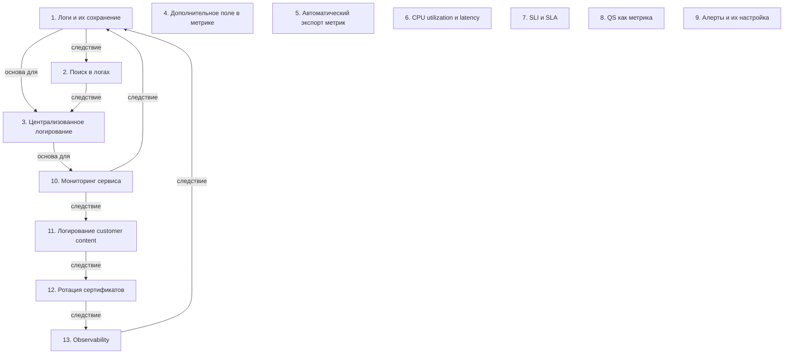

# Observability и системный дизайн

> [!abstract] Обзор
> Лекция по observability и системному дизайну. Основные темы: логирование, централизованное логирование, метрики, алерты, мониторинг, безопасность, тестирование и релизы. Объясняется, как observability помогает понять, почему приложение не работает, и как это связано с безопасностью и масштабируемостью.

> [!info] Курс
> [[index|Оглавление курса]]

## Оглавление
1. [[#1. Логи и их сохранение]]
2. [[#2. Поиск в логах]]
3. [[#3. Централизованное логирование]]
4. [[#4. Дополнительное поле в метрике]]
5. [[#5. Автоматический экспорт метрик]]
6. [[#6. CPU utilization и latency]]
7. [[#7. SLI и SLA]]
8. [[#8. QS как метрика]]
9. [[#9. Алерты и их настройка]]
10. [[#10. Мониторинг сервиса]]
11. [[#11. Логирование customer content]]
12. [[#12. Ротация сертификатов]]
13. [[#13. Observability]]

**Схема** — [[#Схема]]
**Итог** — [[#Итог]]

## 1. Логи и их сохранение

Логи выводятся в stdout и могут не сохраняться, если не настроены. При падении аппки логи теряются. Сохранение логов как файл приводит к проблеме хранения и поиска.

> [!info] Зачем это нужно
> Необходимо сохранять логи для анализа ошибок и отладки.

## 2. Поиск в логах

Поиск в логах сложен из-за распределённого хранения и необходимости искать конкретные запросы или сообщения.

> [!info] Зачем это нужно
> Необходимо упростить поиск для быстрого анализа.

## 3. Централизованное логирование

Каждая подсистема сливает логи в централизованную систему, которая используется для наблюдаемости. Это позволяет собирать и анализировать данные в одном месте.

> [!info] Зачем это нужно
> Централизация упрощает анализ и мониторинг.

## 4. Дополнительное поле в метрике

Метрика может иметь дополнительное поле, по которому можно искать, агрегировать или суммировать данные. Это позволяет уточнять анализ.

> [!info] Зачем это нужно
> Дополнительные поля помогают в детализации анализа.

## 5. Автоматический экспорт метрик

Некоторые метрики экспортируются автоматически в инструменты observability, без ручного ввода. Это упрощает сбор данных.

> [!info] Зачем это нужно
> Автоматизация ускоряет сбор и анализ метрик.

## 6. CPU utilization и latency

Если CPU превышает 70%, это может указывать на необходимость скейлинга или оптимизации. Повышение CPU может привести к росту latency.

> [!info] Зачем это нужно
> Мониторинг CPU помогает предотвратить задержки.

## 7. SLI и SLA

SLI — это статистика критической функциональности приложения. SLA DynamoDB — пример SLI. SLI используется для оценки качества сервиса.

> [!info] Зачем это нужно
> SLI и SLA помогают оценить надежность сервиса.

## 8. QS как метрика

QS — это метрика, которая считает запросы с кодом 200 и процент успешных запросов. Используется для анализа производительности.

> [!info] Зачем это нужно
> QS помогает оценить качество запросов.

## 9. Алерты и их настройка

Алерты могут быть настроены пользователем и отправляться через SMS, e-mail, звонки, мессенджеры и другие каналы. Это позволяет оперативно реагировать на проблемы.

> [!info] Зачем это нужно
> Алерты помогают быстро реагировать на критические события.

## 10. Мониторинг сервиса

Мониторинг сервиса включает в себя готовность к оперативному реагированию на проблемы. Это основа для наблюдаемости.

> [!info] Зачем это нужно
> Мониторинг позволяет быстро реагировать на сбои.

## 11. Логирование customer content

Логирование customer content включает данные пользователей, но не рекомендуется из-за риска утечки информации. Логирование используется для корреляции действий.

> [!info] Зачем это нужно
> Логирование помогает анализировать поведение пользователей, но требует защиты конфиденциальности.

## 12. Ротация сертификатов

Регулярная ротация сертификатов снижает риски утечки и уменьшает dev cost. Сертификаты нельзя использовать долго.

> [!info] Зачем это нужно
> Ротация уменьшает риски безопасности.

## 13. Observability

Observability — это способ понять, работает ли приложение и почему. Логи, метрики и алерты — основные компоненты. Observability необходима для приложений, которые приносят деньги.

> [!info] Зачем это нужно
> Observability позволяет быстро определить причины критических инцидентов.

## Схема

## Итог

> [!success] Что в итоге
> Observability — это ключевой элемент системного дизайна, позволяющий понять, почему приложение не работает. Логирование, метрики, алерты и мониторинг — основные инструменты. Важно учитывать безопасность, ротацию сертификатов и минимизацию хранения данных. Все эти элементы связаны и позволяют быстро реагировать на проблемы и улучшать качество сервиса.

