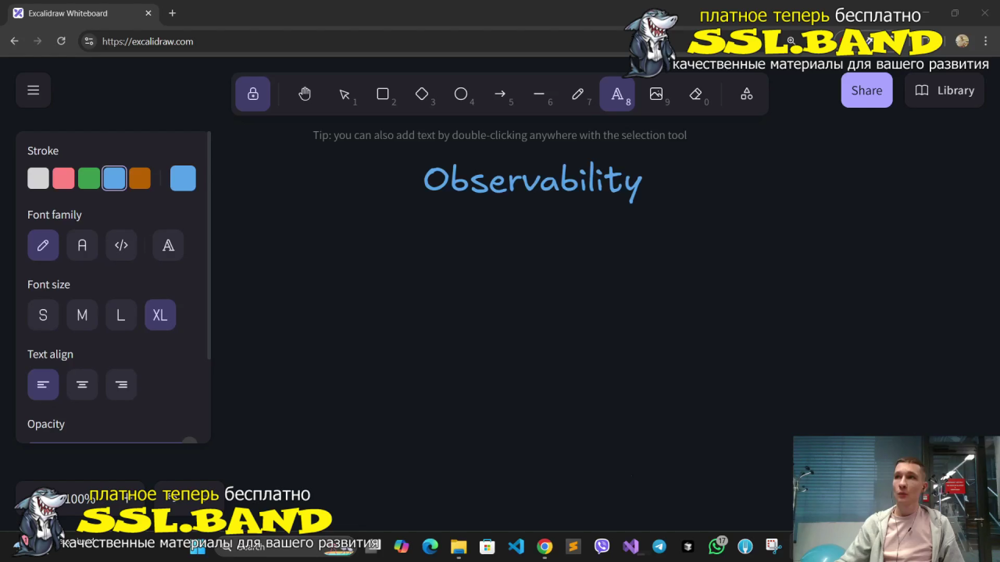
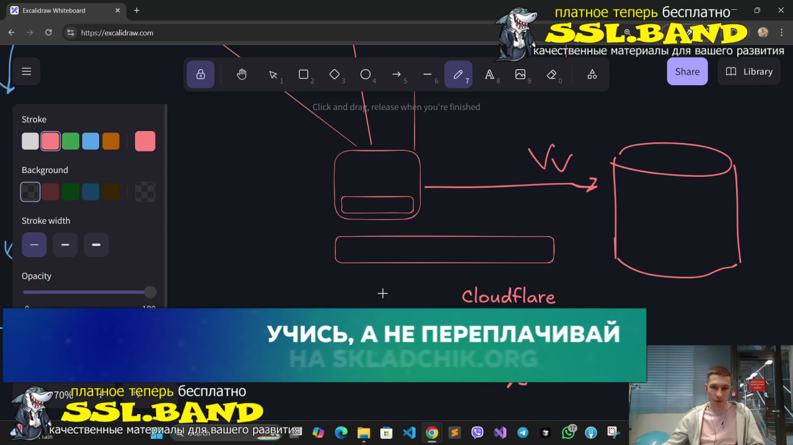
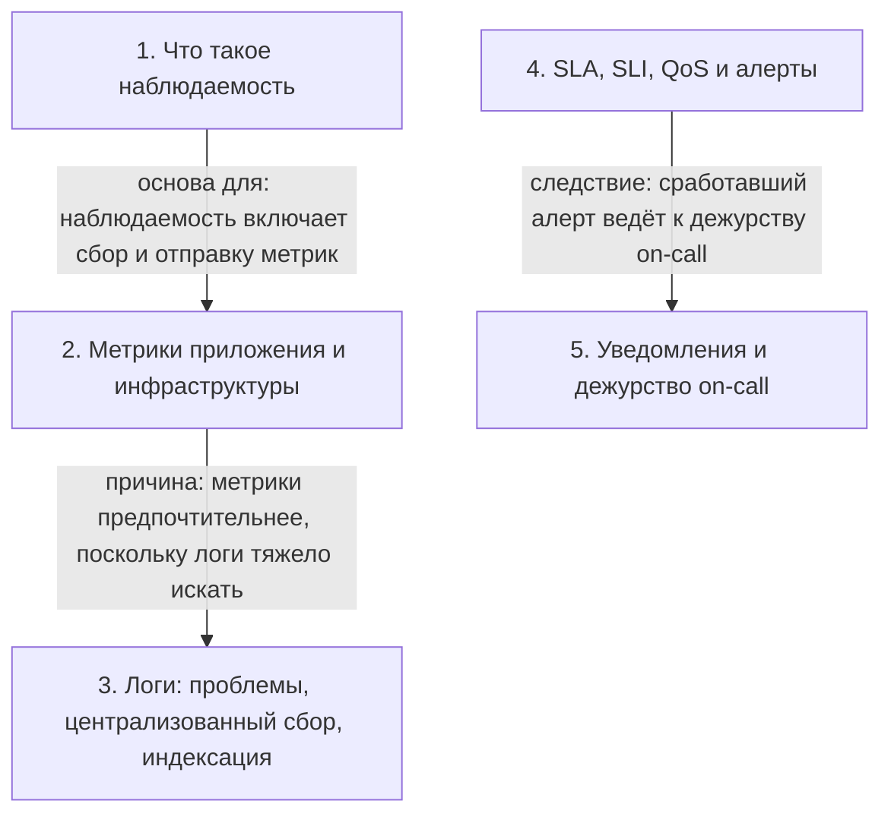

# Наблюдаемость (observability): метрики, логи, SLA и безопасность

> [!abstract] Обзор
> Материал о наблюдаемости (observability): что это и зачем нужно, чтобы понимать, работает ли приложение. Рассматриваются метрики как статистика приложения, метрика и её измерение (dimension), сбор через middleware и метрики задержки (latency), отличие метрик от логов, проблемы логов (вывод в stdout и поиск), централизованный сбор, инструмент наблюдаемости и индексация. Отдельно — недостатки логов при высокой нагрузке, инфраструктурные метрики и алерт на CPU, сезонность нагрузки и перелив трафика. Второй блок про SLA, SLI и компромисс, порог ошибок и компенсации, метрику качества обслуживания (QoS) с алертами, дежурство on-call, работу с партнёрами и обратную связь (feedback loop). Также — безопасность (защита данных в логах, срок хранения (retention) и комплаенс, наименьшие привилегии, OAuth 2/PKCE, access token, TLS/MTLS и ротация, ограничение частоты запросов) и надёжность выката (pre-production окружения, background worker и поэтапный выкат ring-based rollout).

> [!info] Курс
> [[index|Оглавление курса]]

## Оглавление
1. [[#1. Что такое наблюдаемость]]
2. [[#2. Метрики приложения и инфраструктуры]]
3. [[#3. Логи: проблемы, централизованный сбор, индексация]]
4. [[#4. SLA, SLI, QoS и алерты]]
5. [[#5. Уведомления и дежурство on-call]]
6. [[#6. Обратная связь и feedback loop]]
7. [[#7. Работа с партнёрами: мониторинг и лимиты]]
8. [[#8. Защита данных в логах, retention и комплаенс]]
9. [[#9. Принцип наименьших привилегий]]
10. [[#10. OAuth 2, PKCE, access token, TLS/MTLS и ротация]]
11. [[#11. Ограничение частоты запросов: уровни защиты]]
12. [[#12. Выкат: pre-production, background worker и ring-based rollout]]

**Схема** — [[#Схема]]
**Итог** — [[#Итог]]

## 1. Что такое наблюдаемость

**Наблюдаемость (observability)** — это то, что позволяет понять, работает ваше приложение или нет. Если приложение приносит деньги, без наблюдаемости не обойтись: иначе можно потерять критический функционал. Администратор может искать логи по запросу в системе наблюдаемости. Каждый pod отправляет свои логи в систему наблюдаемости. Логи больше используются для отладки: они помогают понять, всё ли хорошо, а если нет — что именно; они содержат информацию о шагах при обработке запроса или фоновой задачи (background-job).

*Источник: [00:00:00]*

> [!quote]- Кадр [00:00:00]
> 

## 2. Метрики приложения и инфраструктуры

**Метрики** — это статистика приложения в целом, числовые значения. Они помогают в наблюдаемости больше, чем логи: их можно отправлять (репортить) в инструмент наблюдаемости, либо они экспортируются сами; при поступлении запроса инструмент агрегирует и сохраняет метрику. У метрики есть **измерение (dimension)** — поле или свойство метрики, дополнительное поле, по которому можно искать, агрегировать и суммировать; измерения работают во всех метриках. Сбор метрик происходит через **middleware**: промежуточный слой (мидлвар) захватывает статус-код ответа и маршрут (route) и отправляет метрику (например, с именем `request`). Метрика `request latency` не просто инкрементится на каждый запрос, а отправляет конкретное значение на каждый запрос: прямо перед ответом отправляется число миллисекунд, которое заняла обработка, и к метрике можно привязать статус-код. По ней видно, что у 90% запросов задержка меньше секунды, и что задержка сильно растёт. Рост задержки означает, что клиенты долго ждут и приложение долго отвечает — из-за выросшего трафика, высокого CPU, нехватки инстансов или проблем с сетью. Стандартные инфраструктурные метрики (CPU, RAM, диск) помогают понять, насколько приложение справляется с нагрузкой. Метрики делятся на **критические** (гарантируют критический функционал сервиса) и **некритические** (к ним относится, например, метрика CPU). Можно добавлять некритические мониторы на CPU, чтобы отслеживать плохой тренд, и смотреть среднее значение в регионе. Если загрузка CPU превышает 70%, это указывает на рост задержки — нужно либо масштабироваться, либо сбрасывать нагрузку, чтобы избежать деградации приложения (degradation). В нагруженных системах CPU загружен в рабочие часы, а на выходных будет провал, поэтому нужны пороги с «трешингами» (треш-холды) против ложных срабатываний (false positive). При отказе региона (regional outage) перелив трафика в другой регион поднимает CPU с 50 до 100 — выше порога 70, что приводит к проблемам с задержкой.

*Источник: [00:01:00], [00:06:44], [00:06:57], [00:07:14], [00:08:17], [00:08:45], …*

## 3. Логи: проблемы, централизованный сбор, индексация

По умолчанию логи выводятся в стандартный вывод (stdout) и могут не сохраняться в файле; если приложение падает, логи пропадают. В высоконагруженной (highly loaded) и сильно распределённой системе логи лежат на каждой поде или виртуалке, и чтобы найти нужный лог, приходится обходить все машины; есть и проблема поиска по логам. Каждая пода сливает все логи в централизованную систему, где инструмент наблюдаемости обрабатывает логи, отслеживает запрос и момент его завершения — это позволяет понять, сколько запросов со статус-кодом 500 и на каком маршруте. Логи собираются в структурированном формате (например, JSON) и индексируются, после чего по ним можно быстро выполнять запросы вместо полного сканирования (range scan); используется декларативный язык, полнотекстовый поиск (full text search) и обычные индексы на поля вроде времени лога и ID пользователя. При миллионе запросов в секунду количество лог-строк достигает 6 миллионов, и по ним нельзя определить работоспособность приложения: наличие ошибок в моменте не означает неработоспособность, а их отсутствие — работоспособность.

*Источник: [00:02:18], [00:02:55], [00:03:21], [00:03:35], [00:04:25], [00:04:55], …*

## 4. SLA, SLI, QoS и алерты

**Функциональное требование (functional requirement)** — это то, что приложение делает по бизнесу. DynamoDB даёт гарантию **SLA (service level agreement)** — обязательство перед клиентом с числовым значением гарантированного процента аптайма, например 99,99%; если сервис лежит 15 минут в месяц, это нарушение SLA, и провайдер выплачивает кредиты. При выборе SLA есть компромисс (trade-off): при очень большом числе девяток софт становится очень нестабильным и будет ломаться, а кредитов придётся отдавать очень много. **SLI (Service Level Indicator)** — это статистика функциональных требований и критической функциональности приложения. Есть заданное число (порог), с которым сравнивается доля ошибок: если доля превышает порог, компания выплачивает клиентам кредиты или деньги. **QoS (Quality of Service)** можно считать как долю запросов со статус-кодом 200 среди всех запросов; при этом нельзя считать все статус-коды кроме 200 ошибками — например, 400-е нужно исключать. На метрику можно навесить **алерт (alert)**, который срабатывает, если значение переходит критический порог: если доля успешных запросов падает ниже 98%, создаётся алерт, и отдельная система следит за метрикой за последние 10 минут, чтобы понять, что приложение упало, и отреагировать — так SLA не заходит в очень дорогую зону.

*Источник: [00:10:33], [00:10:59], [00:11:32], [00:12:53], [00:13:19], [00:13:49], …*

## 5. Уведомления и дежурство on-call

Если метрика отправляет значение в определённой зоне, приходит алерт. Каналы уведомлений включают SMS, e-mail, звонок на телефон и сообщение в Telegram. В высоконагруженных системах, которые гарантируют SLI, обычно есть **дежурство on-call**: специальный человек следит за сервисом и готов в любой момент начать решать проблему — он смотрит, почему значение так низко опустилось и как быстро это починить.

*Источник: [00:18:59], [00:19:30]*

## 6. Обратная связь и feedback loop

Поддержка (саппорт) и клуб обратной связи позволяют клиенту сообщать о багах — так становится понятно, что с приложением что-то не так. **Обратная связь (feedback loop)** позволяет увидеть, что что-то не работает, как можно раньше и быстрее откатиться назад. Есть база, которую покрывают тестами и мониторингом, чтобы быстро понять, когда происходит критический инцидент и где что упало.

> [!info] Зачем это нужно
> Назначение — раннее обнаружение проблем и быстрый откат.

*Источник: [00:01:47], [00:23:35], [00:30:38]*

## 7. Работа с партнёрами: мониторинг и лимиты

Каждый вызов (колл) к сервису должен мониториться отдельно: если деградация растёт — партнёр начинает отвечать 500 — это может испортить вам всё. Нужен дашборд со статистикой вызовов к каждому партнёру, чтобы при падении качества (QoS) можно было быстро посмотреть, что случилось; если сервис партнёра отвечает 500, нужно выставить severity на инцидент на их тему — пусть разбираются. Можно кэшировать большинство ответов от партнёров; нужно контролировать, чтобы выкат (rollout) не удвоил количество запросов. При работе с партнёрами нужно аккуратно следить, чтобы не перегрузить их, и учитывать их пропускную способность: при нагрузке в миллион запросов в секунду на партнёра может идти 50 запросов в секунду за счёт инвалидации кэша. У партнёра тоже должен быть свой ограничитель частоты (rate limiter) хотя бы на уровне самого сервиса.

> [!info] Зачем это нужно
> Чтобы не перегрузить партнёров и учесть их пропускную способность.

*Источник: [00:22:36], [00:23:05], [00:28:20], [00:28:37]*

> [!quote]- Кадр [00:28:20]
> 

## 8. Защита данных в логах, retention и комплаенс

Никогда не логируйте пользовательский контент (customer content): e-mail, ники, имена, адреса, данные карт, пароли. Если очень надо, контент можно хешировать или шифровать (энкриптить), но лучше вообще никогда его не логировать. Логи лучше делать со сроком хранения (retention): логи должны храниться 30–60 дней и не дольше. Требования GDPR и политика конфиденциальности (privacy policy) в разных странах могут отличаться; чем меньше данных хранишь, тем меньше проверок на приватность (privacy review) нужно проходить как владельцу сервиса.

*Источник: [00:24:05], [00:24:35], [00:25:05]*

## 9. Принцип наименьших привилегий

**Принцип наименьших привилегий (least privilege)** описывается как список привилегий. Обычно он является ориентиром (North Star) для авторизации пользователей: чем меньше доступа, тем лучше. Стараемся всё прятать в приватное облако (private cloud).

*Источник: [00:25:35], [00:29:07]*

## 10. OAuth 2, PKCE, access token, TLS/MTLS и ротация

В **OAuth 2** используется authorization code, а поверх — **PKCE**, чтобы не «шарить» Client Secret. Кроме mTLS, можно поверх передавать OAuth Client Credentials по Client ID и Client Secret, чтобы было безопасно; OAuth Client Credentials использует Client ID и Client Secret, и OAuth можно передавать поверх mTLS. Стараемся держать время жизни access token поменьше: цель — чтобы даже если его откуда-то взяли, много сделать не успели. **TLS** — это криптографический протокол, по нему работает HTTPS. **MTLS** — это mutual TLS: не только клиент проверяет сервис, но и сервис проверяет клиента. Сертификаты долго использовать одни и те же нельзя — это **ротация (rotation)**, а не retention: сертификат нужно регулярно менять, потому что через какое-то время его могут подобрать; это тоже расходы на разработку (dev cost).

> [!info] Зачем это нужно
> Регулярная ротация нужна, потому что через какое-то время сертификат могут подобрать.

*Источник: [00:25:52], [00:26:06], [00:26:32], [00:27:02], [00:27:09]*

## 11. Ограничение частоты запросов: уровни защиты

Для чистого API (Pure API) можно делать глобальное ограничение частоты (рейт-лимитинг) у облачного провайдера, а можно — обычное. Для веб-части хорошо работает DDoS rate limiter вроде Cloudflare. Дополнительно можно защищаться в своём сервисе: держать «бакеты» прямо в памяти и отдавать 429-ю, когда запрос доходит уже до самого сервиса.

*Источник: [00:27:37], [00:28:07]*

## 12. Выкат: pre-production, background worker и ring-based rollout

Перед выкатом деплоймента в мировой прод (worldwide production) должны быть тестовые pre-production окружения; они включают unit-, integration- и e2e-тесты. В продовом сервисе деплоят отдельный **background worker**, который прогоняет всю критическую функциональность; в каждом продовом регионе есть такой worker. Он валидирует критические endpoints и функциональность: ходит с реальными пользователями и реальными токенами, реально авторизуется в сервисе авторизации. Существует концепция **поэтапного выката (ring-based rollout)**: например, сначала выкатывают на 100 пользователей. При раскатке фича-флага изменения выкатываются по группам пользователей, и выкат проходит этапы dev → на всю организацию → бета-пользователи → ring → production.

> [!info] Зачем это нужно
> Чтобы перед выкатом в мировой прод были тестовые pre-production окружения.

*Источник: [00:29:07], [00:29:37], [00:30:08], [00:30:38]*

## Схема

## Итог

> [!success] Что в итоге
> Наблюдаемость позволяет понять, работает ли приложение; метрики дают статистику приложения и помогают больше, чем логи, особенно при высокой нагрузке. Логи собираются централизованно, индексируются и используются для отладки; инфраструктурные метрики и алерт на CPU >70% помогают избежать деградации. SLA задаёт гарантированный процент аптайма и обязательство перед клиентом, а на метрике QoS строятся алерты и дежурство on-call. Безопасность строится на минимизации логирования и retention, наименьших привилегиях, OAuth 2/PKCE, коротком времени жизни access token и TLS/MTLS с ротацией сертификатов; выкат проходит через pre-production окружения, background worker и ring-based rollout.
