# Консенсус в распределённых системах: Paxos и Raft

> [!abstract] Обзор
> Материал о консенсусе в распределённых системах: его определении и свойствах termination, integrity и agreement, а также ограничениях — византийских отказах (Byzantine Failure) и теореме FLP Impossibility. Рассматриваются Paxos (его сложность, «Paxos Made Simple» и фазы Prepare/Promise и Accept/Accepted) и Raft: мотивация создания, публикации и визуализация, реализация по Figure 2, API и тесты. В Raft разбираются роли follower, candidate и leader, таймеры и election timeout, термы, выборы лидера и мажоритарное число голосов, записи через лидера и коммит, мультилидер и разделение сети (Network Partition). Отдельно описаны состояния серверов (persistent state: currentTerm, votedFor, log[]; volatile state: commitIndex, lastApplied, nextIndex[]), RPC AppendEntries и RequestVote, досинхронизация логов, снапшот, синхронизация без коммита, membership и joint consensus, а также база данных TDB.

> [!info] Курс
> [[index|Оглавление курса]]

## Оглавление
1. [[#1. Консенсус: определение, свойства и ограничения]]
2. [[#2. Paxos: Paxos Made Simple и фазы протокола]]
3. [[#3. Мотивация, публикации и визуализация Raft]]
4. [[#4. Выборы лидера: роли, Figure 2 и RequestVote]]
5. [[#5. Таймеры Raft: election timeout и heartbeat]]
6. [[#6. Записи через лидера, коммит и разделение сети]]
7. [[#7. Состояние сервера: persistent и volatile state]]
8. [[#8. AppendEntries, досинхронизация логов и снапшот]]
9. [[#9. API Raft-сервера и тесты]]
10. [[#10. Membership и joint consensus]]
11. [[#11. База данных TDB]]

**Схема** — [[#Схема]]
**Итог** — [[#Итог]]

## 1. Консенсус: определение, свойства и ограничения

**Консенсус** в распределённых системах — одна из самых главных фундаментальных задач. Алгоритм консенсуса описывает, как все ноды согласовываются к одному и тому же значению (это называют general agreement — общее согласие). В системе с одной нодой консенсус достигается сразу: если есть значение x, можно записать любое другое значение и тем самым достичь консенсуса. Свойства консенсуса: **Termination** — все корректные процессы в итоге придут к какому-то значению; **Integrity** — если корректный процесс предлагает значение v, другой корректный процесс тоже должен решить v; **Agreement** — когда-нибудь корректные процессы сойдутся к одному и тому же значению. Каждая машина состояний получает на вход команды из своего лога, а алгоритм консенсуса используется для согласования команд в логах серверов: если какая-либо машина состояний применяет `set x to 3` как n-ю команду, никакая другая машина никогда не применит иную n-ю команду. При **византийском отказе (Byzantine Failure)** процесс может врать и специально подделывать информацию. **Теорема FLP Impossibility** (Фишер, Линч, Паттерсон) доказывает, что не существует детерминированного алгоритма консенсуса; в большинстве ситуаций используют элемент случайности (рандом), чтобы обойти FLP Impossibility.

*Источник: [00:00:00], [00:00:12], [00:00:47], [00:01:25], [00:01:48], [00:25:19]*

> [!quote]- Кадр [00:25:19]
> 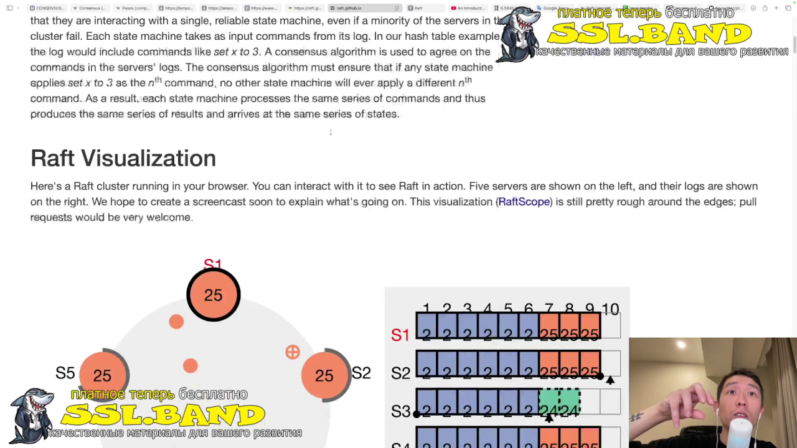

## 2. Paxos: Paxos Made Simple и фазы протокола

**Paxos** — алгоритм консенсуса, который используется везде; он описан в работе Лесли Лампорта (Leslie Lamport) «Paxos Made Simple» от 1 ноября 2001 года — это оригинальная статья по Paxos. Paxos слишком сложный, поэтому Лампорт написал «Paxos Made Simple», чтобы описать процесс проще: статья написана в стиле нонфикшн и рассказывает историю с храмами и жрецами, в ней есть чёткие теоремы, правила и леммы, доказывающие корректность, но они не складываются в общую картину того, как это реализовывать, а реализации Paxos могут сильно различаться. «Оливтакс» — правило на острове Паксос: лампы должны работать только на оливковом масле. Схема протокола Paxos: Proposer выбирает идентификатор 1 — в фазе 1a он рассылает `Prepare(1)`, в фазе 1b получает `Promise(1,Va)`, `Promise(1,Vb)`, `Promise(1,Vc)`, в фазе 2a отправляет `Accept(1,V)`, а в фазе 2b получает `Accepted(1,V)`; здесь V — последнее из {Va, Vb, Vc}.

```
Client, Proposer, A, B, C
Request
Proposer selects 1 as the identifier
Phase 1a
Prepare(1)
Phase 1b
Promise(1,Va)
Promise(1,Vb)
Promise(1,Vc)
Phase 2a
Accept(1,V)
Phase 2b
Accepted(1,V)
Response
Here, V is the last of {Va, Vb, Vc}.
```

*Источник: [00:02:41], [00:03:03], [00:03:28], [00:03:39], [00:03:58], [00:05:29], …*

> [!quote]- Кадр [00:03:03]
> 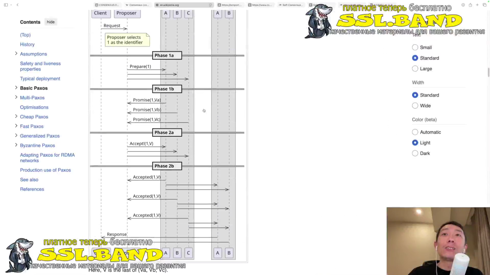

## 3. Мотивация, публикации и визуализация Raft

**Raft** был создан как понятный (understandable) алгоритм консенсуса, поскольку Paxos — слишком сложно описанный алгоритм; основной мотивацией появления Raft стала сложность Paxos, и он задуман как такой же эффективный, как Paxos, но более понятный. Опросы студентов показали, что люди читают статью про Paxos, но не могут ответить на связанные с ним вопросы и объяснить тонкие моменты. Статья «In Search of an Understandable Consensus Algorithm (Extended Version)» Диего Онгаро (Diego Ongaro) и Джона Оустерхаута (John Ousterhout) подробно описывает Raft; её сокращённая версия получила Best Paper Award на USENIX Annual Technical Conference 2014. Диссертация Диего Онгаро расширяет материал статьи, включает более простой алгоритм изменения состава кластера и формальную спецификацию Raft на TLA+. «The Secret Lives of Data» — это альтернативная визуализация Raft: она более управляемая и менее интерактивная, поэтому может быть более мягкой отправной точкой.

| Алгоритм | Особенность |
|---|---|
| Paxos | слишком сложно описанный алгоритм |
| Raft | создан как понятный, задуман как такой же эффективный, как Paxos |

> [!info] Зачем это нужно
> Основной мотивацией появления Raft стала сложность Paxos.

*Источник: [00:02:43], [00:04:59], [00:05:52], [00:05:59], [00:07:40], [00:14:36], …*

> [!quote]- Кадр [00:05:52]
> 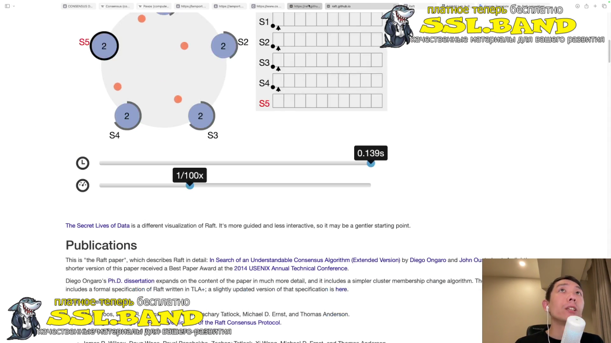

## 4. Выборы лидера: роли, Figure 2 и RequestVote

**Figure 2** описывает состояние, правила и сообщения и относится к выборам лидера; при реализации Raft нужно следовать этим правилам дословно — добавить состояние для выборов из Figure 2 в структуру `raft` в `raft.go` и определить структуру для записи журнала. Все узлы начинают как **follower** (последователь): фолловер записывает значения и принимает запросы только от лидера, а без хартбитов становится **candidate** (кандидатом). Кандидат поднимает терм (term), голосует сам за себя и собирает мажоритарное число голосов (при трёх нодах — два), после чего становится **лидером**; в рамках одного терма нода голосует только один раз. **RequestVote RPC** передаёт `candidateId`, `lastLogIndex` и `lastLogTerm`; если term кандидата больше текущего, узел обновляет `currentTerm`, становится Follower и сбрасывает `votedFor` в -1; если меньше — возвращает текущий term и отклоняет голос. Голосование `vote` запускается как отдельная горутина (goroutine) вызовом `go vote(...)`.

```go
func (rf *Raft) RequestVote(args *RequestVoteArgs, reply *RequestVoteReply) {
	rf.mu.Lock()
	defer rf.mu.Unlock()

	cid := args.CandidateId
	cterm := args.Term

	if cterm < rf.CurrentTerm {
		reply.Term = rf.CurrentTerm
		reply.VoteGranted = false
		return
	}
	if cterm > rf.CurrentTerm {
		rf.CurrentTerm = args.Term
		rf.state = Follower
		rf.VotedFor = -1
	}
	reply.Term = rf.CurrentTerm
	go vote(w, rf, args, cd, rf.state, rf.VoteFor, reply)
}
```

*Источник: [00:05:22], [00:06:29], [00:07:02], [00:08:21], [00:08:57], [00:09:24], …*

> [!quote]- Кадр [00:30:00]
> 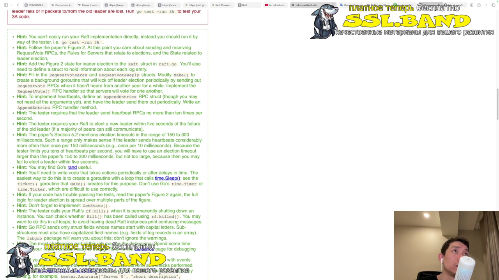

> [!quote]- Кадр [00:10:18]
> 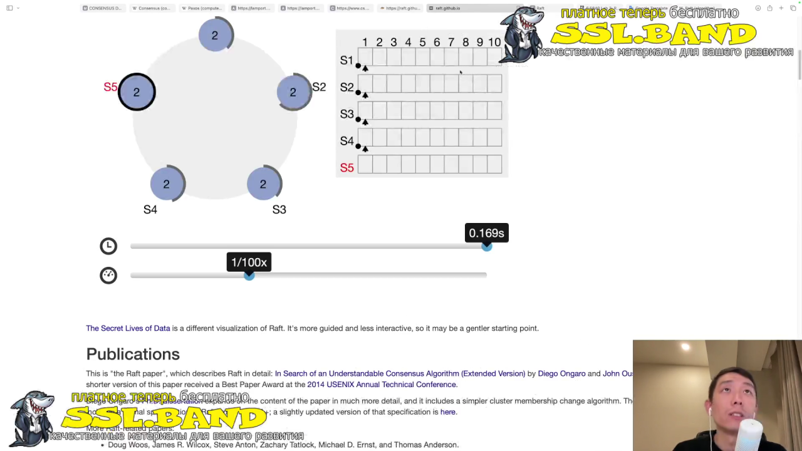

> [!quote]- Кадр [00:21:58]
> 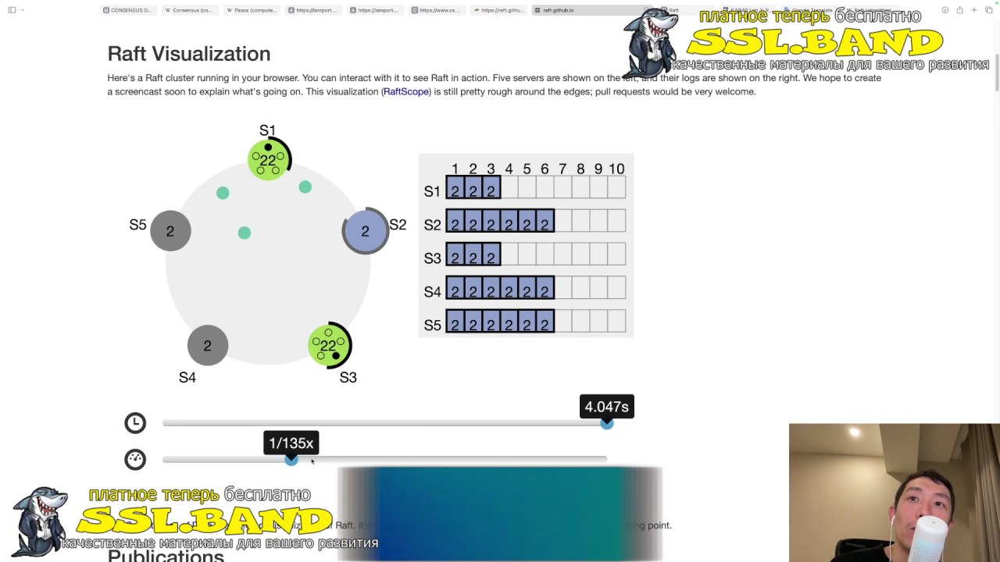

## 5. Таймеры Raft: election timeout и heartbeat

Таймер ожидания сообщения от лидера должен быть больше таймера, в который лидер посылает хартбиты. Если узлы не получают хартбит, их тайм-аут срабатывает, кто-то выигрывает голосование, и они поднимают терм для следующего раунда. **Election timeout** — это как долго нода ничего не слышала про лидера; если лидер перестаёт посылать хартбиты или выходит из сети, происходит election timeout, после чего нода становится кандидатом, поднимает терм и пробует собрать голоса. Каждый раз, когда узел получает новую запись (`append entry`), его election timeout сбрасывается. При становлении кандидатом сервер инкрементит `currentTerm`, голосует сам за себя, обнуляет свой тайм-аут и просит голоса у остальных; если election timeout срабатывает сразу у нескольких кандидатов, каждый собирает по два голоса, и выбрать лидера не удаётся. `AppendEntries` либо содержит значение, либо используется как **heartbeat** — сигнал «я живой». Интервалы в Raft можно настраивать (тюнить): в CockroachDB по умолчанию стоит heartbeat 4 с при 500 миллисекундах, а Proposal — 6 с при 500 миллисекундах. В географически распределённой системе 150 миллисекунд может не хватить даже на отправку запроса между нодами в Америке и Токио из-за сетевой задержки — эти значения настраиваются, они не «прибиты» железом (в рамках статьи их посчитали оптимальными).

*Источник: [00:10:53], [00:11:02], [00:13:03], [00:14:47], [00:26:25], [00:28:01], …*

## 6. Записи через лидера, коммит и разделение сети

Проблема согласованности данных возникает при нескольких нодах: одна нода может записать значение, но не успеть скопировать его на другие, и чтение с другой ноды даст другой результат. Значение должно зареплицироваться на мажоритарное число нод и подтвердиться как закоммиченное; только после подтверждения коммита его можно гарантированно сохранить. Все записи проходят через лидера и реплицируются на остальные ноды; записи на лидере коммитятся, потому что у него мажоритарное число голосов, а запись считается закоммиченной не раньше, чем пройдёт на мажоритарное число нод. При **разделении сети (Network Partition)** в изолированной части ничего не коммитится; если лидер отрезан, мажоритарная часть выберет нового лидера, поэтому возникает два лидера. При 5 нодах мажоритарное число — 3. После восстановления старый лидер узнаёт, что снаружи уже существует более высокий терм, и должен принять его и перестать быть лидером.

*Источник: [00:07:51], [00:12:02], [00:15:09], [00:15:39], [00:17:40], [00:18:46], …*

> [!quote]- Кадр [00:07:51]
> 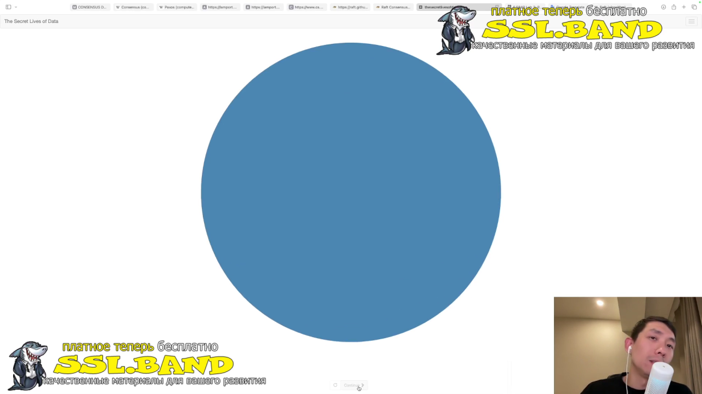

> [!quote]- Кадр [00:20:31]
> 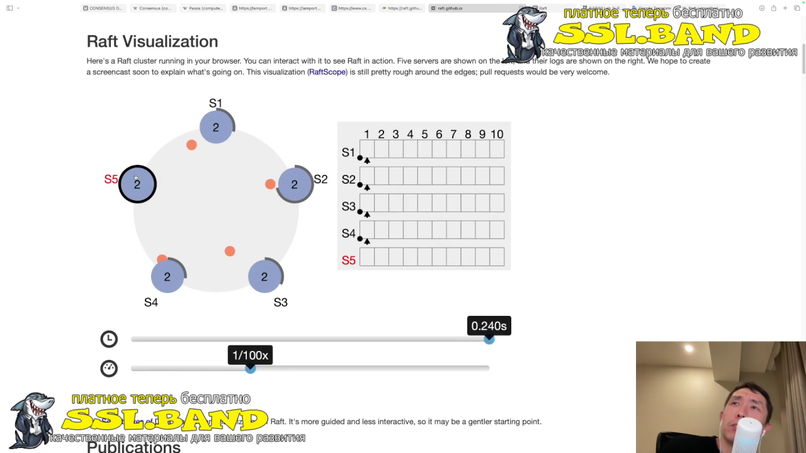

## 7. Состояние сервера: persistent и volatile state

Состояние сервера включает term, vote и log: `currentTerm` — это раунд голосования, `log` — записи (полученные изменения), и на каждом сервере есть информация о том, за кого проголосовали. **Persistent state** (долговременное состояние) хранится на всех серверах и обновляется на стабильном хранилище до ответа на RPC; он включает `currentTerm`, `votedFor` и `log[]`: `currentTerm` — последний увиденный терм, инициализируется 0 при первом запуске и монотонно растёт; `votedFor` — candidateId, получивший голос в текущем терме, либо null; `log[]` содержит команду для машины состояний и терм получения записи лидером, первый индекс равен 1. **Volatile state** (энергозависимое состояние) на всех серверах включает `commitIndex` и `lastApplied`; они инициализируются нулём и монотонно возрастают. `commitIndex` — это индекс, до которого записи в логе закоммичены (высшая запись, известная как закоммиченная), `lastApplied` — индекс высшей записи, применённой к машине состояний. Если `commitIndex` больше `lastApplied`, сервер применяет записи лога к машине состояний. На лидерах volatile state включает `nextIndex[]` для каждого сервера (переинициализируется после выборов) и `matchIndex`, чтобы знать, насколько он «прогрел» каждого фолловера.

*Источник: [00:23:26], [00:24:19], [00:24:49], [00:25:24], [00:25:54], [00:26:25], …*

> [!quote]- Кадр [00:24:19]
> 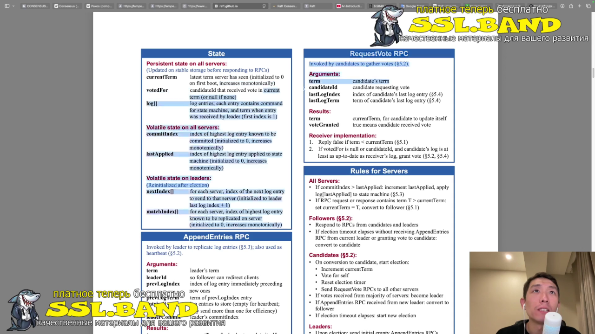

> [!quote]- Кадр [00:30:57]
> 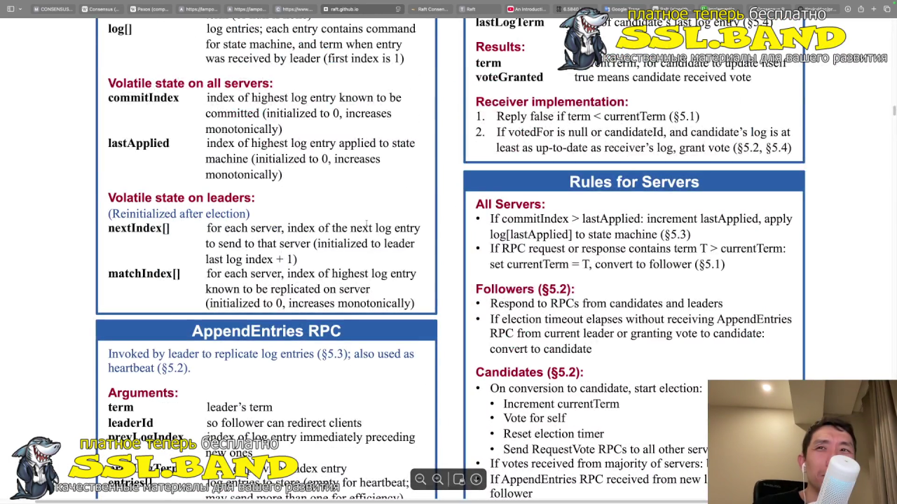

## 8. AppendEntries, досинхронизация логов и снапшот

**AppendEntries RPC** вызывается лидером для репликации записей лога, а также используется как heartbeat, когда записи пусты. Отправитель посылает term, leader id, предыдущий log index и его term, commit index; получатель принимает или не принимает запись по правилам. Лидер досинхронизирует логи остальных узлов до нужного состояния после избрания: он сообщает отставшему узлу, какие изменения тот пропустил, и тот досинковывается до состояния лидера. Значения могут синхронизироваться между S5 и S4, но оставаться не закоммиченными; чтобы закоммитить изменения, S5 должен собрать мажоритарное число голосов. Можно отрезать лог до некоторого состояния и заснапшотить его, затем продолжать вести лог с этого момента.

*Источник: [00:19:54], [00:20:55], [00:21:58], [00:22:25], [00:25:24], [00:27:25], …*

## 9. API Raft-сервера и тесты

`Make` создаёт новый экземпляр Raft-сервера с параметрами `peers`, `me`, `persister`, `applyCh`; `Start` начинает согласование новой записи лога и возвращает `index`, `term`, `isleader`; `GetState` возвращает текущий term и признак лидера. При коммите записи каждый Raft-пир должен отправить `ApplyMsg` сервису (или тестеру). Алгоритм консенсуса реализуется так, как написано в статье, а реализация покрыта тестами: прогоняя их, можно убедиться, что алгоритм корректен. Реализацию Raft нельзя легко запустить напрямую; её следует запускать через тестер командой `go test -run 3A`. Тесты Raft запускаются из каталога `src/raft` командой `go test`; в выводе видно падение `TestInitialElection3A` с сообщением `Fatal: expected one leader, got none`.

```go
// create a new Raft server instance:
rf := Make(peers, me, persister, applyCh)

// start agreement on a new log entry:
rf.Start(command interface{}) (index, term, isleader)

// ask a Raft for its current term, and whether it thinks it is leader
rf.GetState() (term, isLeader)

// each time a new entry is committed to the log, each Raft peer
// should send an ApplyMsg to the service (or tester).
type ApplyMsg
```

*Источник: [00:29:24], [00:29:26], [00:29:29], [00:29:34], [00:30:00]*

> [!quote]- Кадр [00:30:00]
> 

## 10. Membership и joint consensus

Raft заранее должен знать **membership** — состав участников и их количество. Изменение состава кластера (cluster membership change) нужно, если мы хотим добавить новых участников в консенсус, и описано в статье. **Joint consensus** — это переход от одной конфигурации кластера к другой; для этого его придётся сделать.

*Источник: [00:09:40], [00:09:50]*

## 11. База данных TDB

**TDB** — это база данных. TDB использует TKV, который работает на Raft. Всё написано на Go.

*Источник: [00:30:30]*

## Схема

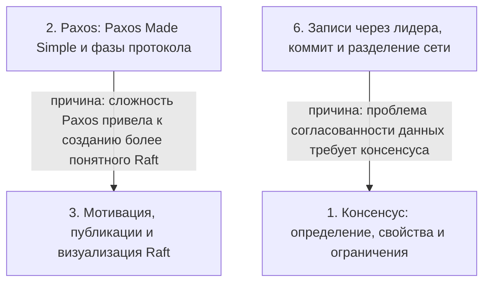

## Итог

> [!success] Что в итоге
> Консенсус — фундаментальная задача согласования нод к одному значению со свойствами termination, integrity и agreement; ему противостоят византийские отказы (Byzantine Failure) и теорема FLP Impossibility, обходимая недетерминизмом (случайностью). Raft задуман как понятный и столь же эффективный, как Paxos, из-за сложности описания Paxos. В Raft состояние серверов делится на persistent state (currentTerm, votedFor, log[]) и volatile state (commitIndex, lastApplied, nextIndex[]); выборы и свежесть лога реализуются через RequestVote RPC, а репликация и heartbeat — через AppendEntries RPC. Все записи проходят через лидера и считаются закоммиченными после мажоритарного подтверждения, при этом синхронизированные значения могут оставаться не закоммиченными до набора мажоритарного числа голосов. При разделении сети возможен мультилидер, но после восстановления узел принимает более высокий term и становится фолловером; membership задаётся заранее и меняется через joint consensus.
