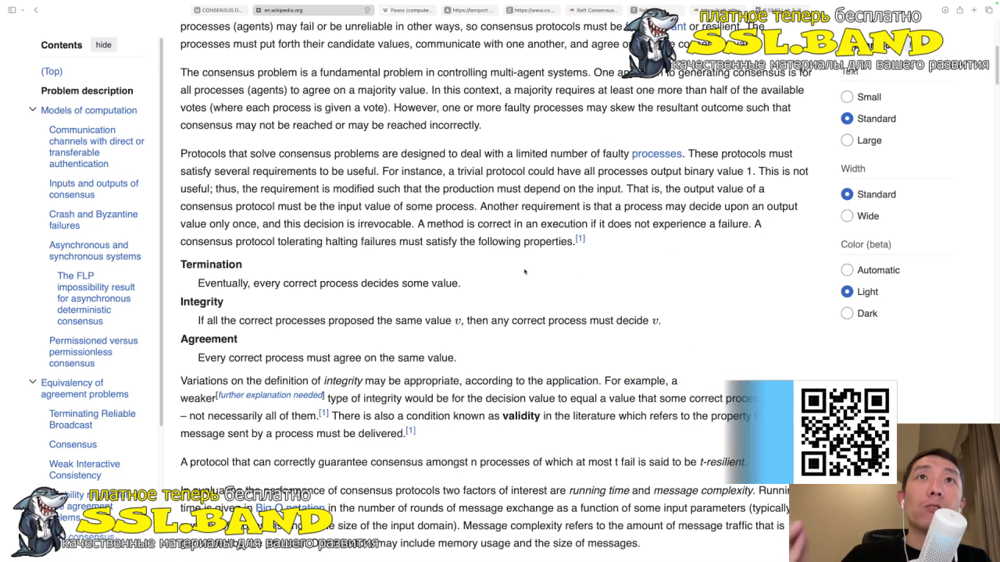
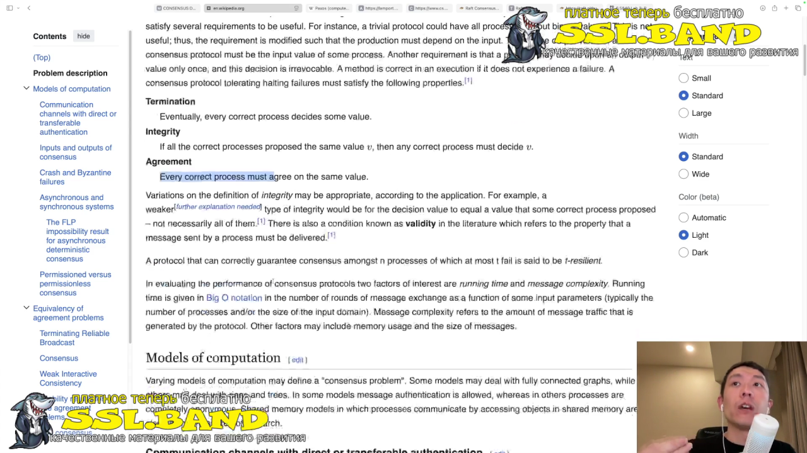
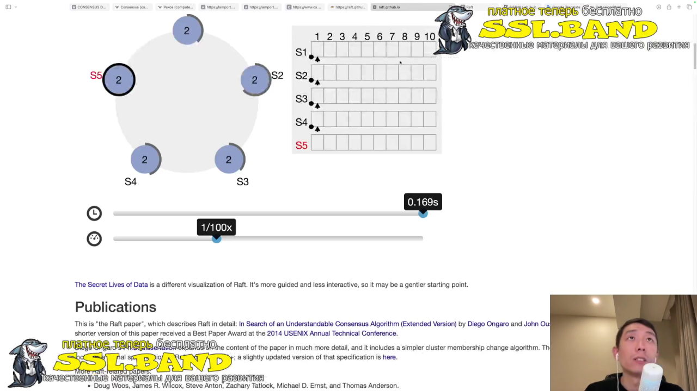
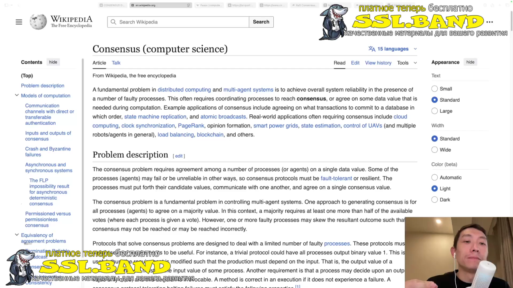
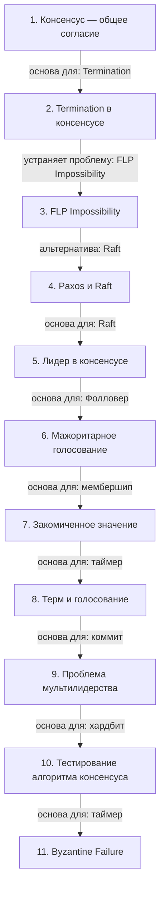

# Консенсус в распределённых системах

> [!abstract] Обзор
> Лекция по алгоритмам консенсуса, таким как Paxos и Raft, их ключевым свойствам, таким как Termination и FLP Impossibility, а также проблемам, таким как мультилидерство и Byzantine Failure. Основные темы включают лидерство, голосование, логи, таймеры и тестирование алгоритмов. Все элементы вместе обеспечивают надёжную и эффективную работу распределённых систем.

> [!info] Курс
> [[index|Оглавление курса]]

## Оглавление
1. [[#1. Консенсус — общее согласие]]
2. [[#2. Termination в консенсусе]]
3. [[#3. FLP Impossibility]]
4. [[#4. Paxos и Raft]]
5. [[#5. Лидер в консенсусе]]
6. [[#6. Мажоритарное голосование]]
7. [[#7. Закомиченное значение]]
8. [[#8. Терм и голосование]]
9. [[#9. Проблема мультилидерства]]
10. [[#10. Тестирование алгоритма консенсуса]]
11. [[#11. Byzantine Failure]]

**Схема** — [[#Схема]]
**Итог** — [[#Итог]]

## 1. Консенсус — общее согласие

Консенсус — это состояние, в котором все участники системы приходят к одному значению. Это основа для работы распределённых систем, где ноды должны согласоваться.

> [!info] Зачем это нужно
> Обеспечивает согласованность данных в распределённых системах.

## 2. Termination в консенсусе

Termination гарантирует, что все корректные процессы достигнут решения в конечном итоге. Это ключевое свойство, обеспечивающее завершение работы алгоритма.

> [!info] Зачем это нужно
> Обеспечивает завершение работы алгоритма в условиях неопределённости.

> [!quote]- Кадр [00:00:47]
> 

## 3. FLP Impossibility

FLP Impossibility — доказательство, что детерминированный алгоритм консенсуса в распределённой системе с возможными сбоями не существует.

> [!info] Зачем это нужно
> Показывает ограничения детерминированных алгоритмов в условиях неопределённости.

> [!quote]- Кадр [00:01:48]
> 

## 4. Paxos и Raft

Paxos и Raft — основные алгоритмы консенсуса. Paxos — классический, сложный, Raft — упрощённый для понимания и реализации. Оба обеспечивают согласованность в распределенных системах.

> [!info] Зачем это нужно
> Выбор алгоритма зависит от сложности и требований к системе.

## 5. Лидер в консенсусе

Лидер — узел, который собирает и передает изменения другим узлам. Лидер определяет порядок обработки запросов и обеспечивает согласованность.

> [!info] Зачем это нужно
> Лидерность позволяет управлять потоком данных и избежать конфликтов.

> [!quote]- Кадр [00:11:54]
> 

## 6. Мажоритарное голосование

Мажоритарный порог определяет, сколько узлов должно подтвердить значение, чтобы оно считалось закомиченным. Это обеспечивает стабильность и окончательность данных.

> [!info] Зачем это нужно
> Мажоритарное голосование предотвращает несогласованность в системе.

## 7. Закомиченное значение

Закомиченное значение — это данные, распространенные на мажорное количество узлов. Это гарантирует их сохранность и стабильность в распределенных системах.

> [!info] Зачем это нужно
> Закомиченные значения обеспечивают окончательность и надежность данных.

## 8. Терм и голосование

Терм — этап, в котором ноды голосуют за лидера. В рамках одного терма голосование не меняется, и лидер определяется после тайм-аута.

> [!info] Зачем это нужно
> Термы позволяют управлять процессом выбора лидера и избежать мультилидерства.

## 9. Проблема мультилидерства

Мультилидерство возникает, когда сеть разбивается на подгруппы, и лидер из одной подгруппы не может собрать мажорное количество голосов. Это приводит к несогласованности.

> [!info] Зачем это нужно
> Мультилидерство — серьезная проблема для консенсуса, требующая специальных решений.

## 10. Тестирование алгоритма консенсуса

Тестирование алгоритма консенсуса включает реализацию по paper и проверку на корректность. Реализация позволяет проверить поведение системы в различных сценариях, включая отказы и сбои.

```go
package main

import (
	"fmt"
	"sync"
	"time"
)

var leader *Leader
var heartbeat time.Time
var electionTimeout time.Duration
var heartbeatInterval time.Duration

// ... (остальной код)
```

> [!info] Зачем это нужно
> Тестирование гарантирует корректность работы алгоритма в реальных условиях.

## 11. Byzantine Failure

Byzantine Failure — отказ узла, который может вести себя произвольно, включая вранье или искажение информации. Такой отказ усложняет достижение консенсуса в распределенных системах.

> [!info] Зачем это нужно
> Понимание Byzantine Failure необходимо для разработки устойчивых алгоритмов консенсуса.

> [!quote]- Кадр [00:01:22]
> 

## Схема



## Итог

> [!success] Что в итоге
> Консенсус — это основа для работы распределённых систем. В лекции рассматриваются ключевые алгоритмы, такие как Paxos и Raft, их свойства, такие как Termination и FLP Impossibility, а также важные концепции, такие как лидерство, голосование и логи. Все эти элементы вместе обеспечивают надёжную и эффективную работу систем консенсуса.

