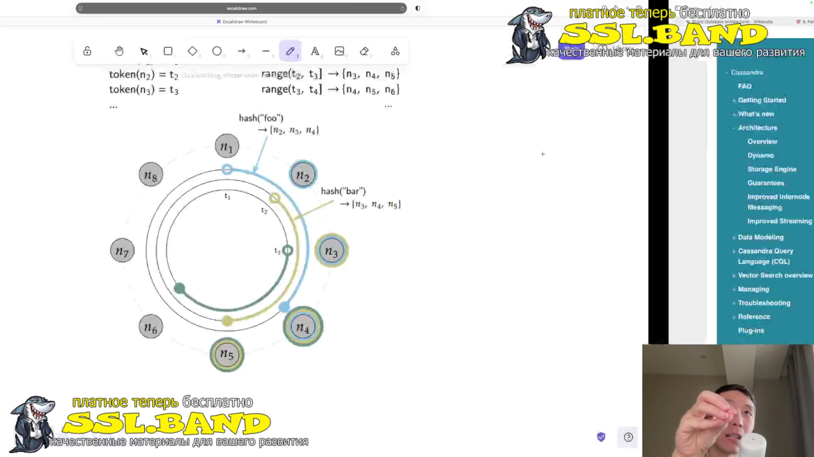
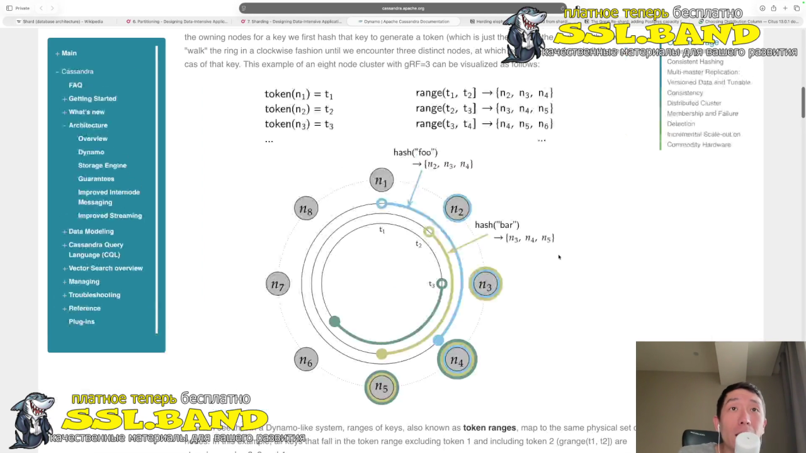
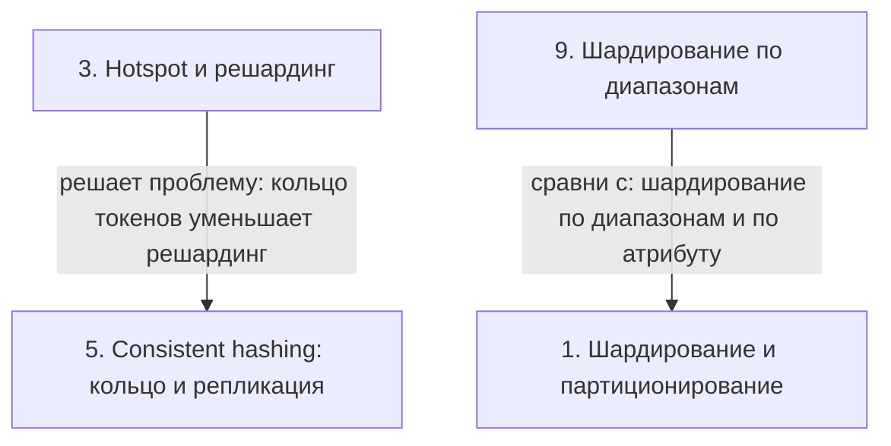

# Шардирование баз данных

> [!abstract] Обзор
> Материал о шардировании баз данных: взаимозаменяемость терминов «шардирование» и «партиционирование», происхождение термина shard, распределение нагрузки между серверами и издержки шардирования. Разбираются схемы шардирования: хэш-шардирование по остатку от деления, кольцо токенов, шардирование по диапазонам (range-based) и по атрибуту. Отдельно — перегруженный шард (hotspot) и решардинг, а также выбор ключа шардирования с учётом бизнес-логики и требований комплаенса. В части про согласованное хэширование (consistent hashing) описано кольцо токенов Dynamo-подобной системы, виртуальные ноды, диапазоны токенов (token ranges), поиск владеющих узлов обходом по часовой стрелке и репликация с учётом различных физических узлов. Также — настройка согласованности (consistency) и протокол Gossip в Cassandra, слой маршрутизации (routing layer), хранение состава кластера (membership) и паттерн миграции double write/backfill.

> [!info] Курс
> [[index|Оглавление курса]]

## Оглавление
1. [[#1. Шардирование и партиционирование]]
2. [[#2. Масштабирование и издержки шардирования]]
3. [[#3. Hotspot и решардинг]]
4. [[#4. Схемы шардирования и хэш-шардирование]]
5. [[#5. Consistent hashing: кольцо и репликация]]
6. [[#6. Consistency и Gossip в Cassandra]]
7. [[#7. Слой маршрутизации и хранение состава кластера]]
8. [[#8. Double write и backfill при миграции]]
9. [[#9. Шардирование по диапазонам]]
10. [[#10. Ключ шардирования и комплаенс]]
11. [[#11. Примеры и источники]]

**Схема** — [[#Схема]]
**Итог** — [[#Итог]]

## 1. Шардирование и партиционирование

Термины «шардирование» и «партиционирование» часто используются взаимозаменяемо: партиционирование «стало» шардингом (в первой версии — партиционирование, во второй — шардинг). Когда шардов не было, а теперь они появились, нужно переехать с одной инфраструктуры на другую, и просто «задаунтаймиться» нельзя. Термин **shard** возник из игры Ultima Online: она столкнулась с проблемой масштабирования — пользователи не помещались в один сервер, и их разместили в разных «осколках кристалла» (shards). При шардировании **по атрибуту** данные распределяются по шардам на основе значения атрибута, например страны пользователя: пользователи из Узбекистана — в одном шарде, из Индии — в другом, из Чехии — в третьем. Атрибут нужно выбирать так, чтобы он равномерно распределял данные: нельзя выбирать случайный атрибут. При неравномерном распределении можно дробить крупные группы на подшарды (например, IN0, IN1), но это усложняет инфраструктуру и координацию.

*Источник: [00:00:02], [00:00:22], [00:00:28], [00:08:50], [00:09:21]*

## 2. Масштабирование и издержки шардирования

Шардирование позволяет распределить нагрузку между серверами и повышает масштабируемость (scalability) и производительность (performance). Шардирование — один из способов масштабирования **записи**: когда одна машина не справляется с потоком записей, добавляют несколько машин и распределяют пользователей между ними; например, пользователи с 1 по 100 идут на одну машину, с 101 по 200 — на другую. Шардирование добавляет сложность (complexity) и координацию (coordination): join-запросы и агрегирующие запросы теперь нужно выполнять сразу на нескольких нодах. **Geosharding** позволяет размещать данные ближе к пользователям, ближе к их региону.

*Источник: [00:00:02], [00:01:04], [00:01:34], [00:02:04]*

## 3. Hotspot и решардинг

**Hotspot (перегруженный шард)** — это когда один шард перегружен больше другого. При шардировании шард может стать hotspot, если в нём будет много данных; тогда приходится делать **решардинг** и постоянно перетаскивать диапазоны между шардами, что добавляет «боли». В Twitter был отдельный набор серверов, обслуживающих только профиль Джастина Бибера, потому что он перегружал систему. Проблемы появляются, когда убирают или добавляют узлы: количество узлов `n` меняется, хэш-функция с остатком от деления начинает указывать не на тот узел, где лежат данные, и приходится делать решардинг — перетаскивать данные в соответствии с новым распределением. При добавлении новой ноды часть диапазона, который раньше шёл в одну из нод, переезжает в новую ноду, а оставшаяся часть остаётся в прежней; при таком перераспределении нагрузка ложится неравномерно, некоторые ноды могут оказаться перегреты, операция блокирует (лочит), и это довольно «больно».

```
token(n2) = t2          range(t2, t3) → [n3, n4, n5]
token(n3) = t3          range(t3, t4) → [n4, n5, n6]

hash("foo") -> {n2, n3, n4}
hash("bar") -> {n3, n4, n5}
```

*Источник: [00:03:04], [00:04:34], [00:05:34], [00:06:34], [00:07:35], [00:14:39]*

## 4. Схемы шардирования и хэш-шардирование

Чтобы правильно сделать шардирование, сначала нужно выбрать схему шардирования (шардинг-схему) — они бывают разные. Чтобы распределить данные по узлам, берут ID пользователя и вычисляют **остаток от деления на количество узлов `n`**. Для чтения также вычисляют остаток от деления ID на `n`, чтобы определить, с какого узла читать. Например, id 1 и 2 идут на соответствующие машины; при `n = 3` новые id идут на соответствующие машины.

*Источник: [00:03:34], [00:04:04], [00:04:34]*

## 5. Consistent hashing: кольцо и репликация

**Согласованное хэширование (consistent hashing):** ноды образуют кольцо в хэш-пространстве. Каждой ноде соответствует токен, например `token(n1) = t1`, `token(n2) = t2`; данные пропускаются через хэш-функцию, попадают на кольцо и кладутся в первую ноду по часовой стрелке, а хэш-функция должна равномерно распределять данные между нодами. Одна физическая нода может состоять из нескольких **виртуальных нод**, распределённых по кольцу. В Dynamo-подобной системе диапазоны ключей, также известные как **token ranges**, отображаются на один и тот же физический набор узлов: например, `range(t1, t2) → {n2, n3, n4}`, `range(t2, t3) → {n3, n4, n5}`. Чтобы найти **владеющие (owning) узлы** для ключа, ключ сначала хешируется в токен, затем по кольцу идут по часовой стрелке, пока не встретят три различных узла; при `RF = 3` это и есть владельцы ключа, например `hash("foo") → {n2, n3, n4}`, `hash("bar") → {n3, n4, n5}`. Задаётся replication-фактор (RF): значение записывают в узел, а затем по кольцу идут дальше и реплицируют его на следующие ноды. При размещении реплик проверяют, относится ли виртуальная нода к той же физической ноде, и если относится — её пропускают: иначе при падении физической ноды все данные пропадут. При определении узлов-владельцев ключа в Cassandra нужно идти по кольцу по часовой стрелке, пока не встретится нужное количество различных **физических** узлов.

```
token(n1) = t1
token(n2) = t2
token(n3) = t3
range(t1, t2) → {n2, n3, n4}
range(t2, t3) → {n3, n4, n5}
hash("foo") → {n2, n3, n4}
hash("bar") → {n3, n4, n5}

# чтобы найти владеющие узлы для ключа, сначала хешируем ключ в токен,
# затем идём по кольцу по часовой стрелке, пока не встретим три различных узла
```

*Источник: [00:06:34], [00:12:46], [00:13:06], [00:14:18], [00:14:39], [00:15:18], …*

> [!quote]- Кадр [00:15:42]
> 

> [!quote]- Кадр [00:16:52]
> 

> [!quote]- Кадр [00:13:06]
> 

## 6. Consistency и Gossip в Cassandra

В Cassandra можно настраивать согласованность (consistency): она задаётся параметрами репликации — репликация на одну ноду, две, три или кворум (quorum); чтобы получать актуальные данные, можно всегда требовать кворум. Ноды Cassandra общаются peer-to-peer по протоколу **Gossip**, чтобы понимать, какая нода живая, какая не живая и за какой диапазон она отвечает. Все ноды знают о составе кластера (membership) друг друга через peer-to-peer: при использовании gossip-протокола любая нода знает, где должны находиться данные, и перенаправляет запрос на нужную ноду. Реализовать такой протокол самостоятельно сложно, особенно если это не готовое решение «из коробки»; при геошардинге с разбросом по географии это не лучший вариант.

*Источник: [00:17:50], [00:18:01], [00:18:31]*

## 7. Слой маршрутизации и хранение состава кластера

После выбора схемы шардирования нужно добавить **слой маршрутизации (routing layer)**: он определяет, в какой шард идти за данными и где эти данные лежат. При **клиентском роутинге** на клиенте хранится отображение (маппинг), которое передаёт Redis Cluster и периодически обновляет, поэтому клиент заранее знает, какие данные куда отправлять. **Middle layer** определяет, в какой шард писать данные, и распределяет нагрузку; это, например, load balancer, но такой слой может стать единой точкой отказа (single point of failure), и тогда его самого нужно разбивать на подноды. **Состав кластера (membership)** — это «кто, где, как, зачем лежит»; его можно хранить в централизованном или децентрализованном решении, например etcd, zookeeper или распределённом key-value, построенном на консенсусе.

| Вариант | Где находится логика | Особенность |
| --- | --- | --- |
| Клиентский роутинг | на клиенте | отображение передаёт Redis Cluster, клиент заранее знает, куда отправлять данные |
| Middle layer | отдельный слой | например load balancer, может стать единой точкой отказа |

*Источник: [00:22:07], [00:22:37], [00:23:07]*

## 8. Double write и backfill при миграции

**Double write (двойная запись)** — это когда новые данные пишутся и в новую конфигурацию, и в старую. После double write на фоне делается **backfill (бэкфил)**: джоба выгребает старые данные из базы и переносит их в новую конфигурацию. При шардировании используется паттерн **double write → backfill → verification → switch over**; он применим не только к шардированию, но и к раскатке новых версий и другим задачам.

*Источник: [00:24:51], [00:25:22]*

## 9. Шардирование по диапазонам

**Шардирование по диапазонам (range-based sharding)** — разбиение данных по диапазонам значений; например, пользователи с 1 по 50 попадают в один шард. В range-based шардинге изначально сложно оценить, сколько диапазонов класть в один шард; при взрывной нагрузке какой-то шард может оказаться перегрет.

*Источник: [00:07:05], [00:08:05]*

## 10. Ключ шардирования и комплаенс

Для распределения нагрузки в вебкам-сервисе рассматриваются атрибуты: UID, комнаты, JoinTime и страна. Оптимально раскидать данные по внешнему ID, прилетевшему из другого сервиса, так как он распределён более-менее равномерно; шардирование по JoinTime даёт жёсткие всплески нагрузки в вечернее время, когда все пришли с работы, а комнаты распределяются по временным отрезкам. При выборе ключа шардирования нужно учитывать не только сам атрибут, но и бизнес-логику сервиса, который вы делаете. Преждевременное шардирование вносит ненужную сложность и может ограничить продуктовую модель до того, как она будет хорошо определена на бизнес-стороне. Иногда шардинг обусловлен регуляторными или комплаенс-требованиями: данные пользователей должны храниться в определённой стране.

*Источник: [00:10:02], [00:10:51], [00:11:21], [00:12:03]*

## 11. Примеры и источники

В Citus для временных рядов (timeseries data) есть лучшая практика: не выбирать `timestamp` в качестве колонки распределения (distribution column). У Notion возникла проблема: они «порвались», и не хватало уже одной машины. На GitHub у проекта papers-we-love собран набор статей, среди которых можно найти материалы по базам данных и распределённым системам; там есть довольно фундаментальные вещи, например про Zookeeper или Raft.

*Источник: [00:19:32], [00:21:09], [00:21:32]*

## Схема



## Итог

> [!success] Что в итоге
> Шардирование распределяет нагрузку и масштабирует запись, но добавляет сложность и координацию; схема шардирования выбирается заранее и бывает хэш-шардированием, кольцом токенов, по диапазонам или по атрибуту. Hotspot и решардинг — основные издержки, а выбор ключа шардирования определяется бизнес-логикой и требованиями комплаенса. В Dynamo-подобной системе узлы образуют кольцо токенов, ключ хешируется в токен и сопоставляется с владеющими узлами обходом по часовой стрелке (RF=3); поверх настраиваются consistency, Gossip и слой маршрутизации. Миграция конфигурации идёт по паттерну double write → backfill → verification → switch over.
