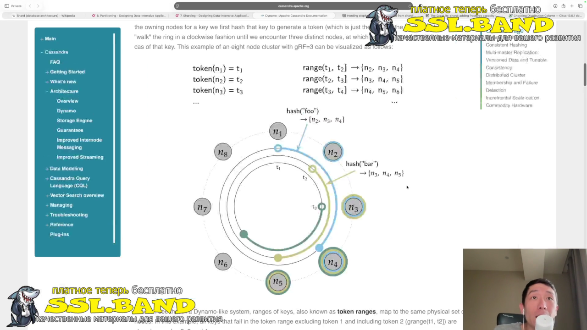
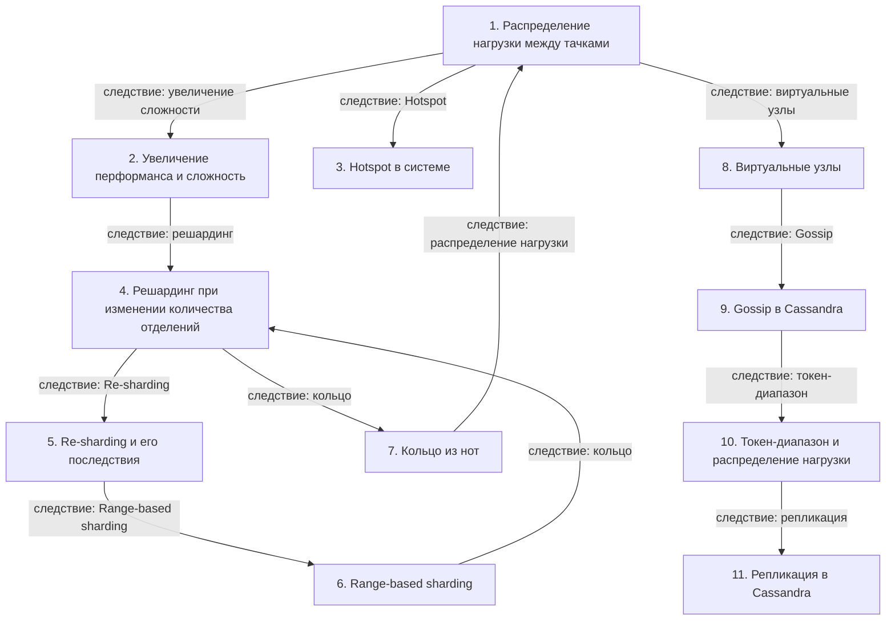

# Шардинг и распределение нагрузки

> [!abstract] Обзор
> Лекция по архитектуре распределенных систем, посвященная шардингу, распределению нагрузки и проблемам, связанным с масштабированием. Основные темы: распределение нагрузки, сложность, Hotspot, решардинг, Range-based sharding, кольцо, виртуальные узлы, Gossip, миграции и инструменты.

> [!info] Курс
> [[index|Оглавление курса]]

## Оглавление
1. [[#1. Распределение нагрузки между тачками]]
2. [[#2. Увеличение перформанса и сложность]]
3. [[#3. Hotspot в системе]]
4. [[#4. Решардинг при изменении количества отделений]]
5. [[#5. Re-sharding и его последствия]]
6. [[#6. Range-based sharding]]
7. [[#7. Кольцо из нот]]
8. [[#8. Виртуальные узлы]]
9. [[#9. Gossip в Cassandra]]
10. [[#10. Токен-диапазон и распределение нагрузки]]
11. [[#11. Репликация в Cassandra]]

**Схема** — [[#Схема]]
**Итог** — [[#Итог]]

## 1. Распределение нагрузки между тачками

Тачка не может обрабатывать бесконечное количество запросов, поэтому добавляют дополнительные тачки. Это позволяет распределять нагрузку, но может привести к неравномерному распределению. Распределение по внешнему ID позволяет равномерно распределять данные.

> [!info] Зачем это нужно
> Распределение нагрузки позволяет масштабировать систему, но требует балансировки.

## 2. Увеличение перформанса и сложность

Повышение производительности на запись требует координации между тачками, что увеличивает сложность архитектуры и усложняет управление запросами.

> [!info] Зачем это нужно
> Координация между узлами снижает эффективность, но позволяет улучшить производительность.

## 3. Hotspot в системе

Hotspot — это ситуация, когда один запрос занимает слишком много ресурсов. Пример: профиль Джастина Бибера на Твиттере.

> [!info] Зачем это нужно
> Hotspot приводит к перегрузке системы и снижению производительности.

## 4. Решардинг при изменении количества отделений

При изменении количества отделений данные перетаскиваются в новые места. Хэш-функция распределяет данные по остатку от деления на количество отделений. Реализуется с помощью кольца.

> [!info] Зачем это нужно
> Решардинг позволяет адаптировать систему под изменение масштаба.

## 5. Re-sharding и его последствия

Re-sharding блокирует систему, требует перетаскивания данных и может быть дорогостоящим.

> [!info] Зачем это нужно
> Re-sharding необходим при изменении структуры данных, но требует значительных ресурсов.

## 6. Range-based sharding

Range-based sharding распределяет данные по диапазонам. Пример: пользователи с 1 по 50 в одной группе, с 51 по 100 — в другой.

> [!info] Зачем это нужно
> Range-based sharding позволяет эффективно управлять диапазонами данных.

## 7. Кольцо из нот

Кольцо из нот — это циклическая структура, где данные распределяются по узлам.

> [!info] Зачем это нужно
> Кольцо позволяет равномерно распределять данные и упрощает перераспределение.

## 8. Виртуальные узлы

Виртуальные узлы распределяются по кольцу, что позволяет улучшить балансировку нагрузки.

> [!info] Зачем это нужно
> Виртуальные узлы позволяют более гибко управлять распределением данных.

> [!quote]- Кадр [00:15:18]
> 

## 9. Gossip в Cassandra

Gossip — это механизм общения между нодами Cassandra, позволяющий обмениваться информацией о состоянии системы.

> [!info] Зачем это нужно
> Gossip обеспечивает синхронизацию и обмен данными между узлами.

## 10. Токен-диапазон и распределение нагрузки

Токены распределяются по кольцу так, чтобы нагрузка равномерно распределялась между узлами. Токен-диапазон определяет, какие данные попадают на конкретную ноду.

> [!info] Зачем это нужно
> Токен-диапазон обеспечивает равномерное распределение данных и упрощает поиск.

## 11. Репликация в Cassandra

Репликация в Cassandra записывает данные в разные физические узлы, обеспечивая дублирование и отказоустойчивость.

> [!info] Зачем это нужно
> Репликация повышает надежность и доступность данных.

## Схема

## Итог

> [!success] Что в итоге
> Шардинг — это ключевой метод масштабирования распределенных систем. Он позволяет распределять нагрузку, но требует балансировки и координации. Виртуальные узлы, кольца и токен-диапазоны помогают улучшить равномерность распределения. Однако решардинг и перетаскивание данных могут быть дорогостоящими и блокировать систему. Важно выбирать подходящий метод шардинга в зависимости от характера данных и требований к отказоустойчивости.

