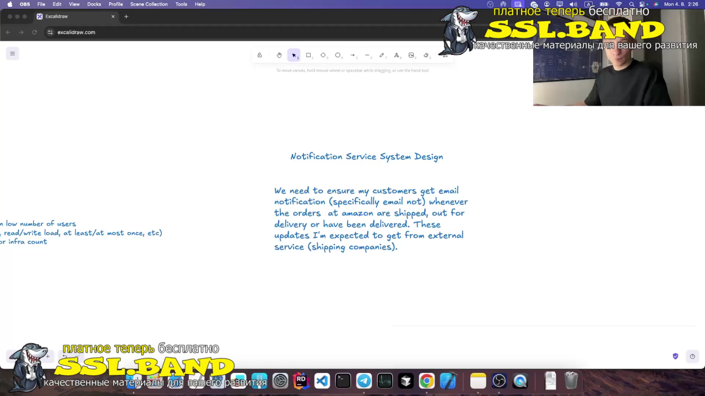
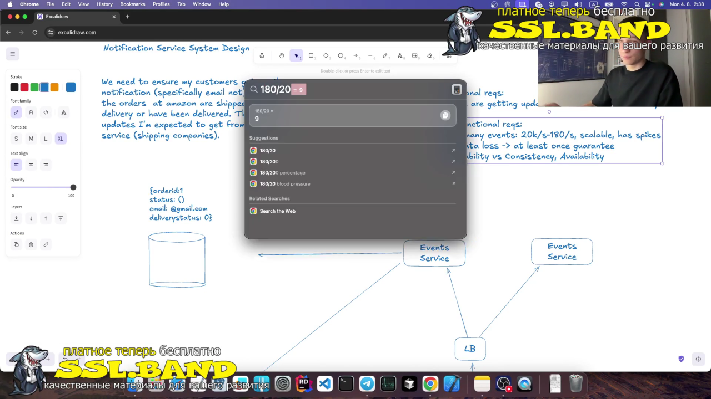
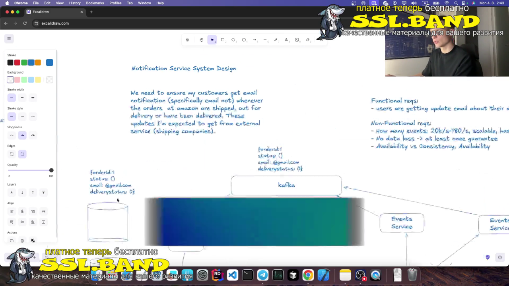
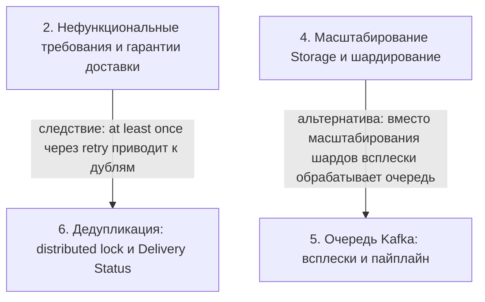

# Проектирование Notification Service: email-уведомления о статусах доставки

> [!abstract] Обзор
> Материал — разбор проектирования системы email-уведомлений о статусах заказа (shipped, out for delivery, delivered), которые приходят от внешних служб доставки. Сначала ставится задача сервиса и компонента между Logistics и Email, затем формулируются нефункциональные требования — число событий, всплески нагрузки (спайки), приоритет доступности и выбор гарантии доставки («не менее одного раза», at least once, без потери данных). Затем строится высокоуровневый дизайн с events-сервисом (сервисом событий), который принимает HTTP-запросы и обращается к внешнему email-сервису, чью отказоустойчивость обеспечивают ретраи (retry), а stateless event service масштабируется через load balancer. Далее — переменная нагрузка, проблема масштабирования хранилища (Storage), шардирование и согласованное хэширование (consistent hashing), а также синхронизация воркеров по Order ID. Завершают материал очередь Kafka для сглаживания всплесков, пайплайн событий с воркерами и логическая развязка (декаплинг) сервисов, а также распределённая блокировка (distributed lock) в Redis и дедупликация через distributed log и Delivery Status.

> [!info] Курс
> [[index|Оглавление курса]]

## Оглавление
1. [[#1. Задача сервиса уведомлений]]
2. [[#2. Нефункциональные требования и гарантии доставки]]
3. [[#3. Высокоуровневый дизайн: events-сервис и отказоустойчивость]]
4. [[#4. Масштабирование Storage и шардирование]]
5. [[#5. Очередь Kafka: всплески и пайплайн]]
6. [[#6. Дедупликация: distributed lock и Delivery Status]]

**Схема** — [[#Схема]]
**Итог** — [[#Итог]]

## 1. Задача сервиса уведомлений

Нужно спроектировать сервис, который отправляет клиентам email-уведомления, когда заказы на Amazon переходят в статусы `shipped`, `out for delivery` или `delivered`. Обновления о статусах приходят от внешнего сервиса — shipping companies (служб доставки), к которому нет прямого доступа; сервис должен поймать эти события и отправить email пользователям, заказавшим посылку. Между внешними Logistics и Email нужен компонент, который принимает события (ивенты) от Logistics про заказ и отправляет их в email-сервис: сначала сохраняем статус доставки (delivery status) как «не отправлен», затем пробуем отправить email. Наш сервис отправляет внешнему email-сервису HTTP-запрос; email-сервис считается масштабируемым, и если он вернул `200 OK`, можно предположить, что email будет доставлен. При недоступности email-сервиса запросы накапливаются и очередь забивается. При одновременной обработке двух одинаковых событий оба проверяют отсутствие записи в БД и создают её — в итоге отправляются два письма. Уведомления сохраняются сразу, а затем доотправляются, если не отправились сразу.

*Источник: [00:00:00], [00:00:30], [00:01:00], [00:01:30], [00:02:00], [00:03:00], …*

> [!quote]- Кадр [00:00:00]
> 

## 2. Нефункциональные требования и гарантии доставки

В нефункциональных требованиях выясняется, сколько событий будет в системе; масштабируемая система может иметь пиковые нагрузки, и в system design есть отдельный паттерн для обработки всплесков (спайков). Приоритет отдаётся доступности: система должна работать как можно быстрее, но допустима задержка email на 10 минут или час; число девяток не оговаривается, но его можно уточнить. Нужно определить, можем ли мы терять данные, и выбрать гарантию доставки: **«не менее одного раза» (at least once)** означает, что данные не теряются, сообщение обязательно будет доставлено, но возможны повторы (email может прийти два раза). Требование отсутствия потери данных обеспечивается согласованностью в конечном счёте (eventual consistency) и репликацией на 100%, чтобы не пропустить email; чтобы не терять данные, нужно делать retry, пока не запишем, и не коммитить offset в Kafka, пока не записали. При гарантии at least once проверка дублей делается простым методом дедубликации; проверка может делаться сразу в месте обработки, если оно достаточно быстрое, ставится «сторож» (lock), а хранилищем может подойти кэш, например Redis. В системе не должно быть потери данных (data loss): при передаче событий между этапами сообщение может не дойти, при тайм-ауте сообщение может потеряться, а ретраи не гарантируют доставку.

> [!info] Зачем это нужно
> Это обеспечивает отказоустойчивость.

*Источник: [00:03:00], [00:03:31], [00:04:05], [00:04:39], [00:07:12], [00:07:42], …*

> [!quote]- Кадр [00:11:54]
> 

## 3. Высокоуровневый дизайн: events-сервис и отказоустойчивость

На первом этапе выполняется высокоуровневый дизайн, закрывающий функциональные требования: можно поставить **events-сервис**, который будет API — HTTP-запросы будут ходить в него, и из него уже слать запрос на email-сервис. Event-сервис — это compute, он быстро масштабируется: достаточно поднять больше контейнеров; event service должен быть масштабируемым и является **stateless** — у него нет состояния, поэтому масштабируется очень просто: ставится load balancer, и сервисов может быть много разных. При падении email-сервиса нужны ретраи, например с экспоненциальной задержкой (exponential back-off); email-сервис должен повышать доступность: при падении одного региона нужно попасть в другой регион.

*Источник: [00:05:09], [00:05:40], [00:06:10], [00:06:40]*

## 4. Масштабирование Storage и шардирование

Хранилище (Store) является простым; в нём хранятся данные про событие, а формат входящего запроса стоит уточнить — он может включать order ID и статус. Нагрузка может варьироваться от 20 тысяч до 180 тысяч событий в секунду; при таком разбросе масштабирование будет работать плохо, поэтому нужно решение, которое масштабируется динамически, так как при 180 тысячах событий в секунду данные не помещаются в Storage. Шардирование можно выполнить через hash key и взятие остатка по модулю числа инстансов (`hash mod`), но это очень плохая идея. При согласованном хэшировании (consistent hashing) инстансы располагаются на кольце (ринге), и ключ попадает в зону ответственности той реплики, в чей участок кольца он попал по хешу — это позволяет не перемешивать данные между базами при добавлении новой реплики: достаточно взять один шард и разделить его вдвое. В распределённой системе может быть два воркера: если партиционировать по order ID, то order ID 1 всегда попадёт в order worker 1, в topic 1, в партицию 1; нужно синхронизировать воркеры, чтобы два воркера не обрабатывали один и тот же order ID, и Kafka помогает гарантировать, что order ID попадает всегда в один и тот же топик и партицию. При большом объёме записей нельзя покрыться только read-репликами: когда база данных требует шардирования или один инстанс становится очень большим, добавляют ещё один инстанс и переносят в него половину хранившихся там данных; масштабирование шардов длится часами и создаёт дополнительную нагрузку.

| Подход | Как работает | Оценка |
|---|---|---|
| hash mod | hash key по модулю числа инстансов | очень плохая идея |
| consistent hashing | инстансы на кольце, ключ попадает в участок реплики | не перемешивает данные при добавлении реплики |

*Источник: [00:08:12], [00:10:13], [00:11:13], [00:11:54], [00:12:14], [00:12:44], …*

## 5. Очередь Kafka: всплески и пайплайн

Всплески нагрузки обрабатываются не масштабированием CPU, а отдельным путём — через очередь. Очередь, например Kafka, при бёрсте (всплеске) позволяет быстрее разблокировать партнёра. Event-сервис отправляет события в Kafka, у которой есть долговечность (durability); воркеры считывают события из Kafka, записывают их в базу данных и коммитят offset, подтверждая обработку. Масштабирование Kafka делают через много партиций; Kafka масштабируется довольно просто, и можно делать кастомное партиционирование по топикам, определяя его со стороны event-сервиса. В системе произошла логическая развязка (декаплинг): две стороны теперь отвечают за свои части, что позволяет индивидуально масштабировать event-сервисы, например при бёрсте. Нагрузка может подскакивать, например до 180 тысяч запросов в секунду на полдня; добавляются воркеры, и в конце концов всё возвращается к 20k в секунду.

> [!info] Зачем это нужно
> Очередь при всплеске позволяет быстрее разблокировать партнёра.

*Источник: [00:14:15], [00:14:45], [00:15:16], [00:16:16]*

## 6. Дедупликация: distributed lock и Delivery Status

**Distributed lock (распределённая блокировка)** — распространённый паттерн, который часто реализуют через Redis: ключ (например, order ID) и блокировка со значением `true`/`false`; если order ID уже занят, другой процесс не может с ним работать. У Redis есть атомарные операции, которые работают по принципу set if not exist; атомарная операция выполняется атомарно, гарантирует корректные значения и является специальной инструкцией на уровне CPU, а при неатомарной операции счётчик может получить меньшее значение; похожие аналоги есть и в языках программирования, например атомарный инкремент. Два одинаковых события могут прийти в Worker, и тогда Worker может отправить два одинаковых email; поэтому нужно уходить от дубликации событий. При повторной операции с уже существующим `order.id` response будет `false`, и worker отбросит сообщение — так работает **distributed log**. Для дедупликации нужен storage, который хранит, отправляли ли уже такой email; перед отправкой письма проверяется, есть ли уже событие с таким Order ID (и статусом/email). **Delivery Status**: 0 — не доставлен, 1 — доставлен; если событие уже обработано и Delivery Status равен 1, событие пропускается (скипается), так как письмо уже отправлено, иначе статус записывают и отправляют уведомление. В дизайне Notification Service достаточно делать distributed log и хранить delivery-статус.

*Источник: [00:17:20], [00:18:17], [00:18:48], [00:19:48], [00:20:48], [00:21:18], …*

> [!quote]- Кадр [00:17:20]
> 

## Схема

## Итог

> [!success] Что в итоге
> Материал ведёт от постановки задачи про email-уведомления и выбора гарантий доставки к высокоуровневому дизайну с events-сервисом. Требуется гарантия «не менее одного раза» (at least once): письма не должны теряться, что достигается репликацией и retry без коммита offset в Kafka, а отказоустойчивость email-сервиса обеспечивается ретраями. Переменная нагрузка и проблема масштабирования Storage приводят к шардированию и согласованному хэшированию, всплески сглаживаются очередью Kafka, что даёт логическую развязку сервисов. Возможные дубликаты устраняются шардированием по Order ID, distributed lock в Redis с атомарными операциями и дедупликацией в distributed log с хранилищем и Delivery Status.
