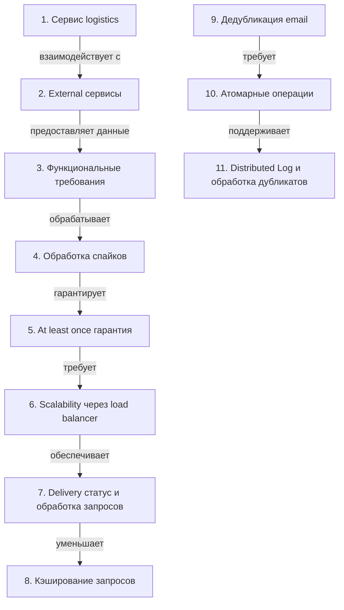

# Системный дизайн для доставки уведомлений

> [!abstract] Обзор
> Лекция по системному дизайну, посвящённая обработке событий и доставке уведомлений. Основные темы: обработка событий, внешние сервисы, функциональные требования, обработка пиковых нагрузок, дедубликация, атомарные операции и масштабируемость.

> [!info] Курс
> [[index|Оглавление курса]]

## Оглавление
1. [[#1. Сервис logistics]]
2. [[#2. External сервисы]]
3. [[#3. Функциональные требования]]
4. [[#4. Обработка спайков]]
5. [[#5. At least once гарантия]]
6. [[#6. Scalability через load balancer]]
7. [[#7. Delivery статус и обработка запросов]]
8. [[#8. Кэширование запросов]]
9. [[#9. Дедубликация email]]
10. [[#10. Атомарные операции]]
11. [[#11. Distributed Log и обработка дубликатов]]

**Схема** — [[#Схема]]
**Итог** — [[#Итог]]

## 1. Сервис logistics

Сервис logistics отправляет события, используемые для обработки заказов и доставки. Это основной источник данных для системы.

> [!info] Зачем это нужно
> Сервис logistics обеспечивает поток событий, необходимых для обработки заказов.

## 2. External сервисы

External сервисы взаимодействуют через HTTP-запросы. Мы не можем контролировать их работу, но можем ожидать успешного ответа (200 OK) как подтверждения выполнения.

> [!info] Зачем это нужно
> Взаимодействие с внешними сервисами требует надёжного обработчика ошибок и ожидания подтверждений.

## 3. Функциональные требования

Функциональные требования включают отправку уведомлений по электронной почте о статусе доставки. Это ключевой момент для пользовательского опыта.

> [!info] Зачем это нужно
> Уведомления по электронной почте обеспечивают прозрачность и доверие к системе.

## 4. Обработка спайков

Спайки обрабатываются отдельно в системе. Это позволяет изолировать пиковые нагрузки и избежать сбоя основной логики. Если ивент уже обработан, его пропускают, чтобы избежать дублирования действий. Обработка включает проверку статуса delivery.

> [!info] Зачем это нужно
> Отдельная обработка спайков обеспечивает стабильность и надёжность основной системы.

## 5. At least once гарантия

At least once гарантия означает, что сообщение доставится хотя бы один раз, но может быть отправлено несколько раз. Это обеспечивает надёжность, но может привести к дублированию.

> [!info] Зачем это нужно
> Гарантия доставки важна для критических операций, но требует дедубликации.

## 6. Scalability через load balancer

Event-сервис должен быть stateless и масштабируемым. Load balancer позволяет распределять нагрузку между несколькими инстансами.

> [!info] Зачем это нужно
> Stateless и масштабируемый сервис позволяет быстро адаптироваться к изменяющимся нагрузкам.

## 7. Delivery статус и обработка запросов

Система продолжает получать запросы от других сервисов, даже если один из них не отвечает. Это обеспечивает отказоустойчивость.

> [!info] Зачем это нужно
> Отказоустойчивость позволяет системе продолжать работать при частичных сбоях.

## 8. Кэширование запросов

Кэширование используется для временного хранения запросов, чтобы уменьшить нагрузку на основную систему.

> [!info] Зачем это нужно
> Кэширование ускоряет обработку запросов и снижает нагрузку на базу данных.

## 9. Дедубликация email

Дедубликация используется для проверки отправки одинаковых email, чтобы избежать дублирования. Дедубликация происходит через проверку статуса delivery в базе данных по order id. Если статус отсутствует, событие записывается в базу.

> [!info] Зачем это нужно
> Дедубликация предотвращает дублирование уведомлений и улучшает пользовательский опыт.

## 10. Атомарные операции

Атомарные операции — это специальные инструкции CPU, которые гарантируют целостность данных. Redis поддерживает атомарные операции, такие как set if not exist, что позволяет избежать дублирования.

> [!info] Зачем это нужно
> Атомарные операции обеспечивают надёжность при обработке критических операций.

## 11. Distributed Log и обработка дубликатов

Distributed Log — это паттерн хранения данных в Redis. Если order id уже существует, response будет false.

> [!info] Зачем это нужно
> Distributed Log обеспечивает надёжное хранение и обработку дубликатов.

## Схема

## Итог

> [!success] Что в итоге
> Система для доставки уведомлений должна быть масштабируемой, отказоустойчивой и надёжной. Она должна обрабатывать пиковые нагрузки, избегать дублирования и обеспечивать доставку уведомлений по электронной почте. Ключевые элементы включают обработку событий, дедубликацию, атомарные операции и использование Redis для Distributed Log. Все компоненты связаны между собой и работают вместе для обеспечения стабильности и надёжности системы.

