# OS Updater: система обновления ОС и прошивок

> [!abstract] Обзор
> Материал о проектировании системы обновления ОС и прошивок (os-updater) на примере Microsoft: от постановки задачи и сбора функциональных и нефункциональных требований до архитектуры доставки обновлений, масштабирования и оценки мощности. Рассматриваются требования: 500 млн устройств, только регион EMEA, размер бинарника 1–20 ГБ, обновления каждые 2 часа, срок доставки ~2 часа с синхронизацией с CI/CD; окно 2 часа, масштабируемость и высокая доступность, цель — снизить стоимость инфраструктуры (infra cost). Описывается хранение артефакта в блоб-хранилище (blob, S3), разделение client API и CICD API, хранение метаданных чанков, long polling и опрос (polling) каждые 10 минут, разбиение больших бинарников на чанки по 5–10 МБ с ретраями и проверкой целостности. Обсуждаются согласованность, принудительное обновление (force update), отложенный выпуск через scheduler, нагрузка с преобладанием чтения (read-heavy), масштабирование stateless client API, репликация лидер-фолловер, read-реплики по регионам, Redis-кэши и случайный сдвиг (offset) против всплесков. Отдельно — оценка мощности: собственные бенчмарки и зависимость от языка, ориентировочные RPS и TPS, бенчмарк под 1 vCPU и 2 ГБ RAM, пересчёт запросов в секунду, целевой показатель (North Star) 833 тысячи RPS и 833 инстанса, redis-benchmark и pipelining, загрузка Lua-скрипта, контроль загрузки CPU.

> [!info] Курс
> [[index|Оглавление курса]]

## Оглавление
1. [[#1. Постановка задачи и сбор требований]]
2. [[#2. Четыре шага проектирования системы]]
3. [[#3. Согласованность, force update и отложенный выпуск]]
4. [[#4. Артефакт обновления, blob и S3]]
5. [[#5. Client API, CICD API и версионирование]]
6. [[#6. Хранение метаданных: Postgres и Redis-кэши]]
7. [[#7. Polling и long polling]]
8. [[#8. Разбиение на чанки, retry-политика и целостность]]
9. [[#9. Нагрузка с преобладанием чтения]]
10. [[#10. Масштабирование, высокая доступность и репликация]]
11. [[#11. Оценка мощности и бенчмарки]]

**Схема** — [[#Схема]]
**Итог** — [[#Итог]]

## 1. Постановка задачи и сбор требований

Представим, что мы Microsoft и выпустили новых клиентов на рынок; нужно спроектировать систему обновления ОС и прошивок (firmware) для этих клиентов. Функциональное требование — устройства получают обновления ОС. Требования к обновлениям являются нефункциональными: 500 млн устройств, только EMEA, размер блоба (blob) 1–20 ГБ, обновления каждые 2 часа, окно 2 часа, масштабируемость и высокая доступность, цель — снизить стоимость инфраструктуры (infra cost). Сборка (build) занимает 2–3 часа, но в худшем случае обновления нужны каждые 2 часа; срок доставки обновления на устройство должен быть примерно 2 часа и совпадать с CI/CD. Чтобы вытянуть из интервьюера нефункциональное требование, нужно задать серию вопросов: сначала понять масштаб (scale) и определить, сколько будет устройств (например, 500 миллионов), уточнить регион/зону доступности, например EMEA.

*Источник: [00:00:00], [00:00:02], [00:00:30], [00:01:00], [00:01:27], [00:01:33], …*

> [!quote]- Кадр [00:11:14]
> 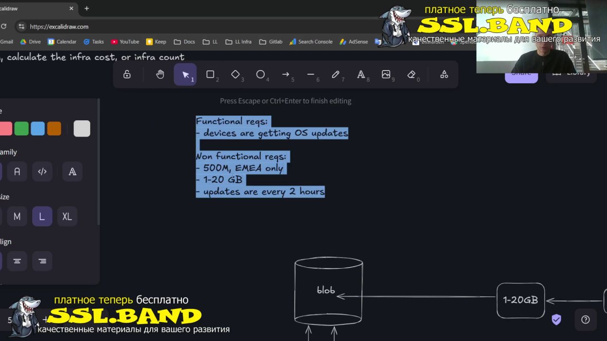

> [!quote]- Кадр [00:18:31]
> 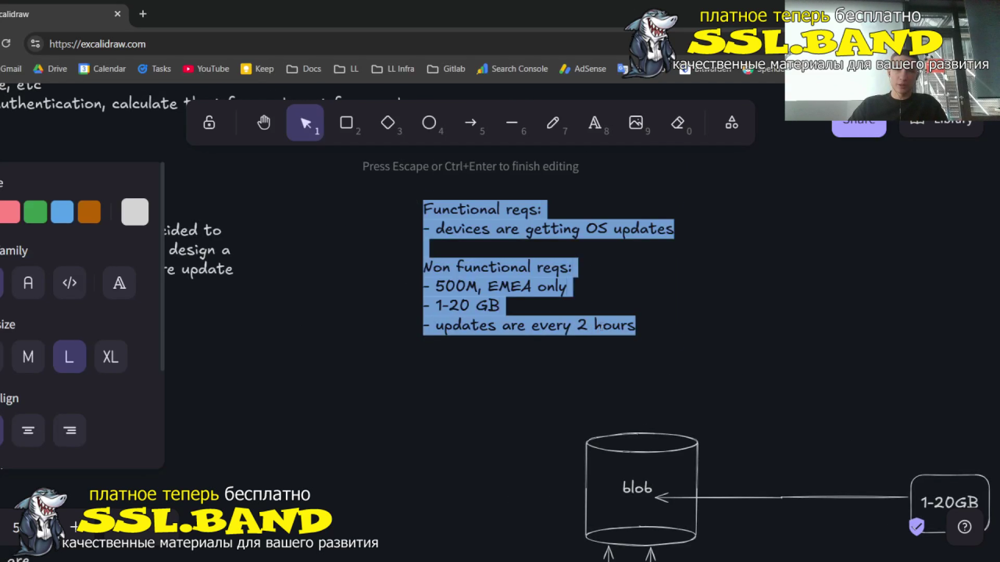

> [!quote]- Кадр [00:00:00]
> 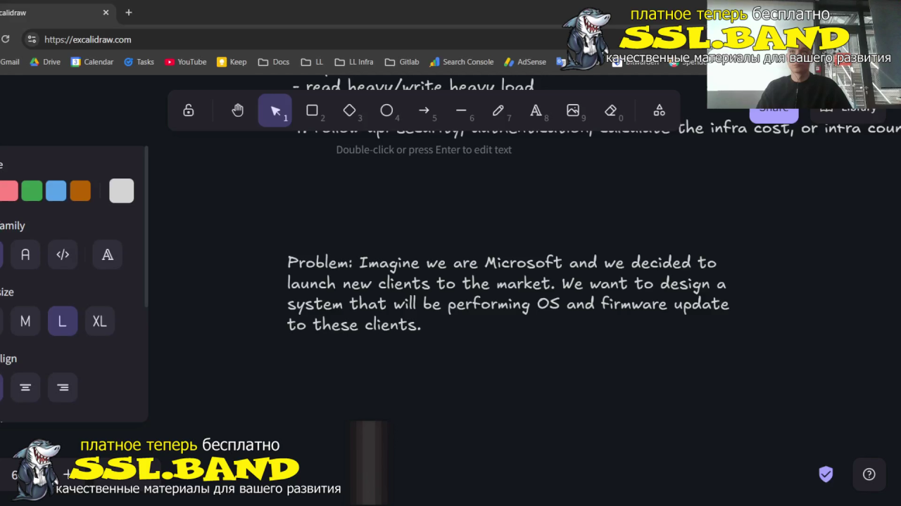

## 2. Четыре шага проектирования системы

Процесс проектирования системы включает четыре шага. Первый — сбор функциональных и нефункциональных требований. Второй — высокоуровневый дизайн, который закрывает только функциональные требования. Третий — выполнение нефункциональных требований: здесь рассматриваются компромиссы (trade-offs), CAP-теорема, нагрузка с преобладанием чтения или записи (read-heavy / write-heavy) и гарантии доставки «не менее / не более одного раза» (at least / at most once); сюда же относятся безопасность (security), аутентификация (authentication) и расчёт стоимости инфраструктуры (infra cost). Четвёртый шаг — уточняющие вопросы (follow-up). System Design стоит начинать с входных точек (entry points).

| Тип требований | Когда рассматриваются |
|---|---|
| Функциональные | На этапе высокоуровневого дизайна |
| Нефункциональные | Отдельно, после высокоуровневого дизайна |

*Источник: [00:00:44], [00:00:46], [00:01:19], [00:05:03], [00:06:34], [00:06:55], …*

> [!quote]- Кадр [00:00:44]
> 

> [!quote]- Кадр [00:00:46]
> 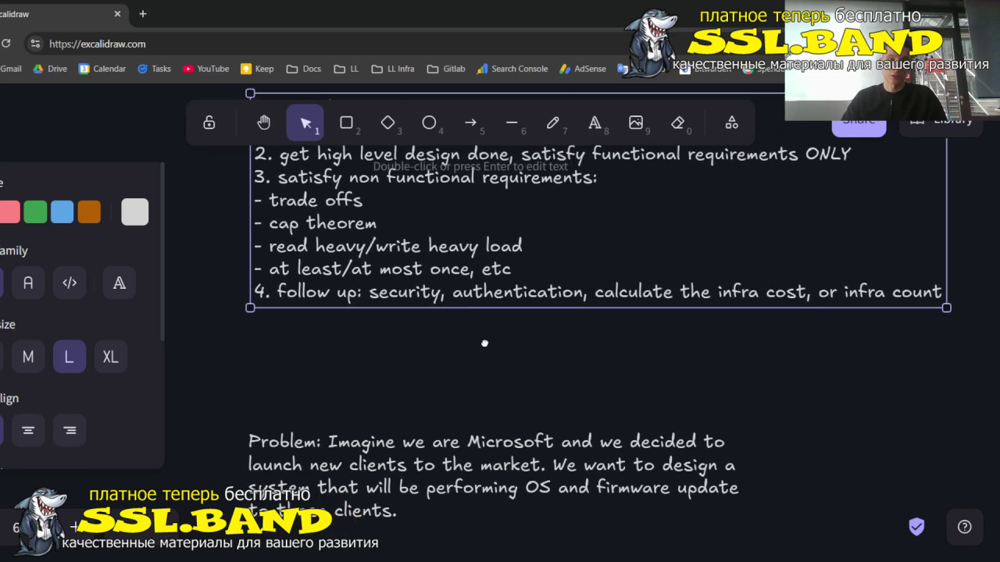

> [!quote]- Кадр [00:01:19]
> 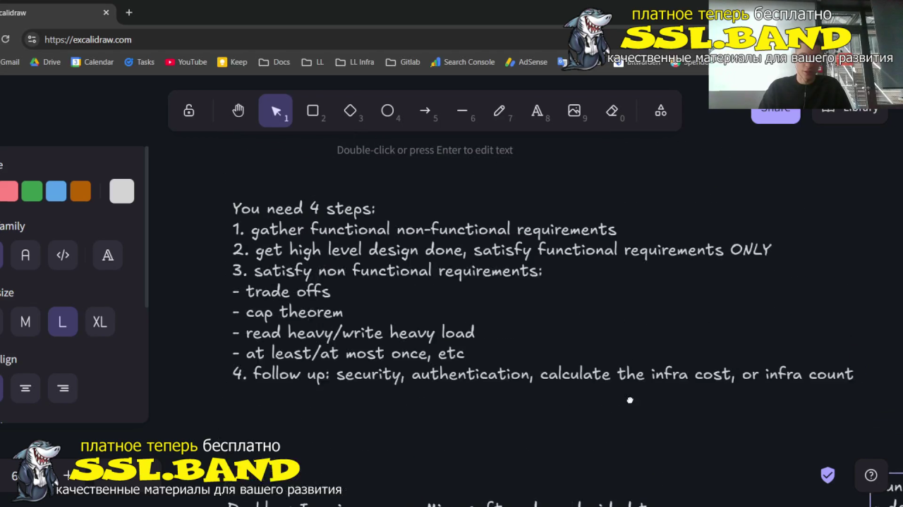

> [!quote]- Кадр [00:43:36]
> 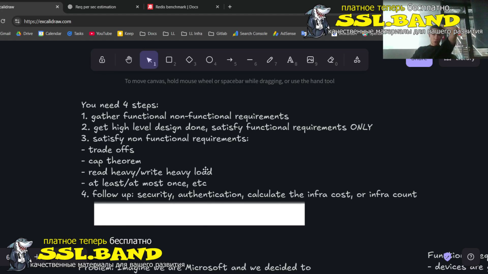

## 3. Согласованность, force update и отложенный выпуск

В этой задаче согласованность (consistency) особой роли не играет, потому что уже есть соответствующее требование. Для задачи обновления ОС и прошивок подходит согласованность в конечном счёте (eventual consistency). Мы хотим делать принудительное обновление (force update) ОС и прошивок сразу же, как только оно появляется, — как можно быстрее. Обновление можно выпускать не сразу, а в конкретную дату; для этого нужен **scheduler (планировщик)**.

*Источник: [00:03:33], [00:03:43], [00:04:18], [00:04:51]*

## 4. Артефакт обновления, blob и S3

Команда CI/CD для обновлений операционной системы выдаёт артефакт — просто бинарник, возможно уже сжатый, размером около 1,20 ГБ. Этот бинарник попадает в блоб (blob) — размер блоба может быть 1–20 ГБ. Для больших бинарников (например, 20 ГБ) не подходит RAM (данные могут потеряться) и не подходит SQL/NoSQL из-за больших накладных расходов (overhead); обычно для больших бинарников используют блоб-хранилище (blob storage). S3 является бесконечно масштабируемым (infinite scalable), высокодоступным и хорошо масштабируемым, поэтому можно сразу договориться использовать его и не решать вопрос его масштабирования. S3 — внешняя система, она уже отмасштабирована.

*Источник: [00:05:33], [00:07:19], [00:23:41], [00:25:41]*

## 5. Client API, CICD API и версионирование

В простейшем варианте бинарник загружается в S3, а API получает все запросы от клиентов; файл обновления кладётся в блоб, клиент достаёт последний загруженный файл и может сразу скачать его через API. Предлагается разделить API на **client API** и **CICD API**: клиентский API придётся масштабировать на 500 миллионов пользователей — он отвечает клиенту, нужно ли скачивать обновление; CICD API масштабировать не нужно, потому что записей (write) мало, и он разделён на read- и write-части. CICD обращается в CICD API, сообщает URL чанков, уже загруженных в блоб, и передаёт информацию о версии (например, 0.2), готовой к загрузке клиентами. Нужно, чтобы сервис знал последнее обновление: API сравнивает самую новую версию (например, 1.2) с версией на клиенте и понимает, нужно ли догружать; если нужно — возвращает флажок `true` и чанки, которые надо загрузить. Клиент отправляет свою текущую версию (например, `my current version 1.0`), а сервис метаданных возвращает самую новую версию из метаданных; Client API не идёт в блоб и не перечисляет (листит) все версии, потому что по чанкам это сложно.

*Источник: [00:08:19], [00:08:49], [00:13:03], [00:13:52], [00:20:04], [00:20:34]*

## 6. Хранение метаданных: Postgres и Redis-кэши

Системе нужно хранить данные о том, какие есть обновления, и метаданные. Метаданные — небольшой JSON с чанками: в нём хранится `update name`, `version` и массив чанков, а для каждого чанка можно записать его blob URL. В хранилище лежат не сами чанки, а `chunk ID` и `ID блоба` либо полный URL на блоб, а также версия и, возможно, название. Данных немного — таких чанков, скорее всего, сотни, но не тысячи, поэтому подойдёт и NoSQL, и SQL-хранилище, например Dynamo или Postgres. Для системы обновления ОС и прошивок предполагается использовать **Postgres**; нормализация сильно не требуется — достаточно одной таблицы, и много join делать не надо. Postgres пишется редко, а клиентами вовсе не читается, а согласованность в конечном счёте обеспечивается ретраями CICD API; если нагрузка минимальная, ставится один маленький инстанс — большего не надо, по диску и TPS нагрузка будет маленькой. Добавляются read-only **Redis-кэши**, в которые пишет только CICD. При нагрузке с преобладанием чтения клиенты читают из Redis, а не из холодного хранилища (cold storage), предназначенного для долговременного хранения и долговечности (persistence и durability) — это быстрее и позволяет обойтись меньшим числом инстансов Redis, что дешевле. CICD пишет и в метаданные, и в Redis: если данные меняются, он параллельно их обновляет.

> [!info] Зачем это нужно
> Postgres дорогой по деньгам и по обслуживанию (мейнтенансу) и выдерживает меньше TPS, чем Redis.

*Источник: [00:10:13], [00:14:50], [00:15:20], [00:15:51], [00:16:28], [00:30:52], …*

> [!quote]- Кадр [00:30:52]
> 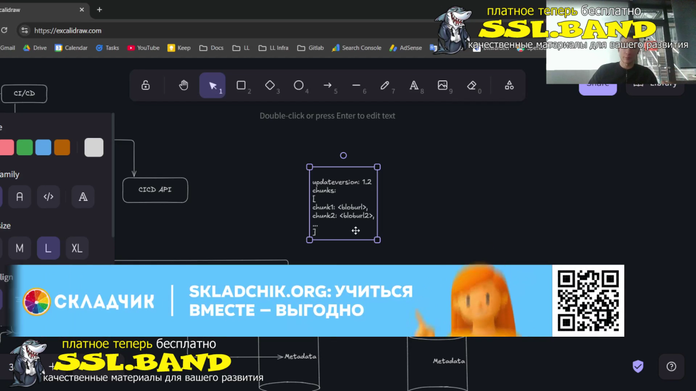

> [!quote]- Кадр [00:40:13]
> 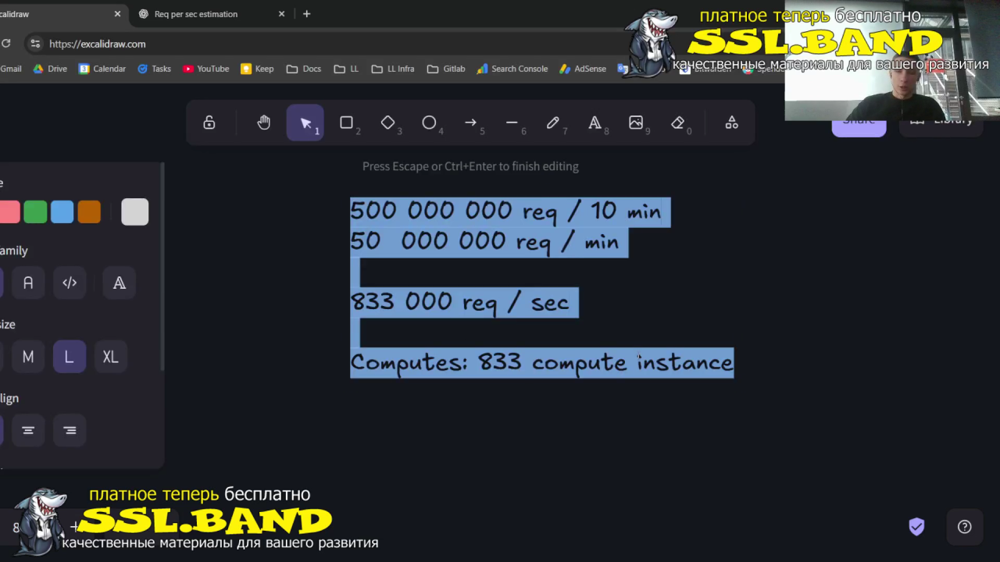

## 7. Polling и long polling

Клиент может раз в час или два проверять наличие нового файла, используя соглашение об именах файлов (file name convention) — это простое решение для доставки обновлений. **Push** — это когда сервер или система оповещает клиента об обновлении. Для задачи обновления ОС и прошивок выбирается **long polling**: клиент постоянно спрашивает (long-poll) сервер, есть ли что-то новое. В системе используется опрос (polling) каждые 10 минут; если обновление пропущено, клиент повторяет попытку. Выбираем polling, потому что не нужна гарантия реального времени (real-time); интервал long polling делают настраиваемым (configurable), что позволяет уменьшить его и ускорить накатывание обновлений клиентами. При polling не нужно знать конкретные устройства, нигде их хранить и обслуживать, поэтому новое устройство не требуется добавлять вручную; также нет проблемы ретрая на стороне сервера, когда запрос к клиенту не дошёл.

> [!info] Зачем это нужно
> Гарантия реального времени не нужна.

*Источник: [00:10:41], [00:18:01], [00:18:33], [00:19:33], [00:20:04]*

## 8. Разбиение на чанки, retry-политика и целостность

Для загрузки больших бинарников используется **чанкирование (разбиение на чанки)**: вы идёте в S3, запрашиваете 100 uploadable-ссылок и загружаете части артефакта по ним; большой артефакт обновления разбивают на чанки по 5–10 МБ, которые клиент скачивает по одному или одновременно. Данные делятся на несколько частей (чанков), которые можно отправлять одновременно (с ограничением через семафор) или последовательно; неуспешные части нужно ретраить, а при обрыве сети (network interruption) уже загруженные чанки не нужно скачивать повторно. Для скачивания обновления можно накатить **retry-политику**, в том числе экспоненциальную задержку (exponential back-off) и размыкатель цепи (circuit breaker); если из-за плохой сети скачать всё не успеваем — на это повлиять не можем, поэтому делаем «как можем» (our best): повторяем как только, так сразу (раз в 10 минут). Клиент может хранить локальную БД или просто файл с последней версией и набором чанков, например в SQLite; это позволяет клиенту знать, какой чанк он загрузил. Поток бинарников летит в клиент, и клиент — тоже приложение; как только поток бинарников к клиенту прилетел, клиент инициирует процесс обновления. Для защиты от атаки «человек посередине» (man in the middle) нужно проверять целостность: хэшировать каждый чанк или шифровать их, чтобы не установить вредоносный чанк (malicious chunk). Хэши должны совпадать, чтобы понять, полностью ли скачался чанк; шифрование с приватным/публичным ключом на клиенте и сервере помогает убедиться, что данные шифруются и сохраняется их целостность; должна быть ротация ключей (ротейшн).

*Источник: [00:11:33], [00:12:03], [00:12:33], [00:19:33], [00:21:34], [00:22:46], …*

> [!quote]- Кадр [00:22:46]
> 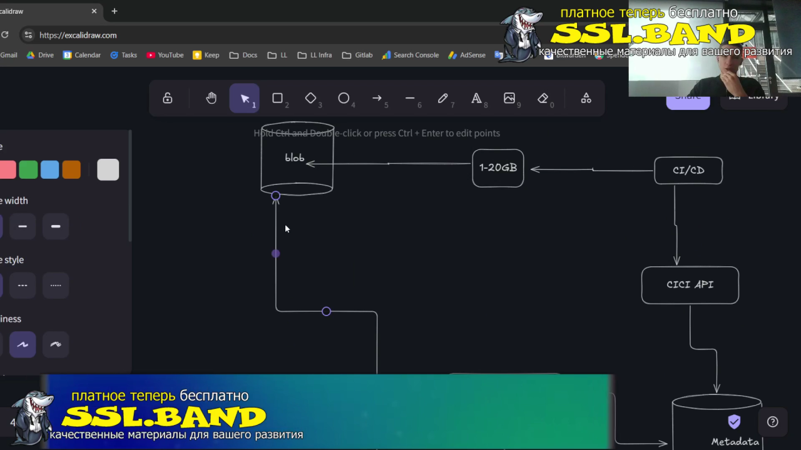

> [!quote]- Кадр [00:44:24]
> 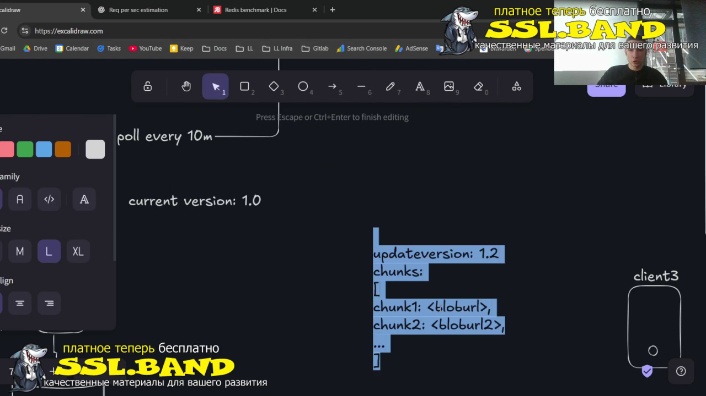

## 9. Нагрузка с преобладанием чтения

Анализ нагрузки на чтение/запись нужен, чтобы понять, сколько операций записи и чтения в системе, а характер нагрузки — с преобладанием чтения или записи (read heavy / write heavy) — определяется для снижения стоимости инфраструктуры. Обновление в худшем случае приходит каждые 2 часа — это очень мало запросов на запись, всё остальное — чтения. 500 миллионов клиентов каждые 10 минут присылают запросы, которые идут в базу и, возможно, в S3; при нагрузке с преобладанием чтения (read-heavy) нагрузка на чтение очень большая, а на запись — маленькая. Соотношение чтений к записям (read-to-write ratio) может составлять миллионы к одному, что означает практически полное отсутствие нагрузки на запись. Нагрузка является read-heavy. Read-реплики распределяют по регионам. Если шардирование не помогает, можно сделать очень много read-реплик. Пользователь скачивает данные с ближайшего региона — это быстрее. Если бы вместо множества read-реплик делалась только одна, это исправило бы только доступность (availability) — нефункциональное требование. Если одна база не выдерживает нагрузку на чтение и запись, обычный паттерн — партиционирование (partitioning) или шардирование (sharding). Но шардирование может не помочь, если у вас мало ключей: например, два релиза за месяц дают два ключа, и вы можете создать максимум два инстанса, которые не выдержат 500 миллионов. Шардирование не подойдёт, если данных мало и клиентов интересует только последний документ: тогда возникает всплеск (spike) на самый последний документ. Клиенты обычно запрашивают самую последнюю версию, поэтому нагрузка на чтение всегда приходит именно к последней версии, и множество клиентов идут проверять её состояние и целостность. После загрузки обновлённой версии она обычно не меняется (обновлённая версия может меняться лишь в критических условиях). Клиент должен приходить в Client API со случайным сдвигом времени (рандомный offset). Иначе все клиенты одновременно обращаются к Redis и одновременно — к load balancer. Если запланировать обновление на фиксированное время (например, 6:10 UTC), каждому клиенту добавляется случайный сдвиг в течение часа. Случайный сдвиг используется против всплесков: всплеск превращается в более равномерную нагрузку, то есть нагрузка «размазывается» по таймлайну.

> [!info] Зачем это нужно
> Учёт нагрузки с преобладанием чтения или записи помогает снизить инфраструктурные расходы (infra cost); а скачивание с ближайшего региона быстрее.

*Источник: [00:23:41], [00:24:18], [00:24:41], [00:27:11], [00:27:41], [00:27:56], …*

> [!quote]- Кадр [00:24:18]
> 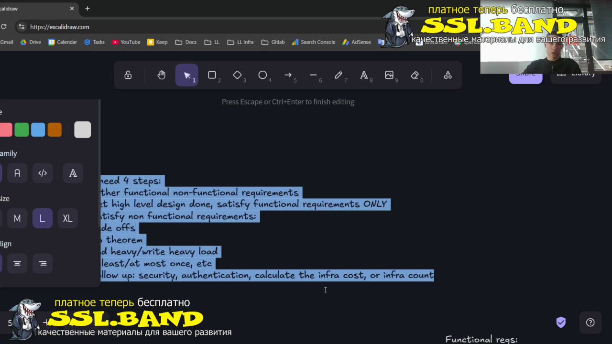

## 10. Масштабирование, высокая доступность и репликация

Систему нужно масштабировать только для того, чтобы гарантировать высокую доступность (high availability): load balancer направляет трафик только к живому серверу, а если сервер упал, запросы перенаправляются на работающий. Stateless-сервисы можно легко убивать и поднимать, поэтому масштабирование client API — очень простая задача: достаточно поднять больше инстансов. При 500 миллионах чтений база данных не выдержит нагрузку, поэтому систему нельзя отмасштабировать вертикально. Для высокой доступности при падении одной базы client API должен читать с другой базы: обычно достаточно схемы **лидер-фолловер**, без лидер-лидер или лидерлесс; консенсус нужен только при необходимости. При нагрузке с преобладанием чтения и малом числе записей один инстанс обрабатывает все записи, репликация 100%, а фолловер реплицируется асинхронно, так как реплики могут отпадать, и запись не должна из-за этого падать; синхронная репликация возможна, но предпочтительна асинхронная.

*Источник: [00:25:11], [00:25:22], [00:26:11], [00:26:41], [00:27:11], [00:27:56], …*

## 11. Оценка мощности и бенчмарки

Чтобы посчитать необходимое количество компьютеров и хранилищ (Postgres, Redis и т.п.), проводят собственные бенчмарки: поднимают инстанс в контейнере или на сервере и запускают нагрузочный тест (load test). API на C++ обычно работает (перформит) намного лучше, чем API на Python, потому что производительность зависит от языка. Чтобы понять, сколько операций или запросов в секунду выдерживает сервис, нужен бенчмарк: без него точную цифру назвать нельзя, так как производительность зависит от реализации; бенчмарк смотрят с ограничением 1 vCPU и 2 ГБ RAM. Простой HTTP API (например, простой endpoint, который ходит в Redis и возвращает данные) обычно выдерживает 500–2000 RPS; при умеренной нагрузке с вызовами БД и кэшированием — 200–700 RPS; при тяжёлой обработке на запрос — менее 100–200 RPS. Реляционная БД (PostgreSQL, MySQL) на 1 vCPU + 4–8 ГБ RAM выдерживает 200–1000 TPS для лёгких запросов с индексами и 50–300 TPS для сложных запросов/записей. 500 миллионов запросов за 10 минут преобразуются в 50 миллионов запросов в минуту; затем это значение нужно разделить на 60, чтобы получить запросы в секунду. Целевой показатель (North Star) — 833 тысячи запросов в секунду, при этом один компьютер в среднем держит 1000 запросов в секунду; для такой нагрузки указано 833 compute-инстанса с 1 vCPU. Можно сделать меньше инстансов, но дать каждому больше ресурсов — например, 6 vCPU и 16 ГБ RAM вместо 1 vCPU и 2,4 ГБ RAM; нужно смотреть, чтобы CPU не перегружалась. Чтобы было поменьше вопросов, можно попросить интервьюера самого сказать, какой бенчмарк использовать, а числа плюс-минус для компьютера, базы данных и Redis можно уточнить у LLM-ассистента.

| Метрика | Условия | Диапазон |
|---|---|---|
| RPS | простой HTTP API | 500–2000 |
| RPS | умеренная нагрузка с БД и кэшем | 200–700 |
| TPS | БД, лёгкие запросы с индексами | 200–1000 |
| TPS | БД, сложные запросы/записи | 50–300 |

*Источник: [00:36:10], [00:36:40], [00:37:14], [00:37:41], [00:38:27], [00:38:48], …*

> [!quote]- Кадр [00:38:27]
> 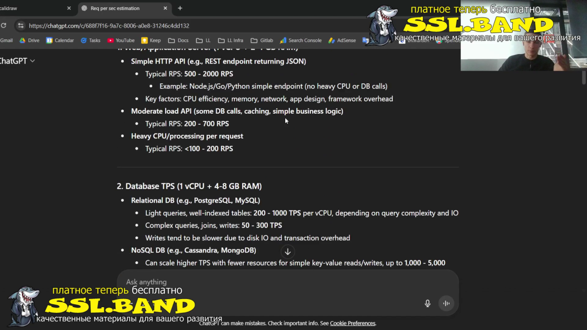

> [!quote]- Кадр [00:39:40]
> 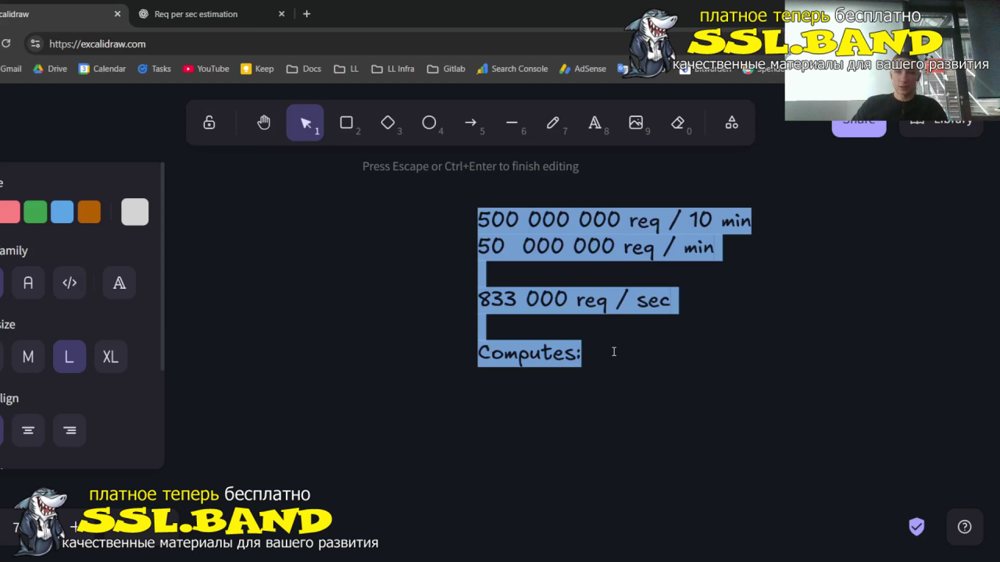

## Схема

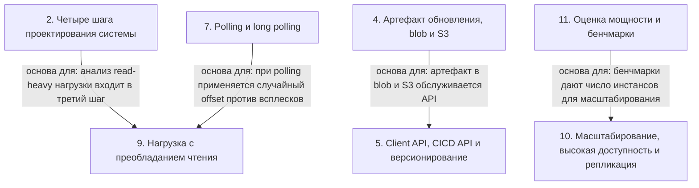

## Итог

> [!success] Что в итоге
> Система обновления ОС и прошивок строится от сбора функциональных и нефункциональных требований к высокоуровневому дизайну, затем к выполнению нефункциональных требований и уточняющим вопросам с безопасностью, аутентификацией и расчётом infra cost. Требования (500 млн устройств, EMEA, 1–20 ГБ, обновления каждые 2 часа) задают нагрузку с преобладанием чтения, поэтому client API масштабируется как stateless-сервис, используются репликация лидер-фолловер, read-реплики по регионам и Redis-кэши метаданных; шардирование ограничено малым числом ключей. Для доставки применяются long polling, чанкирование с ретраями, целостность чанков через хэши и шифрование с ротацией ключей, а также случайный сдвиг против всплесков. Объём инфраструктуры оценивается собственными бенчмарками с ориентировочными RPS и TPS, бенчмарком под 1 vCPU и 2 ГБ RAM и пересчётом запросов в секунду до целевого показателя 833 тысячи RPS и 833 инстансов.
