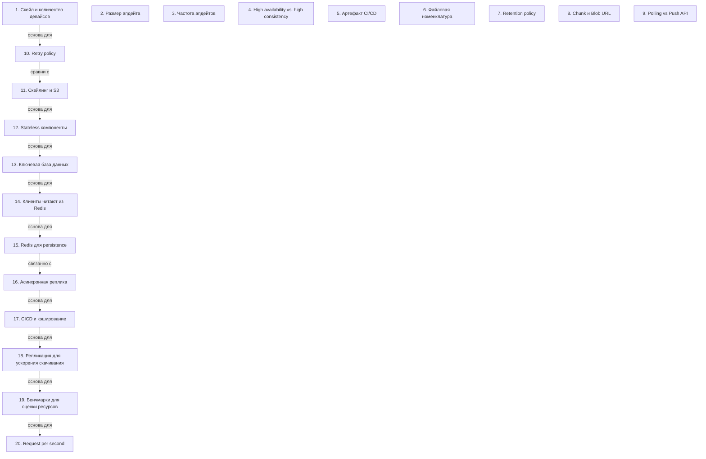

# Системный дизайн: Обновления ОС, масштабирование и архитектурные решения

> [!abstract] Обзор
> Лекция по системному дизайну, посвящённая архитектуре обновлений ОС, масштабированию, хранению данных и выбору архитектурных решений. Основные темы включают обновления, хранение, API, метаданные, стримы, ретри-политики, CI/CD, S3, stateless компоненты и стратегии масштабирования. Основные принципы включают high availability, polling, retry policy и использование S3 для масштабируемости. Stateless архитектура и масштабирование API позволяют поддерживать производительность и надёжность системы при росте нагрузки.

> [!info] Курс
> [[index|Оглавление курса]]

## Оглавление
1. [[#1. Скейл и количество девайсов]]
2. [[#2. Размер апдейта]]
3. [[#3. Частота апдейтов]]
4. [[#4. High availability vs. high consistency]]
5. [[#5. Артефакт CI/CD]]
6. [[#6. Файловая номенклатура]]
7. [[#7. Retention policy]]
8. [[#8. Chunk и Blob URL]]
9. [[#9. Polling vs Push API]]
10. [[#10. Retry policy]]
11. [[#11. Скейлинг и S3]]
12. [[#12. Stateless компоненты]]
13. [[#13. Ключевая база данных]]
14. [[#14. Клиенты читают из Redis]]
15. [[#15. Redis для persistence]]
16. [[#16. Асинхронная реплика]]
17. [[#17. CICD и кэширование]]
18. [[#18. Репликация для ускорения скачивания]]
19. [[#19. Бенчмарки для оценки ресурсов]]
20. [[#20. Request per second]]

**Схема** — [[#Схема]]
**Итог** — [[#Итог]]

## 1. Скейл и количество девайсов

Скейл определяет нагрузку на систему и требования к масштабируемости.

> [!info] Зачем это нужно
> Понимание масштаба позволяет правильно спроектировать систему под ожидаемую нагрузку.

## 2. Размер апдейта

Апдейт может содержать от 1 до 20 ГБ бинарных данных.

> [!info] Зачем это нужно
> Знание размера апдейта позволяет оптимизировать хранение и передачу данных.

## 3. Частота апдейтов

Апдейты ОС должны происходить каждые два часа в худшем случае.

> [!info] Зачем это нужно
> Регулярные апдейты обеспечивают безопасность и стабильность системы.

## 4. High availability vs. high consistency

High availability приоритетен, так как важно, чтобы система не останавливалась.

> [!info] Зачем это нужно
> High availability обеспечивает непрерывность работы системы, что критично для пользователей.

## 5. Артефакт CI/CD

Артефакт — это бинарник, который генерируется в процессе CI/CD и может быть сжатым.

> [!info] Зачем это нужно
> Артефакты позволяют автоматизировать процесс сборки и распределения обновлений.

## 6. Файловая номенклатура

Клиенты проверяют наличие обновлений через polling.

> [!info] Зачем это нужно
> Polling позволяет клиенту не знать конкретных устройств и автоматически проверять наличие обновлений.

## 7. Retention policy

Retention policy определяет срок хранения старых OS апдейтов.

> [!info] Зачем это нужно
> Управление сроком хранения помогает оптимизировать использование хранилищ и уменьшить нагрузку.

## 8. Chunk и Blob URL

Файлы разбиваются на чанки, и каждый чанк имеет URL или ID на blob.

> [!info] Зачем это нужно
> Разделение на чанки позволяет обрабатывать большие файлы и уменьшать нагрузку на систему.

## 9. Polling vs Push API

Push API — это когда сервер оповещает клиента о новых апдейтах.

> [!info] Зачем это нужно
> Выбор между polling и push-api зависит от требований к обновлениям и нагрузке на систему.

## 10. Retry policy

Retry policy может быть настроен на повторные попытки каждые 10 минут.

> [!info] Зачем это нужно
> Retry policy обеспечивает надёжность передачи данных и уменьшает вероятность потери информации.

## 11. Скейлинг и S3

S3 гарантирует высокую доступность и масштабируемость.

> [!info] Зачем это нужно
> S3 обеспечивает надёжное и масштабируемое хранение данных, что критично для больших систем.

## 12. Stateless компоненты

Stateless компоненты легко масштабируются, так как не хранят состояние.

> [!info] Зачем это нужно
> Stateless архитектура упрощает масштабирование и уменьшает сложность системы.

## 13. Ключевая база данных

Данные разбиваются по ключу, и каждый ключ обрабатывается в конкретной базе данных.

> [!info] Зачем это нужно
> Позволяет ускорить доступ к данным и уменьшить нагрузку на систему.

## 14. Клиенты читают из Redis

Клиенты начинают читать данные не из холодного хранилища, а из Redis.

> [!info] Зачем это нужно
> Позволяет ускорить чтение данных и снизить нагрузку на основную систему.

## 15. Redis для persistence

Redis быстрее других решений, что делает его подходящим для кэширования и временного хранения данных.

> [!info] Зачем это нужно
> Позволяет ускорить доступ к данным и снизить нагрузку на основную систему.

## 16. Асинхронная реплика

Репликация может происходить асинхронно, и это не влияет на write.

> [!info] Зачем это нужно
> Позволяет ускорить репликацию и снизить нагрузку на основную систему.

## 17. CICD и кэширование

CICD обновляет данные в Redis и метаданных при изменении информации.

> [!info] Зачем это нужно
> Позволяет поддерживать актуальность данных и ускорить обработку запросов.

## 18. Репликация для ускорения скачивания

Репликация данных позволяет пользователям скачивать информацию с ближайшего региона.

> [!info] Зачем это нужно
> Позволяет ускорить доступ к данным и снизить нагрузку на основную систему.

## 19. Бенчмарки для оценки ресурсов

Бенчмарки позволяют точно посчитать, сколько ресурсов нужно для системы.

> [!info] Зачем это нужно
> Позволяет оптимизировать использование ресурсов и снизить затраты.

## 20. Request per second

Request per second — это ключевой показатель производительности системы. Вычислительные экземпляры рассчитываются как 833 тысяч деленное на тысячу. Вместо серверов могут использоваться контейнеры. Инстансы могут быть настроены с 1 vCPU и 2.4 GB RAM или с 6 vCPU и 16 GB RAM. Postgres подходит для систем с eventual consistency. Postgres используется как основная база данных для storage. Данные из PostgreSQL перезаливаются в Redis, если они отсутствуют. Load будет минимальным, поэтому используется маленький instance Postgres. Integrity помогает предотвратить подстановку malicious chunk. Хэши должны совпадать, чтобы убедиться, что чанки полностью скачаны. Eventually consistency — это состояние системы, при котором данные могут временно несогласованы. Метаданные содержат информацию о версиях данных, позволяя клиенту получить самую новую версию. Read-реплики синхронизируются с лидером. Кэши используются для сокращения нагрузки на основную систему.

> [!info] Зачем это нужно
> Позволяет оценить производительность системы и оптимизировать её.

## Схема

## Итог

> [!success] Что в итоге
> Основные принципы системного дизайна включают масштабируемость, надёжность и оптимизацию ресурсов. Выбор архитектурных решений, таких как stateless компоненты, S3 и Redis, позволяет обеспечить высокую доступность и производительность. Правильное управление обновлениями, ретри-политиками и репликацией критично для поддержания стабильности и масштабируемости системы.

