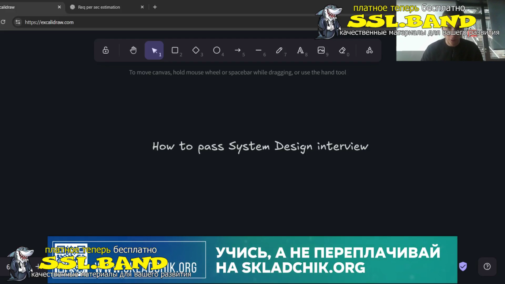
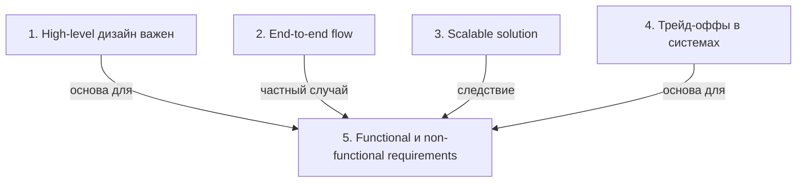

# Системный дизайн: основы и подходы

> [!abstract] Обзор
> Лекция по системному дизайну объясняет важность high-level подхода, end-to-end flow, масштабируемости, трейд-оффов и различий между функциональными и нефункциональными требованиями. Основной акцент на построении структуры, которая сначала работает для нескольких пользователей, а затем масштабируется.

> [!info] Курс
> [[index|Оглавление курса]]

## Оглавление
1. [[#1. High-level дизайн важен]]
2. [[#2. End-to-end flow]]
3. [[#3. Scalable solution]]
4. [[#4. Трейд-оффы в системах]]
5. [[#5. Functional и non-functional requirements]]

**Схема** — [[#Схема]]
**Итог** — [[#Итог]]

## 1. High-level дизайн важен

High-level дизайн должен сначала работать для нескольких пользователей, а не сразу включать оптимизацию или репликацию. Это позволяет сосредоточиться на базовой функциональности и избежать сложности на ранних этапах.

> [!info] Зачем это нужно
> Позволяет построить устойчивую основу, которая легко масштабируется позже.

## 2. End-to-end flow

End-to-end flow — это полный путь запроса от пользователя до ответа. Он должен быть рабочим и понятным, чтобы обеспечить корректную работу всей системы.

> [!info] Зачем это нужно
> Позволяет проверить, что система работает как единица, без пропусков или ошибок в логике.

> [!quote]- Кадр [00:03:25]
> 

## 3. Scalable solution

Scalable solution — это способ распределения запросов на несколько серверов для работы с миллионами и миллиардами пользователей. High availability — часть этого подхода.

> [!info] Зачем это нужно
> Обеспечивает устойчивость и доступность системы при росте нагрузки.

## 4. Трейд-оффы в системах

Трейд-оффы — это компромиссы между производительностью, стоимостью, надежностью и другими факторами. Система может быть read-heavy или write-heavy, что влияет на выбор архитектуры.

> [!info] Зачем это нужно
> Позволяют оптимизировать систему под конкретные задачи и ограничения.

## 5. Functional и non-functional requirements

Functional requirements описывают, что система должна делать (например, авторизация, чат), а non-functional — как она должна делать это (масштабируемость, задержка, доступность). Сначала удовлетворяют functional, затем non-functional.

> [!info] Зачем это нужно
> Позволяет структурировать разработку и убедиться, что система соответствует всем требованиям.

## Схема

## Итог

> [!success] Что в итоге
> High-level дизайн — основа, которая позволяет построить систему, которая сначала работает, а затем масштабируется. End-to-end flow проверяет целостность, scalable solution обеспечивает устойчивость, а трейд-оффы и требования помогают оптимизировать систему под конкретные задачи. Важно сначала удовлетворить функциональные требования, а затем улучшать нефункциональные.

