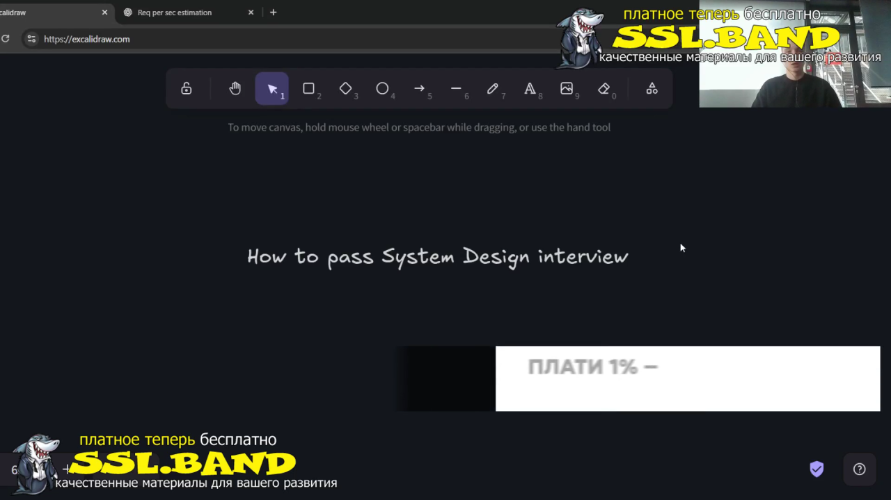
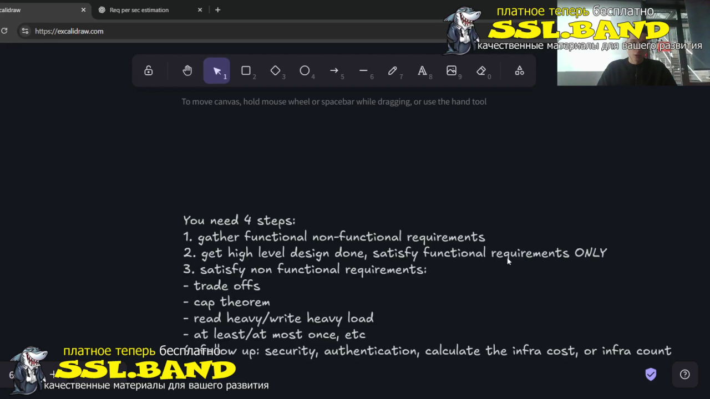
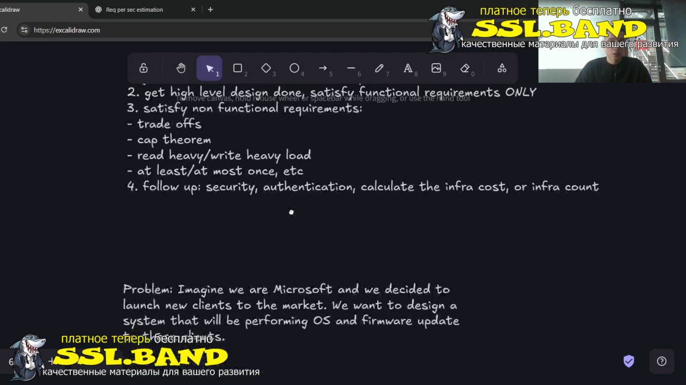
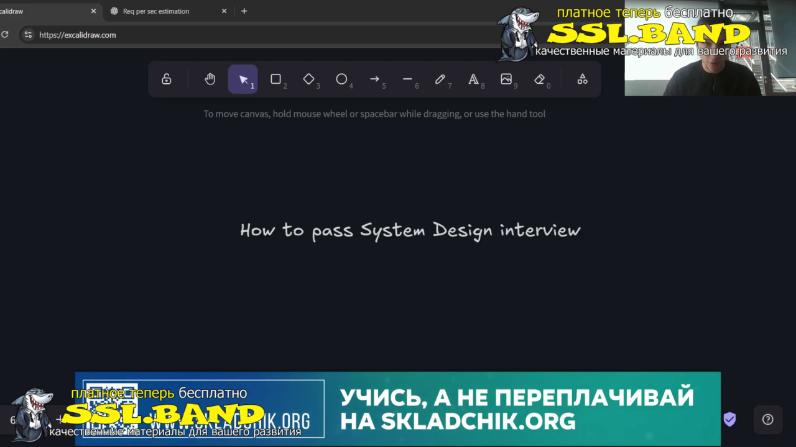
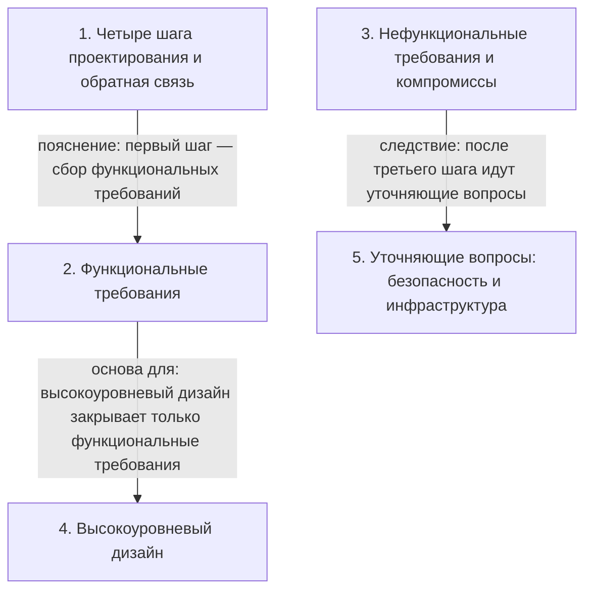

# Как проходить собеседование по System Design

> [!abstract] Обзор
> Материал о том, как проходить собеседование по System Design. Само собеседование идёт по шагам, а проектирование системы состоит из четырёх шагов. Сначала собирают функциональные и нефункциональные требования, задавая вопросы интервьюеру; затем рисуют высокоуровневый дизайн, который закрывает **только функциональные** требования. Третий шаг — выполнить нефункциональные требования с учётом компромиссов (trade-offs), CAP-теоремы, нагрузки с преобладанием чтения или записи и гарантий доставки «не менее / не более одного раза» (at least / at most once). Завершает процесс блок уточняющих вопросов (follow-up): безопасность и аутентификация, а также расчёт стоимости и количества инфраструктуры (infra cost / infra count).

> [!info] Курс
> [[index|Оглавление курса]]

## Оглавление
1. [[#1. Четыре шага проектирования и обратная связь]]
2. [[#2. Функциональные требования]]
3. [[#3. Нефункциональные требования и компромиссы]]
4. [[#4. Высокоуровневый дизайн]]
5. [[#5. Уточняющие вопросы: безопасность и инфраструктура]]

**Схема** — [[#Схема]]
**Итог** — [[#Итог]]

## 1. Четыре шага проектирования и обратная связь

Собеседование по System Design идёт по шагам, и проектирование системы тоже раскладывается на четыре шага: сбор функциональных и нефункциональных требований, высокоуровневый дизайн, выполнение нефункциональных требований и уточняющие вопросы (follow-up). Первый шаг — сбор требований, в том числе через вопросы к интервьюеру. Прежде чем переходить к следующему шагу, нужно **явно проговорить его вслух** и убедиться, что интервьюер согласен двигаться в эту сторону: он может захотеть сместить фокус на другое.

*Источник: [00:00:42], [00:00:51], [00:01:21], [00:01:52], [00:04:02]*

> [!quote]- Кадр [00:00:42]
> 

## 2. Функциональные требования

Функциональные требования описывают, **как система должна вести себя с точки зрения бизнеса и пользователя**. Они отвечают на вопрос «что делает система»: авторизация, чат, лайки, комментарии, лента и алгоритм подбора видео. В них нет количества пользователей, задержки (latency) или годовой стоимости системы. Первым делом нужно закрыть именно функциональные требования.

*Источник: [00:00:51], [00:01:21]*

> [!quote]- Кадр [00:00:51]
> 

## 3. Нефункциональные требования и компромиссы

Нефункциональные требования (non-functional requirements) описывают **технические свойства** системы, а не бизнес-логику: масштабируемость (scalability), доступность (availability), задержку (latency), поддерживаемость (maintainability), тестируемость (testability), компромиссы (trade-offs), CAP-теорему, характер нагрузки (с преобладанием чтения или записи) и гарантии доставки «не менее / не более одного раза». На третьем шаге эти требования нужно выполнить. Масштабируемое решение (scalable solution) требуется почти всегда из-за миллионов и миллиардов пользователей и запросов, поэтому запросы распределяют по разным машинам. При нагрузке с преобладанием чтения (read-heavy) репликация условного хранилища может быть альтернативой шардированию. Важно **явно проговаривать компромиссы**: если выбор остаётся за вами, решайте исходя из требований, а не из личных предпочтений.

| | Функциональные требования | Нефункциональные требования |
|---|---|---|
| Что описывают | поведение системы: авторизация, чат, лайки, комментарии, лента и алгоритм подбора видео | технические свойства: масштабируемость, доступность, задержка, поддерживаемость, тестируемость |
| Чего в них нет | количества пользователей, задержки, годовой стоимости системы | — |

*Источник: [00:01:52], [00:03:53], [00:05:04], [00:05:34], [00:06:04], [00:06:30], …*

## 4. Высокоуровневый дизайн

На втором шаге нужно нарисовать высокоуровневый дизайн (high level design), который закрывает **только функциональные** требования. Достаточно остановиться на базовом варианте, работающем для нескольких пользователей; не нужно уходить вглубь — думать про оптимизацию или репликацию. На примере YouTube: пользователь заходит на сайт, видит список видео, открывает видео, может поставить лайк и оставить комментарий, видео проигрывается — сквозной сценарий (end-to-end flow) рабочий для одного пользователя и одного сервера. Отдельно часто фиксируют требование высокой доступности (high availability): приложение должно работать даже при отказе целого региона (outage региона).

*Источник: [00:02:52], [00:03:25], [00:03:53], [00:05:04], [00:08:03], [00:08:11]*

> [!quote]- Кадр [00:08:11]
> 

> [!quote]- Кадр [00:03:25]
> 

## 5. Уточняющие вопросы: безопасность и инфраструктура

Четвёртый шаг — уточняющие вопросы (follow-up). Сюда входят безопасность (security) и аутентификация (authentication), а также расчёт стоимости и количества инфраструктуры (infra cost / infra count).

*Источник: [00:08:03], [00:08:14]*

## Схема

## Итог

> [!success] Что в итоге
> Проектирование системы состоит из четырёх шагов: сбор функциональных и нефункциональных требований, высокоуровневый дизайн только по функциональным требованиям, выполнение нефункциональных требований и уточняющие вопросы. Функциональные требования описывают поведение системы, нефункциональные — её технические свойства, такие как масштабируемость и высокая доступность. Между шагами важно держать обратную связь с интервьюером и явно проговаривать компромиссы.
