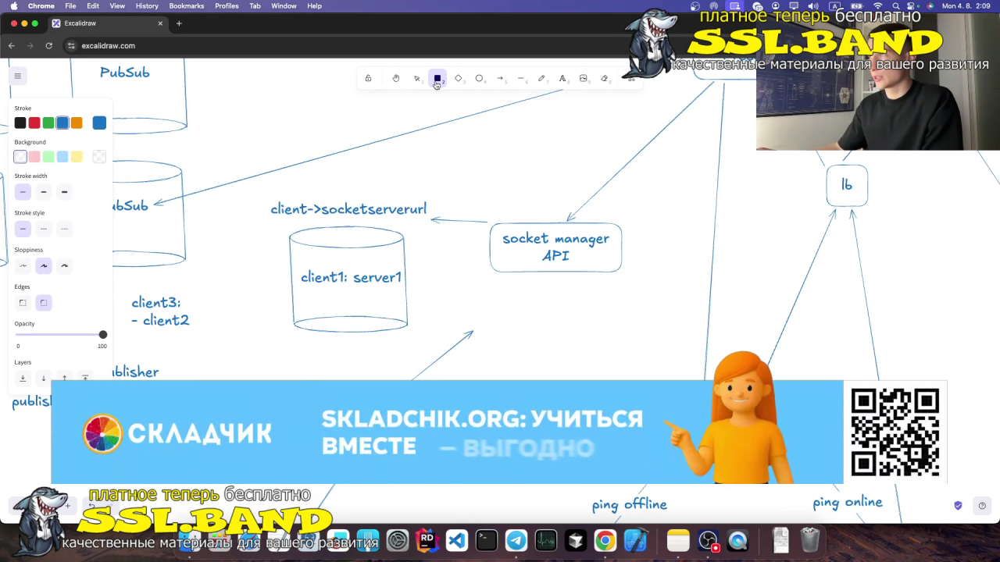
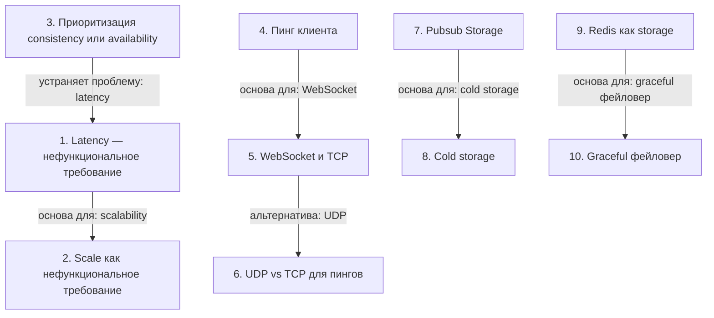

# Системный дизайн: требования и архитектура

> [!abstract] Обзор
> Лекция по системному дизайну охватывает ключевые нефункциональные требования: latency, scalability и reliability. Основное внимание уделено выбору протоколов, масштабируемости и управлению состоянием. Важно понимать, как эти элементы взаимодействуют для обеспечения надежной и быстрой работы системы.

> [!info] Курс
> [[index|Оглавление курса]]

## Оглавление
1. [[#1. Latency — нефункциональное требование]]
2. [[#2. Scale как нефункциональное требование]]
3. [[#3. Приоритизация consistency или availability]]
4. [[#4. Пинг клиента]]
5. [[#5. WebSocket и TCP]]
6. [[#6. UDP vs TCP для пингов]]
7. [[#7. Pubsub Storage]]
8. [[#8. Cold storage]]
9. [[#9. Redis как storage]]
10. [[#10. Graceful фейловер]]

**Схема** — [[#Схема]]
**Итог** — [[#Итог]]

## 1. Latency — нефункциональное требование

Latency — это задержка между отправкой и получением данных. Минимизация latency важна для обеспечения быстрого взаимодействия пользователей.

> [!info] Зачем это нужно
> Latency влияет на пользовательский опыт и должен быть минимизирован.

## 2. Scale как нефункциональное требование

Система должна масштабироваться, чтобы справляться с высокой нагрузкой, например, с 300 миллионами пользователей.

> [!info] Зачем это нужно
> Масштабируемость обеспечивает устойчивость системы при росте нагрузки.

## 3. Приоритизация consistency или availability

Приоритет отдан consistency — данные должны быть согласованы, даже если это снижает доступность.

> [!info] Зачем это нужно
> Consistency обеспечивает надежность данных, что критично для многих приложений.

## 4. Пинг клиента

Пинг отправляется каждые 2 секунды, чтобы определить, жив ли клиент. Это позволяет быстро обнаруживать отключения.

> [!info] Зачем это нужно
> Пинги обеспечивают мониторинг состояния клиентов.

## 5. WebSocket и TCP

WebSocket — протокол уровня приложения, работающий поверх TCP. Используется для поддержания долгих соединений в мессенджерах и Teams.

> [!info] Зачем это нужно
> WebSocket обеспечивает низкую задержку и постоянное соединение.

## 6. UDP vs TCP для пингов

UDP используется для пингов из-за скорости, так как гарантии доставки не важны. Пинги небольшие и не требуют оптимизации.

> [!info] Зачем это нужно
> UDP обеспечивает более быструю доставку, чем TCP.

## 7. Pubsub Storage

Pubsub Storage — хранилище, где хранятся сопоставления подписчиков и издателей. Используется для управления подписками и публикациями.

> [!info] Зачем это нужно
> Pubsub Storage позволяет эффективно управлять потоками данных.

## 8. Cold storage

Cold storage используется для обеспечения durability. Он должен быть 100% доступен для хранения исторических данных.

> [!info] Зачем это нужно
> Cold storage обеспечивает надежное хранение данных на долгий срок.

## 9. Redis как storage

Redis используется как storage в production. Он обеспечивает высокую скорость лукапа и ассета, а также durability.

> [!info] Зачем это нужно
> Redis подходит для хранения данных с высокой производительностью.

## 10. Graceful фейловер

При отпаде instance load-balancer перенаправляет запросы на другой instance. Это обеспечивает непрерывность работы.

> [!info] Зачем это нужно
> Graceful фейловер позволяет избежать прерывания сервиса.

> [!quote]- Кадр [00:46:39]
> 

## Схема

## Итог

> [!success] Что в итоге
> Лекция по системному дизайну охватывает ключевые нефункциональные требования: latency, scalability и reliability. Основное внимание уделено выбору протоколов, масштабируемости и управлению состоянием. Важно понимать, как эти элементы взаимодействуют для обеспечения надежной и быстрой работы системы.

