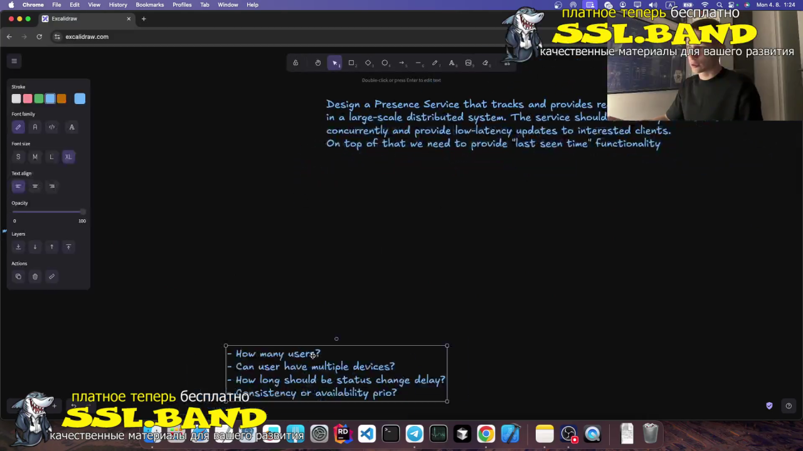
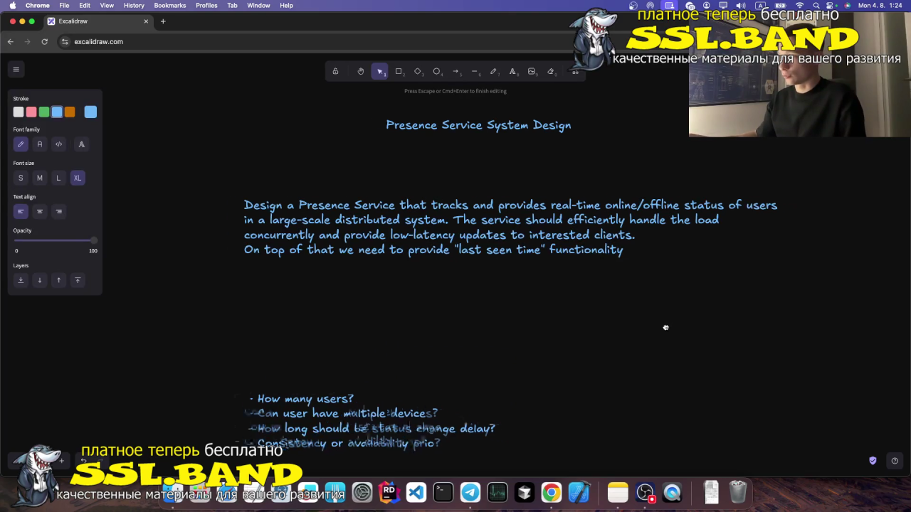
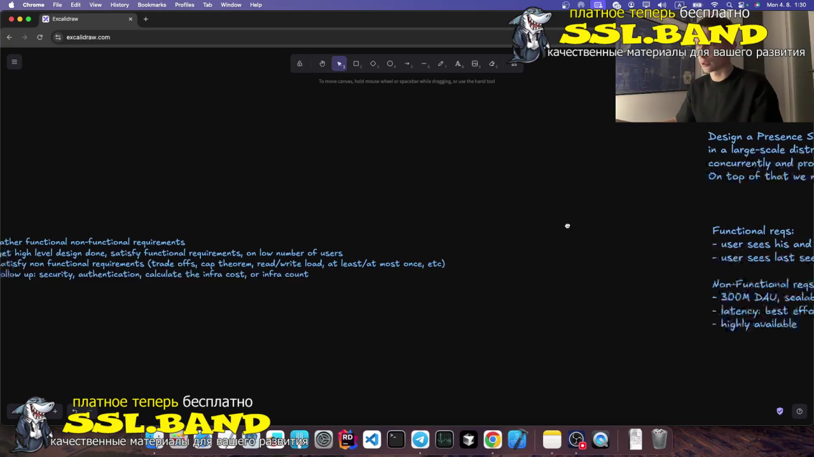
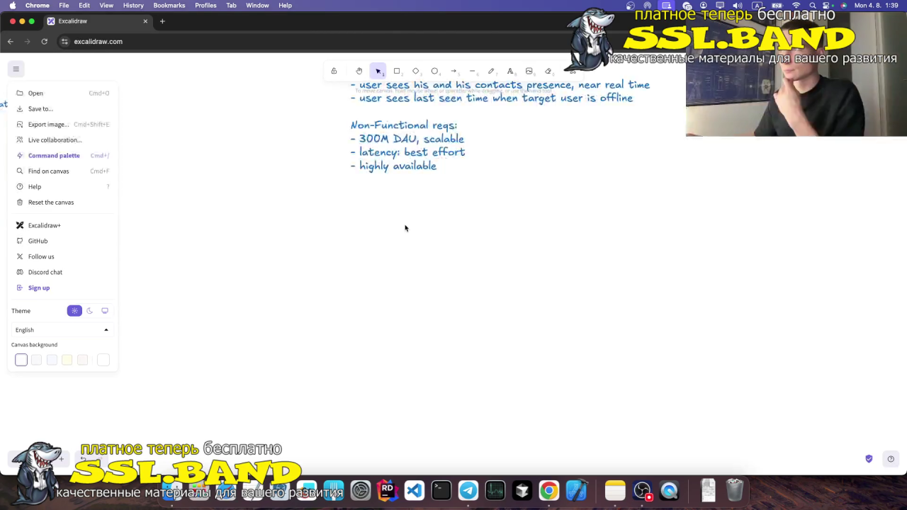
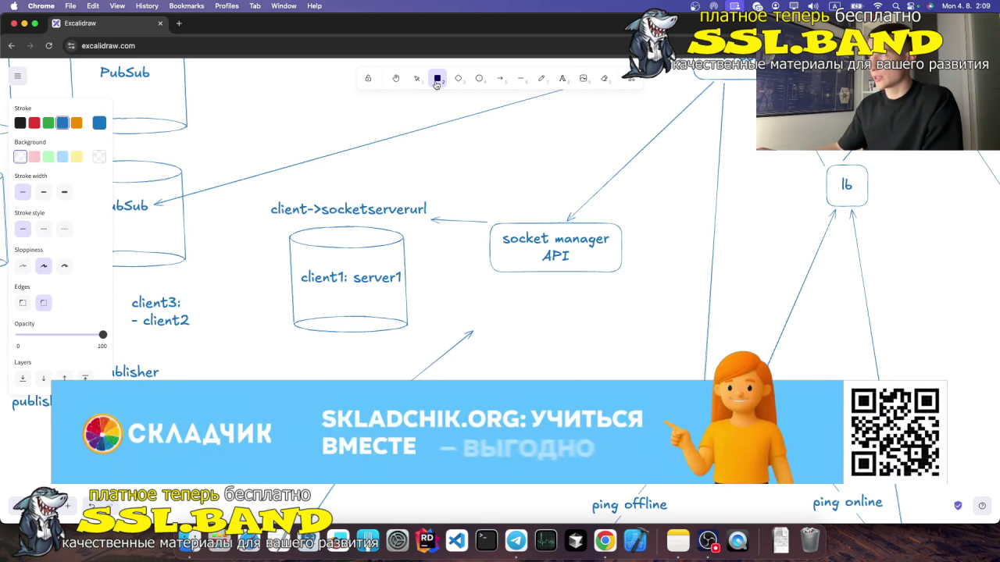
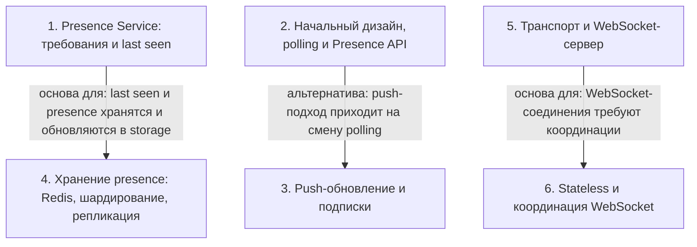

# Presence Service: сервис статусов «онлайн»

> [!abstract] Обзор
> Материал о проектировании **Presence Service** — сервиса, который отслеживает статус online/offline пользователей в крупномасштабной распределённой системе. Разбираются функциональные и нефункциональные требования, включая режим почти реального времени (near real-time), время последнего присутствия (last seen time), 300 млн DAU, задержку «по возможности» (best effort latency) и высокую доступность. Показана эволюция подхода: от начального «счастливого пути» (happy path) с постоянным опросом (polling) к push-подходу (обновление по записи и подписки на presence). Отдельно — транспорт и WebSocket-сервер, stateless/stateful, маршрутизация и координация через load balancer, «липкая» сессия (sticky session), Socket Manager и traffic manager. Также — хранение presence в Redis с шардированием и репликацией, плавное переключение при отказе (graceful failover), определение офлайна через polling и scheduler job, а также типичная ошибка с топиками Kafka на каждого пользователя (per-user топики).

> [!info] Курс
> [[index|Оглавление курса]]

## Оглавление
1. [[#1. Presence Service: требования и last seen]]
2. [[#2. Начальный дизайн, polling и Presence API]]
3. [[#3. Push-обновление и подписки]]
4. [[#4. Хранение presence: Redis, шардирование, репликация]]
5. [[#5. Транспорт и WebSocket-сервер]]
6. [[#6. Stateless и координация WebSocket]]
7. [[#7. Graceful failover и определение офлайна]]
8. [[#8. Kafka: топики на пользователя и retry]]

**Схема** — [[#Схема]]
**Итог** — [[#Итог]]

## 1. Presence Service: требования и last seen

**Presence Service** отслеживает статус online/offline пользователей в крупномасштабной распределённой системе. Пользователь видит свой presence и presence контактов почти в реальном времени (near real time); также есть **last seen time** — время последнего присутствия, которое показывается, когда пользователь офлайн, и не показывается, если пользователь никогда не заходил. Last seen обновляется при каждом пинге: сервис идёт в хранилище и перезаписывает время для клиента; значения хранятся в мапе (map) или таблице. Нужно вычленить функциональные и нефункциональные требования и решить, что приоритизировать: согласованность (consistency) или доступность (availability). При 300 млн DAU и 3–4 млн одновременно активных нагрузка около 4 млн запросов в секунду. Система должна быть масштабируемой, высокодоступной, с задержкой «по возможности» (latency best effort); **status change delay** — допустимое время смены статуса. Присутствие отслеживается на уровне устройств, но для простоты считаем одно устройство на пользователя.

*Источник: [00:00:00], [00:00:02], [00:00:05], [00:00:30], [00:00:40], [00:00:42], …*

> [!quote]- Кадр [00:01:41]
> 

> [!quote]- Кадр [00:01:58]
> 

## 2. Начальный дизайн, polling и Presence API

Высокоуровневый дизайн сначала закрывает только функциональные требования: допускается малое число пользователей и «счастливый путь» (happy path) без сетевых сбоев и падений машин. Пока приложение запущено, клиент отправляет онлайн-пинги каждые две секунды, а при закрытии отправляет запрос о переходе в оффлайн. Клиенты могут постоянно опрашивать сервис каждую секунду GET-запросом по пользователю; при подключении клиент регистрирует себя и делает первый базовый опрос (polling), чтобы узнать текущий статус всех контактов. **Presence API** — stateless HTTP-сервис, который масштабируется через load balancer; для него, скорее всего, выбирается TCP, потому что нужно знать, доставлены ли пинги, и при потере соединения отправлять их в другое место. Раз в 15 минут клиент ходит в presence API опросом (polling), чтобы ничего не потерялось; пинги всё равно делаются периодически, чтобы знать, что клиент жив — это даёт оптимизацию и экономию (cost-saving).

*Источник: [00:07:13], [00:09:15], [00:09:45], [00:10:15], [00:11:45], [00:13:45], …*

> [!quote]- Кадр [00:07:13]
> 

## 3. Push-обновление и подписки

При запуске приложения клиент сразу сообщает (пушит), что он онлайн. Вместо постоянного чтения статуса используют **push-подход**, и время выхода в оффлайн записывается. Обновление идёт через `update of presence API`: при изменении presence все заинтересованные клиенты получают обновление push-подходом, а клиент отправляет событие при корректном завершении (graceful shutdown). Изменений presence мало, и записей меньше, чем чтений, поэтому триггер обновления меняется: presence обновляется не при чтении, а при записи; нужно знать, кто заинтересован в изменении, и доставлять обновление только им. Presence в Redis обновляется только когда меняется; его шардируют на несколько баз, например `presence 01`, `presence 02`. Отображения (маппинги) «какой пользователь подписан на какого» хранятся в pub-sub-хранилище, динамически меняются и кэшируются; ставят лимиты, добавляют TTL, подписки (сабскрипции) чистятся при отключении (дисконнекте). Если каждый пользователь может смотреть presence каждого, нагрузка на подписки растёт экспоненциально.

| Механизм | Кто инициирует |
|---|---|
| Клиент (polling) | клиент опрашивает сервис |
| update of presence API (push) | сервер по записи (push-подход) |

> [!info] Зачем это нужно
> Иначе системе будет плохо, если такое позволить многим пользователям; список подписок динамически меняется, поэтому его нужно кэшировать.

*Источник: [00:11:15], [00:16:55], [00:17:25], [00:18:26], [00:23:58], [00:26:28], …*

> [!quote]- Кадр [00:16:55]
> 

## 4. Хранение presence: Redis, шардирование, репликация

Присутствие можно хранить в памяти (in-memory), например в хеш-мапе (hashmap); для небольшого числа пользователей этого достаточно, но при перезапуске сервиса данные в памяти будут утеряны. Presence работает с первичным ключом (primary key) client ID; ID достаточно равномерно распределены (GUID или номера), поэтому шардирование должно работать нормально. Чтобы не потерять last seen time, у каждого шарда будет read-реплика 100%, что позволяет сделать выборы лидера (leader election) и зафейловериться на другую реплику. Хранилище должно быть cold storage, потому что требуется долговременная персистентность (durable); в реальном production-сценарии используется Redis как хранилище — он обеспечивает долговечность и остаётся быстрым для поиска (лукапа) и доступа. При отказе (фейловере) происходят выборы лидера, и это должно быть высокодоступно; при отказе базы данных стараются делать репликацию **лидер-фолловер**, а если данные потеряются — это допустимо: клиент ещё раз создаёт подписку.

> [!info] Зачем это нужно
> Чтобы не потерять last seen time, требуется долговременная персистентность, а репликация лидер-фолловер проще и уменьшает число ошибок.

*Источник: [00:12:15], [00:40:03], [00:40:33], [00:41:03], [00:41:33], [00:42:03], …*

## 5. Транспорт и WebSocket-сервер

Для режима почти реального времени (near real-time) следует рассматривать долгоживущее соединение (long-lived connection) и сокеты. TCP немного медленнее, но гарантирует доставку, а UDP нужен для скорости, когда гарантии доставки не важны. **WebSocket** — это протокол прикладного уровня (Application Layer) поверх TCP: каждый клиент подключается веб-сокетами, и получается двунаправленная коммуникация (bidirectional), когда и сервер может слать клиенту, и клиент серверу. Один WebSocket-сервер выдерживает примерно 50 тысяч соединений (коннекшенов); нагрузка также зависит от объёма передаваемых данных и сериализации, что нагружает CPU. WebSocket-сервер пробрасывает события офлайна в presence-сервис, который занимается агрегацией; за счёт развязки (декаплинга) эта логика вынесена из WebSocket-сервера, а компонент называется WebSocket Server, потому что он занимается real-time-обновлениями клиентов. В веб-сокетах есть рукопожатие (handshake), его можно использовать для авторизации.

| Протокол | Особенность |
|---|---|
| TCP | немного медленнее, гарантирует доставку |
| UDP | нужен для скорости, когда гарантии доставки не важны |

> [!info] Зачем это нужно
> WebSocket не является stateless-сервисом, поэтому его сложно масштабировать.

*Источник: [00:20:27], [00:20:57], [00:21:57], [00:27:28], [00:27:58], [00:36:31], …*

## 6. Stateless и координация WebSocket

Stateless лучше stateful: stateless-сервисы легче масштабировать и переключать при отказе (фейловерить), а stateless compute масштабируется бесконечно без проблем. Load balancer 4 уровня работает на TCP-слое (TCP layer); **sticky session** нужно где-то хранить, чтобы знать, на каком WebSocket-сервере клиент держит соединение, поскольку у клиента может не быть статического IP-адреса. **Socket Manager** масштабируется через несколько инстансов; для отслеживания WebSocket-серверов используется координатор (например, ZooKeeper), а WebSocket-сервер постоянно пингует socket manager API. Если пинг перестал работать и сервер мёртв, socket manager инициирует переключение (failover) через ZooKeeper и считает клиентов на этом сервере недоступными. Socket Manager API — stateless HTTP-сервис, который отвечает, какой клиент на каком WebSocket-сервере; его можно шардировать, масштабировать и добавлять лидеры. Failover socket-менеджера делается через load balancer, DNS round robin, умный обратный прокси (smart reverse proxy) и другие механизмы и должен быть плавным (graceful) и автоматическим; вместо поиска сервера клиента обновления отправляются на URL глобального **traffic manager**, который сам определяет, куда доставить обновление.

> [!info] Зачем это нужно
> Stateless легче масштабировать и переключать при отказе; чтобы отправить сообщение клиенту, нужно знать, на каком WebSocket-сервере он держит соединение.

*Источник: [00:28:59], [00:29:59], [00:30:59], [00:32:30], [00:37:02], [00:37:32], …*

> [!quote]- Кадр [00:46:39]
> 

## 7. Graceful failover и определение офлайна

При деплое можно плавно (gracefully) переключать WebSocket-соединения между WebSocket-серверами и сообщать клиенту переподключиться к другому серверу; так происходит failover. При закрытии приложения в последний момент должно выдаваться событие о том, что пользователь не онлайн; система принимает, что это может не сработать, и если клиент отключится, не успев отправить сигнал, WebSocket-сервер перестаёт знать об этом, и некому триггерить push для уведомления других клиентов. При опросе каждые 15 минут можно смотреть на время последнего обновления (last updated time) и сравнивать его с тайм-аутом, например 10 минут: если last updated time старше 10 минут, клиент помечается офлайн и через push-приложение отправляется уведомление. После регистрации клиента планируется запрос в Presence API через 10 минут; автоматически менять статус на оффлайн можно по триггеру чтения при polling или через **scheduler job** — внешний сервис, который высокодоступен и хорошо масштабируется. Опрос от клиентов можно делать не раз в 15 минут, а раз в 2–3 минуты; фоновая джоба постоянно проверяет, когда последний раз клиент был, чтобы понять, не ушёл ли он офлайн. Компромисс: больше работы у фоновой джобы и чаще обращения к presence API, но меньше задержка.

> [!info] Зачем это нужно
> Цель запроса — проверить, онлайн ли клиент ещё; проверка нужна, чтобы понять, не ушёл ли клиент офлайн.

*Источник: [00:46:05], [00:48:06], [00:48:36], [00:49:07], [00:49:37], [00:53:08], …*

## 8. Kafka: топики на пользователя и retry

Частая ошибка в system design для presence — соединять WebSocket-серверы через Kafka, создавая отдельный топик на каждого пользователя и подписку от каждого пользователя. Вместо топика на каждого пользователя можно использовать один глобальный топик событий: держать одновременно 3–4 миллиона топиков — это перебор (оверкилл), каждый топик — отдельный процесс, топики дорогие. При использовании Kafka, если на этапе доставки (delivery) что-то не работает, вместо реализации retry-логики можно положиться на Kafka.

*Источник: [00:50:38], [00:51:08], [00:52:08]*

## Схема

## Итог

> [!success] Что в итоге
> Presence Service отслеживает статус online/offline и last seen time, показывая свой presence и presence контактов почти в реальном времени. При 300 млн DAU одна машина нагрузку не выдерживает, поэтому система должна быть высокодоступной, с задержкой «по возможности» и масштабируемой; значение last seen поддерживается в хранилище перезаписью времени при каждом пинге. В ходе дизайна подход эволюционирует от постоянного polling к push-обновлению по записи с подписками и доставкой только заинтересованным клиентам. Для режима почти реального времени используются WebSocket-соединения, а масштабирование и надёжность обеспечиваются через stateless-компоненты, Socket Manager, шардирование/репликацию хранилища и плавный failover.
