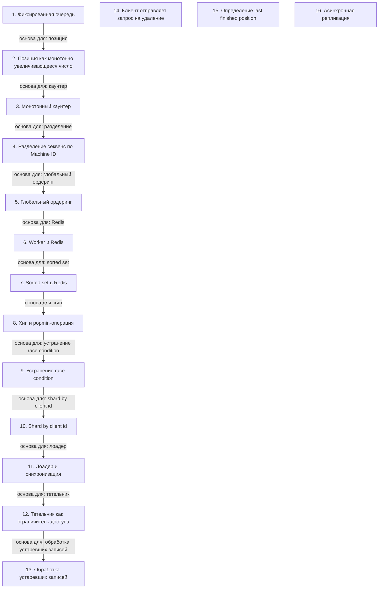

# Системный дизайн очереди и управления состоянием

> [!abstract] Обзор
> Лекция по системному дизайну очереди и управления состоянием. Основные темы: фиксированная очередь, монотонный каунтер, разделение секвенс по Machine ID, глобальный ордеринг, Redis, хип, устранение race condition, shard by client id, лоадер, тетельник, обработка устаревших записей, клиенты и удаление, last finished position, асинхронная репликация. Система строится на упорядочении, распределении и синхронизации.

> [!info] Курс
> [[index|Оглавление курса]]

## Оглавление
1. [[#1. Фиксированная очередь]]
2. [[#2. Позиция как монотонно увеличивающееся число]]
3. [[#3. Монотонный каунтер]]
4. [[#4. Разделение секвенс по Machine ID]]
5. [[#5. Глобальный ордеринг]]
6. [[#6. Worker и Redis]]
7. [[#7. Sorted set в Redis]]
8. [[#8. Хип и popmin-операция]]
9. [[#9. Устранение race condition]]
10. [[#10. Shard by client id]]
11. [[#11. Лоадер и синхронизация]]
12. [[#12. Тетельник как ограничитель доступа]]
13. [[#13. Обработка устаревших записей]]
14. [[#14. Клиент отправляет запрос на удаление]]
15. [[#15. Определение last finished position]]
16. [[#16. Асинхронная репликация]]

**Схема** — [[#Схема]]
**Итог** — [[#Итог]]

## 1. Фиксированная очередь

Хранение количества людей в очереди перед текущим узлом позволяет управлять нагрузкой и очередью в реальном времени. Каждый узел имеет свою очередь, данные хранятся в виде числа.

> [!info] Зачем это нужно
> Управление нагрузкой и очередью в реальном времени.

## 2. Позиция как монотонно увеличивающееся число

Позиция клиента определяется уникальным числом, которое растет с каждым новым клиентом. Это гарантирует уникальность и последовательность позиций в очереди.

> [!info] Зачем это нужно
> Обеспечивает уникальность и последовательность позиций в очереди.

## 3. Монотонный каунтер

Каунтер должен быть монотонным и уметь обрабатывать 14 лямов. Это сложная задача, так как глобальное упорядочение невозможно в распределенной системе.

> [!info] Зачем это нужно
> Обеспечивает уникальность и последовательность в распределенной системе.

## 4. Разделение секвенс по Machine ID

Секвенсы разделяются по Machine ID, чтобы избежать конфликтов. Это позволяет каждому узлу иметь собственную последовательность, но требует решения конфликтов на уровне приложения.

> [!info] Зачем это нужно
> Избежать конфликтов в распределенной системе.

## 5. Глобальный ордеринг

Глобальный ордеринг предполагает честное и общее упорядочение элементов. Он противопоставляется относительному ордерингу и требует строгой честности в упорядочении.

> [!info] Зачем это нужно
> Обеспечивает честное и общее упорядочение элементов.

## 6. Worker и Redis

Worker получает число, сохраняет его в Redis, который шардируется по client ID. Это позволяет эффективно управлять состоянием и очередью.

> [!info] Зачем это нужно
> Эффективное управление состоянием и очередью.

## 7. Sorted set в Redis

Sorted set — это структура данных в Redis, которая позволяет хранить и упорядочивать элементы по значению.

> [!info] Зачем это нужно
> Позволяет хранить и упорядочивать элементы по значению.

## 8. Хип и popmin-операция

Хип позволяет получать минимальный элемент за логарифмическое время. Это используется для эффективного управления очередью.

> [!info] Зачем это нужно
> Эффективное управление очередью.

## 9. Устранение race condition

Один поток считывает 20k рекордов из шарды, выбирает 20 тысяч меньше которых в memory и запушивает их в другие шарды. Это устраняет race condition.

> [!info] Зачем это нужно
> Устраняет race condition в распределенной системе.

## 10. Shard by client id

Система шардируется по client id, чтобы распределить нагрузку и избежать конфликтов.

> [!info] Зачем это нужно
> Распределение нагрузки и избежание конфликтов.

## 11. Лоадер и синхронизация

Лоадер крутится до тех пор, пока данные не появятся в Redis. Это обеспечивает синхронизацию между компонентами.

> [!info] Зачем это нужно
> Обеспечивает синхронизацию между компонентами.

## 12. Тетельник как ограничитель доступа

Тетельник угасает, чтобы пользователь не мог пользоваться билетом после ухода. Это ограничивает доступ к ресурсам.

> [!info] Зачем это нужно
> Ограничение доступа к ресурсам.

## 13. Обработка устаревших записей

Для удаления устаревших записей можно использовать background worker вместо TTL. Это позволяет более гибко управлять состоянием.

> [!info] Зачем это нужно
> Гибкое управление состоянием.

## 14. Клиент отправляет запрос на удаление

Клиент может отправить запрос на удаление, если пользователь вышел из ивента, закрыл вкладку или приложение. Это позволяет удалить запись вручную.

> [!info] Зачем это нужно
> Удаление записей вручную.

## 15. Определение last finished position

Если клиент закончил, купил билет и вышел, мы удаляем эту запись и ставим last finished position 5. Это позволяет отслеживать состояние очереди.

> [!info] Зачем это нужно
> Отслеживание состояния очереди.

## 16. Асинхронная репликация

На запись используется асинхронная репликация. Система использует лидерскую репликацию, а чтение происходит со всех реплик. Асинхронная репликация на 50 реплик может занимать много времени, и 100% last finished будет не актуальным. Это требует асинхронного подхода.

> [!info] Зачем это нужно
> Эффективная репликация и чтение.

## Схема

## Итог

> [!success] Что в итоге
> Система управления очередью и состоянием строится на принципах упорядочения, распределения и синхронизации. Основные компоненты включают монотонный каунтер, разделение секвенс по Machine ID, Redis, хип, устранение race condition, асинхронную репликацию и обработку устаревших записей. Все эти элементы работают вместе для обеспечения надежности, производительности и корректности системы.

