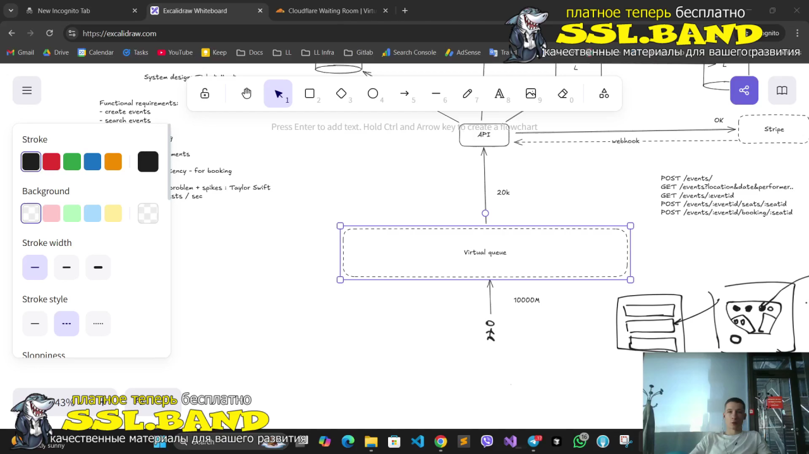
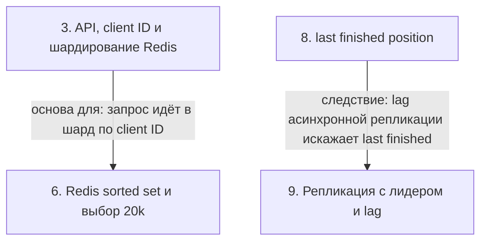

# Виртуальная очередь на Redis для системы продажи билетов

> [!abstract] Обзор
> Материал о построении виртуальной очереди (virtual queue) на Redis для системы продажи билетов. Рассматриваются пиковые нагрузки (пример — Taylor Swift) и требование выдерживать 14 миллионов одновременных пользователей, масштабирование API, client ID и шардирование Redis по client ID. Обсуждаются функциональные требования (create events и search events), монотонная позиция клиента, монотонный счётчик (counter), распределённое упорядочивание (distributed ordering) и секвенсы (последовательности) на нескольких нодах. Отдельно — Redis sorted set и операция popmin, единственный обработчик для выбора 20k, протухание записей и способы его обнаружения. Завершают материал last finished position и репликация с лидером (leaderful replication) с задержкой (lag) асинхронной репликации.

> [!info] Курс
> [[index|Оглавление курса]]

## Оглавление
1. [[#1. Виртуальная очередь и пиковые нагрузки]]
2. [[#2. Функциональные требования системы]]
3. [[#3. API, client ID и шардирование Redis]]
4. [[#4. Позиция клиента и worker]]
5. [[#5. Монотонный счётчик и секвенсы]]
6. [[#6. Redis sorted set и выбор 20k]]
7. [[#7. Таймаут доступа и протухание]]
8. [[#8. last finished position]]
9. [[#9. Репликация с лидером и lag]]

**Схема** — [[#Схема]]
**Итог** — [[#Итог]]

## 1. Виртуальная очередь и пиковые нагрузки

**Виртуальная очередь (Virtual Queue)** реализуется за счёт Redis. Нужно запускать дальше в систему только фиксированное количество людей. Система хранит, сколько людей в очереди перед тобой (позиция в очереди). В схеме системы продажи билетов между API и Stripe используется виртуальная очередь. Возникает проблема пиковых нагрузок (пример — Taylor Swift), и система должна выдерживать (хендлить) 14 миллионов людей одновременно.

*Источник: [00:00:00], [00:01:02], [00:11:50]*

> [!quote]- Кадр [00:00:00]
> 

## 2. Функциональные требования системы

Функциональные требования системы продажи билетов включают `create events` (создание событий) и `search events` (поиск событий).

*Источник: [00:01:32], [00:05:35], [00:07:06], [00:11:19]*

## 3. API, client ID и шардирование Redis

Клиенты приходят в API, которое масштабируется бесконечно. При этом у каждого клиента есть **client ID**. Redis шардируется по client ID. Клиент при входе посылает свой client ID, чтобы он был виден везде. Во всех шардах будет всего 20 тысяч записей для этого события (ивента).

> [!info] Зачем это нужно
> Чтобы client ID был виден везде.

*Источник: [00:01:32], [00:04:04], [00:06:05]*

## 4. Позиция клиента и worker

В виртуальной очереди пользователь ждёт, пока люди перед ним получат доступ. Клиенту присваивается число, означающее его позицию в очереди (например, 5), и позиция монотонно возрастает. Из Redis выполняется поиск (лукап), чтобы узнать позицию клиента. При постановке в очередь запрос синхронно возвращает `OK`, а клиент показывает индикатор загрузки (лоадер) до попадания записи в Redis. **Worker** слушает канал (или «трубку»), получает число и ставит его в Redis.

*Источник: [00:02:02], [00:04:04], [00:04:34]*

## 5. Монотонный счётчик и секвенсы

Нужен **монотонный счётчик (counter)**, который можно сделать как отдельный инстанс и который должен уметь выдерживать 14 миллионов. Распределённый счётчик невозможно сделать глобально упорядоченным: глобальное упорядочивание (global ordering) обеспечивает «супер-честный» порядок, а относительное упорядочивание (relative ordering) позволяет сделать систему распределённой. Если нод несколько, нельзя сделать одну общую последовательность (sequence): нужно разбивать по Machine ID, тогда получатся две последовательности с префиксами A1, A2, A3 и B1, B2, B3. На приложении придётся решать, кто из A1 и B1 должен быть первым; другой вариант — разделение на чётные/нечётные.

*Источник: [00:02:33], [00:03:03]*

## 6. Redis sorted set и выбор 20k

В Redis есть структура данных **sorted set (отсортированное множество)**; для эффективной операции **popmin** используется sorted set, и хранилище должно поддерживать popmin. Куча/хип (heap) позволяет получать минимальный элемент за логарифм от всех элементов в хипе. Выбором 20k занимается **единственный компонент**, чтобы не было состояния гонки (race condition): он считывает по 2 тысячи записей из каждого шарда, в памяти выбирает 20 тысяч и пушит их в ещё один шардированный Redis. Координатор закидывает 20 тысяч человек; запрос идёт в шард для конкретного клиента и проверяет, есть ли запись о нём, чтобы понять, может ли он использовать приложение, и очередь запускает его на Ticketmaster. Координатор также спуливает со всех шардов все записи для этого события и добирает условно по 500 записей с каждого шарда, из которых берёт тысячу самых минимальных и докидывает в очередь.

> [!info] Зачем это нужно
> Проверка нужна, чтобы понять, может ли пользователь использовать приложение.

*Источник: [00:04:34], [00:05:04], [00:05:35], [00:07:06], [00:07:36], [00:08:06]*

## 7. Таймаут доступа и протухание

В очереди есть **таймаут доступа**: доступ «угасает», и если человек пошёл пить кофе, он в какой-то момент перестаёт иметь доступ и даёт другим выбрать билет. Записи в виртуальной очереди протухают — например, через 15 минут после выбора места. Когда пользователь закончил сессию и больше не будет брать билеты, запись удаляется из хранилища очереди; а если что-то не удалили своевременно, оно удалится само. Нужно определять (детектить), когда запись протухла: вместо TTL можно сделать **background worker**, который постоянно сканирует 20 тысяч записей и удаляет протухшие. Второй вариант — когда клиент определит, что пользователь закрыл вкладку или приложение, он пришлёт endpoint, чтобы выкинуть этого клиента.

*Источник: [00:07:36], [00:08:06], [00:08:36], [00:09:06]*

## 8. last finished position

Когда клиент закончил, его удаляют из очереди. Воркер при удалении может записывать в отдельное хранилище **last finished position** (позиция последнего завершившего). При удалении ставят last finished position 5.

*Источник: [00:09:37]*

## 9. Репликация с лидером и lag

Для обработки 14 миллионов запросов используется стандартная **репликация с лидером (leaderful replication)**: один лидер и несколько фолловеров. Запись идёт через асинхронную репликацию, а чтение — со всех реплик. Из-за этого last finished position будет не самым свежим (не up to date), выдаётся только приблизительное значение, и это не решается.

*Источник: [00:10:49], [00:11:19]*

## Схема

## Итог

> [!success] Что в итоге
> Виртуальная очередь на Redis позволяет запускать дальше в систему только фиксированное количество людей при пиковых нагрузках и 14 миллионах одновременных пользователей. Redis шардируется по client ID, а позиция клиента — монотонно возрастающее число; для распределённого упорядочивания применяется относительный порядок (relative ordering) и разбиение последовательностей по Machine ID. Записи хранятся в sorted set, обслуживаются единственным обработчиком для выбора 20k и протухают, для чего используются background worker или клиентский endpoint. last finished position ведётся в отдельном хранилище и из-за асинхронной репликации выдаёт приблизительное значение.
