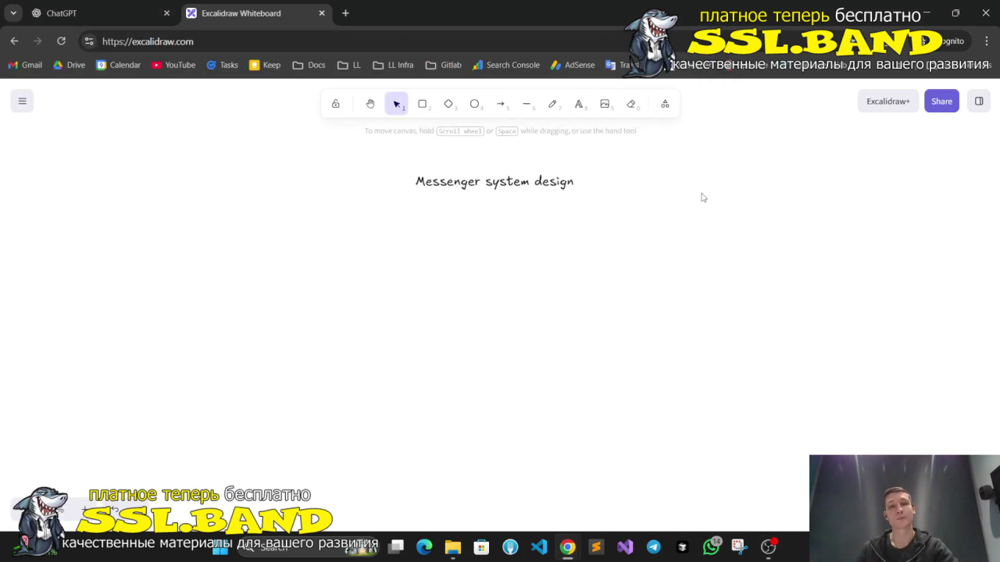
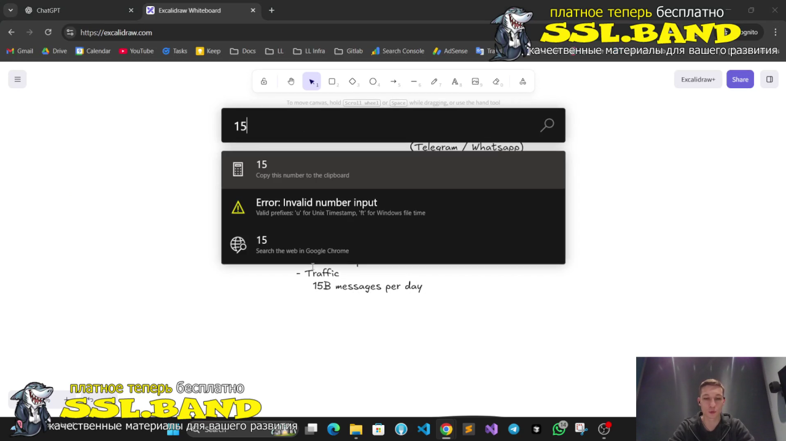
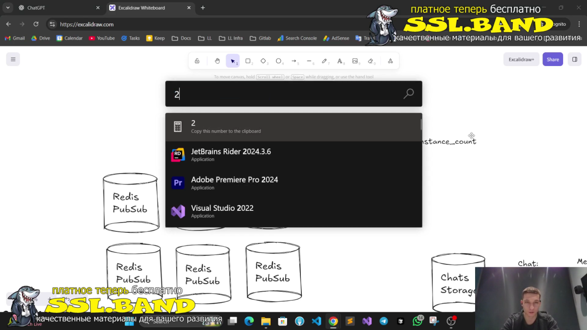
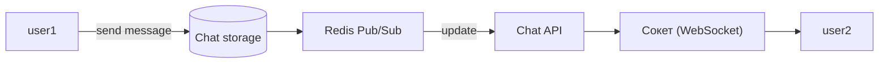
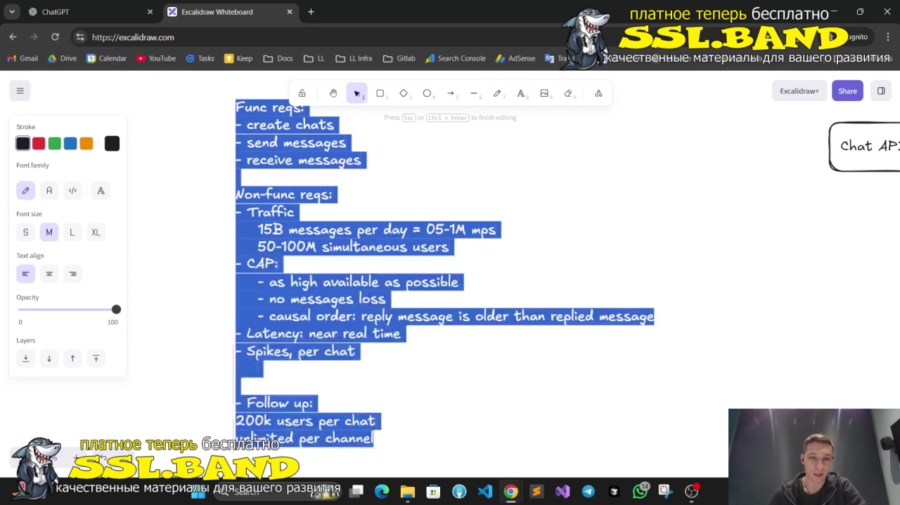
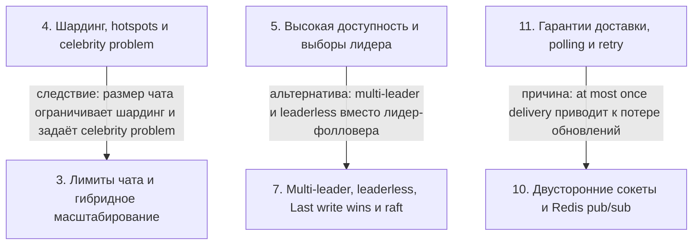

# Проектирование системы мессенджера: доставка, порядок и шардинг

> [!abstract] Обзор
> Материал о проектировании системы мессенджера. Разбираются функциональные и нефункциональные требования, оценка нагрузки, лимит участников чата, причинный порядок (causal order), сущности Chat и Message, pull-модель чтения, двусторонние сокеты, доставка обновлений (апдейтов) через Redis pub/sub и шардирование. Отдельно — шардирование по чату, перегруженные шарды (hotspots) и «проблема знаменитости» (celebrity problem), ограничитель частоты (rate limiter), высокая доступность и репликация, уникальные ID, multi-leader и leaderless, консенсус raft, а также порядок сообщений через send timestamp, расхождение часов (clock skew) и гибридный sequence number. Общая задача — обеспечить высокую доступность, отсутствие потери сообщений (no message loss), низкую задержку и причинный порядок при большой нагрузке.

> [!info] Курс
> [[index|Оглавление курса]]

## Оглавление
1. [[#1. Требования и каналы]]
2. [[#2. Оценка нагрузки и одновременные пользователи]]
3. [[#3. Лимиты чата и гибридное масштабирование]]
4. [[#4. Шардинг, hotspots и celebrity problem]]
5. [[#5. Высокая доступность и выборы лидера]]
6. [[#6. Уникальные ID сообщений]]
7. [[#7. Multi-leader, leaderless, Last write wins и raft]]
8. [[#8. Причинный порядок, clock skew и sequence number]]
9. [[#9. Сущности чата и pull-модель]]
10. [[#10. Двусторонние сокеты и Redis pub/sub]]
11. [[#11. Гарантии доставки, polling и retry]]
12. [[#12. Ограничитель частоты и TTL]]

**Схема** — [[#Схема]]
**Итог** — [[#Итог]]

## 1. Требования и каналы

При проектировании мессенджера начинают с точки зрения UI: определяют чаты, которые можно создавать, и сообщения, которые пишут пользователи. Функциональных требований три: создание чатов (create chats), отправка сообщения (send message), получение сообщений (receive messages). Когда я написал сообщение, оно должно попасть в чат, и все другие участники должны его увидеть — и наоборот. Функциональные требования достаточно просты (easy), а проблемы будут с нефункциональными. В канале могут быть посты; уточняющие вопросы (follow-up) делаются по каждому чату (per chat), а лимит подписок на канал — неограниченный. Комментарий — это по сути тот же чат, он работает в реальном времени (real-time), поэтому людей может быть даже больше, чем 200k.

*Источник: [00:00:36], [00:01:15], [00:03:52], [00:04:22]*

> [!quote]- Кадр [00:00:36]
> 

## 2. Оценка нагрузки и одновременные пользователи

5 000 000 делят на 24, затем на 3 600. При расчёте среднего числа сообщений в секунду учитывают всплески (спайки), умножая показатель на 5–10. Делить сутки нужно не на 24, а примерно на 16, так как основной трафик идёт из Европы и Азии — это даёт оценку 0,5–1 миллион сообщений в секунду. За день к Telegram подключаются 450 миллионов пользователей, а одновременно — 50–100 миллионов (одновременных пользователей, concurrent users). Система должна держать 50–100 миллионов соединений пользователей, которые сейчас в системе.

*Источник: [00:02:03], [00:02:15], [00:02:59], [00:03:19]*

> [!quote]- Кадр [00:02:03]
> 

## 3. Лимиты чата и гибридное масштабирование

Ограничение — 200k пользователей на чат (200k users per chat). Это ломает дизайн, рассчитанный на WhatsApp с 200 человек: такой дизайн не потянет 200k. Даже если сделать 200 шардов, проблема 200 участников в чате не решится. Стратегия считается рабочей, если число пользователей составляет примерно 10% от числа шардов: в примере — 1000 шардов и максимум 100 пользователей. Устанавливается порог участников на чат (participants per chat): если в чате больше 50 участников, он переводится на гибридную схему. Гибридная схема позволяет делать real-time-обновления на чат, а для не-real-time-обновлений — гибридное решение для шардинга, которое решает проблемы со масштабированием и задержкой. Chat API, который держит сокеты, будет работать не «по пользователю»: он не будет держать соединение на каждого пользователя.

*Источник: [00:03:19], [00:15:54], [00:21:06], [00:23:08], [00:26:08], [00:26:38], …*

## 4. Шардинг, hotspots и celebrity problem

Суть шардинга — равномерно распределять пользователей между шардами. В мессенджере чаты могут быть один на один, на 100 человек, на тысячи и десятки тысяч участников, поэтому «слот» будет очень неравномерным; в качестве ключа используется хеш от пользователя, а ребалансировку (rebalancing) можно сделать на Redis hash slots. **Chat storage нужно шардировать по чату, а не по сообщению**: при шардировании по сообщению потребуется scatter-gather для сбора всех сообщений, а чтобы не отслеживать, какой шард держит какое сообщение, все сообщения чата должны быть в одной ноде — это создаёт hotspot для активных чатов. При шардинге по чатам возникают hotspots; Redis может держать очень маленькие чаты, но очень большой чат будет «выжирать» все CPU и память, и супербольшие чаты можно обрабатывать как **celebrity problem**: выделять для них отдельные инстансы. В чате может быть больше пользователей, чем есть нод: нод — сотни или тысячи, а в чате может быть до 200k пользователей; пока число Redis-шардов меньше максимального числа пользователей в чате, шардинг работать не будет. Большие чаты всегда обращаются ко всем шардам, добавление Redis-шардов не даёт линейного роста производительности, из-за чего шардинг становится нелинейной функцией. В худшем случае при отправке сообщения в чат на 200 участников система ходит во все 20 Redis, после отправки берутся участники, и на каждого из них отправляется обновление.

> [!info] Зачем это нужно
> Применяется для равномерного распределения чатов; чтобы не отслеживать, какой шард держит какое сообщение.

*Источник: [00:07:57], [00:15:54], [00:19:36], [00:21:06], [00:21:36], [00:22:06], …*

> [!quote]- Кадр [00:22:35]
> 

## 5. Высокая доступность и выборы лидера

Система должна быть **максимально высокодоступной (as high available as possible)**: мы не хотим, чтобы она лежала. Как только сообщение записано и на клиент пришёл confirm, сообщение нельзя терять, и его всегда нужно потом считать; при этом нужно стремиться к как можно лучшей задержке (latency). В дизайне мессенджера допускается, что из-за падения ноды сообщение добежит позже: из-за delta-сообщения обновление приходит позже, при опросе (поллинге) появляется delta. Высокая доступность решается за счёт других инстансов, на которые можно переключиться (зафейловериться). Репликация лидер-фолловер обеспечивает высокую доступность, но восстановление из холодного бэкапа занимает часы, поэтому используется **асинхронная репликация лидер-фолловер**. Для мессенджера лидер-фолловер не подходит, потому что при выборах лидера (leader election) сообщение можно потерять; пользователи могут подождать 10–20 секунд, потерянные данные перезапишутся, чат перередиректится, клиенты видят, что соединение мертво, и переподключаются.

> [!info] Зачем это нужно
> Для обеспечения высокой доступности.

*Источник: [00:04:52], [00:05:22], [00:05:57], [00:32:12], [00:35:15], [00:35:45], …*

## 6. Уникальные ID сообщений

Для предотвращения потери сообщений (message loss) используют уникальные идентификаторы сообщений, например GUID. Использовать автоинкрементный первичный ключ (primary ID) для сообщений проблематично при репликации, поэтому идентификатор генерируется на стороне клиента (например, GUID). Пользователь не может обновлять сообщение, поэтому потеря обновлений (lost update) невозможна.

> [!info] Зачем это нужно
> Для предотвращения потери сообщений.

*Источник: [00:37:15], [00:37:48]*

## 7. Multi-leader, leaderless, Last write wins и raft

В итоге все реплики получают данные; при использовании нескольких лидеров данные синхронизируются, и проблема потери данных решается (data loss solved). В **leaderless-схеме** клиент шлёт запрос на все реплики, а кворум задаётся условием `W + R > N`: при трёх машинах нужно минимум два успешных чтения и две успешных записи — это гарантирует, что данные не потеряются. На обновлениях можно словить проблему конкуренции (concurrency): потеря обновления может произойти из-за сочетания отказа ноды, расхождения часов (clock skew) и способа разрешения конфликта, а **Last write wins** может перетереть данные и привести к потере данных, поэтому при наличии обновляющих сообщений в области видимости этот подход не подходит. Чтобы гарантировать одновременно и доступность, и отсутствие потери данных, применяется консенсус **raft**; другой возможности нет, но это дорого, альтернатива — терпеть небольшую потерю данных. В мультилидер-системе возникает точно такая же проблема с порядком, в leaderless — та же проблема, и в итоге всё равно приходим к какому-то роду консенсуса. Самое безопасное решение — консенсус, но это дорого и сказывается на производительности. Линеаризуемость (linearizable) значит, что если мы что-то записали, то точно прочитаем, и если прочитали — оно уже точно есть в базе.

*Источник: [00:38:18], [00:38:48], [00:39:18], [00:39:48], [00:40:19], [00:40:49], …*

## 8. Причинный порядок, clock skew и sequence number

Ключевой момент в дизайне мессенджера — **причинный порядок (causal order)**: это не полный порядок (total order), а порядок, при котором ответ не может появиться раньше исходного сообщения. При ответе все клиенты должны прийти к тому, что сообщение, на которое ответили, старее, чем ответ, и ответ (reply) отображается позже. Чтобы определить, какое сообщение пришло раньше, вводится **send timestamp**; клиент может сам проставлять таймстамп, но у клиентов сильное расхождение часов (clock skew), синхронизацию времени мы не гарантируем, а плохой rollout может испортить таймстампы, поэтому доверять клиенту — плохая идея. Сообщение может «стемпиться» разными нодами, между которыми возможно расхождение часов, например минус 3 секунды; из-за этого не удаётся обеспечить причинный порядок, и нужно гарантировать, что clock skew меньше времени на ответ. Один из вариантов решения — если у нас одна нода, делать таймстамп на самой ноде базы данных, тогда всё будет согласованно, но одна нода не устраивает, если нужна высокая доступность. В качестве решения можно сделать **гибридный sequence number**: клиент присылает, какое последнее сообщение он увидел, а таймстамп выбирается как максимум из `UTC now` и send timestamp последнего увиденного сообщения плюс 1; sequence number — логический, а не физический таймстамп, и если уже отправлено сообщение 1, то сообщение 2 точно получит больший счётчик. Третий вариант — сделать глобальный счётчик (или auto-increment) на каждый чат: например, для chat ID 1 ведётся последовательность 1, 2, 3, 4. Полный порядок (total order) нужен только в рамках одного чата, а не глобально по всем чатам; гранулярность порядка «на чат» позволяет системе масштабироваться.

*Источник: [00:05:57], [00:06:27], [00:07:27], [00:41:19], [00:41:49], [00:42:19], …*

## 9. Сущности чата и pull-модель

Для создания чата можно сделать endpoint `POST /chats`. Созданный чат сохраняется в базе данных, чтобы обеспечить долговечность (durability). Чат имеет ID, возможно name и participants. Сообщение имеет ID, content, chat ID, sender и parent ID для ответов (reply). Чтобы отправить сообщение, используется путь `chat / chat ID / message / messages`. Клиенты забирают сообщения pull-запросами: делают GET по чату, где offset и limit настраиваются на клиенте, и загружают все сообщения; при наличии функции прокрутки (scroll) сообщения догружаются дополнительно с другим offset. Когда получатель прочитывает сообщение, отправитель получает статус о прочтении (message read).

> [!info] Зачем это нужно
> Сохранение в базе данных делается, чтобы обеспечить долговечность.

*Источник: [00:08:27], [00:08:57], [00:09:38], [00:10:29], [00:11:11], [00:45:32]*

## 10. Двусторонние сокеты и Redis pub/sub

В чате есть участники (participants) — user1 и user2; когда первый отправляет сообщение, обновление нужно доставить и второму участнику, поэтому из-за сокетов связь двунаправленная. Режим почти реального времени (near real-time) автоматически означает либо WebSocket (если в клиентах есть браузер), либо server-side events (SSE). Для задержки доставки сообщения выбирают быструю отправку через WebSocket, а для доставки по сокетам нужно отслеживать, кто находится в чате и куда подключены участники. Чтобы отправить обновление пользователю в реальном времени, нужно знать, где находится его соединение; при подключении пользователь подключается случайно (рандомно) к одной из нод, а Connect-запрос является HTTP и распределяется балансировщиком (load balancer); нода обновляет Redis, указывая, какой Chat API обслуживает пользователя, и Chat API периодически пингует Redis. В дизайне мессенджера используют **Redis pub/sub**, а не Kafka: топики Kafka очень дорогие, их нельзя создать 400 миллионов за раз. Redis PubSub обеспечивает доставку **«не более одного раза» (at most once delivery)**: сообщение отправляется и забывается, при потере повторно не доставляется. Сообщение от первого пользователя сохраняется в базе, после чего в PubSub уходит обновление; PubSub определяет участников чата и рассылает сообщение им, Chat API триггерит подписчика (сабскрайбера), который по локальной мапе находит сокет пользователя и отправляет ему сообщение. Но при очень большом количестве обновлений нода Redis Pub/Sub становится перегруженной и глобально немасштабируемой (non-scalable).

➕ Схема доставки сообщения:

> [!info] Зачем это нужно
> Для задержки доставки сообщения выбирают быструю отправку через WebSocket.

*Источник: [00:12:11], [00:12:44], [00:13:11], [00:13:45], [00:14:15], [00:14:54], …*

> [!quote]- Кадр [00:12:44]
> 

## 11. Гарантии доставки, polling и retry

При гарантии **«не более одного раза» (at most once)** сообщение может не прийти. Если обновления не ретраятся (at most once), часть из них может потеряться, создавая «дырки» в доставке; в системе мессенджера таких дырок три, включая дырку от чата к пользователю. Гибридный подход лучше всего; для больших чатов можно переходить на опрос (polling), а если можно позволить — подойдёт и чистый polling. Раз в 30 секунд polling позволяет догрузить пропущенные сообщения. Если у нас 30 секунд, то retry нет смысла делать: можно два раза попробовать в памяти (in-memory) и никаких retry-джоб не надо. При неудачной отправке обновления можно заретраить локально 3–4 раза, попробовать отправить всем заинтересованным нодам или сделать задачу по расписанию (schedule-джобу).

*Источник: [00:19:06], [00:19:36], [00:20:06], [00:25:38]*

## 12. Ограничитель частоты и TTL

Для снижения нагрузки на чаты можно использовать **ограничитель частоты (rate limiter)**, работающий по чату: например, разрешить не более 10 сообщений в секунду, так как большее количество не имеет смысла для real-time-опыта пользователя. Read-limiter позволяет допустить максимум 100 сообщений в секунду; больше этого получать не будем. Потеря данных допустима: эти данные можно потерять, потому что следующий подключившийся клиент может сразу их перезаписать. Данные, которые можно потерять, можно хранить с TTL-экспирацией, чтобы они автоматически удалялись.

> [!info] Зачем это нужно
> Для снижения нагрузки на чаты.

*Источник: [00:32:42], [00:33:12], [00:33:42], [00:35:15], [00:36:45]*

## Схема

## Итог

> [!success] Что в итоге
> Проектирование мессенджера начинается с функциональных требований, но основные сложности лежат в нефункциональных: нагрузке, высокой доступности, отсутствии потери сообщений, задержке и причинном порядке. Доставка обновлений строится на двусторонних сокетах и Redis pub/sub с доставкой «не более одного раза» (at most once), компенсируемой polling и локальными ретраями, а масштабирование — на шардинге, ограниченном размером чата. Порядок сообщений требует отдельного решения: клиентский таймстамп ненадёжен из-за расхождения часов (clock skew), поэтому применяют таймстемпинг в одном инстансе, таймстамп на ноде базы данных, гибридный sequence number или глобальный счётчик на чат. Для гарантий без потери данных применяют уникальные ID, multi-leader/leaderless с кворумом `W + R > N` или консенсус raft.
