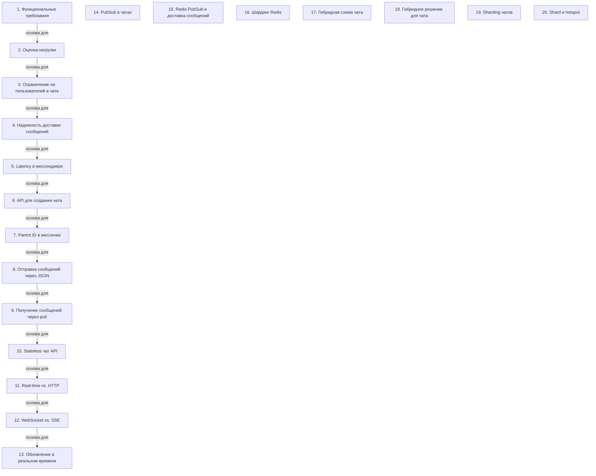

# Дизайн системы мессенджера

> [!abstract] Обзор
> Лекция по проектированию мессенджера охватывает функциональные требования, нагрузку, доставку сообщений, шардинг и архитектуру. Основные темы: функциональные требования, оценка нагрузки, ограничения на чаты, доставка сообщений, latency, API, PubSub, Redis, шардинг и гибридные схемы. Все элементы связаны между собой и позволяют создать надежную и масштабируемую систему мессенджера.

> [!info] Курс
> [[index|Оглавление курса]]

## Оглавление
1. [[#1. Функциональные требования]]
2. [[#2. Оценка нагрузки]]
3. [[#3. Ограничение на пользователей в чате]]
4. [[#4. Надежность доставки сообщений]]
5. [[#5. Latency в мессенджере]]
6. [[#6. API для создания чата]]
7. [[#7. Parent ID в мессенже]]
8. [[#8. Отправка сообщений через JSON]]
9. [[#9. Получение сообщений через pull]]
10. [[#10. Stateless чат API]]
11. [[#11. Real-time vs. HTTP]]
12. [[#12. WebSocket vs. SSE]]
13. [[#13. Обновление в реальном времени]]
14. [[#14. PubSub в чатах]]
15. [[#15. Redis PubSub и доставка сообщений]]
16. [[#16. Шардинг Redis]]
17. [[#17. Гибридная схема чата]]
18. [[#18. Гибридное решение для чата]]
19. [[#19. Sharding чатов]]
20. [[#20. Shard и hotspot]]

**Схема** — [[#Схема]]
**Итог** — [[#Итог]]

## 1. Функциональные требования

Создание чатов и отправка сообщений. Сообщение должно быть видно всем участникам чата.

> [!info] Зачем это нужно
> Функциональные требования обеспечивают основные действия системы и взаимодействие между пользователями.

## 2. Оценка нагрузки

Нагрузка оценивается с учетом регионов и пиковых значений. Нет необходимости делить нагрузку по времени суток.

> [!info] Зачем это нужно
> Оценка нагрузки позволяет оптимизировать ресурсы и обеспечить стабильную работу системы.

## 3. Ограничение на пользователей в чате

Система должна поддерживать до 200 000 пользователей в одном чате. Один инстант может обрабатывать только один чат.

> [!info] Зачем это нужно
> Ограничение на количество пользователей влияет на выбор архитектуры и масштабируемости.

## 4. Надежность доставки сообщений

Сообщения не должны теряться после отправки, даже если клиент подтвердил получение. Порядок сообщений важен.

> [!info] Зачем это нужно
> Надежность доставки обеспечивает целостность данных и корректность работы чатов.

## 5. Latency в мессенджере

Latency — это задержка получения сообщения, которая допустима, так как пользовательский опыт не требует real-time.

> [!info] Зачем это нужно
> Latency влияет на пользовательский опыт и требует оптимизации при высокой нагрузке.

## 6. API для создания чата

Чат создается через endpoint POST /chats, где отправляется запрос на создание.

> [!info] Зачем это нужно
> API для создания чатов позволяет централизованно управлять чатами и их участниками.

## 7. Parent ID в мессенже

Parent ID используется для связи сообщений в диалоге.

> [!info] Зачем это нужно
> Parent ID позволяет отслеживать связь между сообщениями и обеспечивает структуру диалога.

## 8. Отправка сообщений через JSON

Для отправки сообщения используется JSON с чатом, чат-ид и месседжем.

> [!info] Зачем это нужно
> JSON обеспечивает структурированную отправку данных и упрощает обработку на сервере.

## 9. Получение сообщений через pull

Клиенты получают сообщения через get-запросы, указывая chat ID, offset и limit.

> [!info] Зачем это нужно
> Pull-метод позволяет клиентам получать данные по запросу и управлять объемом получаемой информации.

## 10. Stateless чат API

Чат API у нас stateless. Можно наспаунить много инстансов, и они все захендлят.

> [!info] Зачем это нужно
> Stateless API позволяет легко масштабировать систему и упрощает управление состоянием.

## 11. Real-time vs. HTTP

Real-time не означает использование HTTP. Вместо HTTP могут использоваться server-side events или веб-сокеты.

> [!info] Зачем это нужно
> Real-time требует более эффективных методов передачи данных, чем HTTP.

## 12. WebSocket vs. SSE

SSE тоже является допустимым подходом. Оба метода позволяют достичь real-time.

> [!info] Зачем это нужно
> SSE и WebSocket — альтернативные подходы к real-time, каждый из которых имеет свои преимущества.

## 13. Обновление в реальном времени

Для отправки апдейта пользователю нужно знать его текущее соединение.

> [!info] Зачем это нужно
> Real-time позволяет отправлять апдейты моментально, что важно для пользовательского опыта.

## 14. PubSub в чатах

PubSub используется для уведомлений в чатах с небольшим количеством пользователей.

> [!info] Зачем это нужно
> PubSub позволяет эффективно управлять уведомлениями в небольших чатах.

## 15. Redis PubSub и доставка сообщений

Redis PubSub обеспечивает доставку сообщений 'at most once'.

> [!info] Зачем это нужно
> Redis PubSub обеспечивает надежную доставку сообщений в определенных условиях.

## 16. Шардинг Redis

Шардинг Redis не работает, если количество Redis меньше, чем максимальное количество юзеров в чате.

> [!info] Зачем это нужно
> Шардинг Redis позволяет распределять нагрузку, но не подходит для чатов с большим количеством участников.

## 17. Гибридная схема чата

Гибридная схема используется, когда в чате больше 50 участников.

> [!info] Зачем это нужно
> Гибридная схема позволяет сочетать преимущества разных подходов к доставке сообщений.

## 18. Гибридное решение для чата

Каждый чат связан с определённым инстансом. Все пользователи, открывшие чат, подключаются к нему.

> [!info] Зачем это нужно
> Позволяет управлять нагрузкой и масштабировать систему.

## 19. Sharding чатов

Sharding чатов по чатам позволяет избежать необходимости сбора данных из разных shard'ов.

> [!info] Зачем это нужно
> Упрощает доступ к данным и повышает производительность.

## 20. Shard и hotspot

Все сообщения одного чата должны храниться в одной ноде. RAID-лимитер ограничивает количество сообщений на чат (10 в секунду). Лимитер ограничивает количество сообщений в секунду (100). Гибридный подход балансирует реквахи и полинг. Обеспечение causal dependency требует строгого порядка обработки сообщений. В системе eventual consistency данные в итоге становятся согласованными, но не сразу. updateMessage может привести к потере данных из-за конфликта. Clock skew — разница во времени между серверами. Инстанс может таймстемпировать сообщения. Clock-sq может быть меньше на 3 секунды, что вызывает проблемы с синхронизацией. Логический каунтер используется для порядка сообщений внутри одного чата. Апдейты отправляются на попсап для каждого участника чата. Гибридные подходы позволяют управлять нагрузкой и снижать latency.

> [!info] Зачем это нужно
> Упрощает управление, но требует тщательного распределения.

## Схема

## Итог

> [!success] Что в итоге
> Дизайн системы мессенджера требует баланса между надежностью, масштабируемостью и производительностью. Основные принципы включают функциональные требования, управление нагрузкой, доставку сообщений, шардинг и гибридные подходы. Эти элементы взаимосвязаны и позволяют создать систему, которая поддерживает большие чаты, обеспечивает надежную доставку и оптимизирует задержки. Важно учитывать как real-time, так и асинхронные методы, а также правильно управлять состоянием и временем для корректной работы.

