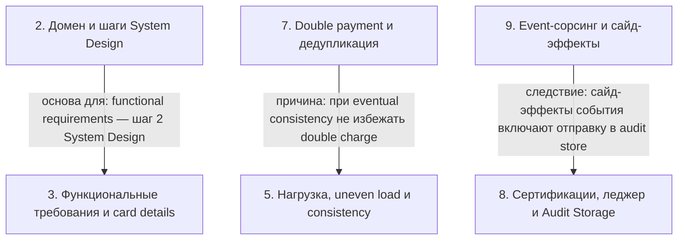

# System Design: платёжный сервис Stripe

> [!abstract] Обзор
> Материал разбирает проектирование платёжного сервиса Stripe: его роль как сервиса платежей, инкапсуляцию платёжной логики и место мерчанта. Рассматриваются доменные знания о платёжном шлюзе (payment gateway), банках и карточных сетях (card networks), порядок шагов System Design и проверка допущений (assumptions). Система не хранит деньги: нужны интеграции с банками мерчантов и карточными сетями, а расчёт с мерчантом идёт с удержанием комиссии (fee) и выплатой (payout) банк-банк. Платёжный поток строится на Authorize и Capture, отложенном довзыскании (delayed recharging) и подтверждении банком, а также на дедупликации и идемпотентности. Отдельно — нефункциональные требования (нагрузка, строгая согласованность (strong consistency), неравномерная нагрузка по мерчантам (uneven load by merchant)), хранение данных мерчанта и карточных данных (card details), сертификации, транзакционный леджер и доставка webhook в Merchant API. Вторая часть — событийное проектирование (event sourcing), ретраи, сверка (reconciliation), шардирование и репликация.

> [!info] Курс
> [[index|Оглавление курса]]

## Оглавление
1. [[#1. Stripe, интеграции и payout]]
2. [[#2. Домен и шаги System Design]]
3. [[#3. Функциональные требования и card details]]
4. [[#4. Authorize, Capture и delayed recharging]]
5. [[#5. Нагрузка, uneven load и consistency]]
6. [[#6. Webhook, статусы и сохранение]]
7. [[#7. Double payment и дедупликация]]
8. [[#8. Сертификации, леджер и Audit Storage]]
9. [[#9. Event-сорсинг и сайд-эффекты]]
10. [[#10. At-least-once и ретраи]]
11. [[#11. Сверка (reconciliation): банки и audit store]]
12. [[#12. Шардирование по Payment ID]]
13. [[#13. Репликация и кворум]]
14. [[#14. Файл решения .sln]]

**Схема** — [[#Схема]]
**Итог** — [[#Итог]]

## 1. Stripe, интеграции и payout

**Stripe** — сервис, который даёт возможность делать платежи на веб-странице и в сервисах: он забирает деньги у клиентов (кастомеров), передаёт их мерчанту и удерживает комиссию (fee), например процент с выплат. Stripe — не банк; банк в дизайне — отдельный внешний сервис, который не проектируется. Система не хранит деньги: внутри неё есть только запись (рекорд) о том, что происходило с деньгами между банками. Stripe инкапсулирует логику с картами, обработкой платежей (процессингом) и уведомлением мерчантов, поэтому мерчанту не нужно интегрироваться с карточными сетями и банками, обрабатывать клиентские данные или получать лицензии. **Merchant** — это клиент Stripe, бизнес, который хочет списывать деньги со своих клиентов; клиенты мерчанта не являются прямыми клиентами Stripe. Нужны интеграции с карточными сетями (Visa, Mastercard) для списания с карточки и с банками мерчантов, чтобы делать перевод из своего банка на их банк; **Card Network** знает всё о картах и умеет взаимодействовать с банками, выдавшими карту. Провайдер забирает деньги с клиентов мерчанта, удерживает 5% комиссии и 95% оплаты переводит банковским переводом в банк мерчанта. **Payout** — это перевод с банка на банк, при котором часть отправляется мерчанту, а часть остаётся себе (например, из 100 — 80 мерчанту, 20 себе).

> [!info] Зачем это нужно
> Назначение: дать возможность делать платежи и передавать деньги мерчанту, удерживая комиссию, при этом Stripe не банк. Нужно, чтобы делать перевод из своего банка на банк мерчанта и списывать деньги с карточки.

*Источник: [00:00:02], [00:00:41], [00:03:01], [00:04:01], [00:05:01], [00:50:29]*

## 2. Домен и шаги System Design

Для проектирования системы Stripe необходимо понимать, как работают платёжный шлюз (payment gateway), банки и карточные сети. На системном дизайне вы не обязаны знать все домены в IT: выходите из своих допущений (assumptions) и проверяйте их с интервьюером. Если они не «окей» — спросите, как это работает на самом деле, или можно ли загуглить. Порядок выполнения: сначала функциональные требования (шаг 2), затем нефункциональные требования (шаг 3), затем уточняющие вопросы (follow-up, шаг 4).

> [!info] Зачем это нужно
> На системном дизайне не обязаны знать все домены, поэтому выходите из своих допущений и проверяйте их с интервьюером.

*Источник: [00:01:41], [00:02:31]*

## 3. Функциональные требования и card details

Функциональное требование — отправка денег от клиента (customer) к мерчанту: на стороне мерчанта показывается экран с товаром (good) и кнопкой pay, после нажатия пользователь попадает на страницу с карточными данными (card details) и кнопкой confirm. Второе функциональное требование — мерчант может зайти в свой аккаунт и посмотреть, что происходит с продажами: сколько покупок, сколько клиентов пришло, кто заплатил, кто нет, у кого не получилось (зафейлилось), кто отменил подписки. Рекуррентные платежи (ежемесячные подписки с ежемесячным списанием) не входят в рамки проекта (out of scope). В системе платежей card details не нужны, функционала сохранять карты нет; для рекуррентного платежа (например, monthly subscription) card details нужны, потому что без них невозможно делать ежемесячные оплаты. На странице карточных данных есть кнопка confirm; страница с card details и confirm может быть как нашей страницей, так и страницей на стороне мерчанта.

| Случай | Card details |
|---|---|
| В системе платежей | Не нужны |
| Для рекуррентного платежа | Нужны |

*Источник: [00:09:01], [00:10:01], [00:17:01], [00:18:01], [00:18:40]*

## 4. Authorize, Capture и delayed recharging

В платежах обычно есть два основных запроса: **Authorize** и **Capture**. Данные карты шифруются и сохраняются, создаётся карт-токен, который отправляется на авторизацию вместе с суммой списания и мерчантом; банк инициирует подтверждение платежа, пользователь вводит код, после чего выполняется authorize-запрос в сеть: сначала получаем authorize ID, затем снова отправляем authorize-запрос и получаем success или error. При шаге authorize запрос идёт в сеть (network), которая возвращает 301-редирект на банковскую страницу, а return URL возвращает обратно — это работает по протоколу authorization code. При создании авторизации можно записать `createPaymentInDB` и отправить `authorizeRequest`. Authorize-запрос валидирует карточные данные и проверяет наличие средств на карточке; при успехе средства блокируются в банке, а пользователь нажимает кнопку, клиент отправляет запрос в Payments, выполняется authorize, и банк возвращает в браузер authorize ID. **Capture** — это непосредственный перевод средств от карты и аккаунта клиента к Stripe; его выделяют в отдельный шаг, в частности для дедубликации: большинство банков не дают закапчивать один и тот же authorization ID дважды. Создаём payment со статусом `new`, делаем авторизацию indirect, получаем webhook по `payment.id` из return URL, обновляем платёж до `authorized`, ставим auth id и выполняем capture; после capture сохраняем результат платежа в базу данных, `payment.id` вшиваем в return URL. **Delayed recharging (отложенное довзыскание)** — это причина, когда отель авторизует чуть больше денег, и если алкоголь не был выпит, капчуринг происходит на меньшую сумму, а оставшиеся авторизованные средства автоматически разблокируются в банке.

> [!info] Зачем это нужно
> Блокировка нужна, чтобы платящий не мог использовать средства до capture, так как они зарезервированы для будущего капчера. Capture выделяют в отдельный шаг, в частности для дедубликации: большинство банков не дают закапчивать один и тот же authorization ID дважды.

*Источник: [00:06:01], [00:07:01], [00:08:01], [00:19:18], [00:20:18], [00:21:50], …*

## 5. Нагрузка, uneven load и consistency

Ожидается 10K платежей в секунду и 10K остальных запросов в секунду, суммарно около 20K запросов в секунду. Нагрузка неравномерна по мерчантам: один «жирный» мерчант может выжечь все ресурсы, а остальные — маленькие; такая нагрузка называется **uneven load by merchant (неравномерная нагрузка по мерчантам)**. Детали мерчанта будут сохраняться в каком-то хранилище (storage); возможно, это будет SQL или NoSQL — пока не понятно. При проектировании выбирается **строгая согласованность (strong consistency)**, и приоритет отдаётся именно ей: это гарантия, что данные будут согласованны между всеми нодами одновременно. Обычно она не про потерю данных, а про то, чтобы система оставалась в корректном состоянии. Strong consistency нужен не для всех функциональных требований: например, временное исчезновение только что созданного товара из-за repeatable read не критично, но первое требование должно быть строго согласованным. Линеаризуемость означает, что после записи данные должны быть видны во всех последующих запросах; для обработки платежей (payment processing) выбирают strong consistency, потому что при eventual consistency не получится избежать двойного списания (double charge). Поэтому хранилище для платежей должно оставаться линеаризуемым (linearizable), а для всех остальных API используют eventual consistency.

> [!info] Зачем это нужно
> Для обработки платежей выбирают strong consistency, чтобы избежать двойного списания (double charge).

*Источник: [00:12:40], [00:13:40], [00:14:40], [00:15:40], [00:16:31], [00:32:48], …*

## 6. Webhook, статусы и сохранение

В дизайне будет **Merchant API**: с точки зрения API нужен POST-запрос для Merchants и GET-запрос для получения деталей, на каждом шаге мы хотим обновлять статус. Доставка webhook в Merchant API должна быть **«не менее одного раза» (at least once)** в течение 30 дней: система повторяет попытки, пока не получится прислать webhook. Если Merchant API выключен, все запросы висят до таймаута 15–30 секунд, что может привести к дополнительным ретраям. **Webhook-секрет** используется, чтобы валидировать, что webhook прислали мы, а не кто-то другой. Каждый статус платежа (`new`, `authorizing`, `captured`, `failed` и др.) отправляется вебхуком в Merchant API; в Stripe около 100 типов вебхуков, и важная часть системы — это то, что происходит (события), а не сам state; на базе событий можно создавать и обновлять состояние. После получения webhook от платёжной сети нужно сохранить или обновить статус в БД, а также сохранить Authorization ID, чтобы при сбое пользователю не пришлось повторно авторизовывать платёж; повторная авторизация нежелательна, потому что мы не хотим блокировать лишние средства пользователя и создавать «мёртвые» транзакции в БД.

> [!info] Зачем это нужно
> На каждом шаге мы хотим обновлять статус.

*Источник: [00:11:40], [00:17:01], [00:23:50], [00:30:17]*

## 7. Double payment и дедупликация

Если клиент случайно пришлёт два запроса, двойной платёж (double payment) никак не обрабатывается. Двойное списание (double charge) может произойти, если на один и тот же `payment ID` попадают два authorize, и без трекинга `payment ID` отличить double charge от обычного создания платежа невозможно. Дедупликация на Create Payment: уникальный ID в базе данных не даёт создать повторный Payment — второй Payment с тем же ID не запишется. При повторном вебхуке статус в БД обновляется через оптимистичную блокировку (optimistic): `UPDATE payments SET status = 'authorized' WHERE id = … AND status = 'new'`; перед отправкой запроса ставим статус `authorizing`, и если апдейт в SQL прошёл — запрос успешен, а если не прошёл (статус уже не `new`) — клиенту шлём reject. Если Capture приходит с таким же `outID`, который уже был закапчен минуту назад, Card Network его отклоняет; у Card Network есть свой способ дедупликации, также можно заставить внешний сервис принимать идентификатор дедупликации или понадеяться на банк. Дедупликация применяется при ретраях: события могут ретраиться, даже если уже были обработаны, события хранятся в долговременном хранилище (durable storage) 30 дней, а для защиты от повторной отправки (double sender) или дублирующегося объекта нужны свои механизмы.

*Источник: [00:21:50], [00:27:17], [00:28:17], [00:29:17], [00:38:55], [00:51:08]*

## 8. Сертификации, леджер и Audit Storage

Большинство финансовых систем — банки, платёжные шлюзы, платёжные процессоры — должны иметь необходимые сертификации, чтобы иметь право хранить и обрабатывать данные, связанные с финансами. Одно из юридических требований (legal requirements) для банков — наличие транзакционного леджера: данные простой транзакции нельзя терять. Транзакция в леджере записывается как списание с одного аккаунта и зачисление на другой, и сумма всех записей должна быть равна нулю; это юридическое требование, поэтому требуется отсутствие потери данных (no data loss). **Audit Storage** — это своего рода Ledger, но не «считаемый»; он нужен для юридических и комплаенс-целей: туда просто пишут данные и не считают. В него что-то записывают, а читают очень редко — если надо что-то отдать по комплаенсу. Audit storage можно шардировать как угодно, например по региону или по дате, где за каждый месяц — отдельный шард.

> [!info] Зачем это нужно
> Это юридическое требование, поэтому требуется отсутствие потери данных.

*Источник: [00:10:40], [00:11:40], [00:33:18]*

## 9. Event-сорсинг и сайд-эффекты

**Event sourcing (событийное проектирование)** — архитектурный паттерн (возможно, стиль), где центральный элемент — событие. Состояния (state) по сути нет: состояние всегда проигрывается из событий; это полноценная eventual consistency. Вы создаёте payment и начинаете проигрывать событие за событием; в конце получается конечное состояние (стейт), которое визуализируется из этих событий. Каждое событие требует своего сайд-эффекта и является результатом; сайд-эффект включает отправку в audit storage и вызов метода API. Когда есть один результат и много сайд-эффектов, можно использовать паттерн «трубка» (pipeline); можно повесить отдельного воркера на каждый тип сайд-эффекта.

*Источник: [00:31:17], [00:32:17], [00:32:48], [00:33:18]*

## 10. At-least-once и ретраи

В системе гарантируется доставка **«не менее одного раза» (at least once)**: мы просто ставим событие, и оно долетает куда надо в соответствии с тем, кто на что подписан. Гарантия ровно одного раза (exactly once) не гарантируется, и Stripe тоже не гарантирует exactly once для Merchant API. События обрабатываются независимо на этапе worker: если событие с ошибкой уходит на retry, оно не останавливает обработку остальной очереди. Для retry нужна экспоненциальная задержка (exponential back-off): повтор через секунду, три, пять, минуту, час, день, неделю и так далее. Держать ожидание ретрая в памяти процесса нельзя: памяти не хватит, а процесс может упасть, и ожидание пропадёт вместе с ним. Можно использовать внешний/распределённый планировщик (external/distributed scheduler) или записывать время следующей попытки в хранилище перед отправкой; а retry storage — по сути задача распределённого планирования (distributed scheduling). Если Merchant API недоступен, можно сразу сохранять данные в базу, а retryer позже асинхронно достанет их и отправит в Merchant API; это eventual consistency, время доставки не гарантируется. Идея, чтобы retryer запихивал всё назад в очередь, плохая, потому что из очереди разные консьюмеры могут опять попробовать добавить всё по новой.

*Источник: [00:34:18], [00:36:18], [00:36:55], [00:37:55], [00:49:58]*

## 11. Сверка (reconciliation): банки и audit store

У банков всегда есть **сверка (reconciliation)** — механизм, когда система Stripe не уверена, сходится ли у неё с кредитом. Сверка — процесс, когда банк 1 приходит в банк 2, запрашивает все транзакции за день и сверяет их с теми, что есть у банка 1. Если банк 1 где-то не дописал транзакцию — он синхронизирует свой сайт и дописывает её; если написал лишнюю транзакцию, которой у банка 2 нет, — эту лишнюю запись убирают. Транзакции отправляются раз в час или раз в день, объекты обычно обрабатываются батчем (пакетом) для оптимизации. Раз в день информация о транзакциях через сеть (network) или банк сверяется с audit store, который не то чтобы источник истины (source of truth), но хранит все статусы.

*Источник: [00:39:33], [00:40:03], [00:41:02]*

## 12. Шардирование по Payment ID

Наиболее нагруженную систему шардируют по **Payment ID**, а не по мерчанту: это позволяет равномерно распределить нагрузку и игнорировать всплески по мерчанту. Нужно масштабироваться достаточно, чтобы обрабатывать нужное количество платежей; чтений очень мало, основной критерий — запись, которая контролируется соотношением воркеров (worker ratio). Получение всех Payment за месяц требует scatter-gather, потому что Payment за каждый месяц может находиться в любом из шардов; чтобы получить платежи для Merchant 1, нужно рассылать запросы на все шарды. Если данные уже не влезают, можно делать шардирование; payment-методы шардируются по merchant ID, и для Merchant 1 может быть три payment, распределённых по трём разным шардам, а шардирование по мерчанту приводит к неравномерным шардам. Так как используется eventual consistency, воркеры могут синхронно записывать сразу в этот стор; чтобы избежать роста нагрузки на каждый шаг, можно сделать отдельный стор для чтения (ридов), в него кладут всё, кроме payment; он поддерживает eventual consistency и может быть более «расслабленным» и дешёвым в реализации, а read storage шардируется по merchant ID. Нагрузка на шард не зависит от количества платежей, а зависит только от объёма памяти.

| | По merchant ID | По Payment ID |
|---|---|---|
| Равномерность | неравномерные шарды | равномерное распределение |
| Всплески по мерчанту | — | игнорируются |

> [!info] Зачем это нужно
> Отдельный стор для чтения делают, чтобы избежать роста нагрузки на каждый шаг.

*Источник: [00:44:30], [00:45:07], [00:46:12], [00:46:30], [00:46:42], [00:47:42], …*

## 13. Репликация и кворум

При 5–10к платежей один сервер или инстанс не выдерживает нагрузку, поэтому требуется масштабирование (скейлинг). Скейлинг бывает двух типов: по объёму памяти (memory capacity) и по числу запросов (request capacity); новые партиции с репликацией позволяют масштабировать трафик без проблем. Репликация — это механизм масштабирования, но пока не говорим про механизм устойчивости (ресиленсии) — работать будет плохо. При **синхронной репликации** запись успешна только тогда, когда все реплики получили эту запись; проблема в доступности: если одна реплика умерла, запись будет падать. А при **асинхронной** репликации, если она идёт в другой стор, произойдут выборы лидера (leader election) — потеряем данные, что недопустимо, и double charge может не всегда сработать. Можно делать репликацию на **Raft**, если это очень критично: можно поставить, условно, 5 реплик и писать консенсусом из 3 — если 3 реплики успешно записали, запись считается успешной; также можно задать, что из 3 реплик должно прочитаться, чтобы точно попасть в ту, где самые новые данные.

| Репликация | Условие успешной записи | Риск |
|---|---|---|
| Синхронная | запись успешна только когда все реплики получили запись | если одна реплика умерла, запись будет падать; проблема в доступности |
| Асинхронная | — | если идёт в другой стор, произойдут выборы лидера — потеряем данные, недопустимо; double charge может не всегда сработать |

> [!info] Зачем это нужно
> Репликация на Raft нужна, чтобы не терять данные на выборах лидера.

*Источник: [00:41:38], [00:42:09], [00:43:00], [00:43:30], [00:44:30], [00:47:42], …*

## 14. Файл решения .sln

Solution File Format Version 12.00 объявляет проект RedisHashslotSharding с csproj-файлом. Секции GlobalSection задают конфигурации `Debug|Any CPU` и `Release|Any CPU`.

```
Microsoft Visual Studio Solution File, Format Version 12.00
Project("{FAE04EC0-301F-11D3-BF4B-00C04F79EFBC}") = "RedisHashslotSharding", "RedisHashslotSharding\RedisHashslotSharding.csproj", "{CB84B499-F812-4A7C-94AF-A51C70EFF65D}"
EndProject
Global
    GlobalSection(SolutionConfigurationPlatforms) = preSolution
        Debug|Any CPU = Debug|Any CPU
        Release|Any CPU = Release|Any CPU
    EndGlobalSection
    GlobalSection(ProjectConfigurationPlatforms) = postSolution
        {CB84B499-F812-4A7C-94AF-A51C70EFF65D}.Debug|Any CPU.ActiveCfg = Debug|Any CPU
        {CB84B499-F812-4A7C-94AF-A51C70EFF65D}.Debug|Any CPU.Build.0 = Debug|Any CPU
        {CB84B499-F812-4A7C-94AF-A51C70EFF65D}.Release|Any CPU.ActiveCfg = Release|Any CPU
        {CB84B499-F812-4A7C-94AF-A51C70EFF65D}.Release|Any CPU.Build.0 = Release|Any CPU
    EndGlobalSection
EndGlobal
```

*Источник: [00:46:27]*

## Схема



## Итог

> [!success] Что в итоге
> Stripe проектируется как сервис платежей, который инкапсулирует платёжную логику и не хранит деньги: деньги остаются и обрабатываются через банки, а в системе хранится только запись. Для перевода денег нужны интеграции с банками мерчантов и карточными сетями, а платёжный поток строится на Authorize и Capture с дедупликацией и идемпотентностью. Для обработки платежей выбирают строгую согласованность (strong consistency), чтобы избежать двойного списания, а масштабирование идёт через шардирование, репликацию и кворум. Event sourcing, доставка «не менее одного раза» (at least once) с ретраями и сверка (reconciliation) с банками и audit store завершают дизайн.
