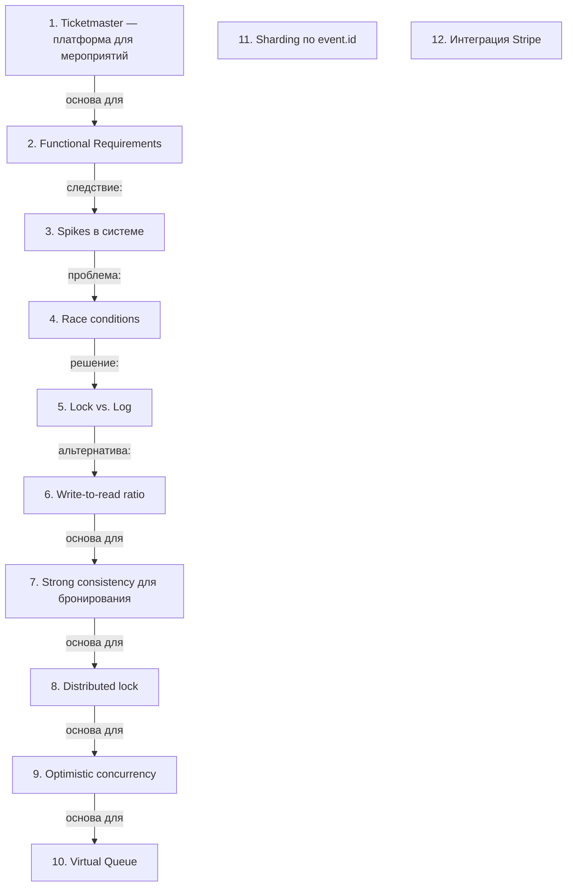

# Системный дизайн Ticket Master

> [!abstract] Обзор
> Лекция по системному дизайну Ticket Master охватывает ключевые аспекты обработки трафика, управления состоянием, обеспечения согласованности и масштабируемости. Основные темы включают соотношение read/write, проблему дабл-букинга, использование distributed lock, optimistic concurrency, и стратегии масштабирования. Система оптимизирована под высокую нагрузку и частые read-операции, используя eventual consistency, virtual queue и sharding для обеспечения надежности и масштабируемости.

> [!info] Курс
> [[index|Оглавление курса]]

## Оглавление
1. [[#1. Ticketmaster — платформа для мероприятий]]
2. [[#2. Functional Requirements]]
3. [[#3. Spikes в системе]]
4. [[#4. Race conditions]]
5. [[#5. Lock vs. Log]]
6. [[#6. Write-to-read ratio]]
7. [[#7. Strong consistency для бронирования]]
8. [[#8. Distributed lock]]
9. [[#9. Optimistic concurrency]]
10. [[#10. Virtual Queue]]
11. [[#11. Sharding по event.id]]
12. [[#12. Интеграция Stripe]]

**Схема** — [[#Схема]]
**Итог** — [[#Итог]]

## 1. Ticketmaster — платформа для мероприятий

Ticketmaster — это платформа, где можно создать мероприятие и продавать билеты на него. Основная цель — обеспечить удобство и надежность процесса покупки билетов.

> [!info] Зачем это нужно
> Позволяет пользователям участвовать в мероприятиях и получать доступ к билетам.

> [!quote]- Кадр [00:00:02]
> 

## 2. Functional Requirements

Functional Requirements включают создание, поиск и бронирование событий, а также предотвращение двойной брони. Это основа функциональности системы.

> [!info] Зачем это нужно
> Обеспечивают корректную работу системы и предотвращают ошибки.

## 3. Spikes в системе

Spikes — это временные пиковые нагрузки, которые система должна обрабатывать. Они могут быть вызваны популярными мероприятиями.

> [!info] Зачем это нужно
> Позволяют системе адаптироваться к резкому увеличению нагрузки.

## 4. Race conditions

Race conditions происходят, когда несколько пользователей одновременно выполняют запросы. Это может привести к конфликтам при бронировании мест.

> [!info] Зачем это нужно
> Обеспечивают корректную обработку одновременных запросов.

## 5. Lock vs. Log

Lock блокирует доступ к ресурсу, Log улучшает user experience. Lock используется для предотвращения двойной брони, Log — для отслеживания действий.

> [!info] Зачем это нужно
> Позволяют управлять состоянием и улучшать взаимодействие с пользователем.

## 6. Write-to-read ratio

Write-to-read ratio показывает соотношение операций записи и чтения в системе. Большинство пользователей читают больше, чем пишут, что влияет на выбор архитектуры и оптимизацию.

> [!info] Зачем это нужно
> Позволяет оптимизировать ресурсы и выбрать подходящую модель хранения данных.

## 7. Strong consistency для бронирования

Strong consistency требуется только для book-ивентов, чтобы избежать дабл-букинга. Для search и create-ивентов она не нужна. Это позволяет использовать eventual consistency для большинства операций.

> [!info] Зачем это нужно
> Позволяет балансировать между производительностью и согласованностью.

## 8. Distributed lock

Distributed lock используется для синхронизации доступа к ресурсу в distributed-системе. Его можно зашардить по event ID и реализовать через redlock. Это позволяет быстро обработать все ситы, связанные с event.

> [!info] Зачем это нужно
> Позволяет избежать дабл-букинга и обеспечить согласованность.

## 9. Optimistic concurrency

Optimistic concurrency — это подход, при котором не используются физические блокировки на уровне базы данных. Если rows affected равно 0, это означает, что данные не изменились. Это позволяет избежать блокировок и повысить производительность.

> [!info] Зачем это нужно
> Позволяет обрабатывать высокую нагрузку без блокировок.

## 10. Virtual Queue

Virtual Queue используется для управления нагрузкой и предотвращения спайков. Он позволяет ограничить количество одновременных запросов до заданного числа, например, 20 тысяч.

> [!info] Зачем это нужно
> Позволяет сглаживать пиковые нагрузки и избежать перегрузки системы.

## 11. Sharding по event.id

Sharding происходит по уникальному event.id, что позволяет распределять нагрузку и улучшать производительность. Это особенно важно при высокой нагрузке на систему.

> [!info] Зачем это нужно
> Позволяет масштабировать систему и распределять нагрузку.

## 12. Интеграция Stripe

Stripe используется для обработки платежей в системе. Это позволяет интегрировать платежи и обрабатывать сайд-эффекты, такие как обновление статуса билета.

> [!info] Зачем это нужно
> Позволяет обрабатывать платежи и сайд-эффекты в рамках системы.

## Схема

## Итог

> [!success] Что в итоге
> Ticket Master — это система, которая должна обеспечивать надежное и удобное бронирование билетов. Основные проблемы: race conditions, пиковые нагрузки и управление состоянием. RESTful API и strong consistency обеспечивают надежность, а локировка и логирование — удобство пользователей. Система должна масштабироваться и обрабатывать пиковые нагрузки. Использование eventual consistency, distributed lock, optimistic concurrency и Virtual Queue позволяет балансировать между производительностью и надежностью.

