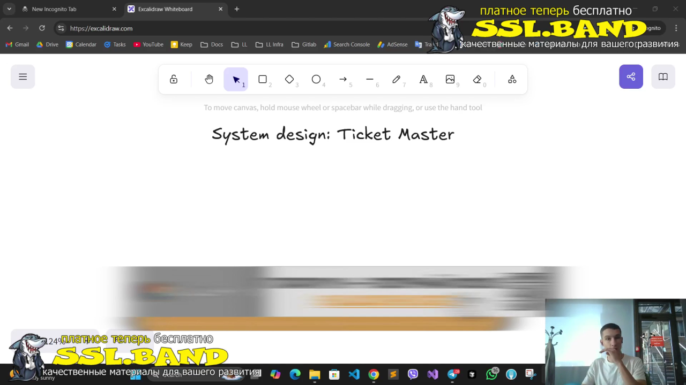
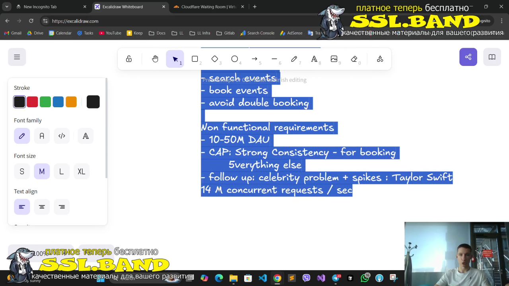
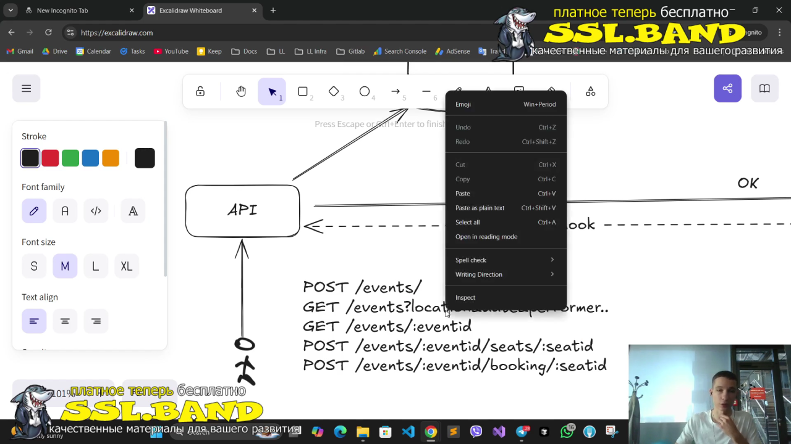
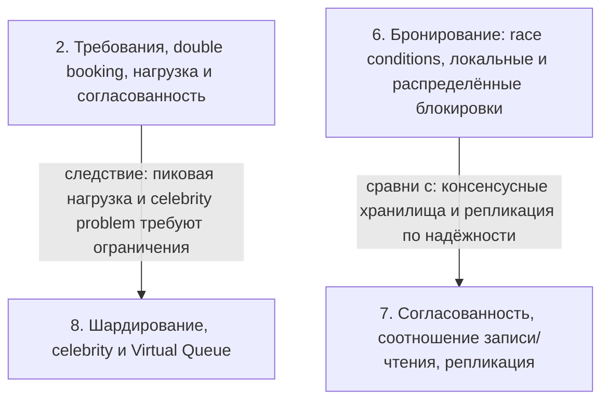

# System design: Ticket Master

> [!abstract] Обзор
> Материал о системном дизайне Ticket Master: роль платформы, аналогия с продажей авиабилетов и шаги интервью по System Design. Сформулированы функциональные требования, ключевая проблема надёжности и оценка нагрузки на 10–50 миллионов активных пользователей в день (daily active users), а также пиковые всплески и «проблема знаменитости» (celebrity problem). Отдельно — требования согласованности: строгая согласованность (strong consistency) для бронирования (booking) и согласованность в конечном счёте (eventual consistency) для поиска и создания события; оптимистичная блокировка (optimistic concurrency) и уровень изоляции, а также необходимость линеаризуемости для флага «в продаже» (on sell). Описаны сущности event и seat, поиск событий с фильтрами и индексами, поток покупки билета, загрузка карты мест (seat map), оплата через Stripe и подтверждение вебхуком. В части бронирования разобраны коллизии, состояния гонки (race conditions), двойное бронирование (double booking), статус locked со снятием блокировок через `locked_at` и фоновую задачу, а также распределённые блокировки (Redlock, консенсусные хранилища) и ограничения шардирования. Обсуждаются способы ограничения пиковой нагрузки — виртуальная комната ожидания (virtual waiting room) и Virtual Queue — и альтернативы вроде email-ссылки и наивного ограничителя частоты.

> [!info] Курс
> [[index|Оглавление курса]]

## Оглавление
1. [[#1. Введение: платформа и шаги интервью]]
2. [[#2. Требования, double booking, нагрузка и согласованность]]
3. [[#3. Сущности Event и Seat]]
4. [[#4. Поиск событий и эндпоинты API]]
5. [[#5. Поток покупки билета и оплата]]
6. [[#6. Бронирование: race conditions, локальные и распределённые блокировки]]
7. [[#7. Согласованность, соотношение записи/чтения, репликация, storage и индексы]]
8. [[#8. Шардирование, celebrity и Virtual Queue]]
9. [[#9. Масштабирование по компонентам и обработка sign-up]]

**Схема** — [[#Схема]]
**Итог** — [[#Итог]]

## 1. Введение: платформа и шаги интервью

**Ticketmaster** — платформа, где организатор создаёт событие (ивент: стендап, концерт, любое мероприятие), а потребители покупают билет и приходят на него. Системный дизайн Ticket Master очень похож на систему продажи авиабилетов: самолёт можно рассматривать как арену с меньшим числом мест. На интервью по System Design придерживаются шагов: функциональные требования, простое решение на одного пользователя и одну машину, нефункциональные требования, уточняющие вопросы (follow-up).

*Источник: [00:00:02], [00:00:30], [00:01:00]*

> [!quote]- Кадр [00:00:02]
> 

## 2. Требования, double booking, нагрузка и согласованность

Организатор создаёт события, потребитель ищет и бронирует их; система должна исключать **double booking** — ситуацию, когда на одно и то же место два человека успешно купили билет. Основные проблемы Ticket Master — double booking и всплеск (spike), а надёжность с точки зрения бизнеса — ключевая проблема, которую нужно гарантировать как можно лучше. В system design рассчитывают на 10–50 миллионов активных пользователей в день (daily active users), что даёт тысячи запросов в секунду. В кейсе Taylor Swift было около 14 миллионов одновременных запросов в секунду, что порождает **celebrity problem** — непостоянный трафик на популярный ивент. Для Ticket Master нужна **строгая согласованность (strong consistency, linearizability)** для бронирования (booking), чтобы не было двойного бронирования, и оптимистичная блокировка (optimistic concurrency) с хорошим уровнем изоляции (isolation level); для поиска (search) и создания события применяется eventual consistency. Флаг «в продаже» (on sell) должен быть линеаризуемым и выносится в отдельное хранилище, так как eventual consistency может не увидеть изменение `on-sell = false`.

| Область | Согласованность |
|---|---|
| Booking | Строгая согласованность (linearizability) |
| Search и создание события | Согласованность в конечном счёте |

> [!info] Зачем это нужно
> Надёжность нужно гарантировать как можно лучше, иначе при частых сбоях пользователи перестанут пользоваться системой.

*Источник: [00:01:30], [00:02:30], [00:03:30], [00:04:18], [00:04:51], [00:05:52], …*

> [!quote]- Кадр [00:47:42]
> 

## 3. Сущности Event и Seat

В хранилище нужна сущность **event** с ID и перформером, возможно, в виде массива; предполагается, что event ID уникален, и шардирование выполняется по event ID. В базе про событие могут быть поля location (арена и город) и date (когда событие будет происходить), а также manager ID. Для системы продажи билетов нужна сущность **seat** (место), чтобы отображать места, которые можно бронировать. Место может иметь статус `free` или `paid`; для оплаченного места хранится user ID (опционально), а если нужно слать уведомления — name, email и phone для напоминаний (ремайндеров) и подтверждений (конфирмаций). Цены на места будут разные: места впереди дороже, сзади дешевле; информацию о ценах предоставляет организатор.

*Источник: [00:09:25], [00:09:55], [00:10:55], [00:11:26], [00:11:56], [00:12:26]*

## 4. Поиск событий и эндпоинты API

Для поиска событий (search event) нужен отдельный endpoint с query-параметрами; поиск событий можно фильтровать по location, date и performer. Сканирование всей базы данных дорого, влияет на производительность и задержку, поэтому не нужно сканировать всю базу; для ускорения поиска нужен индекс, и индекс должно поддерживать хранилище. API включает эндпоинты: `POST /events/`, `GET /events?location=...`, `GET /events/:eventid`, `POST /events/:eventid/seats/:seatid`, `POST /events/:eventid/booking/:seatid`.

> [!info] Зачем это нужно
> Чтобы поиск был быстрым и не сканировать всю базу данных.

*Источник: [00:12:56], [00:13:26], [00:30:23]*

> [!quote]- Кадр [00:30:23]
> 

## 5. Поток покупки билета и оплата

При нажатии на событие открывается страница с ареной и местами; после выбора места появляется экран с деталями и оплатой. Загружать всю карту мест (seat map) не нужно: если каждое событие в браузере будет грузить 100 тысяч мест, это даст много памяти и трафика, поэтому нужен отдельный запрос, который по event ID загружает информацию о событии вместе с seat map. Платёжную систему можно не реализовывать самостоятельно, а использовать внешний платёжный провайдер (payment-provider), например Stripe; покупка билета оформляется как POST-запрос. При оплате мы отправляем запрос в Stripe и получаем payment intent, а окончательное подтверждение приходит через вебхук; после `OK` статус заказа становится `paid`, а место в хранилище обновляется с `free` на `paid` с записью user ID покупателя. Если платёж не прошёл, его нужно откатить, чтобы вернуть место (seat) в исходное состояние. Результат платёжки триггерит сайд-эффекты: обновление статуса, постоянный лог (перманентный лог) и уведомления, причём воркер обрабатывает событие независимо, и падение уведомлений не критично, так как база данных уже обновлена.

> [!info] Зачем это нужно
> У арены может быть до 10, 20, 100 тысяч мест. Если платёж не прошёл, место возвращается в некупленное состояние, потому что денег нет.

*Источник: [00:10:25], [00:13:56], [00:14:26], [00:14:56], [00:15:26], [00:15:56], …*

## 6. Бронирование: race conditions, локальные и распределённые блокировки

Проверка статуса `free`/`paid` в базе данных и возврат ошибки при `paid` может показаться достаточной, но при одновременных запросах возникают **состояния гонки (race conditions)**: два запроса могут почти одновременно прочитать статус места как `free`. Для изменения статуса в Postgres используется `UPDATE` с условием на текущий статус: блокировка ставится только на свободное место, статус меняется на `locked`. Вместо физической блокировки можно использовать оптимистичную блокировку (optimistic concurrency): `rows affected = 0` — блокировка не взята, `rows affected = 1` — взята. Добавляется статус `locked`: залоченное место нельзя бронировать, но оно не куплено; на странице запускается таймер на 10 минут, и первый, кто установил `locked`, побеждает. При этом нельзя ставить блокировку навсегда, поэтому есть timestamp `locked_at`, и фоновая задача каждые 5–10 секунд переводит протухшие блокировки в `free`. В распределённой системе для блокировки ресурса используют распределённую блокировку (distributed lock): **Redlock** (блокировка на Redis через set if not exist) может терять данные, но имеет нативный TTL, что убирает необходимость в фоновой задаче; консенсусные хранилища (Raft, etcd, zookeeper) данных не теряют, но записи в них дороже. Если данные нельзя терять и double booking невозможен — выбирают консенсус; при малой вероятности потери данных можно сделать сверку (reconciliation), вернуть деньги и извиниться; distributed lock можно зашардить по event ID.

| Подход | Признак |
|---|---|
| Физическая блокировка | Блокировка ставится только на свободное место, статус меняется на `locked` |
| Оптимистичная блокировка | `rows affected = 0` — блокировка не взята; `rows affected = 1` — взята |

> [!info] Зачем это нужно
> Для пользовательского опыта лучше ставить `locked`. Чтобы данные не терялись, можно использовать Raft.

*Источник: [00:16:56], [00:18:57], [00:19:27], [00:19:57], [00:20:59], [00:21:29], …*

## 7. Согласованность, соотношение записи/чтения, репликация, storage и индексы

При проектировании системы нужно знать, какую согласованность она позволяет, и каково соотношение записи и чтения (write-to-read ratio). В Ticket Master записей намного меньше, чем чтений: организаторов, создающих события, меньше, чем пользователей, которые ищут и покупают билеты; read-запросов в итоге больше, чем write-запросов. При высокой нагрузке на чтение можно применить репликацию (лидер-фолловер), поскольку в системе допустима eventual consistency и приоритет отдаётся доступности; но репликация остаётся механизмом высокой доступности, а не масштабирования. Индексы в базе данных усложняют обновление и делают запись медленнее; для бронирования нужна строгая согласованность, писать можно только в одну машину. На интервью по system design не стоит сразу называть конкретное хранилище (storage), потому что интервьюер может спросить, почему выбран именно этот, и вы можете запутаться.

*Источник: [00:08:25], [00:08:55], [00:28:59], [00:29:29], [00:30:29], [00:30:59], …*

## 8. Шардирование, celebrity и Virtual Queue

«Жирное» событие может попасть в один шард и создать hotspot; всплеск на одно событие не удаётся до конца покрыть шардированием — существует проблема celebrity. Одна машина не справится с 14 миллионами одновременных пользователей, но с помощью репликации лидер-фолловер и нужного количества read-реплик можно выдержать 14 миллионов; шардирование не по event ID, а по зонам не помогает. Блокировки на одно место (seat) будет недостаточно: при 40 миллионах запросов в первые 2 секунды места нет, пользователь будет жать тысячу раз, пока не попадёт на узел, который не возвращает ошибку. **Virtual waiting room (Virtual Queue)** — умный ограничитель частоты перед виртуальной очередью: только первые 10K пользователей попадают к выбору билетов, остальные ждут в очереди, которая гарантирует заданное число одновременных запросов на событие. Альтернатива — первым пришедшим высылают email со ссылкой, но простой ограничитель частоты не сильно поможет, так как все 14 миллионов запросов будут случайно либо загружаться, либо не загружаться.

*Источник: [00:33:30], [00:45:01], [00:45:31], [00:46:01], [00:48:09], [00:48:28], …*

## 9. Масштабирование по компонентам и обработка sign-up

Есть отдельный сервис, который принимает запросы на регистрацию (sign-up); воркер постепенно их разгребает. Чтобы понять, как масштабировать систему, нужно рассмотреть каждую её компоненту и посмотреть, как она масштабируется. Фоновая задача (background job) выступает координатором и может обновлять optimistic concurrency, поэтому её можно масштабировать как угодно и распределять по диапазону event. RESTful API является stateless, поэтому масштабируется без проблем: просто поднимается и опускается.

*Источник: [00:27:59], [00:28:29], [00:49:40]*

## Схема

## Итог

> [!success] Что в итоге
> Ticket Master — платформа продажи билетов, дизайн которой похож на систему продажи авиабилетов; проектирование идёт по шагам системного дизайна. Основные проблемы — double booking и всплески; для бронирования нужна строгая согласованность (linearizability) и оптимистичная блокировка с хорошим уровнем изоляции, для поиска и создания событий — eventual consistency. Пиковые нагрузки на популярные события создают celebrity problem, для которых делают отдельное хранилище; ключевая идея для пиковой нагрузки — ограничить число пользователей, одновременно выбирающих билеты, через virtual waiting room и Virtual Queue. Для борьбы с коллизиями и race conditions вводится статус `locked` с таймером и снятием блокировок через `locked_at` и фоновую задачу; выбор между Redlock и консенсусными хранилищами зависит от допустимости потери данных и double booking.
