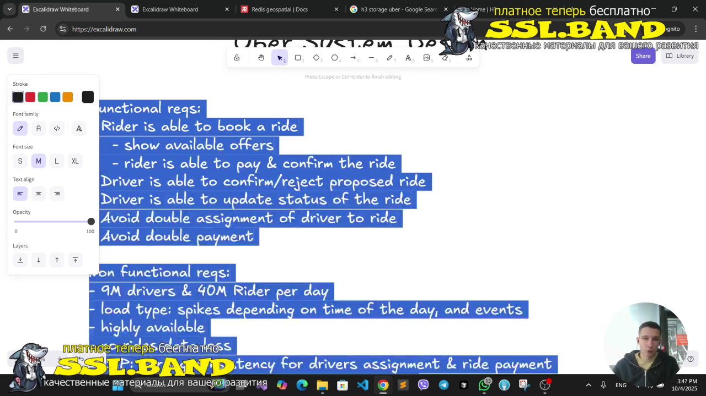
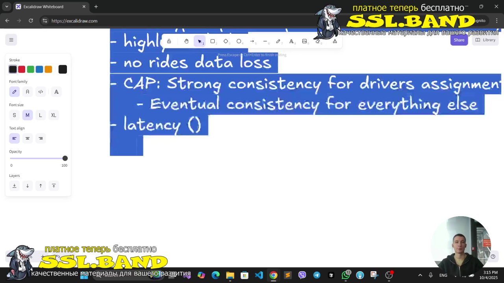
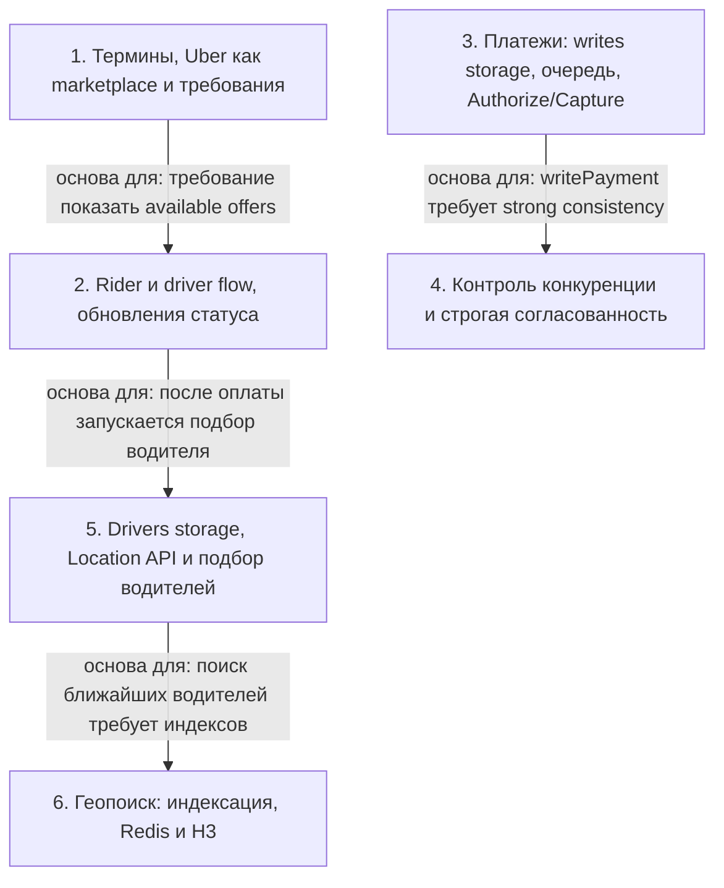

# Uber System Design

> [!abstract] Обзор
> Материал о проектировании системы Uber: термины и роль Uber как маркетплейса (marketplace), требования и путь пользователя от показа офферов до оплаты и подбора водителя (driver matching). Рассматриваются путь водителя (driver flow) с уведомлениями и жизненный цикл поездки (ride), доставка обновлений через опрос (polling) или сокеты, платежи с хранилищем записей (writes storage) и очередью. Отдельно — проблема двойного назначения водителя и контроль конкуренции через оптимистичную или пессимистичную блокировку, а также согласованность: строгая (strong) для критичных операций и согласованность в конечном счёте (eventual) для остального. Геопоиск опирается на индексацию latitude/longitude, Redis geospatial, H3 и геохэшинг (geohashing), а масштабирование — на stateless-сервисы, репликацию и шардирование. В конце оценивается нагрузка: 9 миллионов драйверов, 40 миллионов поездок в день (rides per day), 500 поездок в секунду, всплески и требование высокой доступности.

> [!info] Курс
> [[index|Оглавление курса]]

## Оглавление
1. [[#1. Термины, Uber как marketplace и требования]]
2. [[#2. Rider и driver flow, обновления статуса]]
3. [[#3. Платежи: writes storage, очередь, Authorize/Capture]]
4. [[#4. Контроль конкуренции и строгая согласованность]]
5. [[#5. Drivers storage, Location API и подбор водителей]]
6. [[#6. Геопоиск: индексация, Redis и H3]]
7. [[#7. Отсутствие водителя и virtual queue]]
8. [[#8. Нагрузка, всплески и масштабирование]]
9. [[#9. Сторонние сервисы и метрики]]

**Схема** — [[#Схема]]
**Итог** — [[#Итог]]

## 1. Термины, Uber как marketplace и требования

**driver** — водитель, **rider** — пассажир, **ride trip** — поездка, **source** — откуда везут, **destination** — куда везут. Uber — сервис поиска такси и маркетплейс (marketplace) для такси: пассажир указывает пункт назначения, Uber находит водителя, а второй клиент — сами водители, которые платят комиссию (fee) за поездки. Цена зависит от дистанции, погодных условий, премиальности автомобиля, соотношения спроса и предложения и трафика. Разбор начинается с функциональных требований, затем нефункциональных; для функциональных требований полезно рисовать UI/UX пользователя. Первое функциональное требование — показывать доступные офферы (available offers): `rider is able to book a ride` (пассажир может заказать поездку), `rider is able to pay and confirm the ride` (пассажир может оплатить и подтвердить поездку), `driver is able to confirm or reject the proposed ride` (водитель может подтвердить или отклонить предложенную поездку). Офферы могут отличаться ценой, премиальностью машины, временем и атрибутами вроде Pet Friendly или Woman for Woman; если в радиусе 10 экономов и один премиум, нужно показать только два оффера, а не 11.

*Источник: [00:00:02], [00:00:30], [00:01:00], [00:01:30], [00:02:00], [00:02:30], …*

> [!quote]- Кадр [00:00:30]
> 

> [!quote]- Кадр [00:00:02]
> 

## 2. Rider и driver flow, обновления статуса

Пользователь выбирает оффер и оплачивает поездку; после выбора оффера приложение предлагает сразу заплатить, а подбор водителя (driver matching) происходит после оплаты, затем нужно обновить статус заказа на `paid` и запустить подбор. Система показывает поиск водителя; найденный водитель едет в source, а пассажир ставит рейтинг после высадки (drop-off). **Driver flow** — второй клиент: водителю приходит уведомление с задержкой (cooldown), решение reject или accept, на решение даётся 5–10 секунд, иначе поездка считается непринятой. У поездки (ride) есть этапы: заказана, водитель приехал, пассажир сел, пассажир высажен, которые определяются по GPS или кнопками в приложении. Обновления доставляются через опрос (polling) или сокеты; требование по задержке (latency) исключает polling, а сокеты в реальном времени дают хорошую задержку, при этом система уведомлений знает соединение водителя и шлёт WebSocket-обновление, а пассажиры тоже находятся в соединениях. `PUT/PATCH` по ID поездки обновляет статус на `confirm`, «высадил», «посадил пассажира», «приехал» или `rejected`. Обычно делают гибрид: периодический опрос каждые 15 секунд, чтобы не потерять данные, если уведомление не дойдёт, а просроченная запись проверяется через get по write id по last updated time: если last updated time больше 120 секунд, а статус `new`, то запись считается просроченной.

> [!info] Зачем это нужно
> Сокеты в реальном времени используются для хорошей задержки; периодический опрос нужен, чтобы не потерять данные, если уведомление не дойдёт.

*Источник: [00:03:26], [00:03:39], [00:04:09], [00:04:39], [00:05:09], [00:05:39], …*

## 3. Платежи: writes storage, очередь, Authorize/Capture

При нажатии на оффер система должна сохранить запись (write) с информацией об оффере, доступных водителях и сумме через `POST writes`. **Writes storage** хранит запись с полями ID, rider ID, chosen driver ID, price и статус; статус инициализируется значением `new`. Событие об оплате отправляется в очередь, воркер читает из очереди новую запись и выполняет запись. Платежи обычно состоят из двух этапов: **Authorize** и **Capture**; Authorize блокирует деньги на карте, Capture выполняет реальный перевод и может сработать (триггернуться) после высадки (drop-off). При проектировании платежей нужно избегать двойной оплаты (double payment): double payment может возникнуть, если запрос на пассажира не дошёл из-за таймаута сети, клиент делает retry, при этом оплата фактически прошла; **Idempotency Key** сразу фиксит (устраняет) double payment. Проблема несогласованности статусов решается с помощью сверки (reconciliation) с платёжным шлюзом (payment gateway).

*Источник: [00:07:10], [00:07:40], [00:25:20], [00:25:50], [00:26:20], [00:31:50], …*

> [!quote]- Кадр [00:45:57]
> 

## 4. Контроль конкуренции и строгая согласованность

Функциональное требование Uber System Design — избежать двойного назначения водителя на поездку (double assignment): double assignment возможен, если один водитель думает 10 секунд при waiting time 10 секунд, даже при идеальной синхронизации часов, и два запроса могут записать свой driver ID и статус `confirm`. **Оптимистичная блокировка (optimistic concurrency)** использует compare-and-swap: `UPDATE ride SET status = 'confirmed' WHERE status = 'paid'`; если `affected rows` равен 0 — апдейт не прошёл, значит кто-то другой обновил запись. **Пессимистичный подход** реализуется через `SELECT ... FOR UPDATE` (чтение и запись в одной транзакции). При небольшом количестве конкурентных запросов выбирают оптимистичную блокировку, потому что она дешевле и легче, а при конкурентных запросах на одну строку (row) и большом contention пессимистичный подход дешевле. Строгая согласованность (strong consistency) нужна для назначения водителя (driver's assignment) и записи платежа (writePayment), чтобы не допускать double assignment, double payment, повторяющегося чтения (repeatable read), задержек данных и потери данных; по CAP-теореме два функциональных требования заставляют думать в контексте strong consistency. Для всего остального используется eventual consistency; хранилище для записей должно быть линеаризуемым (linearizable) и обеспечивать строгую согласованность, а при шардировании репликация не подойдёт — в строго линеаризуемом хранилище делают raft и мажоритарный консенсус (majority consensus).

```sql
ride = SELECT FOR UPDATE
UPDATE ride SET status = confirmed WHERE ...
```

| Подход | Когда выбирают | Особенность |
|---|---|---|
| Оптимистичная блокировка | Небольшое количество конкурентных запросов (краевой случай, например два водителя) | Дешевле и легче |
| Пессимистичный подход | Конкурентные запросы на одну и ту же строку при большом contention | Сам по себе дороже оптимистика, но при contention дешевле |

> [!info] Зачем это нужно
> Это функциональное требование — избежать двойного назначения водителя на поездку; строгая согласованность нужна, чтобы не допускать double assignment, double payment, repeatable read, задержек данных и потери данных.

*Источник: [00:11:09], [00:11:39], [00:13:49], [00:37:52], [00:38:23], [00:39:23], …*

> [!quote]- Кадр [00:13:49]
> 

## 5. Drivers storage, Location API и подбор водителей

В дизайне есть **drivers storage**: водитель имеет ID, данные машины (car details), местоположение (latitude, longitude). Простейший вариант обновления — **Location API**, который пишет в хранилище, с `POST`-запросом на местоположение водителя. В системе Uber есть согласованные обновления водителя примерно раз в секунду, обновление передаёт longitude и latitude. 8 миллионов водителей занимают несколько гигабайт памяти и влезают в одно хранилище, но строк много, локация обновляется каждую секунду, и есть чтения от каждого оффера. При поиске водителя выбирают тех, кто ближе к source, сканируя радиус, например 5 километров; Rider API достаёт всех водителей в локации в радиусе 5 километров от source. Задержка (latency) означает оповестить пассажира о готовом водителе как можно быстрее; нужно минимизировать задержку для подбора водителя и отправки предложения (driver write proposal), на подбор водителя даётся 120 секунд. При стратегии **fan-out** запрос рассылается всем десяти водителям одновременно; пакетная рассылка (батчевая) снижает конкуренцию и минимизирует плохой пользовательский опыт, а при последовательной рассылке за 120 секунд можно опросить 11 водителей. Если выбор водителя делать в Rider API, endpoint в цикле `while not matched` начинает обращаться к каждому водителю; у запроса есть тайм-аут, например 30 секунд, а хорошая API должна словить cancellation token (токен отмены).

> [!info] Зачем это нужно
> Для отслеживания локации водителей; для пользовательского опыта — оповестить пассажира как можно быстрее.

*Источник: [00:12:09], [00:12:39], [00:13:49], [00:15:10], [00:15:40], [00:16:10], …*

## 6. Геопоиск: индексация, Redis и H3

Чтобы найти водителей, нужно накинуть индексы на latitude и longitude и сканировать по ним, отрезая квадраты. Хранить latitude и longitude в двух колонках и сканировать их — плохой вариант, даже с B+ деревом; для поиска всех, кто попадает в квадрат, B+ дерево плохо подходит — для этого есть R-дерево (R-tree). Пример хранилища для геоданных — **Redis + Geospatial**: `GEOADD` добавляет точки по latitude/longitude, а geospatial-индексы позволяют хранить координаты и искать ближайшие точки в радиусе или ограничивающем прямоугольнике (bounding box). Geospatial data type не следует путать с Geospatial features in Redis Query Engine: тип данных — для более простых случаев, и у него нет такого диапазона форматов и запросов. Redis можно поставить в память (on memory), а у Postgres есть плагин/расширение (extension) для геоданных. **H3 Storage** используется напрямую в Uber; родительско-дочерние структуры дробят шестиугольники: большой содержит маленькие, а чем больше шестиугольник, тем меньше информации нужно для его кодирования в base32. H3 и Geospatial обычно шардятся; размер шестиугольника определяет размер сектора, чтобы не создавать hotspot для хранилища; ключ шардирования — longitude и latitude, поэтому информация о водителе может оказаться в нескольких шардах и дублироваться, а дубликаты согласуются по last updated или задаётся TTL в Redis.

```
GEOADD bikes:rentable -122.27652 37.805186 station:1
GEOADD bikes:rentable -122.2674626 37.8062344 station:2
GEOADD bikes:rentable -122.2469854 37.8104049 station:3
```

| Понятие | Geospatial data type | Geospatial features in Redis Query Engine |
|---|---|---|
| Назначение | для более простых случаев | — |
| Форматы и запросы | меньше | больше |

> [!info] Зачем это нужно
> Цель — найти водителей; структура данных полезна для поиска ближайших точек в заданном радиусе или bounding box; количество символов выбирают так, чтобы поиск был комфортным, а шард — не горячим.

*Источник: [00:01:30], [00:18:40], [00:19:10], [00:19:40], [00:20:15], [00:20:18], …*

## 7. Отсутствие водителя и virtual queue

Система может не подобрать водителя: нет водителей вокруг или все отклонили (reject'нули). В такой ситуации не нужно держать инфраструктурные ресурсы (capacity) вхолостую. На поиск водителя даётся 120 секунд; если за 120 секунд водитель не найден — все попытки были отклонены или проигнорированы — поездка считается отклонённой (rejected), и система отправляет статус `rejected`, а пассажиру сообщают, чтобы он попробовал позже. При всплеске (spike) на одну и ту же локацию можно применить схему как у Ticketmaster: virtual queue или умный ограничитель частоты, допускающий лишь условно 2–3 тысячи пассажиров одновременно на одну локацию. Дешёвая virtual queue позволяет не сжигать инфраструктуру при всплесках нагрузки.

> [!info] Зачем это нужно
> Чтобы не держать инфраструктурные ресурсы вхолостую.

*Источник: [00:13:09], [00:14:09], [00:36:58], [00:55:27], [00:55:57]*

## 8. Нагрузка, всплески и масштабирование

Первым шагом определяется нагрузка (load): около 9 миллионов водителей и около 40 миллионов поездок в день (rides per day). Тип нагрузки у Uber — всплески в зависимости от времени суток (spikes depending on time of the day), что даёт примерно 500 поездок в секунду. Всплески вызваны массовыми поездками на работу и с работы и событиями вроде концертов или футбола; есть и локальные всплески: глобально 40 миллионов поездок и 9 миллионов водителей, но в одной локации может быть 100 тысяч за раз, а водителей в момент времени около 500 тысяч–1 миллиона. Система должна быть высокодоступной всегда, пока это возможно; API у нас stateless, поэтому мы просто поднимаем (спауним) их столько, сколько надо, а воркеров (worker) также можно расмасштабировать. Есть две опции масштабирования (scaling): репликация и шардирование (sharding). Для строго согласованного хранилища асинхронная репликация лидер-фолловер не подходит из-за возможной потери данных; синхронная репликация гарантирует данные одновременно в обоих дата-центрах, но снижает доступность, а высокая доступность обеспечивается read-репликами с переключением за пару минут. Нет кейса, где нужно вытаскивать все поездки по критерию, поэтому можно шардить по ride ID; если нужно вытащить все поездки конкретного пассажира — шардить по rider ID; для обновлений локации можно шардить по локации, но это приведёт к hotspots, а использование 3–5 read-реплик распределяет нагрузку, и при hotspot данные закидываются в кэш. При этом есть чтения для показа офферов и записи — оба должны быть оптимизированы, нельзя ответить, что вы выберете простой SQL.

| Опция | Эффект |
| --- | --- |
| Репликация | не всегда работает и применяется |
| Шардирование | разбивает данные и число запросов, даёт прирост |

> [!info] Зачем это нужно
> Поднятие инстансов нужно, чтобы выдержать нагрузку и держать хороший CPU; нельзя ответить, что вы выберете простой SQL.

*Источник: [00:08:40], [00:09:06], [00:09:37], [00:10:09], [00:18:10], [00:47:25], …*

## 9. Сторонние сервисы и метрики

В системном дизайне обычно заявляют использование стороннего сервиса для расчёта множества метрик (пробки, время суток, пик и не пик) и выбора на их основе. Это комплексная проблема, и решать её «в лоб» (императивно) нельзя. Для расчёта соотношения спроса и предложения используется хранилище, которое считает supply-demand по поездкам против водителей. Машинное обучение (ML) может быть отдельным системным дизайном, поэтому его можно абстрагировать как внешний сервис (external service), а при необходимости углубиться в детали.

*Источник: [00:23:19], [00:23:50], [00:24:20]*

## Схема



## Итог

> [!success] Что в итоге
> Система Uber проектируется от терминов и требований до оценки нагрузки. Проблема двойного назначения водителя решается контролем конкуренции: оптимистичная блокировка compare-and-swap при малом contention или пессимистичная `SELECT FOR UPDATE` при большом; для критичных операций (назначение водителя, writePayment) нужна строгая согласованность, для остального — eventual consistency. Геопоиск опирается на индексацию latitude/longitude, Redis geospatial, Postgres и H3 Storage с геохэшингом и шардированием; платежи проходят через writes storage, очередь, этапы Authorize/Capture и защиту от double payment через idempotency key. Нагрузка оценивается из 9 миллионов водителей и 40 миллионов поездок в день; всплески не позволяют распределить её равномерно, а низкая задержка и высокая доступность обеспечиваются read-репликами, кэшем и virtual queue при всплесках.
