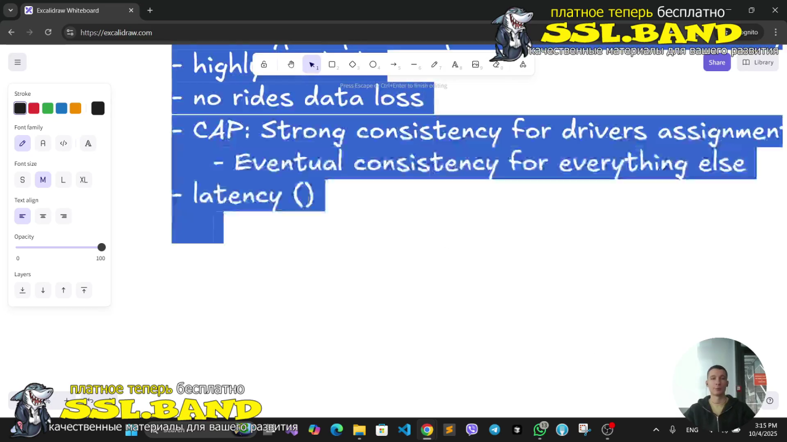
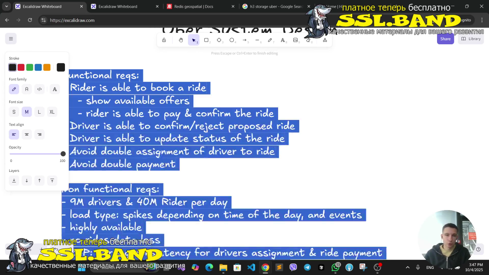
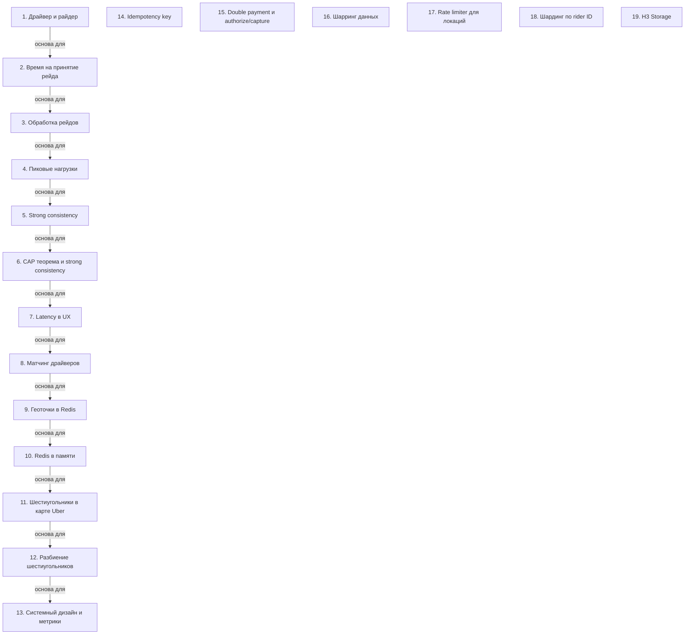

# Системный дизайн Uber: ключевые концепции

> [!abstract] Обзор
> Лекция по системному дизайну Uber охватывает основные аспекты работы с драйверами, райдерами, нагрузкой, стабильностью, геолокацией и интеграцией. Основные темы включают обработку запросов, управление состоянием, геоточки, метрики и безопасность платежей. Также рассматриваются стратегии хранения данных, ограничения на доступ к локациям, распределение нагрузки и использование специализированных хранилищ.

> [!info] Курс
> [[index|Оглавление курса]]

## Оглавление
1. [[#1. Драйвер и райдер]]
2. [[#2. Время на принятие рейда]]
3. [[#3. Обработка рейдов]]
4. [[#4. Пиковые нагрузки]]
5. [[#5. Strong consistency]]
6. [[#6. CAP теорема и strong consistency]]
7. [[#7. Latency в UX]]
8. [[#8. Матчинг драйверов]]
9. [[#9. Геоточки в Redis]]
10. [[#10. Redis в памяти]]
11. [[#11. Шестиугольники в карте Uber]]
12. [[#12. Разбиение шестиугольников]]
13. [[#13. Системный дизайн и метрики]]
14. [[#14. Idempotency key]]
15. [[#15. Double payment и authorize/capture]]
16. [[#16. Шарринг данных]]
17. [[#17. Rate limiter для локаций]]
18. [[#18. Шардинг по rider ID]]
19. [[#19. H3 Storage]]

**Схема** — [[#Схема]]
**Итог** — [[#Итог]]

## 1. Драйвер и райдер

Драйвер — водитель, райдер — пассажир. Система работает с ними как с двумя участниками: драйвер принимает рейды, райдер ожидает их.

> [!info] Зачем это нужно
> Разделение ролей упрощает логику взаимодействия и улучшает пользовательский опыт.

## 2. Время на принятие рейда

Драйвер может принять или отклонить рейд в течение 10 секунд. Если драйвер не отвечает, рейд считается непринятым.

> [!info] Зачем это нужно
> Ограниченное время на принятие рейда улучшает скорость обработки и снижает задержки.

## 3. Обработка рейдов

Одна тачка может обрабатывать 500 рейдов в секунду. 8 миллионов драйверов соответствуют 100 драйверам в секунду.

> [!info] Зачем это нужно
> Высокая пропускная способность позволяет масштабировать систему под большие нагрузки.

## 4. Пиковые нагрузки

Пиковые нагрузки могут возникать из-за массовых событий, таких как концерты или футбольные матчи. Это требует гибкой архитектуры.

> [!info] Зачем это нужно
> Система должна быть готова к резкому увеличению запросов в определённые периоды.

## 5. Strong consistency

Strong consistency гарантирует, что данные не теряются и не задерживаются, предотвращая проблемы вроде double payment.

> [!info] Зачем это нужно
> Это критически важно для платежей и обеспечения целостности данных.

## 6. CAP теорема и strong consistency

CAP теорема требует strong consistency для правильного назначения драйверов и платежей.

> [!info] Зачем это нужно
> Strong consistency обеспечивает надёжность в условиях распределённых систем.

## 7. Latency в UX

Latency влияет на пользовательский опыт. Оповещение о готовом драйвере должно быть без задержек.

> [!info] Зачем это нужно
> Низкая задержка улучшает восприятие системы и повышает удовлетворённость пользователей.

## 8. Матчинг драйверов

Для матчинга драйверов выделяется 120 секунд. Это время используется для поиска подходящего драйвера.

> [!info] Зачем это нужно
> Время на матчинг влияет на скорость доставки и качество сервиса.

> [!quote]- Кадр [00:13:49]
> 

## 9. Геоточки в Redis

В Redis можно добавлять геоточки с координатами latitude и longitude для работы с геолокацией.

> [!info] Зачем это нужно
> Геоточки позволяют эффективно искать драйверов и райдеров в определённых зонах.

## 10. Redis в памяти

Redis может хранить данные в оперативной памяти и реплицировать операции на follower.

> [!info] Зачем это нужно
> Хранение в памяти обеспечивает высокую скорость доступа и низкую задержку.

## 11. Шестиугольники в карте Uber

Карта Uber разделена на шестиугольники, которые позволяют эффективно обновлять и искать данные.

> [!info] Зачем это нужно
> Шестиугольники упрощают геолокационные запросы и улучшают производительность.

## 12. Разбиение шестиугольников

Шестиугольники можно дробить на более мелкие элементы в зависимости от необходимости.

> [!info] Зачем это нужно
> Разбиение позволяет адаптировать систему под разные географические зоны.

> [!quote]- Кадр [00:21:52]
> 

## 13. Системный дизайн и метрики

Анализ нагрузки и метрик требует сторонних инструментов из-за их сложности.

> [!info] Зачем это нужно
> Сторонние инструменты позволяют эффективно мониторить и оптимизировать систему.

## 14. Idempotency key

Idempotency key решает проблему double payment, гарантируя, что повторный запрос не приведёт к двойной оплате.

> [!info] Зачем это нужно
> Это критически важно для безопасности платежей и предотвращения ошибок.

## 15. Double payment и authorize/capture

Платежи состоят из двух этапов: authorize и capture. Authorize проверяет наличие средств.

> [!info] Зачем это нужно
> Эта модель позволяет избежать дублирования платежей и улучшает безопасность.

> [!quote]- Кадр [00:45:57]
> 

## 16. Шарринг данных

Шарринг данных выбирается в зависимости от объёма данных и частоты обновлений. Если данные не превышают возможности одного хранилища, можно использовать централизованную стратегию. При больших объёмах или частых обновлениях применяется распределённый подход.

> [!info] Зачем это нужно
> Позволяет оптимизировать использование ресурсов и избежать перегрузки одного хранилища.

## 17. Rate limiter для локаций

Rate limiter ограничивает количество райдеров на одну локацию до 2-3 тысяч. Работает по схеме, похожей на ticketmaster, чтобы избежать переполнения и обеспечить справедливое распределение доступа.

> [!info] Зачем это нужно
> Предотвращает перегрузку локаций и обеспечивает стабильность системы.

## 18. Шардинг по rider ID

Шардинг по rider ID позволяет избежать scatter gather, распределяя нагрузку равномерно. Это сохраняет смысл репликации и шардинга, обеспечивая высокую производительность и отказоустойчивость.

> [!info] Зачем это нужно
> Упрощает управление данными и повышает масштабируемость.

## 19. H3 Storage

H3 Storage используется напрямую в Uber для хранения данных. Это специализированная система, оптимизированная под большие объёмы и высокую доступность.

> [!info] Зачем это нужно
> Позволяет эффективно хранить и обрабатывать данные в масштабированных системах.

## Схема

## Итог

> [!success] Что в итоге
> Системный дизайн Uber включает в себя обработку рейдов, геолокацию, безопасность платежей и управление нагрузкой. Ключевые концепции включают strong consistency, шестиугольники, idempotency key и метрики. Также рассматриваются стратегии хранения данных, ограничения на доступ к локациям, распределение нагрузки и использование специализированных хранилищ. Все эти элементы работают вместе для обеспечения высокой производительности и надёжности сервиса.

