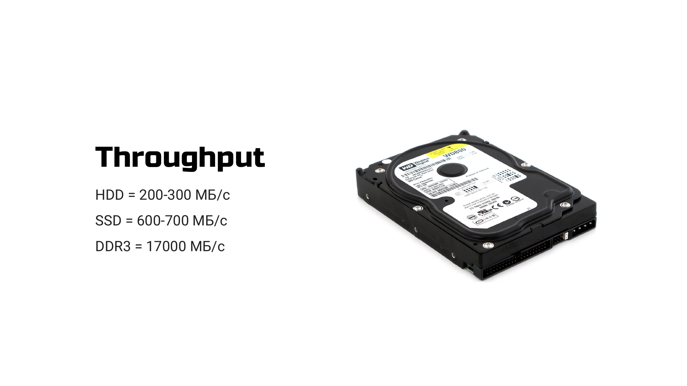
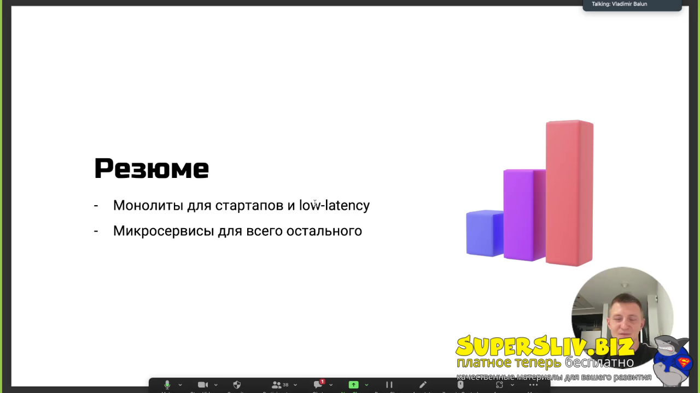
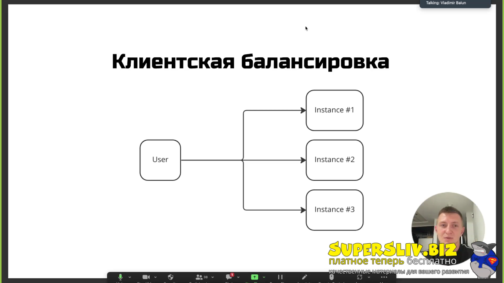
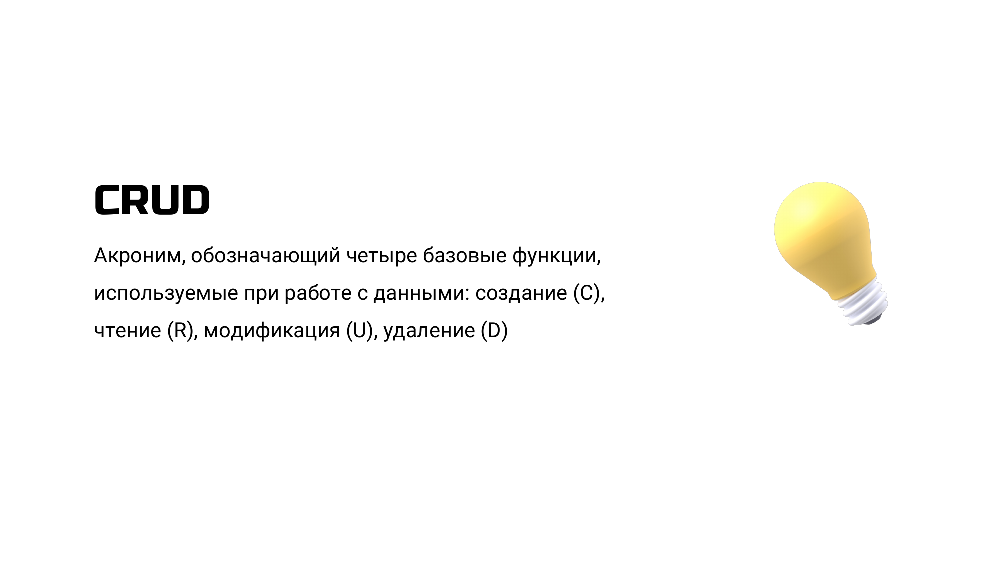
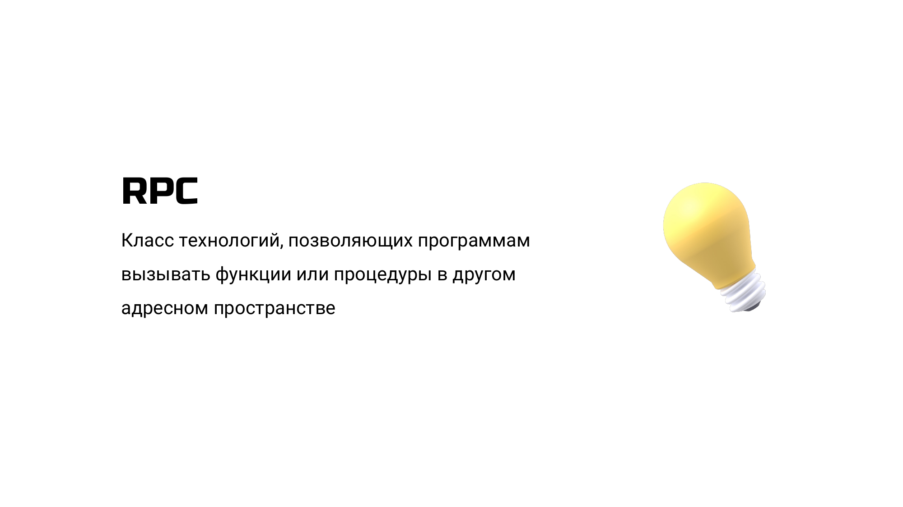
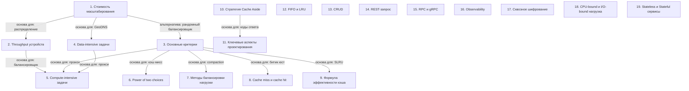

# Основные термины и компоненты системного дизайна

> [!abstract] Обзор
> Лекция по основным терминам и компонентам системного дизайна. Основные темы: масштабируемость, производительность, кэширование, архитектура, обсервабилити, API, безопасность и типы нагрузок. Объясняются ключевые понятия и их практическое применение. Понимание этих терминов позволяет создавать эффективные и надежные системы.

> [!info] Курс
> [[index|Оглавление курса]]

## Оглавление
1. [[#1. Стоимость масштабирования]]
2. [[#2. Throughput устройств]]
3. [[#3. Основные критерии]]
4. [[#4. Data-intensive задачи]]
5. [[#5. Compute-intensive задачи]]
6. [[#6. Power of two choices]]
7. [[#7. Методы балансировки нагрузки]]
8. [[#8. Cache miss и cache hit]]
9. [[#9. Формула эффективности кэша]]
10. [[#10. Стратегия Cache Aside]]
11. [[#11. Ключевые аспекты проектирования]]
12. [[#12. FIFO и LRU]]
13. [[#13. CRUD]]
14. [[#14. REST-запрос]]
15. [[#15. RPC и gRPC]]
16. [[#16. Observability]]
17. [[#17. Сквозное шифрование]]
18. [[#18. CPU-bound и I/O-bound нагрузка]]
19. [[#19. Stateless и Stateful сервисы]]

**Схема** — [[#Схема]]
**Итог** — [[#Итог]]

## 1. Стоимость масштабирования

Рост затрат на увеличение ресурсов не линеен относительно мощности. Масштабирование может вызывать downtime и ограничено по ресурсам. Стоимость растет экспоненциально, а не линейно.

> [!info] Зачем это нужно
> Необходимо учитывать затраты при планировании роста системы.

> [!quote]- Слайд
> 

## 2. Throughput устройств

HDD имеет пропускную способность 200-300 МБ/с, SSD — 600-700 МБ/с, DDR3 — 17000 МБ/с. Разница в скорости влияет на выбор оборудования для хранения и обработки данных.

> [!info] Зачем это нужно
> Выбор устройства зависит от требований к скорости и объему данных.

> [!quote]- Слайд
> 

## 3. Основные критерии

В FAQ перечислены основные критерии: надежность, масштабируемость, производительность, удобство сопровождения и безопасность. Также рассматриваются способы взаимодействия и алгоритмы вытеснения. Система оценивается по двум критериям: read-write и data compute intensive. Это влияет на выбор архитектуры и способа хранения данных.

> [!info] Зачем это нужно
> Эти критерии помогают оценить качество и эффективность системы.

> [!quote]- Кадр [00:49:20]
> 

## 4. Data-intensive задачи

Требуют сохранения больших объемов данных и результатов ресурсоемких операций. Включают поиск, фильтрацию и хранение данных.

> [!info] Зачем это нужно
> Такие задачи требуют специализированных решений для хранения и обработки.

## 5. Compute-intensive задачи

Задачи, требующие выполнения большого количества вычислительных операций. Включают обработку больших объемов данных.

> [!info] Зачем это нужно
> Требуют оптимизации вычислений и использования мощных процессоров.

## 6. Power of two choices

Случайным образом выбирается два бэкенда, и выбирается лучший по целевой метрике. Это метод распределения нагрузки.

> [!info] Зачем это нужно
> Позволяет оптимизировать распределение запросов.

> [!quote]- Слайд
> 

## 7. Методы балансировки нагрузки

В FAQ перечислены методы балансировки нагрузки: Round Robin, Weighted RR, Sticky Sessions, Least Connections, L4 / L7. Каждый метод имеет свои особенности и сценарии применения.

> [!info] Зачем это нужно
> Выбор метода влияет на производительность и надежность системы.

## 8. Cache miss и cache hit

Cache miss — когда запрошенный ключ не найден в кэше. Cache hit — когда ключ найден. Эти понятия используются для оценки эффективности кэширования.

> [!info] Зачем это нужно
> Позволяют оценить производительность системы и оптимизировать кэширование.

## 9. Формула эффективности кэша

Эффективность кэша рассчитывается как AverageTime = DBAccessTime * CacheMissRate + CacheAccessTime. Формула позволяет оценить влияние кэша на производительность.

> [!info] Зачем это нужно
> Позволяет оптимизировать использование кэша и уменьшить нагрузку на базу данных.

## 10. Стратегия Cache Aside

Приложение управляет запросами к кэшу и БД, определяя, когда и куда обращаться. Это позволяет управлять кэшем и базой данных вручную.

> [!info] Зачем это нужно
> Позволяет гибко управлять кэшем и оптимизировать производительность.

## 11. Ключевые аспекты проектирования

Важно учитывать актуализацию данных и балансировать между характером нагрузки (чтение/запись). Это влияет на выбор архитектуры и оптимизацию.

> [!info] Зачем это нужно
> Помогает создать систему, адаптированную под конкретные требования.

> [!quote]- Слайд
> 

## 12. FIFO и LRU

FIFO — алгоритм вытеснения, где элементы удаляются в порядке поступления. LRU — алгоритм, где удаляются элементы, которые не использовались дольше всего. TLRU — модификация LRU с TTL.

> [!info] Зачем это нужно
> Выбор алгоритма влияет на эффективность использования памяти и производительность.

> [!quote]- Кадр [00:56:22]
> 

> [!quote]- Кадр [01:08:22]
> 

## 13. CRUD

CRUD — акроним, обозначающий четыре базовые функции работы с данными: создание, чтение, модификация, удаление. Это основа для работы с базами данных.

> [!info] Зачем это нужно
> Позволяет стандартизировать работу с данными и упрощает разработку.

> [!quote]- Слайд
> 

## 14. REST-запрос

Глагол в REST — это метод запроса, например GET или POST. REST-запросы используют HTTP-методы для взаимодействия с сервером.

> [!info] Зачем это нужно
> Позволяет стандартизировать взаимодействие между клиентом и сервером.

## 15. RPC и gRPC

RPC позволяет программам вызывать функции в другом адресном пространстве. gRPC используется для внутреннего взаимодействия в системах.

> [!info] Зачем это нужно
> RPC и gRPC упрощают взаимодействие между компонентами системы.

> [!quote]- Слайд
> 

## 16. Observability

Observability достигается через метрики, логи, трейсы и профили. Обсервабилити обеспечивает удобство сопровождения и эксплуатации системы.

> [!info] Зачем это нужно
> Позволяет анализировать работу системы и устранять проблемы.

## 17. Сквозное шифрование

Сквозное шифрование не хранит данные на серверах. Используется в WhatsApp для обеспечения конфиденциальности.

> [!info] Зачем это нужно
> Позволяет защитить данные от несанкционированного доступа.

## 18. CPU-bound и I/O-bound нагрузка

CPU-bound — приложения, требующие много вычислений. I/O-bound — приложения, часто взаимодействующие с сетью или диском. Оба типа нагрузки требуют разных подходов к оптимизации.

> [!info] Зачем это нужно
> Понимание типа нагрузки помогает выбрать оптимальную архитектуру и оптимизировать производительность.

> [!quote]- Кадр [00:50:22]
> 

## 19. Stateless и Stateful сервисы

Stateless сервисы легче масштабировать, так как не хранят состояние. Stateful сервисы требуют хранения состояния и сложнее масштабировать.

> [!info] Зачем это нужно
> Выбор типа сервиса влияет на архитектуру и масштабируемость.

## Схема

## Итог

> [!success] Что в итоге
> Основные термины и компоненты системного дизайна включают масштабируемость, производительность, кэширование, архитектуру, обсервабилити, API, безопасность и типы нагрузок. Понимание этих понятий позволяет создавать эффективные и надежные системы. Кэширование, балансировка нагрузки и выбор подходящих технологий играют ключевую роль в оптимизации производительности и масштабируемости. Также важно учитывать типы нагрузки и архитектуру системы для выбора правильных решений.

