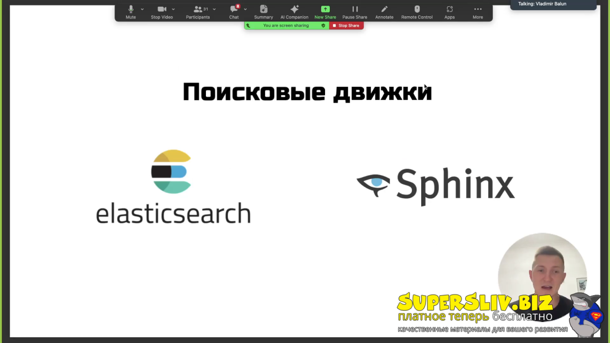
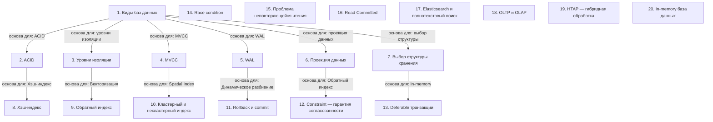

# Хранение данных

> [!abstract] Обзор
> Лекция посвящена основам хранения данных, включая виды баз, индексирование, транзакции и архитектуру систем. Основные темы: типы баз данных, ACID, уровни изоляции, MVCC, WAL, проекция данных, выбор структуры хранения, индексы и транзакции. Важно понимать, как различные типы баз подходят к разным задачам, а также как механизмы транзакций и управления версиями обеспечивают надежность и производительность.

> [!info] Курс
> [[index|Оглавление курса]]

## Оглавление
1. [[#1. Виды баз данных]]
2. [[#2. ACID]]
3. [[#3. Уровни изоляции]]
4. [[#4. MVCC]]
5. [[#5. WAL]]
6. [[#6. Проекция данных]]
7. [[#7. Выбор структуры хранения]]
8. [[#8. Хэш-индекс]]
9. [[#9. Обратный индекс]]
10. [[#10. Кластерный и некластерный индекс]]
11. [[#11. Rollback и commit]]
12. [[#12. Constraint — гарантия согласованности]]
13. [[#13. Deferable транзакции]]
14. [[#14. Race condition]]
15. [[#15. Проблема неповторяющейся чтения]]
16. [[#16. Read Committed]]
17. [[#17. Elasticsearch и полнотекстовый поиск]]
18. [[#18. OLTP и OLAP]]
19. [[#19. HTAP — гибридная обработка]]
20. [[#20. In-memory база данных]]

**Схема** — [[#Схема]]
**Итог** — [[#Итог]]

## 1. Виды баз данных

Основные типы баз: реляционные, документоориентированные, графовые, key-value, колоночные, time series и blob store. Реляционные подходят для точечных операций, колоночные — для массового чтения. NoSQL не требует строгой типизации и поддерживает гибкую схему.

| Тип | Характеристика |
| --- | --- |
| Реляционная | Точечные операции, ACID |
| Колоночная | Массовое чтение, сжатие |
| NoSQL | Гибкая схема, масштабируемость |

> [!info] Зачем это нужно
> Выбор типа базы зависит от задач: транзакции — реляционные, аналитика — колоночная, графы — графовые, временные данные — time series.

> [!quote]- Слайд
> 

## 2. ACID

Стандарт для транзакций, гарантирующий атомарность, согласованность, изоляцию и устойчивость. Обеспечивает надежность операций.

> [!info] Зачем это нужно
> Транзакции должны быть надежными, особенно в критических системах.

## 3. Уровни изоляции

READ_UNCOMMITTED позволяет грязные чтения, неповторяющиеся чтения и потери обновлений. Это самый низкий уровень изоляции.

> [!info] Зачем это нужно
> Используется в системах с низкими требованиями к согласованности.

## 4. MVCC

MVCC использует t_xmin и t_xmax для управления версиями записей. t_xmin — идентификатор транзакции, создавшей запись, t_xmax — удалившей.

> [!info] Зачем это нужно
> Позволяет избежать блокировок и обеспечивает высокую производительность.

## 5. WAL

Журнал изменений (WAL) записывает изменения только после их фиксации в файлы. Это ускоряет восстановление и повышает надежность.

> [!info] Зачем это нужно
> Позволяет быстро восстанавливать данные после сбоя.

## 6. Проекция данных

Проекция позволяет извлекать только нужные колонки, что ускоряет работу с диском. Уменьшает объем данных, которые нужно считывать.

> [!info] Зачем это нужно
> Ускоряет запросы и снижает нагрузку на диск.

## 7. Выбор структуры хранения

Выбор структуры зависит от требований к производительности, масштабируемости и сложности. Проектирование баз — это перевод бизнес-требований в технические.

> [!info] Зачем это нужно
> Правильная структура упрощает работу с данными и повышает эффективность.

## 8. Хэш-индекс

Хэш-индекс позволяет обращаться к одной записи за константу времени, а не за логарифмическое. Это ускоряет поиск.

> [!info] Зачем это нужно
> Ускоряет доступ к данным по ключу.

## 9. Обратный индекс

Обратный индекс хранит информацию о том, в каких текстах и под какими индексами встречаются слова. Покрывающий индекс позволяет выполнить запрос без обращения к таблице.

> [!info] Зачем это нужно
> Ускоряет поиск текстов по словам.

## 10. Кластерный и некластерный индекс

Кластерный индекс определяет порядок хранения данных, некластерный — это отдельная структура, ссылка на данные. Некластерный индекс не влияет на порядок хранения.

> [!info] Зачем это нужно
> Позволяет оптимизировать доступ к данным.

## 11. Rollback и commit

Commit фиксирует изменения, если все запросы выполнены успешно. Rollback откатывает изменения при неудаче транзакции.

> [!info] Зачем это нужно
> Обеспечивает целостность данных.

> [!quote]- Кадр [01:01:49]
> 

## 12. Constraint — гарантия согласованности

Constraint обеспечивает согласованность данных. Это гарантия целостности и корректности.

> [!info] Зачем это нужно
> Предотвращает ввод некорректных данных.

## 13. Deferable транзакции

Deferable транзакции проверяют констрейты в самом конце. Проверка не происходит при каждом запросе.

> [!info] Зачем это нужно
> Упрощает обработку сложных транзакций.

## 14. Race condition

Race condition — типичная проблема параллельного программирования. Два параллельных запроса обновляют одну и ту же переменную, но результат не соответствует ожиданиям.

> [!info] Зачем это нужно
> Приводит к некорректным результатам в параллельных запросах.

## 15. Проблема неповторяющейся чтения

При выполнении нескольких select без изменений в данных могут вернуться разные результаты. Это связано с изменением данных между запросами.

> [!info] Зачем это нужно
> Приводит к некорректным результатам при чтении.

## 16. Read Committed

Read Committed — уровень изоляции, где грязные чтения предотвращены, но возможны неповторяющиеся чтения, фантомные чтения и потери обновлений.

> [!info] Зачем это нужно
> Уровень изоляции, обеспечивающий определённый баланс между производительностью и целостностью.

## 17. Elasticsearch и полнотекстовый поиск

Elasticsearch используется для полнотекстового поиска, хранения логов и трасс. Не предназначен для хранения основных данных. Поддерживает поиск связанных слов и вариантов написания через редакционное расстояние. Может работать без сопутствующей БД.

> [!info] Зачем это нужно
> Для поиска и анализа больших объемов текста.

> [!quote]- Кадр [00:04:52]
> 

> [!quote]- Кадр [00:05:52]
> 

## 18. OLTP и OLAP

OLTP — это обработка транзакций в реальном времени, OLAP — аналитика. Системы различаются по назначению: OLTP для операций, OLAP для отчетности.

> [!info] Зачем это нужно
> Для разделения задач обработки данных и анализа.

> [!quote]- Кадр [00:24:01]
> 

## 19. HTAP — гибридная обработка

HTAP объединяет OLTP и OLAP. Позволяет выполнять транзакции и аналитику в одной системе. Подходит для сценариев, где требуется высокая производительность и аналитика в реальном времени.

> [!info] Зачем это нужно
> Для упрощения архитектуры и повышения эффективности.

> [!quote]- Кадр [00:25:01]
> 

## 20. In-memory база данных

In-memory базы хранят данные в оперативной памяти, что ускоряет доступ. При перезапуске данные теряются, но могут сохраняться на диск для резервного копирования. Embedded-базы встроены в приложение, работают с файлами как с БД. Single File — БД, хранящаяся в одном файле. Может быть колоночной, где каждая колонка — отдельный файл. Атомарность — транзакция выполняется полностью или не выполняется. Гарантия отката — откат в случае сбоя. Изоляция — траннякции не видят изменений друг друга. Устойчивость — данные сохраняются при сбоях. Soft State — модель, где данные могут меняться со временем из-за отсутствия строгой согласованности. Модель BASE разрывается с концепцией согласованной БД. Кэширование может применяться на уровне аккаунтов, баз данных и транзакций. Ускоряет доступ к данным, снижает нагрузку на основную систему. Асинхронная связь между сервисами через очередь позволяет обмениваться данными независимо. Обеспечивает отказоустойчивость, так как данные сохраняются при сбое. Pull — получение данных по запросу. Push — передача данных без запроса. Отличаются способом взаимодействия между клиентом и сервером. Data Retention определяется бизнесом. Устанавливает срок хранения данных, после которого они удаляются. Определяет политики управления архивированием и хранением. Гарантии доставки обеспечивают надежность передачи сообщений. «At least once» — доставка хотя бы один раз. «At most once» — доставка не более одного раза. Фаза расширения — запрашиваются блокировки, они не высвобождаются. Фаза сжатия — высвобождаются блокировки. Обеспечивают согласованность и изоляцию.

> [!info] Зачем это нужно
> Для высокой производительности при работе с данными.

> [!quote]- Кадр [00:59:01]
> 

## Схема

## Итог

> [!success] Что в итоге
> Хранение данных — это основа системного дизайна. Выбор типа базы, индексов и структуры хранения зависит от задач: транзакции — реляционные, аналитика — колоночные, графы — графовые. MVCC и WAL обеспечивают надежность и производительность. Проекция данных и выбор структуры упрощают работу с данными и повышают эффективность. Индексы, уровни изоляции и транзакции — основа надёжной работы с базами данных. Понимание этих концепций позволяет оптимизировать работу с данными и избежать ошибок в параллельных запросах.

