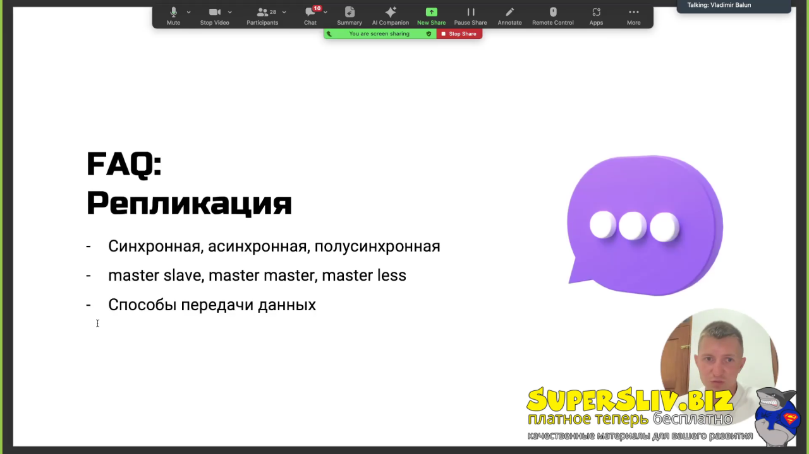
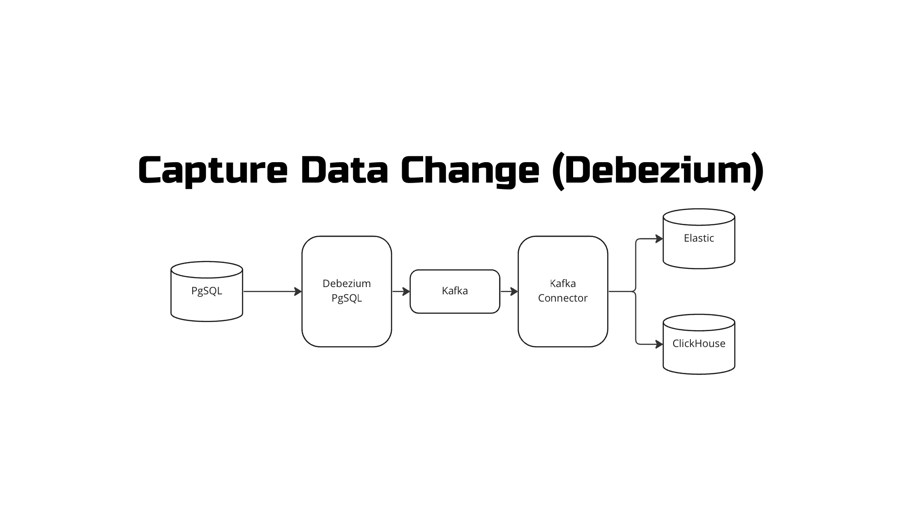
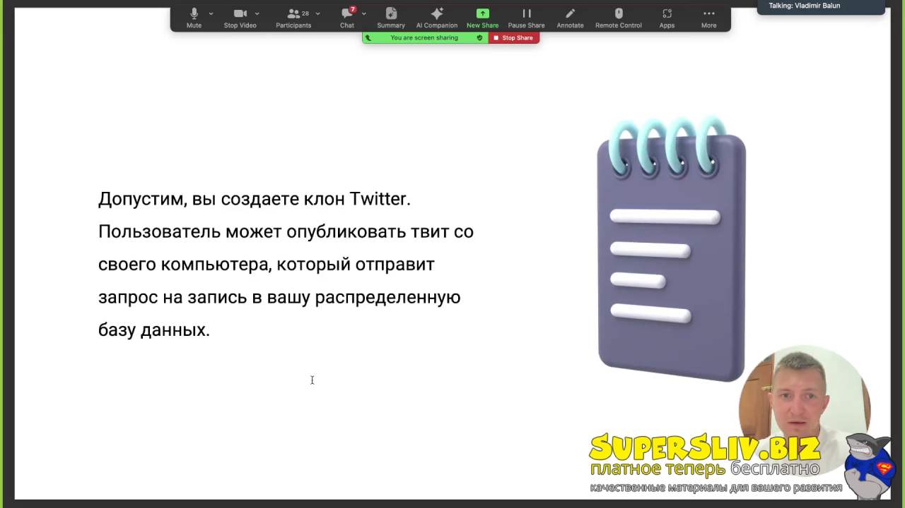
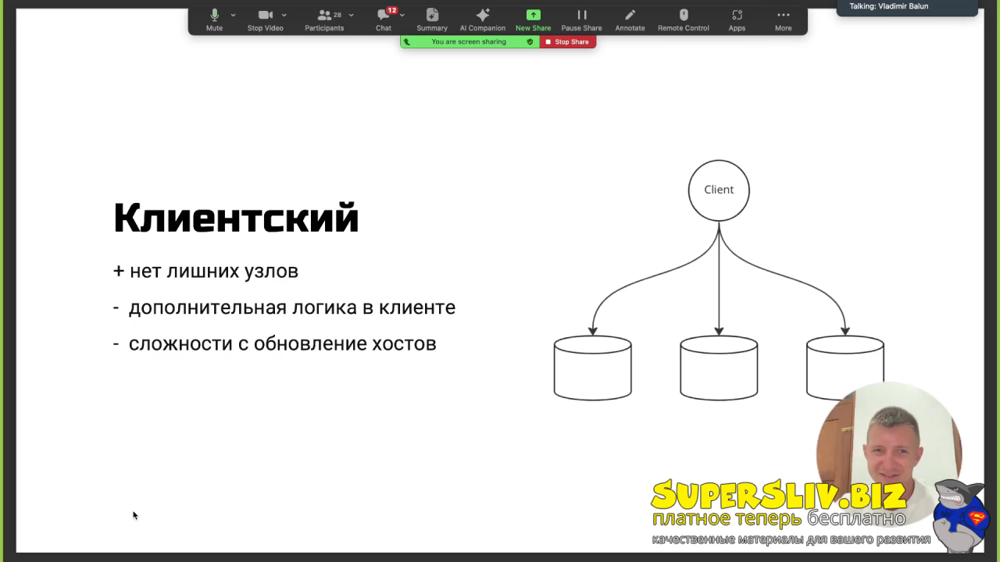
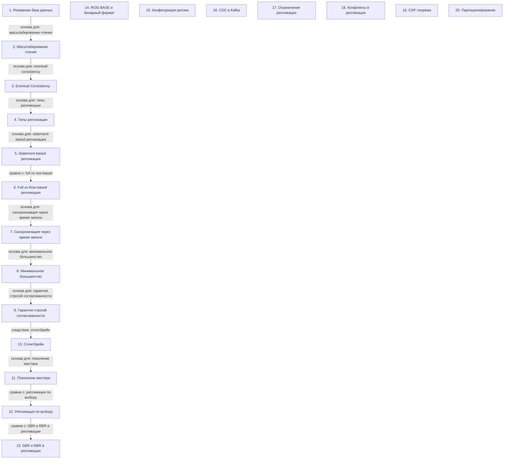

# Распределенное хранение данных

> [!abstract] Обзор
> Лекция о распределенном хранении данных, включая репликацию, шардинг, бэкапы и CDC. Основные темы: резервное копирование, масштабирование чтения, eventual consistency, типы репликации, statement-based репликация, full vs row-based репликация, синхронизация через время записи, минимальное большинство, гарантия строгой согласованности, сплитбрейн и поколение мастера. Важно понимать, как эти механизмы взаимодействуют для обеспечения надежности и производительности распределенных систем.

> [!info] Курс
> [[index|Оглавление курса]]

## Оглавление
1. [[#1. Резервная база данных]]
2. [[#2. Масштабирование чтения]]
3. [[#3. Eventual Consistency]]
4. [[#4. Типы репликации]]
5. [[#5. Statement-based репликация]]
6. [[#6. Full vs Row-based репликация]]
7. [[#7. Синхронизация через время записи]]
8. [[#8. Минимальное большинство]]
9. [[#9. Гарантия строгой согласованности]]
10. [[#10. Сплитбрейн]]
11. [[#11. Поколение мастера]]
12. [[#12. Репликация по выбору]]
13. [[#13. SBR и RBR в репликации]]
14. [[#14. ROG-BASE и бинарный формат]]
15. [[#15. Конфигурация реплик]]
16. [[#16. CDC в Kafka]]
17. [[#17. Ограничения репликации]]
18. [[#18. Конфликты в репликации]]
19. [[#19. CAP-теорема]]
20. [[#20. Партиционирование]]

**Схема** — [[#Схема]]
**Итог** — [[#Итог]]

## 1. Резервная база данных

Резервная база данных обеспечивает отказоустойчивость и доступ к данным при отказе основной.

> [!info] Зачем это нужно
> Обеспечивает отказоустойчивость и доступ к данным в критических ситуациях.

## 2. Масштабирование чтения

Масштабирование чтения достигается за счет переноса части запросов на реплики.

> [!info] Зачем это нужно
> Увеличивает производительность системы при высокой нагрузке на чтение.

## 3. Eventual Consistency

Eventual Consistency — это состояние, когда все запросы возвращают последнее значение после задержки.

> [!info] Зачем это нужно
> Позволяет ускорить обработку запросов при задержках в синхронизации.

## 4. Типы репликации

Pull — реплики получают данные самостоятельно. Push — мастер отправляет данные. Репликация может быть синхронной, асинхронной или полусинхронной.

> [!info] Зачем это нужно
> Определяет способ синхронизации данных между узлами.

> [!quote]- Слайд
> 

## 5. Statement-based репликация

Statement-based репликация передаёт запросы, а не сущности, что упрощает отладку.

> [!info] Зачем это нужно
> Упрощает отладку и анализ изменений в системе.

## 6. Full vs Row-based репликация

Full — репликация всей сущности. Row-based — передача только изменений. Режимы могут переключаться.

> [!info] Зачем это нужно
> Выбор режима влияет на производительность и объем данных.

## 7. Синхронизация через время записи

Верный порядок событий определяется по времени записи, но не всегда работает в распределенных системах.

> [!info] Зачем это нужно
> Позволяет определить порядок событий в распределенных системах.

## 8. Минимальное большинство

Минимальное большинство рассчитывается как N/2 + 1 для обеспечения согласованности.

> [!info] Зачем это нужно
> Позволяет определить минимальное количество узлов для согласованности.

## 9. Гарантия строгой согласованности

Если W + R > N, данные всегда согласованы. Если W + R ≤ N, согласованность не гарантируется.

> [!info] Зачем это нужно
> Определяет условия для строгой согласованности в распределенных системах.

## 10. Сплитбрейн

Сплитбрейн возникает при отказе мастера, что приводит к потере данных.

> [!info] Зачем это нужно
> Представляет проблему согласованности в распределенных системах.

## 11. Поколение мастера

Поколение используется для определения актуального мастера и избежания конфликтов.

> [!info] Зачем это нужно
> Позволяет отслеживать устаревшие мастера и обеспечивать отказоустойчивость.

## 12. Репликация по выбору

Репликация может быть отключена для оптимизации ресурсов, но снижает надежность.

> [!info] Зачем это нужно
> Для оптимизации использования ресурсов в системах с низкой нагрузкой.

> [!quote]- Слайд
> 

## 13. SBR и RBR в репликации

SBR — репликация запросов, RBR — репликация изменений. SBR точнее, но требует больше ресурсов.

> [!info] Зачем это нужно
> Для выбора подхода к репликации в зависимости от требований к точности и производительности.

> [!quote]- Кадр [00:53:13]
> 

## 14. ROG-BASE и бинарный формат

ROG-BASE не использует информацию о запросах, бинарный формат более компактный.

> [!info] Зачем это нужно
> Для минимизации объема передаваемых данных и повышения производительности.

> [!quote]- Кадр [00:54:13]
> 

## 15. Конфигурация реплик

Передача данных между репликами происходит через TCP. Конфигурация настраивается при настройке кластера.

> [!info] Зачем это нужно
> Для обеспечения надежной и масштабируемой передачи данных между репликами.

## 16. CDC в Kafka

CDC — способ захвата изменений данных из базы, например, MySQL, через журнал изменений.

> [!info] Зачем это нужно
> Для автоматической синхронизации данных между системами.

> [!quote]- Слайд
> 

## 17. Ограничения репликации

Репликация не масштабирует запись из-за необходимости синхронизации. При сбоях может потребоваться откат.

> [!info] Зачем это нужно
> Ограничения репликации требуют внимательного проектирования архитектуры.

## 18. Конфликты в репликации

Конфликты возникают при одновременных изменениях на разных репликах. Их можно разрешить с помощью CRDT или LWW.

> [!info] Зачем это нужно
> Разрешение конфликтов важно для обеспечения согласованности.

> [!quote]- Кадр [00:31:37]
> 

## 19. CAP-теорема

CAP-теорема утверждает, что в распределенных системах невозможно обеспечить все три свойства: согласованность, доступность и устойчивость к разделению одновременно.

> [!info] Зачем это нужно
> CAP-теорема определяет границы возможностей распределенных систем.

## 20. Партиционирование

Партиционирование — это метод разделения больших таблиц на части для оптимизации хранения и обработки. Может быть вертикальным или горизонтальным. Шардинг — распределение данных между серверами по ключевому полю.

> [!info] Зачем это нужно
> Партиционирование помогает масштабировать базы данных.

> [!quote]- Кадр [01:53:19]
> 

> [!quote]- Кадр [01:21:45]
> 

## Схема

## Итог

> [!success] Что в итоге
> Распределенное хранение данных требует репликации, согласованности и отказоустойчивости. Репликация позволяет масштабировать систему, а согласованность — обеспечивать целостность данных. Сплитбрейн и поколение мастера — важные аспекты управления отказами. Выбор типа репликации и режима согласованности зависит от требований к производительности и надежности. Бэкапы и CDC обеспечивают восстановимость и автоматическую синхронизацию данных. Все эти методы связаны и дополняют друг друга для построения надежной и масштабируемой архитектуры.

