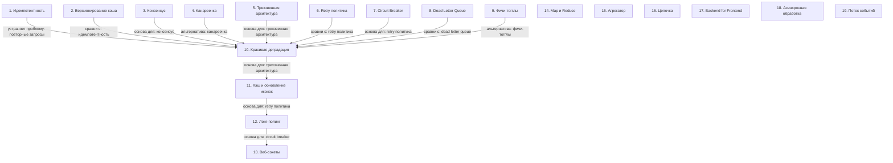

# Паттерны и приемы проектирования

> [!abstract] Обзор
> Лекция по паттернам и приемам проектирования, направленным на построение отказоустойчивых, масштабируемых и управляемых систем. Основные темы включают идемпотентность, версионирование кэша, консенсус, канареечка, трехзвенную архитектуру, retry политику, circuit breaker, dead letter queue, фичи-тогглы, красивую деградацию, хэш, асинхронную обработку, двустороннюю коммуникацию, агрегаторы, распределенные транзакции, паттерны обработки данных и управления состоянием. Все темы связаны через общие принципы: отказоустойчивость, масштабируемость, управление состоянием и безопасность.

> [!info] Курс
> [[index|Оглавление курса]]

## Оглавление
1. [[#1. Идемпотентность]]
2. [[#2. Версионирование кэша]]
3. [[#3. Консенсус]]
4. [[#4. Канареечка]]
5. [[#5. Трехзвенная архитектура]]
6. [[#6. Retry политика]]
7. [[#7. Circuit Breaker]]
8. [[#8. Dead Letter Queue]]
9. [[#9. Фичи-тогглы]]
10. [[#10. Красивая деградация]]
11. [[#11. Хэш и обновление иконок]]
12. [[#12. Лонг-полинг]]
13. [[#13. Веб-сокеты]]
14. [[#14. Map и Reduce]]
15. [[#15. Агрегатор]]
16. [[#16. Цепочка]]
17. [[#17. Backend for Frontend]]
18. [[#18. Асинхронная обработка]]
19. [[#19. Поток событий]]

**Схема** — [[#Схема]]
**Итог** — [[#Итог]]

## 1. Идемпотентность

Идемпотентность — свойство операции, при котором повторное применение дает тот же результат. Это позволяет безопасно повторять запросы без изменения состояния системы. Используется для GET и DELETE, где данные не изменяются. Повторные запросы не влияют на систему.

> [!info] Зачем это нужно
> Позволяет безопасно повторять запросы, не нарушая целостность данных.

## 2. Версионирование кэша

Ключ кэширования содержит версию, например, icon_v1. Инвалидация происходит через инкремент версии. Это позволяет обновлять данные без полной очистки кэша. Кэш тегированный позволяет инвалидировать только часть данных.

> [!info] Зачем это нужно
> Упрощает управление кэшем и позволяет инвалидировать только нужные данные.

## 3. Консенсус

Необходимость согласования действий между узлами. Используется в распределенных системах для согласования состояния. Обеспечивает согласованность данных и предотвращает конфликты.

> [!info] Зачем это нужно
> Обеспечивает согласованность данных в распределенных системах.

## 4. Канареечка

Метод постепенного запуска новых версий сервиса. Позволяет проверять стабильность новой версии перед полной замены. Используется для минимизации рисков при обновлениях.

> [!info] Зачем это нужно
> Позволяет безопасно запускать новые версии сервиса.

## 5. Трехзвенная архитектура

Разделение приложения на фронтенд-сервер, бэкенд-сервер и статику на NGINX. Бэкенд не знает о статике, что упрощает масштабирование и управление. Статика хранится отдельно, что улучшает производительность.

> [!info] Зачем это нужно
> Упрощает масштабирование и управление статикой.

## 6. Retry политика

Повторные попытки при недоступности сервиса. Используется для агрегации данных. Может быть экспоненциальной, константной или квадратичной. Неправильная настройка может привести к перегрузке.

> [!info] Зачем это нужно
> Позволяет избежать немедленного возврата ошибок клиенту.

## 7. Circuit Breaker

Паттерн, блокирующий запросы к неисправному серверу. Переводит состояние в open, чтобы не пропускать трафик. Отбивает ошибки 500-ками. Используется для предотвращения перегрузки.

> [!info] Зачем это нужно
> Предотвращает перегрузку сервиса при сбоях.

## 8. Dead Letter Queue

Очередь для хранения сообщений, которые не могут быть обработаны. Используется для перенаправления сообщений на обработку в будущем. Позволяет избежать потери данных.

> [!info] Зачем это нужно
> Позволяет избежать потери данных при сбоях.

## 9. Фичи-тогглы

Механизм отключения отдельных функций или сервисов. Используется для тестирования и управления версиями. Позволяет включать/выключать функции без изменения кода.

> [!info] Зачем это нужно
> Позволяет управлять функциями без изменения кода.

## 10. Красивая деградация

Заранее подготовленные данные для отклика в случае ошибок. Цель — чтобы пользователь не замечал сбоев. Требует продуманного подхода к обработке ошибок.

> [!info] Зачем это нужно
> Позволяет избежать влияния ошибок на пользователей.

## 11. Хэш и обновление иконок

Браузеры кэшируют статику, включая иконки. Обновление иконки требует изменения имени файла. Хэш используется для обозначения версии файла. Позволяет обновлять иконки без очистки кэша.

> [!info] Зачем это нужно
> Позволяет обновлять иконки без очистки кэша.

## 12. Лонг-полинг

Лонг-полинг позволяет клиенту меньше опрашивать сервер, если нет новых сообщений. Это уменьшает частоту опроса и делает обмен данными более эффективным. Используется для оптимизации сетевого трафика.

> [!info] Зачем это нужно
> Снижает нагрузку на сервер и улучшает производительность.

## 13. Веб-сокеты

Веб-сокеты поддерживают двустороннюю коммуникацию. Данные могут передаваться как с клиента, так и с сервера через одно соединение. Это позволяет серверу инициировать сообщения.

> [!info] Зачем это нужно
> Позволяет реализовать реальную времени взаимодействие.

## 14. Map и Reduce

Map — функция, которая обрабатывает данные и создает промежуточные результаты. Reduce — функция, которая объединяет промежуточные результаты в финальный ответ. Используется в обработке больших объемов данных.

> [!info] Зачем это нужно
> Позволяет эффективно обрабатывать данные в распределенных системах.

## 15. Агрегатор

Агрегатор — это сервис, который собирает данные из нескольких сервисов. Используется для предоставления данных фронту и упрощения взаимодействия между сервисами.

> [!info] Зачем это нужно
> Упрощает доступ к данным и снижает нагрузку на клиентов.

## 16. Цепочка

Цепочка — архитектурный паттерн, при котором сервисы взаимодействуют последовательно, передавая данные друг другу. Используется для организации взаимодействия между сервисами.

> [!info] Зачем это нужно
> Позволяет структурировать логику обработки данных.

## 17. Backend for Frontend

Backend for Frontend — это агрегатор, который предоставляет данные фронту. Используется в микросервисах для упрощения доступа к данным.

> [!info] Зачем это нужно
> Упрощает взаимодействие между фронтом и бэкендом.

## 18. Асинхронная обработка

Асинхронная обработка позволяет пользователю не ждать завершения заказа. Пользователь может продолжать действия после отправки запроса. Используется для улучшения пользовательского опыта.

> [!info] Зачем это нужно
> Повышает производительность и улучшает UX.

## 19. Поток событий

Пользователь может генерировать постоянный поток событий. Поток событий может быть обработан не в реальном времени. Примеры включают просмотр и заказ товаров. Data Warehouse — хранилище данных, используемое для анализа и формирования рекомендаций. Данные сгружаются в аналитическую базу или кластер, например, Hadoop. Дебаунсинг — метод, при котором запрос отправляется только после прохождения определенного временного интервала. Используется для предотвращения множества запросов при быстром вводе текста. Распределенная транзакция — это способ обеспечения согласованности данных в нескольких сервисах. Нужно договориться, чтобы данные сохранились и в одном, и в другом. Проверка готовности узлов — это способ определить, готов ли узел к выполнению операции. Если узел не готов, операция не выполняется. Роллбэк — это откат изменений в случае сбоя. Сервис начинает транзакции в нескольких базах данных одновременно и откатывает их при ошибке. Выборы в распределенных системах — это процесс, при котором узлы с более высоким рангом участвуют в выборах. Это позволяет определить новый лидер. Коммит — окончательное сохранение изменений, после которого откатить их невозможно. Это гарантирует целостность данных. Хореография — это подход, при котором сервисы взаимодействуют автономно через события. Нет центрального координатора. Сага — это набор локальных транзакций на каждом этапе маршрута. Каждая транзакция отвечает за свой участок. 2PC — это протокол, при котором commit происходит только после получения сообщения от координатора. Обеспечивает согласованность данных. Роллбек после черты — это откат изменений, которые уже были применены. После перехода черты откатить изменения невозможно. Transaction Outbox — паттерн, который гарантирует доставку сообщений в очередь после успешной записи в базу данных. Обеспечивает надежность обработки данных. Inbox используется для временного хранения сообщений, чтобы избежать дублирования долгих операций. Отправка ОК после помещения сообщения в Inbox позволяет начать асинхронную обработку. В одну единицу времени только один сервис может работать с ресурсом. Это обеспечивает согласованность и предотвращает конфликты. nx в Radius означает вставку значения только при отсутствии ключа с этим значением. Используется для предотвращения дублирования данных. Блокировка с тайм-аутом — это временная блокировка ресурса, которая автоматически удаляется после истечения времени. Используется для управления доступом. Random value используется для предотвращения data race. Он позволяет клиенту удалять только свою запись, а не чужую. Аренда в ETCD автоматически удаляется, если не продлевается. Если лидер упал, фолловеры получают ивент о потере аренды и становятся лидером.

> [!info] Зачем это нужно
> Позволяет обрабатывать данные в асинхронном режиме.

## Схема

## Итог

> [!success] Что в итоге
> Паттерны и приемы проектирования позволяют строить надежные, масштабируемые и отказоустойчивые системы. Они помогают управлять состоянием, обрабатывать данные, обеспечивать согласованность и улучшать производительность. Понимание этих паттернов позволяет эффективно проектировать и развивать сложные системы.

