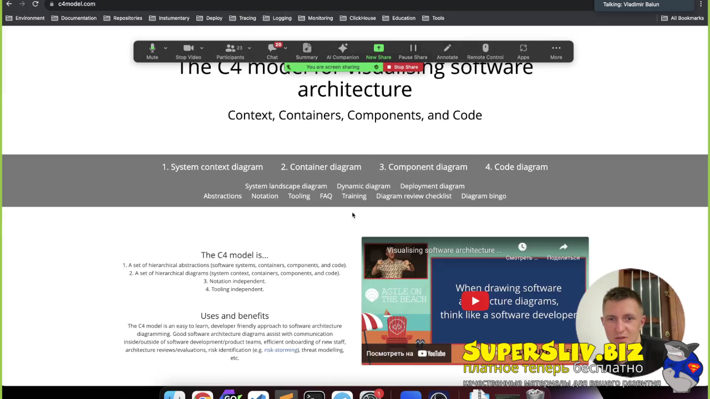

# Урок 5. Дизайн популярных систем

> [!abstract] Обзор
> Лекция по архитектуре популярных систем, включая домашние ленты, обработку постов, масштабирование, хранение данных и оптимизацию. Основные темы: требования к системе, архитектурные решения, обработка лайков и комментариев, хранение медиафайлов, оптимизация производительности. Система должна поддерживать 50 миллионов пользователей, обеспечивать высокую доступность и масштабироваться под нагрузку.

> [!info] Курс
> [[index|Оглавление курса]]

## Оглавление
1. [[#1. Домашняя лента]]
2. [[#2. Функциональные требования]]
3. [[#3. Нефункциональные требования]]
4. [[#4. API Gateway как фильтр]]
5. [[#5. Acer — ключевое требование]]
6. [[#6. Минимизация времени ответа на чтение]]
7. [[#7. Пост-сервис и реалиционка]]
8. [[#8. Хранение изображений в S3]]
9. [[#9. Отстойник для хранения медиа]]
10. [[#10. Расчет RPS для DAO]]
11. [[#11. Репликация для масштабирования]]
12. [[#12. Обновление ленты]]
13. [[#13. Ограничение количества лайков]]
14. [[#14. РПС для лайков]]
15. [[#15. Фидбэк-сервис]]
16. [[#16. Разделение на подсистемы]]
17. [[#17. Геохэш и поиск водителей]]
18. [[#18. Stateful notification сервис]]
19. [[#19. Геораспределение через CDN]]
20. [[#20. Eventual Consistency]]
**Итог** — [[#Итог]]

## 1. Домашняя лента

Домашняя лента формируется на основе подписок и друзей. Посты отображаются в обратном хронологическом порядке. Лента поддерживает комментарии и лайки. Пользователь видит только контент, который ему интересен.

> [!info] Зачем это нужно
> Позволяет персонализировать контент и улучшить вовлеченность пользователей.

## 2. Функциональные требования

Лента отображает посты в обратном хронологическом порядке. Поддерживает комментарии и лайки. Пользователь может взаимодействовать с контентом.

> [!info] Зачем это нужно
> Обеспечивает базовую функциональность для пользовательского взаимодействия.

## 3. Нефункциональные требования

Система поддерживает 50 миллионов пользователей, имеет availability 99,95, хранит посты без удаления, ограничивает посты до 2000 символов и 1 изображение.

> [!info] Зачем это нужно
> Обеспечивает масштабируемость, надежность и устойчивость к нагрузке.

## 4. API Gateway как фильтр

API Gateway используется для авторизации, ограничения скорости запросов и распределения трафика между сервисами для водителей и пассажиров.

> [!info] Зачем это нужно
> Позволяет централизовать проверки и управлять нагрузкой на систему.

## 5. Acer — ключевое требование

Acer — это Architecture Significant Requirement, без которого архитектура системы может быть непригодна. Он определяет ключевые ограничения и требования.

> [!info] Зачем это нужно
> Позволяет определить основные принципы архитектуры и избежать ошибок.

## 6. Минимизация времени ответа на чтение

В read-intensive системах приоритет отдается минимизации времени ответа на чтение, даже если это увеличивает время на запись. Используются способы масштабирования, оптимизированные для чтения.

> [!info] Зачем это нужно
> Улучшает производительность и ускоряет доступ к данным.

## 7. Пост-сервис и реалиционка

Пост-сервис используется для хранения постов. Посты хранятся в реалиционной модели из-за связей с хэштегами и категориями. Роутинг по хэшу распределяет нагрузку между узлами.

> [!info] Зачем это нужно
> Позволяет масштабировать систему и управлять нагрузкой на хранение.

## 8. Хранение изображений в S3

URL изображений сохраняется в базе данных, а изображения хранятся в S3. Это позволяет уменьшить нагрузку на базу и ускорить доступ к медиафайлам. Информация о лайках хранится в отдельной таблице с ссылкой на ID-поста. Это позволяет быстро искать, кто ставил лайки.

> [!info] Зачем это нужно
> Оптимизирует хранение и доступ к изображениям.

## 9. Отстойник для хранения медиа

Отстойник используется для временного хранения медиафайлов перед их удалением. Это позволяет управлять временными данными и избежать потери.

> [!info] Зачем это нужно
> Позволяет управлять временными данными и избежать потери.

## 10. Расчет RPS для DAO

RPS рассчитывается как 50 миллионов DAU за 5 дней, деленные на 86400 секунд в сутках. Это позволяет оценить нагрузку на систему.

> [!info] Зачем это нужно
> Позволяет оценить нагрузку и спланировать ресурсы.

## 11. Репликация для масштабирования

Репликация не масштабирует систему, так как синхронизация реплик становится ограничивающим фактором. Используются асинхронные методы для масштабирования. В ClickHouse по умолчанию используется синхронная репликация данных, что обеспечивает согласованность и надежность. Репликация данных важна для обеспечения отказоустойчивости при выходе Тарантула из строя.

> [!info] Зачем это нужно
> Позволяет масштабировать систему без ограничений синхронизации.

## 12. Обновление ленты

Лента обновляется с добавлением новых элементов в начало и удалением старых с конца. Используется структура деки для эффективного обновления. При переподключении пользователя в другой сервис нужно обновлять IP-адрес для корректного направления уведомлений. Создание коннекта с notification сервисом связано с получением IP-адреса.

```go
var ip string = getIP();
connectToNotificationService(ip);
```

> [!info] Зачем это нужно
> Позволяет быстро обновлять ленту и поддерживать актуальность данных.

## 13. Ограничение количества лайков

Лайки отображаются до 10, а больше 100 лайков не отображаются. Это упрощает интерфейс и уменьшает нагрузку на систему.

> [!info] Зачем это нужно
> Упрощает интерфейс и уменьшает нагрузку на систему.

## 14. РПС для лайков

РПС для лайков оценивается как 25 тысяч запросов в секунду. Это позволяет спланировать ресурсы и масштабировать систему.

> [!info] Зачем это нужно
> Позволяет оценить нагрузку и спланировать ресурсы.

## 15. Фидбэк-сервис

Фидбэк-сервис используется для хранения лайков и комментариев, чтобы избежать перегрузки фид-сервиса и частой перестройки ленты. Это позволяет уменьшить нагрузку на основной поток данных.

> [!info] Зачем это нужно
> Упрощает обработку пользовательского контента и снижает нагрузку на основной фид.

## 16. Разделение на подсистемы

Разделение на подсистемы упрощает обработку запросов и позволяет независимо развивать части системы. Это улучшает масштабируемость и поддерживаемость.

> [!info] Зачем это нужно
> Упрощает разработку и поддержку сложных систем.

## 17. Геохэш и поиск водителей

Геохэш используется для эффективного поиска водителей в определенной зоне, особенно при высоких объемах данных.

> [!info] Зачем это нужно
> Позволяет быстро искать водителей в определенной геозоне.

## 18. Stateful notification сервис

Notification сервис stateful, так как хранит коннекшены к пассажирам и водителям, что позволяет управлять уведомлениями в реальном времени.

> [!info] Зачем это нужно
> Обеспечивает надежную доставку уведомлений.

## 19. Геораспределение через CDN

CDN используется для геораспределения данных между дата-центрами, что улучшает производительность и доступность.

> [!info] Зачем это нужно
> Ускоряет доставку данных и снижает нагрузку на центральные серверы.

## 20. Eventual Consistency

Eventual Consistency позволяет не отслеживать данные в реальном времени, а обновлять их с задержкой, что упрощает архитектуру. Для доступности необходимо сделать дополнительную репликацию. Потеря данных на короткий период времени (до 10 секунд) не критична. Система в real-time переналивается. Апдейт позиций играет ключевую роль в обработке данных в реал-тайм-системе.

> [!info] Зачем это нужно
> Упрощает обработку данных в распределенных системах.

> [!quote]- Кадр [02:07:34]
> 

## Итог

> [!success] Что в итоге
> В итоге, архитектура популярных систем строится на балансе между функциональными и нефункциональными требованиями, обеспечивая масштабируемость, доступность и производительность. Домашняя лента, как ключевая часть, требует поддержки через специализированные сервисы, такие как пост-сервис и фидбэк-сервис, что позволяет избежать перегрузки основной системы. Оптимизация производительности достигается через репликацию, CDN и асинхронные методы, что позволяет системе масштабироваться под огромное количество пользователей. Это важно для реализации систем, где требуется высокая доступность и обработка больших объемов данных в реальном времени.

