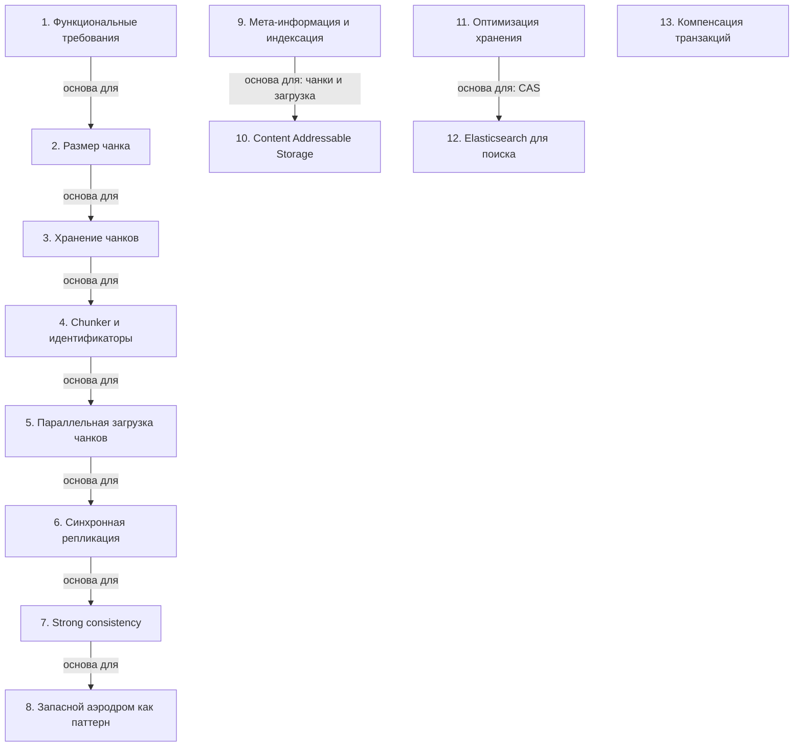

# Дизайн популярных систем

> [!abstract] Обзор
> Лекция по проектированию популярных систем, включая функциональные требования, хранение данных, обработку файлов и архитектурные паттерны. Основные темы: хранение чанков, синхронизация, шардинг, резервные решения и обработка данных. Система должна обеспечивать надежность, масштабируемость и отказоустойчивость. Важно понимать, как эти элементы взаимодействуют для обеспечения стабильной и эффективной работы системы.

> [!info] Курс
> [[index|Оглавление курса]]

## Оглавление
1. [[#1. Функциональные требования]]
2. [[#2. Размер чанка]]
3. [[#3. Хранение чанков]]
4. [[#4. Chunker и идентификаторы]]
5. [[#5. Параллельная загрузка чанков]]
6. [[#6. Синхронная репликация]]
7. [[#7. Strong consistency]]
8. [[#8. Запасной аэродром как паттерн]]
9. [[#9. Мета-информация и индексация]]
10. [[#10. Content Addressable Storage]]
11. [[#11. Оптимизация хранения]]
12. [[#12. Elasticsearch для поиска]]
13. [[#13. Компенсация транзакций]]

**Схема** — [[#Схема]]
**Итог** — [[#Итог]]

## 1. Функциональные требования

Функциональные требования включают создание каталогов и сохранение/загрузку файлов. Это основа работы системы, обеспечивающая возможность управления и доступа к данным.

> [!info] Зачем это нужно
> Функциональные требования определяют, что система должна делать, и служат основой для проектирования архитектуры.

## 2. Размер чанка

Размер чанка — 50 МБ. Это оптимальный размер для обработки и хранения данных в системе.

> [!info] Зачем это нужно
> Чанки разбивают большие файлы на управляемые блоки, упрощая хранение и передачу.

## 3. Хранение чанков

Чанки хранятся в облаке как ключ-значение. Это позволяет эффективно управлять и идентифицировать данные.

> [!info] Зачем это нужно
> Облачное хранение чанков обеспечивает масштабируемость и доступность данных.

## 4. Chunker и идентификаторы

Chunker использует идентификатор файла и хеш-чанка для управления данными. Идентификаторы и хеши обеспечивают уникальность и целостность данных.

> [!info] Зачем это нужно
> Идентификаторы и хеши обеспечивают уникальность и целостность данных.

## 5. Параллельная загрузка чанков

Загрузка чанков должна происходить параллельно, так как это IO-bound нагрузка. Это позволяет максимально использовать пропускную способность.

> [!info] Зачем это нужно
> Параллельная загрузка ускоряет обработку данных и улучшает производительность.

## 6. Синхронная репликация

Синхронная репликация гарантирует целостность данных, но может быть медленной из-за высокого трафика.

> [!info] Зачем это нужно
> Синхронная репликация используется в системах, где важна надежность и согласованность данных.

## 7. Strong consistency

Strong consistency гарантирует актуальность данных и отсутствие конфликтов при одновременных операциях. Применяется в системах бронирования.

> [!info] Зачем это нужно
> Strong consistency обеспечивает надежность в системах, где важна согласованность данных.

## 8. Запасной аэродром как паттерн

Запасной аэродром — это паттерн, когда вместо отказа системы используется альтернативный способ выполнения задачи. Это позволяет избежать отказа системы и обеспечивает отказоустойчивость.

> [!info] Зачем это нужно
> Этот паттерн позволяет избежать отказа системы и обеспечивает отказоустойчивость.

## 9. Мета-информация и индексация

Хранение данных включает внесение мета-информации о файле и пользователе. Индексация файлов организует и ускоряет доступ к данным.

> [!info] Зачем это нужно
> Мета-информация и индексация позволяют эффективно управлять и находить данные.

## 10. Content Addressable Storage

CAS — это система хранения, где файлы идентифицируются через хэши. Дедубликация происходит через сравнение хэшей.

> [!info] Зачем это нужно
> CAS позволяет эффективно хранить и идентифицировать данные.

## 11. Оптимизация хранения

Хранение данных в чанках требует оптимизации и детализации. Чанки распределяются по носителям (SSD, HDD), что позволяет оптимизировать стоимость хранения.

> [!info] Зачем это нужно
> Оптимизация хранения снижает затраты и улучшает производительность.

## 12. Elasticsearch для поиска

Elasticsearch используется для поиска данных, например, по названиям или описаниям. Это позволяет быстро находить информацию в больших объемах данных.

> [!info] Зачем это нужно
> Elasticsearch ускоряет поиск и улучшает пользовательский опыт.

## 13. Компенсация транзакций

Компенсация транзакций используется для отката операций в случае неудачи оплаты или тайм-аута. Это позволяет восстановить состояние системы после ошибки.

> [!info] Зачем это нужно
> Компенсация транзакций обеспечивает надежность и целостность данных.

## Схема

## Итог

> [!success] Что в итоге
> Дизайн популярных систем включает управление функциональными требованиями, хранение и обработку данных, а также использование архитектурных паттернов для обеспечения надежности и масштабируемости. Основные темы: хранение чанков, синхронизация, шардинг и резервные решения. Важно понимать, как эти элементы взаимодействуют для обеспечения стабильной и эффективной работы системы.

