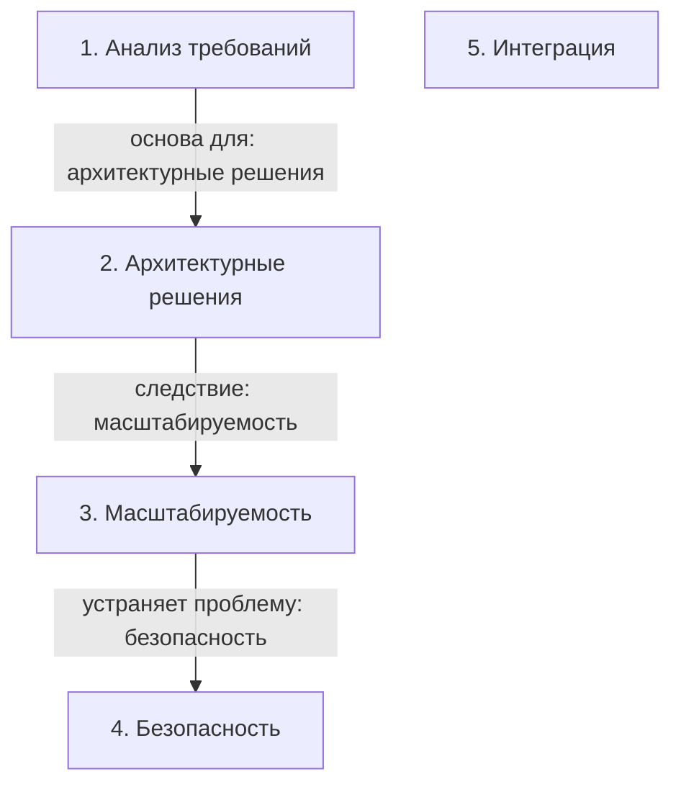

# Итоговый проект по проектированию социальной сети

> [!abstract] Обзор
> Лекция о проектировании социальной сети. Основные этапы: анализ требований, архитектурные решения, масштабируемость, безопасность и интеграция. Темы связаны через общие принципы и реальные примеры.

> [!info] Курс
> [[index|Оглавление курса]]

## Оглавление
1. [[#1. Анализ требований]]
2. [[#2. Архитектурные решения]]
3. [[#3. Масштабируемость]]
4. [[#4. Безопасность]]
5. [[#5. Интеграция]]

**Схема** — [[#Схема]]
**Итог** — [[#Итог]]

## 1. Анализ требований

Проект начинается с определения функциональных и непрерывных требований: регистрация, авторизация, профиль, друзья, сообщения, посты, лента, поиск. Требования делятся на пользовательские и системные.

> [!info] Зачем это нужно
> Требования определяют границы и цели проекта, позволяя структурировать дальнейшие этапы.

## 2. Архитектурные решения

Выбор архитектуры: микросервисы для масштабируемости, REST API для взаимодействия, базы данных для хранения данных. Используются кэширование, балансировка нагрузки и CDN для производительности.

> [!info] Зачем это нужно
> Архитектура определяет масштабируемость, надежность и поддерживаемость системы.

## 3. Масштабируемость

Проект должен поддерживать рост пользователей и данных. Используются горизонтальное масштабирование, кэширование, асинхронная обработка и распределенные базы данных.

> [!info] Зачем это нужно
> Масштабируемость позволяет системе работать при увеличении нагрузки без потери производительности.

## 4. Безопасность

Важно защитить данные пользователей: шифрование, аутентификация, авторизация, защита от DDoS и SQL-инъекций. Используются OAuth, JWT и регулярные аудиты.

> [!info] Зачем это нужно
> Безопасность обеспечивает доверие пользователей и соответствует стандартам.

## 5. Интеграция

Система должна интегрироваться с внешними сервисами: платежные системы, аналитика, мессенджеры. Используются API, Webhooks и SDK для удобства.

> [!info] Зачем это нужно
> Интеграция расширяет функциональность и позволяет использовать существующие ресурсы.

## Схема

## Итог

> [!success] Что в итоге
> Итоговый проект по проектированию социальной сети требует тщательного анализа требований, выбора архитектуры, обеспечения масштабируемости и безопасности. Все компоненты связаны между собой и направлены на создание надежной и удобной платформы.

