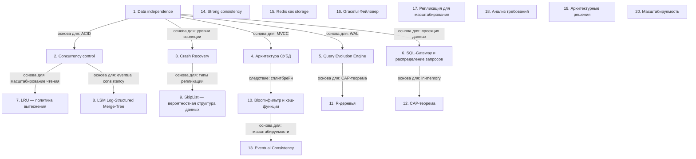

# System Design

> [!abstract] Обзор
> Лекция по системному дизайну объединяет основы систем хранения данных, управления памятью, надежности, распределенных систем и мониторинга. Основные темы включают независимость данных, контроль конкурентного доступа, восстановление после сбоев, архитектуру СУБД, обработку запросов, хранение данных, индексы, кэширование, оптимизацию запросов, LRU, LSM, SkipList, B-деревья, R-деревья, Bloom-фильтры и другие структуры. Все компоненты связаны между собой и работают вместе для обеспечения надёжности, производительности и масштабируемости систем хранения и управления данными.

## Оглавление
1. [[#1. Data independence]]
2. [[#2. Concurrency control]]
3. [[#3. Crash Recovery]]
4. [[#4. Архитектура СУБД]]
5. [[#5. Query Evolution Engine]]
6. [[#6. SQL-Gateway и распределение запросов]]
7. [[#7. LRU — политика вытеснения]]
8. [[#8. LSM (Log-Structured Merge-Tree)]]
9. [[#9. SkipList — вероятностная структура данных]]
10. [[#10. Bloom-фильтр и хэш-функции]]
11. [[#11. R-деревья]]
12. [[#12. CAP-теорема]]
13. [[#13. Eventual Consistency]]
14. [[#14. Strong consistency]]
15. [[#15. Redis как storage]]
16. [[#16. Graceful Фейловер]]
17. [[#17. Репликация для масштабирования]]
18. [[#18. Анализ требований]]
19. [[#19. Архитектурные решения]]
20. [[#20. Масштабируемость]]

**Схема** — [[#Схема]]
**Итог** — [[#Итог]]

## 1. Data independence

Data independence означает, что данные не зависят от способа их хранения. Это позволяет менять структуру хранения без изменения приложений, работающих с данными. Это основа для масштабируемости и гибкости СУБД.

> [!info] Зачем это нужно
> Позволяет изменять способ хранения данных без изменения приложений.

## 2. Concurrency control

Конкурентный доступ возникает при одновременном изменении одного атрибута несколькими пользователями. СУБД обеспечивает контроль над этим, чтобы избежать конфликтов и обеспечить целостность данных.

> [!info] Зачем это нужно
> Обеспечивает целостность данных при одновременном доступе.

## 3. Crash Recovery

Crash Recovery восстанавливает базу данных до последнего корректного состояния после сбоя. Использует write-ahead-log для сохранения данных на диск и защиты от частично выполненных транзакций.

> [!info] Зачем это нужно
> Обеспечивает надёжность данных после сбоев.

## 4. Архитектура СУБД

SQL-запросы обрабатываются СУБД, которая парсит их, проверяет на валидность и использует закон эквивалентности для замены запросов. Значок представляет выборку данных, как в SQL-запросе.

> [!info] Зачем это нужно
> Позволяет обрабатывать запросы и обеспечивать их корректность.

## 5. Query Evolution Engine

Query Evolution Engine парсит SQL-запросы, разбивает их на выражения и строит оптимальные планы выполнения. Это позволяет оптимизировать производительность запросов.

> [!info] Зачем это нужно
> Позволяет оптимизировать выполнение запросов.

## 6. SQL-Gateway и распределение запросов

SQL-Gateway отвечает за разбор SQL-запросов, а SQL-экзекутор — за их распределение. Это позволяет масштабировать обработку запросов в распределённых системах.

> [!info] Зачем это нужно
> Позволяет распределять запросы между узлами.

## 7. LRU — политика вытеснения

LRU (Least Recently Used) — это политика вытеснения, которая удаляет наименее недавно использованные данные. Это позволяет эффективно управлять памятью, особенно в кэшах.

> [!info] Зачем это нужно
> Позволяет сохранять в памяти наиболее часто используемые данные.

## 8. LSM (Log-Structured Merge-Tree)

LSM — подход к хранению данных, который решает проблемы балансировки при частых записях. Данные добавляются последовательно, а компакция происходит фоном. LSM используется в системах вроде ROXDB.

> [!info] Зачем это нужно
> Эффективен для высоких скоростей записи и масштабируемости.

## 9. SkipList — вероятностная структура данных

SkipList — это вероятностная структура данных, которая позволяет хранить и искать значения в сортированном виде. Уровни SkipList задаются случайным образом, что обеспечивает баланс между простотой и скоростью.

> [!info] Зачем это нужно
> Позволяет быстро искать данные в больших наборах.

## 10. Bloom-фильтр и хэш-функции

Bloom-фильтр использует несколько хэш-функций для отображения ключа в биты массива. Он позволяет быстро определить наличие элемента, но может давать ложноположительные результаты.

> [!info] Зачем это нужно
> Ускоряет поиск, но с риском ложных срабатываний.

## 11. R-деревья

R-деревья используются для хранения и поиска геометрических данных. Они позволяют эффективно выполнять запросы на пространственные операции, такие как поиск ближайших соседей.

> [!info] Зачем это нужно
> Позволяют эффективно выполнять пространственные запросы.

## 12. CAP-теорема

CAP-теорема утверждает, что в распределенной системе невозможно одновременно обеспечить согласованность, доступность и отказоустойчивость. Система должна выбрать два из этих свойств.

> [!info] Зачем это нужно
> CAP-теорема помогает понять ограничения распределенных систем.

## 13. Eventual Consistency

Eventual Consistency позволяет не отслеживать данные в реальном времени, а обновлять их с задержкой, что упрощает архитектуру. Для доступности необходимо сделать дополнительную репликацию. Потеря данных на короткий период времени (до 10 секунд) не критична. Система в real-time переналивается. Апдейт позиций играет ключевую роль в обработке данных в реал-тайм-системе.

> [!info] Зачем это нужно
> Упрощает обработку данных в распределенных системах.

## 14. Strong consistency

Strong consistency гарантирует актуальность данных и отсутствие конфликтов при одновременных операциях. Применяется в системах бронирования. Stripe требует strong consistency для платежного процесса. Eventual consistency не подходит, так как это может привести к ошибкам в обработке платежей.

> [!info] Зачем это нужно
> Strong consistency обеспечивает надежность в системах, где важна согласованность данных.

## 15. Redis как storage

Redis используется как storage в production. Он обеспечивает высокую скорость лукапа и ассета, а также durability. Redis подходит для хранения данных с высокой производительностью.

> [!info] Зачем это нужно
> Redis подходит для хранения данных с высокой производительностью.

## 16. Graceful Фейловер

При отпаде instance load-balancer перенаправляет запросы на другой instance. Это обеспечивает непрерывность работы. Graceful фейловер позволяет избежать прерывания сервиса.

> [!info] Зачем это нужно
> Graceful фейловер позволяет избежать прерывания сервиса.

## 17. Репликация для масштабирования

Репликация не масштабирует систему, так как синхронизация реплик становится ограничивающим фактором. Используются асинхронные методы для масштабирования. В ClickHouse по умолчанию используется синхронная репликация данных, что обеспечивает согласованность и надежность. Репликация данных важна для обеспечения отказоустойчивости при выходе Тарантула из строя.

> [!info] Зачем это нужно
> Репликация данных важна для обеспечения отказоустойчивости.

## 18. Анализ требований

Проект начинается с определения функциональных и непрерывных требований: регистрация, авторизация, профиль, друзья, сообщения, посты, лента, поиск. Требования делятся на пользовательские и системные.

> [!info] Зачем это нужно
> Требования определяют границы и цели проекта, позволяя структурировать дальнейшие этапы.

## 19. Архитектурные решения

Выбор архитектуры: микросервисы для масштабируемости, REST API для взаимодействия, базы данных для хранения данных. Используются кэширование, балансировка нагрузки и CDN для производительности.

> [!info] Зачем это нужно
> Архитектура определяет масштабируемость, надежность и поддерживаемость системы.

## 20. Масштабируемость

Проект должен поддерживать рост пользователей и данных. Используются горизонтальное масштабирование, кэширование, асинхронная обработка и распределенные базы данных. Важно защитить данные пользователей: шифрование, аутентификация, авторизация, защита от DDoS и SQL-инъекций. Используются OAuth, JWT и регулярные аудиты. Система должна интегрироваться с внешними сервисами: платежные системы, аналитика, мессенджеры. Используются API, Webhooks и SDK для удобства. Пример применения системного проектирования: социальная сеть с функциями регистрации, авторизации, профиля, друзей, сообщений, постов, ленты и поиска. Включает архитектурные решения, масштабируемость, безопасность и интеграцию.

> [!info] Зачем это нужно
> Масштабируемость позволяет системе работать при увеличении нагрузки без потери производительности.

## Схема

## Итог

> [!success] Что в итоге
> System Design — это основа проектирования надежных и масштабируемых систем. Выбор типа базы данных, индексов и структуры хранения зависит от задач: транзакции — реляционные, аналитика — колоночные, графы — графовые. MVCC и WAL обеспечивают надежность и производительность. Проекция данных и выбор структуры упрощают работу с данными и повышают эффективность. Индексы, уровни изоляции и транзакции — основа надёжной работы с базами данных. Понимание этих концепций позволяет оптимизировать работу с данными и избежать ошибок в параллельных запросах.

