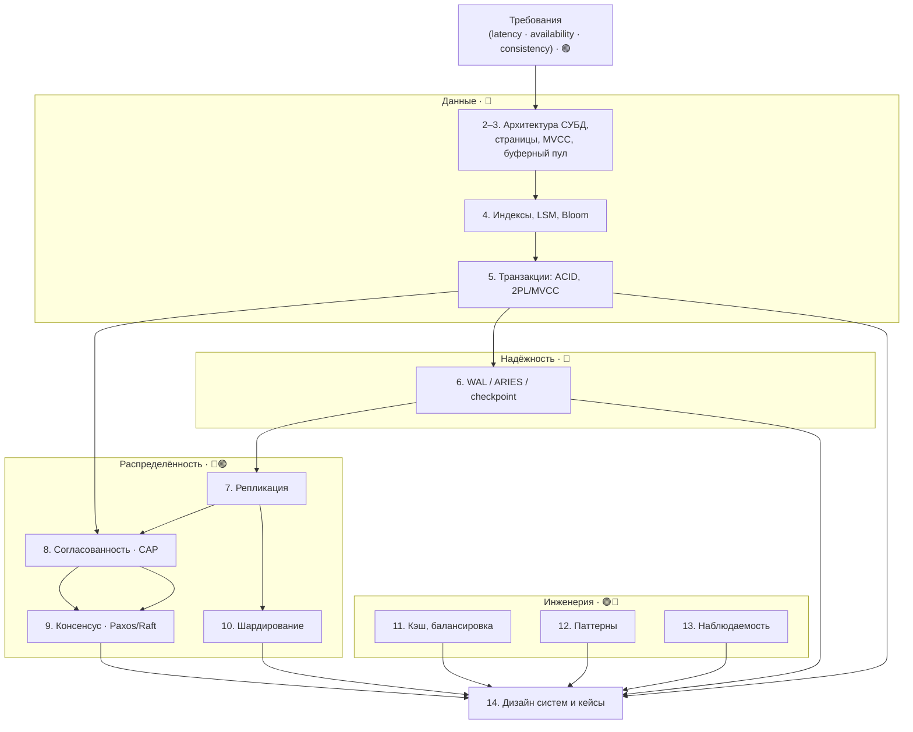

# System Design — сводный конспект

> [!abstract] Обзор
> Сводный конспект по двум курсам системного дизайна. **SSL.BAND (Влад Тен)** даёт «внутренности» — как устроены СУБД, индексы, транзакции, журнал, репликация, консенсус и шардирование, то есть механика, на которой стоит любой бэкенд. **SuperSliv.biz (Balun.Courses)** даёт «внешний» язык — критерии качества, паттерны отказоустойчивости, наблюдаемость и разборы популярных систем. Здесь они сведены **снизу вверх**: *механизм → гарантия → архитектурное решение*, чтобы одна картина объясняла и устройство хранилища, и проектирование распределённой системы целиком.

> [!info] Как связаны курсы
> Требования (latency, availability, consistency) задают рамку — 🟢 SuperSliv. Под них выбираются механизмы хранения и обработки данных — 🔵 SSL.BAND. Механизмы дают **гарантии** (ACID, durability, linearizability), а гарантии превращаются в **архитектурные решения** и паттерны (репликация, шардинг, кэш, retry, circuit breaker) — 🟢/🔵 вместе. В конце — практика: как из этого собираются реальные системы.

> [!info] Источники
> - [[SSL.BAND Систем Дизайн/index|🔵 SSL.BAND — Системный дизайн (Влад Тен)]]
> - [[SuperSliv System Design/index|🟢 SuperSliv.biz — System Design (Balun.Courses)]]

## Оглавление
1. [[#1. Критерии качества и типы нагрузки]]
2. [[#2. СУБД как абстракция: архитектура и оптимизатор]]
3. [[#3. Хранение: страницы, MVCC, row/column, буферный пул]]
4. [[#4. Индексы и LSM-хранилища]]
5. [[#5. Транзакции и конкурентный доступ]]
6. [[#6. Восстановление после сбоя: WAL и ARIES]]
7. [[#7. Репликация и отказоустойчивость]]
8. [[#8. Согласованность: CAP и спектр гарантий]]
9. [[#9. Консенсус: Paxos и Raft]]
10. [[#10. Шардирование и секционирование]]
11. [[#11. Кэширование и балансировка нагрузки]]
12. [[#12. Паттерны и приёмы проектирования]]
13. [[#13. Наблюдаемость (observability)]]
14. [[#14. Дизайн популярных систем и кейсы]]
15. [[#15. Сквозные связи и соответствие курсов]]

**Схема** — [[#Схема]]
**Итог** — [[#Итог]]

## 1. Критерии качества и типы нагрузки

🟢 Системный дизайн начинается с общего языка: **масштабируемость** (растёт ли система с нагрузкой) против **производительности** (насколько быстро отвечает), **throughput** и **latency**, **доступность**, **надёжность**, **стоимость**. Стоимость масштабирования растёт нелинейно, а само масштабирование ограничено ресурсами и может вызывать downtime. Задачи делятся на **data-intensive** и **compute-intensive**, нагрузка — на **CPU-bound** и **I/O-bound**, сервисы — на **stateless** и **stateful**. Базовые приёмы: **балансировка нагрузки** (в т.ч. «power of two choices»), **кэширование** (cache hit/miss, эффективность кэша, стратегия **Cache Aside**, политики **FIFO/LRU**), выбор API (**CRUD**, **REST**, **RPC/gRPC**).

🔗 *Связь:* эти критерии — входные требования. Ниже видно, как latency превращается в индексы и кэш, availability — в репликацию, а consistency — в выбор модели согласованности.

*Подробно:* [[SuperSliv System Design/01 - Основные термины и компоненты/notes|🟢 01 · Термины и компоненты]]

## 2. СУБД как абстракция: архитектура и оптимизатор

🔵 **СУБД (DBMS)** — абстракция над хранилищем, дающая **data independence** (независимость приложения от способа хранения), **concurrency control**, **crash recovery** (через WAL) и **разграничение доступа**. Архитектура: SQL-интерфейс → движок оценки запроса (**Parser → Optimizer → Plan Executor → Operator Evaluator**) со слоем **SQL Gateway**; оптимизатор опирается на **реляционную алгебру** (проекция, фильтр, эквивалентные преобразования, «опускание» фильтра к join) и статистику. Отдельный случай — **Neon**: разделение вычислений (Compute) и хранения (Storage) ради бранчинга.

🔗 *Связь:* именно абстракция СУБД даёт приложению те гарантии, которыми оперирует системный дизайн: durability, изоляцию, согласованное чтение.

*Подробно:* [[01 - storage/notes|🔵 01 · storage]]

## 3. Хранение: страницы, MVCC, row/column, буферный пул

🔵 Таблицы лежат в отдельных файлах и разбиты на **страницы (pages)** фиксированного размера; записи — фиксированной или переменной длины (со смещениями), при переполнении — страница переполнения или **TOAST**. **MVCC** и **VACUUM** управляют версиями и «мёртвыми» строками. Данные хранятся **строчно (row-oriented)** или **колоночно (column-oriented)** — второе выигрывает в аналитике. **Буферный пул** держит горячие страницы в памяти с политиками вытеснения (**LRU**).

🔗 *Связь:* выбор структуры хранения — прямой ответ на тип нагрузки (OLTP против OLAP); буферный пул связывает дисковое хранение с производительностью чтения.

*Подробно:* [[01 - storage/notes|🔵 01 · storage]] · [[SuperSliv System Design/02 - Хранение данных/notes|🟢 02 · Хранение данных]]

## 4. Индексы и LSM-хранилища

🔵 Индексы убирают полное сканирование. Виды и назначение:

| Индекс | Когда применять |
|---|---|
| **Кластеризованный** | задаёт физический порядок строк |
| **Разрежённый** | отображает диапазоны (range-запросы) |
| **Вторичный (secondary)** | поиск не по primary key |
| **Хэш-индекс** | точечный поиск по равенству |
| **B+ дерево / Bε-дерево** | диапазоны + частые записи (Bε — write-optimized) |
| **Bitmap** | низкокардинальные колонки, аналитика |
| **Инвертированный** | полнотекстовый поиск |
| **R-дерево** | многомерный / пространственный поиск |
| **LSM (memTable → SST)** | высокая скорость записи, компактификация, **Bloom-фильтр** |

**Bloom-фильтр** (несколько хэш-функций) быстро отсекает отсутствующие ключи, но даёт ложноположительные срабатывания.

🔗 *Связь:* индекс — это компромисс «скорость чтения ↔ скорость записи ↔ память»; на системном уровне тот же компромисс повторяется в кэшах и в LSM-хранилищах.

*Подробно:* [[01 - storage/notes|🔵 01 · storage]]

## 5. Транзакции и конкурентный доступ

🔵 **Транзакция** переводит БД из одного согласованного состояния в другое и отвечает критериям **ACID**; commit связан с **durability**. Корректность конкурентного выполнения описывает расписание (**schedule**), которое должно быть **сериализуемым**; анализ — через конфликты **RW/WR/WW**, **граф предшествования** и топологическую сортировку (нарушения → невосстанавливаемое расписание и каскадный откат). Механизмы: блокировки с **гранулярностью** Database → Table → Page, **intent-блокировки**, протоколы **2PL / strong strict 2PL**, борьба с **deadlock** (**wait-die**, **wound-wait**); оптимистично — **MVCC** со **snapshot isolation**, версиями и таймстампами, полями **xmin/xmax** и **CTID**. В PostgreSQL: уровни изоляции (**read committed / repeatable read / serializable**), **Serializable Snapshot Isolation**, `SELECT … FOR UPDATE SKIP LOCKED`, **VACUUM** и **Vacuum Freeze**.

🔗 *Связь:* уровень изоляции — это и есть выбор модели согласованности для конкретных данных; на распределённом уровне та же дилемма возвращается как CAP.

*Подробно:* [[02 - transactions/notes|🔵 02 · transactions]]

## 6. Восстановление после сбоя: WAL и ARIES

🔵 Ядро СУБД включает **Recovery Manager**. Ограниченный буферный пул и политики **Steal/No-Steal** и **Force/No-Force** определяют, когда грязные страницы попадают на диск. **WAL** (журнал упреждающей записи) хранит записи «до/после» с **LSN**; восстановление — по **checkpoint** и алгоритму **ARIES** (фазы **analysis / redo / undo**) с компенсационными записями **CLR**, а откат — по **PrevLSN**, **undo next LSN**, **Dirty Page Table** и **page LSN**. WAL же служит основой репликации (Neon перехватывает WAL-поток).

🔗 *Связь:* durability из ACID реализуется именно здесь; WAL — мост от транзакций к репликации.

*Подробно:* [[03 - recovery/notes|🔵 03 · recovery]]

## 7. Репликация и отказоустойчивость

🔵🟢 **Репликация** копирует данные между нодами ради доступности, долговечности, масштабирования чтения и низкой задержки. Роли **лидера и фолловера**, режимы **синхронный/асинхронный**, репликация **физическая/логическая**, health-чеки и снапшоты, выборы лидера, **split brain** (инцидент GitHub 2018), отстающая реплика, **кворум**, метрики **replication latency / lag**. Через **CDC** и бэкапы обеспечиваются автосинхронизация и восстановимость.

| Режим | Плюс | Минус |
|---|---|---|
| Синхронный | нет потери данных, консистентно | выше задержка записи |
| Асинхронный | быстрее запись, доступнее | риск потери/расхождения |

🔗 *Связь:* репликация — источник распределённых компромиссов; её цена — задержка и риск расхождения, что ведёт прямо к теме согласованности.

*Подробно:* [[04 - replication/notes|🔵 04 · replication]] · [[SuperSliv System Design/03 - Распределенное хранение данных/notes|🟢 03 · Распределённое хранение]]

## 8. Согласованность: CAP и спектр гарантий

🔵🟢 **CAP-теорема**: при сетевом разделении система выбирает между **Consistency** и **Availability** (→ CA/CP/AP). Между **eventual consistency** и **линеаризуемостью (Linearizability)** лежит спектр гарантий:

| Гарантия | Смысл |
|---|---|
| Eventual consistency | реплики сойдутся «в конце концов» |
| Read your own writes | клиент видит свои записи |
| Monotonic Read | чтения не «откатываются» назад |
| Causal consistency | сохраняется причинный порядок |
| Serializability | результат как при последовательном выполнении |
| Linearizability | линейный порядок, реальное время |

Разрешение конфликтов: **Last Write Win**, **CRDT**; **TrueTime** в Google Spanner даёт линеаризуемость. Гарантии проверяют инструментом **Jepsen**.

🔗 *Связь:* это центральный узел дизайна — здесь требования (часть I) встречаются с механикой репликации (часть IV) и определяют, чем можно пожертвовать.

*Подробно:* [[04 - replication/notes|🔵 04 · replication]]

## 9. Консенсус: Paxos и Raft

🔵 **Консенсус** — согласование нод к одному значению со свойствами **termination**, **integrity**, **agreement**; ему противостоят **византийские отказы** и теорема **FLP Impossibility** (обходится недетерминизмом). **Paxos**: фазы **Prepare/Promise** и **Accept/Accepted**. **Raft**: роли **follower/candidate/leader**, **термы**, **election timeout**, выборы по мажоритарию; состояние — persistent (**currentTerm, votedFor, log[]**) и volatile (**commitIndex, lastApplied, nextIndex[]**); RPC **RequestVote** (выборы) и **AppendEntries** (репликация/heartbeat); записи через лидера, коммит по большинству, работа при **network partition**, изменение состава через **joint consensus**.

🔗 *Связь:* консенсус — то, что превращает «реплику» в отказоустойчивый лидер, а значит underpins strong consistency (часть 8).

*Подробно:* [[06 - consensus/notes|🔵 06 · consensus]]

## 10. Шардирование и секционирование

🔵🟢 **Шардирование** (= **партиционирование**) распределяет нагрузку и масштабирует запись, добавляя сложность. Схемы: **хэш**, **кольцо токенов**, **range-based**, **по атрибуту**. Издержки — **hotspot** и **решардинг**. **Согласованное хэширование (consistent hashing)**: кольцо токенов, **виртуальные ноды**, диапазоны токенов, поиск владеющих узлов, RF=3; поверх — consistency, **Gossip**, слой маршрутизации, membership. Миграция — **double write → backfill → verification → switch over**.

🔗 *Связь:* шардирование — ответ на масштабирование *записи*; сочетается с репликацией (часть 7) для отказоустойчивости и с консенсусом (часть 9) для метаданных кластера.

*Подробно:* [[07 - sharding/notes|🔵 07 · sharding]]

## 11. Кэширование и балансировка нагрузки

🟢🔵 **Кэширование** снижает latency и нагрузку на хранилище: cache hit/miss, эффективность кэша, **Cache Aside**, версионирование кэша, политики **FIFO/LRU** (в БД — вытеснение из буферного пула, часть 3). **Балансировка нагрузки** распределяет запросы («power of two choices»), **graceful failover** перенаправляет трафик при отказе инстанса, **CDN** снимает нагрузку на медиа.

🔗 *Связь:* кэш повторяет на системном уровне тот же компромисс память↔скорость, что индекс и буферный пул на уровне БД.

*Подробно:* [[SuperSliv System Design/01 - Основные термины и компоненты/notes|🟢 01 · Термины и компоненты]]

## 12. Паттерны и приёмы проектирования

🟢 Набор приёмов для отказоустойчивых, масштабируемых и управляемых систем:

| Проблема | Паттерн |
|---|---|
| повторная доставка | **идемпотентность** |
| недоступность зависимости | **retry** + **circuit breaker** |
| «застрявшие» сообщения | **dead letter queue** |
| безопасный выкат | **canary**, **фича-тоглы** |
| деградация | **graceful degradation** |
| всплески нагрузки | **асинхронная обработка**, **агрегаторы** |
| распределённые изменения | **распределённые транзакции / саги** |
| устаревший кэш | **версионирование кэша** |

*Подробно:* [[SuperSliv System Design/04 - Паттерны и приемы проектирования/notes|🟢 04 · Паттерны и приёмы]]

## 13. Наблюдаемость (observability)

🔵 Наблюдаемость состоит из **логов**, **метрик** и обратной связи от клиентов и отвечает на вопрос «работает ли приложение и где его отлаживать». Метрики полезнее логов при высокой нагрузке; типы — **counter**, **gauge**, **histogram**; для latency — **персентили** (в распределённых системах предпочитают **гистограммы**, а не Summary). Стек: **Prometheus** (pull/push), **Grafana**, **NodeExporter**/**cAdvisor**, логи через **Promtail → Loki**, нагрузочный тест **k6**. **SLI/SLA/SLO** и **QoS** задают пороги ошибок и алерты, на них строится **on-call**.

> [!info] Безопасность и выкат
> Минимизация логирования, **retention** и комплаенс, наименьшие привилегии, **OAuth 2/PKCE**, короткоживущий access token, **TLS/MTLS** с ротацией; выкат — pre-production, background worker, **ring-based rollout**.

🔗 *Связь:* наблюдаемость замыкает цикл: измеряет compliance с требованиями (часть 1) и даёт сигнал для эксплуатации всех механизмов выше.

*Подробно:* [[05 - observability — theory/notes|🔵 05 · theory]] · [[05 - observability — practice/notes|🔵 05 · practice]]

## 14. Дизайн популярных систем и кейсы

🟢🔵 Проектирование идёт от **функциональных и нефункциональных требований** → архитектура (микросервисы, REST, БД) → масштабируемость (горизонтальное масштабирование, кэш, асинхронность, распределённые БД) → безопасность (шифрование, аутентификация/авторизация, защита от DDoS и SQL-инъекций) → интеграции (API/Webhooks/SDK).

Разобранные кейсы:
- **Соцсеть / домашняя лента**: ~50 млн пользователей, пост-сервис и фидбэк-сервис, хранение медиа и **чанков**, репликация, **CDN**.
- **Мессенджер**: доставка и порядок сообщений, шардинг.
- **Stripe**: **strong consistency** критична для платежей (eventual consistency недопустима).
- **Ticketmaster**: **virtual queue** на Redis, **eventual consistency**, шардинг.
- **Uber** (драйверы/райдеры, геоточки, платежи), **OS Updater** (S3, polling, retry, stateless), **Presence Service**, **Notification Service**.
- **Собеседование по System Design** (Andrii Bui): чек-лист, end-to-end flow, трейд-оффы.

🔗 *Связь:* здесь встречаются все части — кейс (соцсеть/Stripe) выбирает механизмы (часть 2–7) и модели согласованности (часть 8) под свои требования, обвешивается паттернами (часть 12) и наблюдаемостью (часть 13).

*Подробно:* [[SuperSliv System Design/05 - Дизайн популярных систем/notes|🟢 05]] · [[SuperSliv System Design/06 - Дизайн популярных систем/notes|🟢 06]] · [[SuperSliv System Design/07 - Итоговый проект/notes|🟢 07 · Итоговый проект]] · [[08 - Как пройти system design интервью (от Andrii Bui) — sys-des-checklist/notes|🔵 08 · чек-лист интервью]]

## 15. Сквозные связи и соответствие курсов

**Три сквозные идеи, которые проходят через оба курса:**

1. **Компромисс — вместо «лучшего».** Индекс торгует скоростью записи за чтение, синхронная репликация — задержкой за консистентность, CAP — доступностью за согласованность, кэш — памятью за latency. Дизайн = выбор, чем пожертвовать.
2. **Уровни абстракции повторяют друг друга.** Политика вытеснения (LRU) — и в буферном пуле БД, и в системном кэше. Идемпотентность — и в транзакциях, и в HTTP-retry.
3. **Требования → гарантии → механизмы.** latency/availability/consistency (🟢) определяют, какие механизмы БД и распределённой системы (🔵) брать и какие гарантии они обязаны дать.

**Соответствие тем курсов:**

| Тема | 🔵 SSL.BAND | 🟢 SuperSliv |
|---|---|---|
| Термины, кэш, балансировка | — | 01 |
| Хранение, индексы, транзакции | 01 storage, 02 transactions | 02 Хранение данных |
| Надёжность, репликация, CDC | 03 recovery, 04 replication | 03 Распределённое хранение |
| Паттерны проектирования | — | 04 Паттерны |
| Наблюдаемость | 05 observability (theory + practice) | — |
| Консенсус, шардирование | 06 consensus, 07 sharding | — |
| Дизайн систем / кейсы | 08 (интервью, семинары) | 05, 06, 07 |

## Схема

## Итог

> [!success] Что в итоге
> Два курса складываются в одну картину «снизу вверх». Фундамент — данные: СУБД как абстракция, страничное хранение, индексы (B+ и LSM), транзакции (ACID, 2PL, MVCC) и восстановление (WAL/ARIES). Распределённый слой надстраивает репликацию, спектр гарантий от eventual consistency до линеаризуемости (CAP, LWW/CRDT, TrueTime), консенсус (Paxos/Raft) и шардирование (consistent hashing, решардинг). Поверх — инженерия системы: кэш и балансировка, паттерны отказоустойчивости (идемпотентность, retry, circuit breaker, DLQ, canary) и наблюдаемость (метрики, логи, SLI/SLA, on-call). Всё держится на одном принципе — **компромиссе**: конкретные решения (например, strong consistency для платежей Stripe и eventual consistency для ленты) выбираются под требования, а не «по умолчанию».
