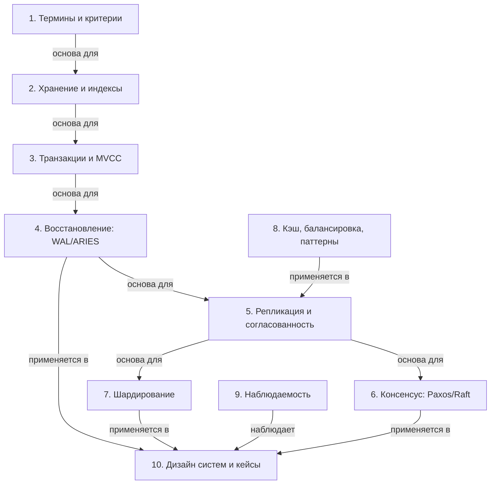

# System Design — сводный конспект

> [!abstract] Обзор
> Единый конспект по двум курсам системного дизайна: **SSL.BAND (Влад Тен)** — про внутренности БД и распределённых систем (хранение, транзакции, восстановление, репликация, консенсус, шардирование, наблюдаемость), и **SuperSliv.biz (Balun.Courses)** — про терминологию, паттерны проектирования и дизайн популярных систем. Материал сведён по тематическим осям: от критериев и хранения данных до согласованности, паттернов и разбора реальных кейсов.

> [!info] Источники
> - [[SSL.BAND Систем Дизайн/index|SSL.BAND — Системный дизайн (Влад Тен)]] — глубокая теория БД и распределённых систем.
> - [[SuperSliv System Design/index|SuperSliv.biz — System Design (Balun.Courses)]] — термины, паттерны и разбор популярных систем.

## Оглавление
1. [[#1. Термины и базовые критерии]]
2. [[#2. СУБД, хранение и индексы]]
3. [[#3. Транзакции и конкурентный доступ]]
4. [[#4. Восстановление после сбоя: WAL и ARIES]]
5. [[#5. Репликация и модели согласованности]]
6. [[#6. Консенсус: Paxos и Raft]]
7. [[#7. Шардирование и секционирование]]
8. [[#8. Кэширование, балансировка и паттерны]]
9. [[#9. Наблюдаемость (observability)]]
10. [[#10. Дизайн популярных систем и итоговый проект]]

**Схема** — [[#Схема]]
**Итог** — [[#Итог]]

## 1. Термины и базовые критерии

Системный дизайн начинается с терминов: **масштабируемость** (растёт ли система с нагрузкой) против **производительности** (насколько быстро отвечает), **throughput** устройств, деление задач на **data-intensive** и **compute-intensive**, деление нагрузки на **CPU-bound** и **I/O-bound**, **stateless** и **stateful** сервисы. Стоимость масштабирования растёт нелинейно, а само масштабирование ограничено ресурсами и может вызывать downtime. Ключевые приёмы — **балансировка нагрузки** (в т.ч. «power of two choices»), **кэширование** (cache hit/miss, формула эффективности кэша, стратегия **Cache Aside**, политики **FIFO/LRU**), выбор API (**CRUD**, **REST**, **RPC/gRPC**), **observability**, **сквозное шифрование**.

*Подробно:* [[SuperSliv System Design/01 - Основные термины и компоненты/notes|01 · Основные термины и компоненты]]

## 2. СУБД, хранение и индексы

**СУБД** — это абстракция над хранилищем, дающая **data independence** (независимость от физического хранения), **concurrency control**, **crash recovery** (через WAL) и **разграничение доступа**. Архитектура: SQL-интерфейс → движок оценки запроса (Parser → Optimizer → Plan Executor → Operator Evaluator) со слоем **SQL Gateway**; оптимизатор опирается на реляционную алгебру (проекция, фильтр, перестановка join/фильтра). Отдельный случай — **Neon**: разделение вычислений (Compute) и хранения (Storage) ради бранчинга.

Хранение: таблицы в отдельных файлах, **страничная организация** (pages) фиксированного размера, записи фиксированной/переменной длины со смещениями, страница переполнения и **TOAST**; **MVCC** и **VACUUM** (сборщик мусора для мёртвых версий строк); строчное (**row-oriented**) и колоночное (**column-oriented**) хранение; **буферный пул** и политики вытеснения (**LRU**).

Индексы заменяют полное сканирование: **кластеризованный**, **разрежённый**, **вторичный (secondary)**, **хэш-индекс** (точечный поиск), **B+ дерево** и write-optimized **Bε-дерево**, **bitmap-индекс**, **инвертированный индекс** и **R-дерево** (многомерный/пространственный поиск). **LSM-хранилище** (key-value) использует **memTable**, **SST**, компактификацию и **Bloom-фильтр** с несколькими хэш-функциями (быстро отсекает отсутствующие ключи, даёт ложноположительные срабатывания).

*Подробно:* [[01 - storage/notes|SSL · 01 storage]] · [[SuperSliv System Design/02 - Хранение данных/notes|SL · 02 Хранение данных]]

## 3. Транзакции и конкурентный доступ

**Транзакция** переводит БД из одного согласованного состояния в другое и отвечает критериям **ACID**; commit связан с долговечностью (**durability**). Корректность конкурентного выполнения описывается расписанием (**schedule**), которое должно быть **сериализуемым**; анализ — через типы конфликтов **RW/WR/WW**, **граф предшественования** и топологическую сортировку (нарушения ведут к невосстанавливаемым расписаниям и каскадному откату).

Конкурентное управление: блокировки и их **гранулярность** (Database → Table → Page), **intent-блокировки**, протоколы **2PL** и **strong strict 2PL**, борьба с **deadlock** политиками **wait-die** и **wound-wait**. Оптимистичный путь — **MVCC**: изоляция по снапшотам (**snapshot isolation**), версии объектов и таймстампы, **xmin/xmax** и **CTID**, мусор и **VACUUM/VACUUM FULL**, **FSM**, переполнение идентификаторов и **Vacuum Freeze**. Практика PostgreSQL: уровни изоляции (**read committed / repeatable read / serializable**), **Serializable Snapshot Isolation**, `SELECT … FOR UPDATE SKIP LOCKED`.

*Подробно:* [[02 - transactions/notes|SSL · 02 transactions]]

## 4. Восстановление после сбоя: WAL и ARIES

Ядро СУБД включает движок оценки запросов, менеджер транзакций и **Recovery Manager**. Ограниченный буферный пул и политики **Steal/No-Steal** и **Force/No-Force** определяют, какие «грязные» страницы попадают на диск. **WAL** (журнал упреждающей записи) хранит записи «до/после» и использует **LSN**; восстановление опирается на **checkpoints** и алгоритм **ARIES** с фазами **analysis / redo / undo** и компенсационными записями **CLR**. Откат использует **PrevLSN**, **undo next LSN**, **Dirty Page Table** и **page LSN** для точки повтора. WAL применяется и для репликации — например, Neon перехватывает WAL-поток от Postgres.

*Подробно:* [[03 - recovery/notes|SSL · 03 recovery]]

## 5. Репликация и модели согласованности

**Репликация** копирует данные между нодами ради доступности, долговечности, масштабирования чтения и низкой задержки. Роли **лидера и фолловера**, синхронный и асинхронный режимы, физическая и логическая репликация, health-чеки и снапшоты, выборы лидера, **split brain** (инцидент GitHub 2018), отстающая реплика, **кворум** и метрики **replication latency / replication lag**. Типы репликации: statement-based vs row-based, синхронизация по времени записи, «минимальное большинство», **CDC** для автосинхронизации и бэкапы для восстановимости.

Согласованность: **CAP-теорема** (выбор двух из Consistency, Availability, Partition tolerance → CA/CP/AP), **линеаризуемость (Linearizability)** и **сериализуемость (Serializability)**, точка линеаризации. Спектр гарантий — от **eventual consistency** через **read your own writes**, **Monotonic Read** и **причинную согласованность (causal consistency)** до линеаризуемости; порядок событий через векторы зависимостей. Разрешение конфликтов: **Last Write Win**, **CRDT**; **TrueTime** в Google Spanner даёт линеаризуемость. Проверка гарантий — **Jepsen**.

*Подробно:* [[04 - replication/notes|SSL · 04 replication]] · [[SuperSliv System Design/03 - Распределенное хранение данных/notes|SL · 03 Распределённое хранение данных]]

## 6. Консенсус: Paxos и Raft

**Консенсус** — согласование нод к одному значению со свойствами **termination**, **integrity**, **agreement**; ему противостоят **византийские отказы** и теорема **FLP Impossibility** (обходится недетерминизмом). **Paxos** сложен в описании: фазы **Prepare/Promise** и **Accept/Accepted** («Paxos Made Simple»). **Raft** задуман как столь же эффективная, но понятная альтернатива: роли **follower/candidate/leader**, **термы**, **election timeout**, выборы лидера по мажоритарному числу голосов; состояние делится на persistent (**currentTerm, votedFor, log[]**) и volatile (**commitIndex, lastApplied, nextIndex[]**). RPC **RequestVote** (выборы, свежесть лога) и **AppendEntries** (репликация, heartbeat). Записи идут через лидера и коммитятся по мажоритарному подтверждению; при разделении сети (**network partition**) возможен мультилидер, а после восстановления узел принимает более высокий term; состав кластера (**membership**) меняется через **joint consensus**.

*Подробно:* [[06 - consensus/notes|SSL · 06 consensus]]

## 7. Шардирование и секционирование

**Шардирование** (синоним — **партиционирование**) распределяет нагрузку и масштабирует запись, добавляя сложность и координацию. Схемы: **хэш-шардирование** по остатку, **кольцо токенов**, **range-based** и **по атрибуту**. Основные издержки — перегруженный шард (**hotspot**) и **решардинг**; ключ шардирования выбирается по бизнес-логике и требованиям комплаенса. В **согласованном хэшировании (consistent hashing)** Dynamo-подобной системы узлы образуют **кольцо токенов**, ключ хешируется в токен и сопоставляется с владеющими узлами обходом по часовой стрелке (RF=3), используются **виртуальные ноды** и диапазоны токенов; поверх — настройка consistency, протокол **Gossip**, слой маршрутизации (**routing layer**) и membership. Миграция — паттерном **double write → backfill → verification → switch over**.

*Подробно:* [[07 - sharding/notes|SSL · 07 sharding]]

## 8. Кэширование, балансировка и паттерны

Набор приёмов, делающих систему отказоустойчивой, масштабируемой и управляемой: **идемпотентность**, **версионирование кэша**, **retry**-политика, **circuit breaker**, **dead letter queue**, **фича-тоглы**, **каскадная / graceful degradation**, асинхронная обработка, двусторонняя коммуникация, **агрегаторы**, распределённые транзакции, канареечный выкат (**canary**), трёхзвенная архитектура и паттерны управления состоянием. Всё связано общими принципами: отказоустойчивость, масштабируемость, управление состоянием и безопасность.

*Подробно:* [[SuperSliv System Design/04 - Паттерны и приемы проектирования/notes|SL · 04 Паттерны и приёмы проектирования]]

## 9. Наблюдаемость (observability)

Наблюдаемость позволяет понять, работает ли приложение и где его отлаживать, и состоит из **логов**, **метрик** и обратной связи от клиентов. Метрики дают статистику приложения и полезнее логов при высокой нагрузке; типы — **counter**, **gauge**, **histogram**; для задержки (**latency**) используют **персентили**, при этом **Summary** ограничен в распределённых системах (предпочитают гистограммы). Логи собирают централизованно с языком запросов (на практике: stdout → **Promtail** → **Loki**). SLA/SLI и **QoS** дают пороги ошибок и алерты, на них строится дежурство **on-call**. Безопасность: минимизация логирования, **retention** и комплаенс, наименьшие привилегии, **OAuth 2/PKCE**, короткоживущий access token, **TLS/MTLS** с ротацией; надёжность выката — pre-production, background worker и **ring-based rollout**. Стек: **Prometheus** (pull/push, агрегация), **Grafana** (UI), **NodeExporter** и **cAdvisor** (инфраструктурные метрики), нагрузочный тест **k6**, облачные метрики (App Insights, Kusto).

*Подробно:* [[05 - observability — theory/notes|SSL · 05 observability (theory)]] · [[05 - observability — practice/notes|SSL · 05 observability (practice)]]

## 10. Дизайн популярных систем и итоговый проект

Проектирование начинается с **функциональных и нефункциональных требований**, затем — архитектура (микросервисы, REST API, БД), масштабируемость (горизонтальное масштабирование, кэш, асинхронность, распределённые БД), безопасность (шифрование, аутентификация/авторизация, защита от DDoS и SQL-инъекций, OAuth/JWT) и интеграции (платежи, аналитика, мессенджеры через API/Webhooks/SDK).

Разобранные кейсы и семинары:
- **Домашняя лента / соцсеть**: требования (~50 млн пользователей), пост-сервис и фидбэк-сервис, хранение медиа, репликация, **CDN**, хранение **чанков** и синхронизация.
- **Мессенджер**: доставка, порядок сообщений, шардинг.
- **Stripe**: **strong consistency** критична для платежей (eventual consistency недопустима).
- **Ticketmaster**: виртуальная очередь на Redis для продажи билетов.
- **Uber**, **OS Updater**, **Presence Service** (статусы «онлайн»), **Notification Service**.
- **Собеседование по System Design** (Andrii Bui): чек-лист прохождения, разбор кейсов.

*Подробно:* [[SuperSliv System Design/05 - Дизайн популярных систем/notes|SL · 05]] · [[SuperSliv System Design/06 - Дизайн популярных систем/notes|SL · 06]] · [[SuperSliv System Design/07 - Итоговый проект/notes|SL · 07 Итоговый проект]] · [[08 - Как пройти system design интервью (от Andrii Bui) — sys-des-checklist/notes|SSL · 08 интервью (чек-лист)]]

## Схема

## Итог

> [!success] Что в итоге
> System Design — это проектирование надёжных и масштабируемых систем из сквозных осей. Фундамент — хранение: СУБД как абстракция, индексы (B+ и LSM), буферный пул; корректность — транзакции (ACID, сериализуемость, 2PL и MVCC); надёжность — восстановление (WAL и ARIES). Распределённый слой добавляет репликацию и спектр гарантий от eventual consistency до линеаризуемости (CAP, LWW/CRDT, TrueTime), консенсус (Paxos/Raft) и шардирование (consistent hashing, решардинг). Поверх — паттерны отказоустойчивости (идемпотентность, retry, circuit breaker, DLQ, canary) и наблюдаемость (метрики, логи, SLI/SLA, on-call). Выбор конкретных решений диктуется требованиями: например, платежи (Stripe) требуют strong consistency, а лента и мессенджер допускают eventual consistency с асинхронностью.
