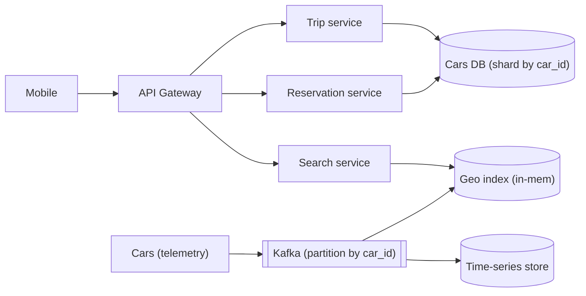

# Эталонное решение — Бронирование каршеринга

> [!warning] Не читать до попытки
> Это эталонный «сильный ответ». Сначала заполните свою попытку по `scenarios/01-carsharing-booking.md`.

## 1. Требования

**Функциональные:** поиск свободных машин в радиусе; бронь (hold) с TTL; старт поездки; завершение и расчёт; история поездок; команда разблокировки.

**Нефункциональные:**
- Бронь — линеаризуемая на уровне машины (двойная бронь исключена).
- Поиск p95 < 300 мс; бронь p95 < 500 мс.
- Доступность поиска/старта ≥ 99.9%; состояние поездки — durable.
- Телеметрия машин — высокочастотная запись (не критична к задержке).

**Скоуп:** `in` — поиск/бронь/старт/финиш/история; `out` — биллинг-платежи, IoT-прошивка авто, поддержка.

## 2. Уточняющие вопросы и модельные ответы

| Вопрос | Модельный ответ |
|---|---|
| Масштаб? | 5M пользователей, 100k машин, 1M DAU, ~1M поездок/сутки |
| Согласованность брони? | Strong по машине; иначе двойная бронь |
| TTL брони? | 10 мин; истёк → машина снова free |
| Что при сбое брони? | Fail-closed (отклонить), не рисковать двойной |
| Несколько городов? | Да; шардинг по городу |

## 3. Оценка нагрузки

- Поиск: 1M DAU × 3 сессии × 2 поиска = 6M/сутки ≈ **70 QPS** avg, пик ×5 ≈ **350 QPS**.
- Брони: ~1M/сутки ≈ **12 QPS** avg, пик ≈ **60 QPS**.
- Телеметрия: 100k машин / 10 с ≈ **10k записей/с** — вот где write-heavy.
- Хранение: поездки 1M/сутки × 3 года ≈ **~1B строк**, ~1 КБ → **~1 ТБ**.
- Нагрузка read-heavy на поиске, write-heavy на телеметрии.

## 4. API

```
GET  /v1/cars?lat&lng&radius&filters        → 200 [cars]
POST /v1/reservations                        → 201 {reservation_id, expires_at} | 409 unavailable
       Header: Idempotency-Key
POST /v1/reservations/{id}/start             → 200 {trip_id} | 409 expired | 404
POST /v1/trips/{id}/finish                   → 200 {cost, breakdown}
GET  /v1/users/{id}/trips                    → 200 [trips]
```

Ошибки: `409` — машина занята/бронь истекла (различать кодом причины). `Idempotency-Key` обязателен на create/start.

## 5. Модель данных

- `cars(car_id PK, city_id, model, status, lat, lng, battery)` — `status ∈ {free, reserved, in_trip, service}`; шард по `car_id`.
- `reservations(reservation_id PK, car_id, user_id, created_at, expires_at, status)` + частичный уникальный индекс «одна активная бронь на car_id».
- `trips(trip_id PK, car_id, user_id, started_at, ended_at, coords, distance, cost)`.
- `car_locations(car_id, ts, lat, lng)` — time-series, TTL.
- Гео: in-memory geo-index (Redis GEO / geohash-шарды) поверх `cars`; durable — в `cars`.

Ключевой приём: занятость машины — **условный апдейт** `UPDATE cars SET status='reserved' WHERE car_id=? AND status='free'` (проверка числа затронутых строк) либо CAS-ключ в Redis.

## 6. Архитектура



Поток брони: `Reservation service` делает условный апдейт статуса машины (strong), фиксирует `reservations` с TTL. Поиск читает geo-index (слабо согласован). Телеметрия через Kafka обновляет TSDB и geo-index.

## 7. Масштабирование

- Geo-шардинг по городу/гео-ячейке; поиск из локального geo-index.
- Шард по `car_id`: все операции по машине сериализуются в одном шарде.
- Телеметрия: Kafka партиции по `car_id`, батч-запись в TSDB.
- Горячие города — саб-шардинг по geohash-ячейкам, кэш результатов поиска.

## 8. Отказоустойчивость

- Cars DB: sync-репликация + автоматический failover; CAS гарантирует отсутствие двойной брони даже при ретраях.
- Geo-index недоступен → поиск из реплики/кэша с деградацией радиуса.
- Разблокировка авто не удалась → ретрай + ручная компенсация; TTL брони не даёт «застрять».
- Reservation store недоступен → **fail-closed**: поиск работает, новые брони отклоняются.

## 9. Consistency

| Данные | Модель |
|---|---|
| Бронь машины | Strong (linearizable per car) |
| Список свободных машин | Eventual (geo-index с лагом ~сек) |
| Состояние поездки | Strong (per trip) |
| Телеметрия | Eventual |

Финальная проверка занятости — сильная в момент брони, поэтому eventual-лаг поиска безопасен.

## 10. Bottlenecks

- Hot zones (аэропорт/центр) → hot-шард; саб-шардинг + кэш.
- Конкуренция за популярную машину → CAS возвращает `409`, клиент переспрашивает.
- Объём телеметрии → Kafka + батч, TTL на сырых локациях.

## 11. Trade-offs

- **TTL-hold vs вечный лок:** TTL не оставит машину заблокированной при краше клиента ценой «ложно занятой» машины на TTL.
- **Серверная бронь (strong) vs оптимистичная клиентская:** корректность важнее отзывчивости.
- **Точность гео vs стоимость:** грубые гео-ячейки дешевле, но шире радиус.

## 12. Вопросы интервьюера (follow-ups)

1. Два устройства одного пользователя бронируют одновременно? — идемпотентность + лок на пользователя.
2. Не сработала разблокировка авто? — компенсация, повторный статус, алерт.
3. Оплата на финише не прошла? — поездка закрывается, биллинг асинхронно с ретраями.
4. Отказ целого города? — мульти-AZ, переключение.
5. Как не бронируют машину за 20 км? — политика радиуса/зоны.

## 13. Rubric оценки (сценарий)

- **Сильный ответ:** распознаёт strong-consistency на брони, использует CAS/условный апдейт, считает write-heavy телеметрию, даёт fail-closed деградацию.
- **Зачёт:** шардинг по машине/городу, TTL на бронь, geo-index, режимы отказа.
- **Red flags:** «check-then-write» без атомарности (гонка → двойная бронь); игнор объёма телеметрии; нет TTL; нет деградации.
