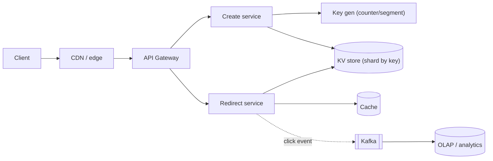

# Эталонное решение — Сокращатель ссылок

> [!warning] Не читать до попытки
> Сначала заполните попытку по `scenarios/02-url-shortener.md`.

## 1. Требования

**Функциональные:** создание короткой ссылки (опц. алиас); редирект; статистика кликов (время/гео/реферер); TTL/удаление.

**Нефункциональные:**
- Read-heavy: редиректы ≈ 100× созданий.
- Редирект p99 < 50 мс, доступность ≥ 99.99%.
- Аналитика — eventually consistent, потеря пары кликов допустима.
- Ключ не угадывается (не последовательный).

**Скоуп:** `in` — create/redirect/stats; `out` — антифрод, свой домен/DNS, биллинг.

## 2. Уточняющие вопросы и модельные ответы

| Вопрос | Модельный ответ |
|---|---|
| Соотношение create:read? | ~1:100 |
| 301 или 302? | 302 по умолчанию (аналитика); 301 если нужен кэш — trade-off |
| Ссылка обязана быть неугадываемой? | Да, base62 от случайного/счётчика с солью |
| Дедуп длинных ссылок? | Опционально; обычно не нужен |
| Объём? | 100M созданий/сутки, 10B редиректов/сутки |

## 3. Оценка нагрузки

- Создания: 100M/сутки ≈ **1.2k QPS** avg, пик ≈ **6k QPS**.
- Редиректы: 10B/сутки ≈ **~115k QPS** avg, пик ≈ **~500k QPS**.
- Ключей: 100M/сутки × 5 лет ≈ **~180B ключей** → нужно ≥ 7 символов base62 (`62^7 ≈ 3.5e12`).
- Хранение mapping: 180B × ~500 Б ≈ **~90 ТБ** → шардинг обязателен.
- Аналитика: 10B событий/сутки → поток в OLAP, не в основную БД.

## 4. API

```
POST /v1/links            {long_url, ttl?, alias?}  → 201 {short_url, key}
GET  /{key}                                          → 302 Location: long_url | 404
GET  /v1/links/{key}/stats?from&to                   → 200 {clicks, by_day, by_geo}
DELETE /v1/links/{key}                               → 204
```

## 5. Модель данных

- KV `links(key PK, long_url, owner, created_at, expires_at, status)` — шард по `key`.
- Аналитика: событие `{key, ts, ip_hash, geo, referrer, ua}` → поток → OLAP/колоночное хранилище.
- Ключ: base62 из (counter + shuffle/соль) либо случайный с ретраем на коллизию.

## 6. Архитектура



## 7. Масштабирование

- KV шард по `key` (равномерно, т.к. key — hash/counter).
- Редирект: кэш (LRU на горячие key) + CDN-эджинг, read-through.
- Key-gen: диапазоны из центрального счётчика (Snowflake-подобно) на инстансы — избегаем коллизий.
- Аналитика: батч/стрим в OLAP, отдельно от критичного пути.

## 8. Отказоустойчивость

- Редирект — критичный путь: кэш → реплики KV; при недоступности KV отдаём из кэша/CDN.
- Потеря аналитики не блокирует редирект (fire-and-forget, буфер).
- Create деградирует мягко (можно вернуть 503), редирект остаётся доступным.

## 9. Consistency

- Create → read: strong (нужно сразу редиректить) — но при шардинге достаточно read-your-write через тот же шард.
- Аналитика: eventual (лаг минуты).
- Кэш: eventual, TTL/инвалидация на удаление.

## 10. Bottlenecks

- Горячая ссылка (viral) → один key-shard/hot cache. Решение: CDN + локальный кэш + реплики.
- Коллизии при случайной генерации → счётчик/диапазоны.
- 500k QPS редиректов → эдж-кэш обязателен.

## 11. Trade-offs

- **301 vs 302:** 301 кэшируется браузером (быстрее, меньше нагрузки), но ломает аналитику и удаление; 302 — контроль.
- **Hash(long_url) vs counter:** hash даёт дедуп, но коллизии/предсказуемость; counter — уникальность, но нужен координатор.
- **Read-through cache vs write-through:** read-through проще, риск stale на удаление.

## 12. Вопросы интервьюера (follow-ups)

1. Пользователь хочет свой алиас, он занят? — 409 + предложение вариантов.
2. Как удалять/истекать ключи? — TTL/статус + инвалидация кэша/CDN.
3. Что если ссылка ведёт на фишинг? — репутация/сканер (out of core scope, упомянуть).
4. Как считать уникальные клики? — гиперлоглог/эскизы в OLAP.

## 13. Rubric оценки (сценарий)

- **Сильный ответ:** явная оценка QPS (~115k/500k), объём ключей и длина, эдж-кэш, горячие ссылки, отделение аналитики от критичного пути.
- **Зачёт:** KV-модель, шардинг по ключу, генерация ключей без коллизий, 302.
- **Red flags:** нет оценки read-heavy; аналитика в OLTP-БД; последовательные предсказуемые ключи без оговорок; нет кэша на редиректе.
