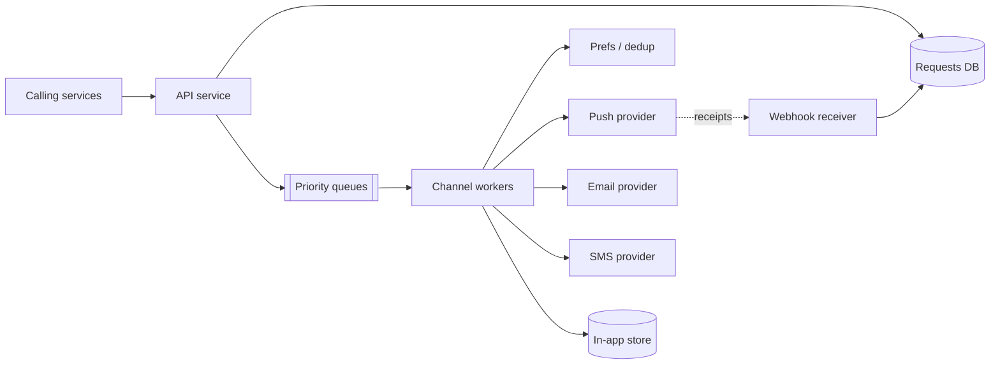

# Эталонное решение — Сервис уведомлений

> [!warning] Не читать до попытки
> Сначала заполните попытку по `scenarios/03-notification-service.md`.

## 1. Требования

**Функциональные:** приём запросов (single/bulk); выбор канала по предпочтениям; шаблоны/локализация; schedule; ретраи; дедуп; opt-out.

**Нефункциональные:**
- Bursty: рассылка на миллионы пользователей за минуты.
- At-least-once + дедупликация (ровно-один раз «в идеале»).
- Деградация по приоритету: транзакционные > маркетинговые.
- Доставка транзакционного — секунды; маркетинг — минуты допустимо.

**Скоуп:** `in` — приём/маршрутизация/доставка/статусы; `out` — рендер креативов, биллинг.

## 2. Уточняющие вопросы и модельные ответы

| Вопрос | Модельный ответ |
|---|---|
| Объём? | 500M/сутки, пик рассылка 2M/мин |
| Каналы? | push, email, SMS, in-app |
| Не потерять или не дублировать? | Не потерять критичное (at-least-once) + дедуп по id |
| Разные SLA? | Транзакционные важнее маркетинга |
| Тихие часы? | Учитывать quiet hours для маркетинга |

## 3. Оценка нагрузки

- 500M/сутки ≈ **6k/с** avg; рассылка 2M за 60 с ≈ **33k/с** пик.
- Fan-out: одно событие → до 4 каналов; при маркетинге — миллионы записей.
- Хранение статусов: 500M × 30 дней × ~200 Б ≈ **~3 ТБ**.
- Провайдеры: жёсткие rate limit (email/SMS) — узкое место, нужен throttling.

## 4. API

```
POST /v1/notifications            {user_id, type, channels?, template, data}  → 202 {id}
POST /v1/notifications/bulk       {user_ids[], ...}                          → 202 {batch_id}
GET  /v1/notifications/{id}                                                  → 200 {status per channel}
POST /v1/webhooks/provider/{name}  (delivery receipts)                        → 200
```

## 5. Модель данных

- `notification_requests(id PK, user_id, type, priority, channels, template, data, created_at)`.
- `delivery_attempts(id, request_id, channel, status, provider_id, attempts, last_error)`.
- `user_preferences(user_id, channel, type, enabled, quiet_hours)`.
- `outbox` + `dedup_keys(key)` (TTL) для идемпотентности.
- Дедуп: `dedup_key` детерминирован от (user_id, type, business_id).

## 6. Архитектура



Поток: приём → persist + outbox → очередь по приоритету → воркеры канала (проверка prefs/dedup, рендер шаблона) → провайдер → статус.

## 7. Масштабирование

- Очереди партиционированы по `user_id`/`type`; отдельные пулы воркеров на канал.
- Провайдеры защищены rate limiter'ом и backpressure (буфер).
- Bulk-рассылка: чанкование по batch, размазывание по времени (jitter).
- Горизонтальный масштаб stateless-воркеров.

## 8. Отказоустойчивость

- **Провайдер упал** → ретраи с экспоненциальным backoff + DLQ; failover на альтернативного провайдера (напр. SMS-агрегаторы).
- **Перегрузка** → сброс маркетинга первым (приоритетные очереди), транзакционные не трогаем.
- Дубли провайдера → дедуп по `provider_id` receipt + `dedup_key`.
- Очередь недоступна → API кладёт в outbox и отвечает 202 (async гарантия).

## 9. Consistency

- Дедуп: идемпотентность по `dedup_key` (ключевое).
- Доставка: at-least-once + дедуп на стороне канала.
- Opt-out: должен применяться строго — проверка перед отправкой (read-your-write на prefs).
- Порядок между каналами не важен; внутри одного пользователя — best effort.

## 10. Bottlenecks

- Внешний провайдер (rate limit, стоимость) — главный.
- Fan-out в bulk-рассылке.
- Горячий пользователь (много уведомлений) — anti-spam/aggregation.

## 11. Trade-offs

- **At-least-once vs exactly-once:** exactly-once дорого; выбираем at-least-once + дедуп.
- **Sync приём vs async:** async (202) не теряет при рестарте, но сложнее статус.
- **Push vs poll статуса:** webhook от провайдера дешевле, но требует идемпотентной обработки.

## 12. Вопросы интервьюера (follow-ups)

1. Пользователь отписался во время рассылки? — prefs-check перед отправкой + cancel.
2. Провайдер вернул «sent», но письмо не дошло? — receipts + retry-политики.
3. Двойной webhook? — идемпотентная обработка по event-id.
4. Тихие часы? — очередь отложенных до окна доставки.

## 13. Rubric оценки (сценарий)

- **Сильный ответ:** приоритетные очереди + деградация, дедуп-ключи, rate limit провайдеров, DLQ, at-least-once осознанно.
- **Зачёт:** async-приём через очередь, каналы как воркеры, ретраи, prefs.
- **Red flags:** синхронная отправка без очереди (рассылка роняет сервис); нет дедупа; нет деградации по приоритету.
