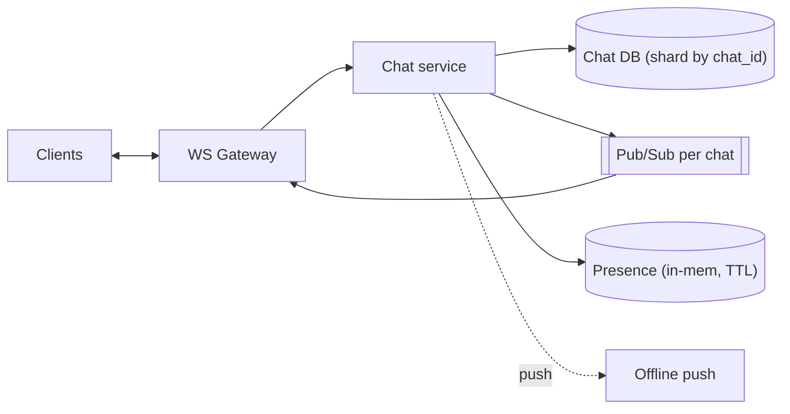

# Эталонное решение — Мессенджер

> [!warning] Не читать до попытки
> Сначала заполните попытку по `scenarios/04-chat.md`.

## 1. Требования

**Функциональные:** сообщения 1:1 и в группах; история; read receipts; presence; доставка оффлайн.

**Нефункциональные:**
- Доставка в онлайне — сотни мс.
- Порядок сообщений внутри чата сохраняется.
- Доступность ≥ 99.9%; большие группы (celebrity).
- История durable; at-least-once с дедупом.

**Скоуп:** `in` — send/receive/history/presence/receipts; `out` — медиа-контент (упомянуть), E2E-шифрование детали.

## 2. Уточняющие вопросы и модельные ответы

| Вопрос | Модельный ответ |
|---|---|
| Размер группы? | до 1000; публичные каналы — отдельная модель fan-out |
| Гарантия? | at-least-once + дедуп по message_id |
| Multi-device? | Да; порядок между устройствами одного юзера — по серверному sequence |
| Presence точность? | Eventual, TTL «онлайн» |

## 3. Оценка нагрузки

- 500M DAU × 40 сообщений/сутки = 20B/сутки ≈ **230k/с** avg, пик ×2.5 ≈ **~600k/с**.
- Соединения: ~100–200M одновременных WS → много gateway-нод.
- Хранение: 20B × 30 Б × сутки → ~600 ГБ/сутки; год ≈ **~200 ТБ**.
- Fan-out в группе 1000 → ×1000 доставок на сообщение.

## 4. API

```
POST /v1/chats/{id}/messages   {client_msg_id, text}     → 201 {message_id, seq}
GET  /v1/chats/{id}/messages?before=seq&limit            → 200 [messages]
POST /v1/chats/{id}/read       {up_to_seq}               → 200
WS   /realtime                 {new_message, receipt, presence}
```

`client_msg_id` — для дедупа при ретраях клиента.

## 5. Модель данных

- `chats(chat_id PK, type, created_at)`; `chat_members(chat_id, user_id, role, last_read_seq)`.
- `messages(chat_id, seq, message_id, sender_id, text, created_at)` — PK `(chat_id, seq)`; шард по `chat_id`.
- `seq` — монотонный счётчик **на чат** (порядок).
- `presence(user_id, last_seen, status)` — TTL, in-memory.
- Публичные каналы: fan-out-on-write в ленты подписчиков или гибрид.

## 6. Архитектура



Поток: клиент шлёт → gateway → chat service (allocation seq, persist) → pub/sub чата → gateway-ноды с активными участниками → доставка. Оффлайн — push.

## 7. Масштабирование

- Шардинг по `chat_id` (все сообщения чата в одном шарде → локальный порядок).
- Роутинг соединений: реестр `user_id→gateway` для адресации pub/sub.
- Fan-out: для больших групп — hybrid (write для маленьких, read-fan-out/кэш для каналов).
- Горячие чаты — отдельный пул шардов/кэш последних сообщений.

## 8. Отказоустойчивость

- Обрыв WS → переподключение + догрузка по `last_read_seq` (polling/tail).
- Отказ gateway-ноды → клиенты переподключаются к другим; pub/sub с at-least-once.
- Доставка at-most-once по сокету компенсируется догрузкой истории (гибрид как в
  [[SSL.BAND Систем Дизайн/08 - Семинары — messenger_system_design/notes|семинаре по мессенджеру]]).
- Отказ шарда чата → реплика + failover.

## 9. Consistency

| Данные | Модель |
|---|---|
| Порядок сообщений | Strong внутри чата (server seq) |
| Read receipts | Eventual |
| Presence | Eventual (TTL) |
| История | Strong на чтение по шарду |

Порядок нельзя строить на клиентских таймстампах (clock skew) — только серверный sequence.

## 10. Bottlenecks

- Celebrity/большие группы → взрывной fan-out. Решение: гибрид, лимит группы, отдельная модель каналов.
- Hot partition одного чата → отдельный шард/кэш.
- Объём соединений → масштаб gateway-нод.

## 11. Trade-offs

- **Push vs poll:** push быстрее, но сложнее; poll(30s) — резерв для догрузки.
- **Fan-out-on-write vs read:** write для малых групп (быстрое чтение), read для каналов (дешевле запись).
- **Storage of messages:** горячие в кэше/SSD, архив — в холодном хранилище.

## 12. Вопросы интервьюера (follow-ups)

1. Сообщение отправлено дважды? — дедуп по `client_msg_id`.
2. Как показываем «доставлено/прочитано»? — receipt с `up_to_seq`.
3. Мультидевайс: где ловим пропущенные? — `last_read_seq` + tail.
4. Канал на 10M подписчиков? — fan-out-on-read + кэш, не писать в каждую ленту.

## 13. Rubric оценки (сценарий)

- **Сильный ответ:** порядок через серверный seq, гибридная доставка (socket + poll), celebrity-стратегия, шардинг по чату, presence с TTL.
- **Зачёт:** WS-gateway, pub/sub, история, оффлайн-push.
- **Red flags:** порядок по клиентскому времени; fan-out в огромные группы без стратегии; нет дедупа; нет плана на обрыв.
