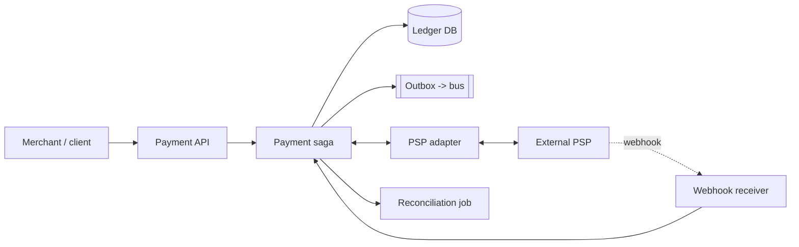

# Эталонное решение — Платёжный сервис

> [!warning] Не читать до попытки
> Сначала заполните попытку по `scenarios/05-payment-service.md`.

## 1. Требования

**Функциональные:** создание платежа (идемпотентно); проведение через PSP; обработка колбэков; возвраты; ledger (двойная запись); сверка.

**Нефункциональные:**
- Strong consistency для денег; ACID на ledger.
- Exactly-once на уровне платежа (идемпотентность + дедуп колбэков).
- Полный неизменяемый аудит; доступность приёмки ≥ 99.99%.
- PCI-границы (данные карт не храним у себя).

**Скоуп:** `in` — payment/refund/ledger/reconcile; `out` — карточный процессинг (у PSP), антифрод-движок детально.

## 2. Уточняющие вопросы и модельные ответы

| Вопрос | Модельный ответ |
|---|---|
| TPS? | 5k TPS avg, 20k пик |
| PSP? | 1 основной + 1 резервный |
| Таймаут PSP? | Статус `unknown`, не `failed` — доводим до конца сверкой |
| Валюты? | Мультивалютность, idempotency по клиенту |

## 3. Оценка нагрузки

- 5k TPS × 86400 ≈ **430M/сутки**; пик 20k TPS.
- Ledger: 2 записи (двойная запись) на транзакцию → ~860M строк/сутки.
- Хранение: 3 года × 430M × ~500 Б ≈ **~250 ТБ** (партиции по дате).
- Ретраи/колбэки: ×2–3 к базовому потоку.

## 4. API

```
POST /v1/payments           {amount, currency, merchant_id, method}   → 201 {payment_id, status}
       Header: Idempotency-Key   (обязателен)
GET  /v1/payments/{id}                                                 → 200 {status}
POST /v1/payments/{id}/refunds {amount?}                               → 201 {refund_id}
POST /v1/webhooks/psp/{name}  (async status)                           → 200
```

Статусы: `created → authorized → captured → settled | failed | refunded`.

## 5. Модель данных

- `payments(payment_id PK, merchant_id, amount, currency, status, idem_key UK, created_at)`.
- `payment_attempts(id, payment_id, psp, psp_ref, status, raw_response)`.
- `ledger_entries(id, txn_id, account, direction, amount, currency, created_at)` — append-only, балансы через двойную запись (сумма debit = credit).
- `outbox(id, type, payload, status)` — события (напр. в биллинг).
- `idem_keys(key UK, payment_id, expires_at)` — идемпотентность.

## 6. Архитектура



Платёж — **сага**: создать → авторизовать (PSP) → записать в ledger → capture → emit. Компенсация — refund/void при откате.

## 7. Масштабирование

- Партиции `payments`/`ledger` по `merchant_id` и дате; горячие merchant — саб-шардинг.
- Ledger как append-only с партиционированием по времени; отдельные OLAP-витрины для отчётности.
- Идемпотентность через `idem_keys` с TTL (кэш + БД).

## 8. Отказоустойчивость

- **Таймаут PSP** → статус `unknown`, не `failed`; сверка (reconciliation) доводит статус.
- **Потерянный колбэк** → активный polling PSP по `psp_ref` + сверка.
- **Двойной колбэк** → дедуп по `psp_ref`/event-id, идемпотентная обработка.
- **Отказ БД** → sync-репликация, failover; сага возобновляется из состояния.
- Outbox гарантирует доставку событий at-least-once.

## 9. Consistency

- Деньги: **strong** (ACID, serializable на уровне платежа).
- Колбэки: ordering не гарантирован → состояние выводим из PSP-статуса, а не из порядка событий.
- Между сервисами (биллинг): eventual через outbox + идемпотентные консьюмеры.

## 10. Bottlenecks

- Внешний PSP (латентность/лимиты) → адаптер с пулом, резервный PSP.
- Горячий merchant → саб-шардинг, отдельная очередь.
- Сверка — тяжёлая батч-операция → off-peak, отдельные ресурсы.

## 11. Trade-offs

- **Sync приём vs async:** sync даёт быстрый ответ, но держит ресурс на время PSP; async (202 + статус) — устойчивее.
- **Exactly-once vs at-least-once + dedup:** физически — at-least-once + идемпотентность = «эффект exactly-once».
- **Ledger в одной БД vs распределённый:** одна БД проще для ACID, распределённый — для масштаба.

## 12. Вопросы интервьюера (follow-ups)

1. Клиент ретраит create с тем же ключом? — вернуть тот же payment_id.
2. PSP вернул success дважды? — дедуп по psp_ref.
3. Refund больше суммы? — валидация против ledger-баланса.
4. Как сверяем «наши деньги» с PSP? — daily reconciliation, расхождения в очередь разбора.
5. Частичный сбой саги? — компенсация/повтор из состояния.

## 13. Rubric оценки (сценарий)

- **Сильный ответ:** сага + компенсации, идемпотентность (ключ + дедуп колбэков), `unknown` вместо `failed` при таймауте, двойная запись, сверка, outbox.
- **Зачёт:** idempotency-key, ledger, обработка колбэков, strong consistency.
- **Red flags:** ретраи без идемпотентности; колбэк-статус как источник истины по порядку; нет сверки; хранение карточных данных.
