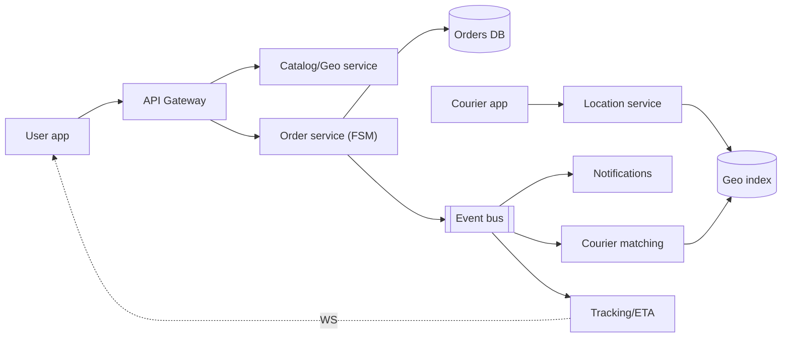

# Эталонное решение — Доставка еды

> [!warning] Не читать до попытки
> Сначала заполните попытку по `scenarios/06-food-delivery.md`.

## 1. Требования

**Функциональные:** каталог/меню с гео-поиском; оформление заказа и оплата; статус-машина заказа; назначение курьера; трекинг и ETA.

**Нефункциональные:**
- Пик обед/ужин (×5–10 к среднему).
- Согласованные переходы статуса заказа (FSM).
- Гео-запросы «рядом» за десятки мс.
- Доступность ≥ 99.9% на приёме заказов.

**Скоуп:** `in` — каталог/заказ/матчинг/трекинг/ETA; `out` — платежи детально (ссылаться), логистика ресторана.

## 2. Уточняющие вопросы и модельные ответы

| Вопрос | Модельный ответ |
|---|---|
| Заказов/день? | 2M/сутки, пик ~×8 |
| Частота апдейтов курьера? | каждые 3–5 с |
| ETA точный или быстрый? | быстрый + постепенно уточняемый |
| Гео-покрытие? | по городам, шардинг по городу |

## 3. Оценка нагрузки

- 2M заказов/сутки ≈ **23 QPS** avg, пик обед ≈ **~200 QPS**.
- Апдейты курьеров: 100k курьеров / 5 с ≈ **20k/с** записи локаций.
- Просмотры меню: 20M DAU × 5 = 100M/сутки ≈ **~1.2k QPS**, пик ×8.
- Хранение: заказы 2M × 365 × 3 ≈ **~2B** + события статусов (×10).

## 4. API

```
GET  /v1/restaurants?lat&lng&radius          → 200 [restaurants]
POST /v1/orders        {restaurant_id, items, address}  → 201 {order_id, status}
GET  /v1/orders/{id}                          → 200 {status, eta, courier}
POST /v1/orders/{id}/cancel                   → 200 | 409 (уже готовится)
POST /v1/couriers/{id}/location  {lat,lng}    → 204
GET  /v1/orders/{id}/track                    → stream/WS {courier_pos, eta}
```

## 5. Модель данных

- `restaurants(id, city_id, geo, status, rating)` — гео-индекс.
- `menu_items(id, restaurant_id, price, available)`.
- `orders(id PK, user_id, restaurant_id, status, total, address, created_at)` — шард по `city_id`/`order_id`.
- `order_events(order_id, ts, from_status, to_status, actor)` — audit событий.
- `couriers(id, city_id, status, current_geo, active_order_id)`.
- `courier_locations(courier_id, ts, geo)` — time-series, TTL.

Статус-машина: `created → paid → accepted → cooking → ready → picked_up → delivered` (+ `cancelled`).

## 6. Архитектура



Заказ — событийная FSM: переходы публикуются в шину, матчинг курьера и трекинг подписаны.

## 7. Масштабирование

- Шардинг по городу/гео-ячейке; geo-index per region.
- Кэш меню и ресторанов (read-heavy), инвалидация при изменении.
- Матчинг — горизонтально по городам; локации — Kafka по курьеру.
- ETA-сервис — отдельно, кэширует модель по маршруту.

## 8. Отказоустойчивость

- Курьер пропал/оффлайн → переназначение (lease с TTL на `active_order_id`).
- Зависший заказ (нет перехода) → watchdog по таймауту статуса.
- Оплата не прошла → заказ не уходит в accepted.
- Отказ города/зоны → деградация (только существующие заказы), мульти-AZ.

## 9. Consistency

- Переходы статуса — strong (FSM с conditional update `WHERE status=ожидаемый`).
- Назначение курьера — strong (lease/lock: один активный заказ на курьера).
- ETA/трекинг — eventual (обновления каждые сек).
- Каталог — eventual (кэш).

## 10. Bottlenecks

- Пик обед/ужин — ×8 разброс; авто-скейл + очереди на время пика.
- Hot city zones — саб-шардинг.
- Гео-запросы к курьерам — in-memory geo-index.

## 11. Trade-offs

- **Push vs pull трекинг:** WS-пуш для активных заказов, polling для фона.
- **Sync vs event-driven статусы:** события дают loose coupling, но усложняют порядок → FSM + conditional update.
- **Точный ETA vs быстрый:** быстрая оценка + уточнение по мере движения.

## 12. Вопросы интервьюера (follow-ups)

1. Курьер отказался после назначения? — переназначение, lease TTL.
2. Пользователь отменяет после «cooking»? — политика/частичный возврат (409).
3. Двойное назначение курьера? — lease/conditional update по `active_order_id`.
4. Как считаем ETA? — маршрут + загрузка кухни + скорость курьера.

## 13. Rubric оценки (сценарий)

- **Сильный ответ:** FSM с conditional update, lease на курьера, гео-шардинг по городу, пиковый автоскейл, событийная архитектура.
- **Зачёт:** сервисы каталог/заказ/матчинг/трекинг, гео-индекс, статус-машина.
- **Red flags:** статусы меняются без валидации перехода; два курьера на заказ; игнор пиков; гео-поиск в реляционной БД без индекса.
