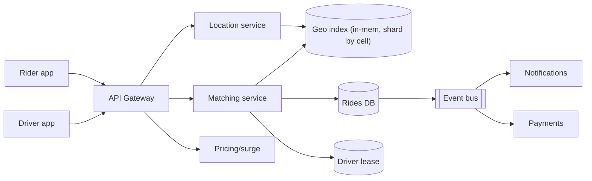

# Эталонное решение — Райдшеринг

> [!warning] Не читать до попытки
> Сначала заполните попытку по `scenarios/07-ride-sharing.md`.

## 1. Требования

**Функциональные:** заказ поездки A→B; матчинг с водителем; live-трекинг; статус поездки; surge-цены; оплата.

**Нефункциональные:**
- Матчинг и апдейты позиции — секунды/десятки мс.
- Гео-«кто рядом» в реальном времени.
- Водитель не ведёт две поездки (strong на назначении).
- Высокая доступность.

**Скоуп:** `in` — заказ/матчинг/трекинг/цены/оплата; `out` — маршрутизация/навигация, антифрод.

## 2. Уточняющие вопросы и модельные ответы

| Вопрос | Модельный ответ |
|---|---|
| Масштаб? | 5M поездок/сутки, 1M активных водителей |
| Частота координат? | каждые 2–4 с от активных водителей |
| Surge? | По гео-зонам, обновление раз в минуту |
| Матчинг: ждать быстрее или дешевле? | Минимум ожидания, затем цена |

## 3. Оценка нагрузки

- Поездки: 5M/сутки ≈ **~60/с** avg, пик ≈ **~300/с**.
- Локации: 1M водителей / 3 с ≈ **~330k записей/с** — доминирующая нагрузка.
- Гео-запросы: матчинг + клиентский трекинг → сотни k/с.
- Хранение треков: 330k/с × 86400 ≈ **~28B точек/сутки** → in-memory + короткий TTL, архив агрегируется.

## 4. API

```
POST /v1/rides            {pickup, dropoff, class}      → 201 {ride_id, est_price}
POST /v1/rides/{id}/match                                → 202 (async matching)
GET  /v1/rides/{id}                                      → 200 {status, driver, eta}
PUT  /v1/drivers/{id}/location  {geo}                    → 204
WS   /v1/rides/{id}/track                                → {driver_pos, eta}
POST /v1/rides/{id}/complete                             → 200 {fare}
```

## 5. Модель данных

- `rides(ride_id PK, rider_id, driver_id, status, pickup, dropoff, fare, surged)`. Статусы: `requested → matched → enroute → in_trip → completed|cancelled`.
- `drivers(driver_id PK, city_id, status, vehicle, rating)`.
- `driver_locations(driver_id, ts, geo)` — in-memory geo store + TTL.
- `surge_zones(cell_id, multiplier, updated_at)`.
- `transactions(ride_id, amount, method, status)`.

Гео: **geohash/S2-ячейки** в in-memory store (Redis / спец-сервис), шард по ячейке/городу.

## 6. Архитектура



## 7. Масштабирование

- Гео-шардинг: geohash-префикс/S2-ячейка определяет шард; city-уровень сверху.
- Водительские локации — в память (не в БД на горячем пути); durable-архив async.
- Матчинг — по ячейке + соседним ячейкам, ограниченный кандидат-сет.
- Surge — периодический пересчёт по зонам, кэш.

## 8. Отказоустойчивость

- Location-нода упала → реплики ячейки, ре-роутинг водителей.
- Водитель пропал на матчинге → таймаут, повторный матчинг.
- Двойное назначение → lease на водителя (`driver.status` + `active_ride_id`, conditional update).
- Отказ региона → мульти-AZ; активные поездки доводятся.

## 9. Consistency

- Назначение водителя — **strong** (lease/conditional update).
- Локации/ETA/surge — eventual.
- Статус поездки — strong (per ride).
- Оплата — strong (в своём сервисе).

## 10. Bottlenecks

- Hotspot-центр города → hot geo-ячейка; саб-шардинг, ограничение кандидатов.
- 330k записей/с локаций → in-memory + батч-архив.
- Матчинг-сервис → горизонтальный масштаб по ячейкам.

## 11. Trade-offs

- **Точность гео vs стоимость:** мельче ячейки — точнее, дороже; подбираем под плотность.
- **Sync vs async матчинг:** sync даёт быстрый ответ, но менее устойчив; async + push — устойчивее.
- **Локации в памяти vs БД:** память быстра, но volatile → репликация + архив.

## 12. Вопросы интервьюера (follow-ups)

1. Водитель принял, потом отменил? — re-match, штрафы/рейтинг.
2. Два riders претендуют на одного водителя? — lease, один побеждает.
3. Как surge не «сходит с ума»? — окна, лимиты, антиабьюз.
4. Как трекаем оффлайн водителя? — последняя известная позиция + деградация ETA.

## 13. Rubric оценки (сценарий)

- **Сильный ответ:** in-memory гео-индекс с шардом по ячейке, lease на водителя (strong), доминирующая нагрузка локаций посчитана, surge-зоны, деградация ETA.
- **Зачёт:** geohash/S2, матчинг по соседним ячейкам, статус-машина поездки.
- **Red flags:** гео-запросы в реляционной БД на горячем пути; нет strong на назначении; игнор объёма локаций.
